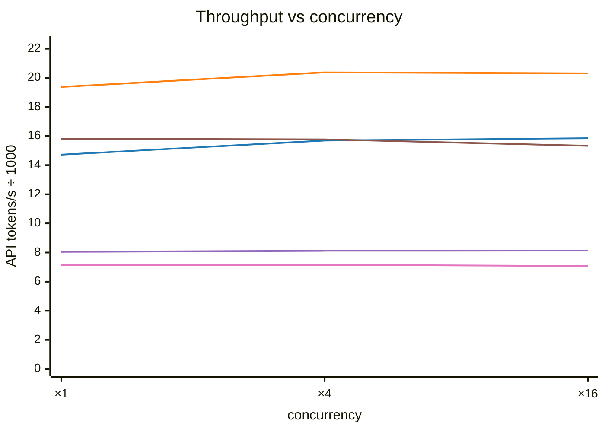
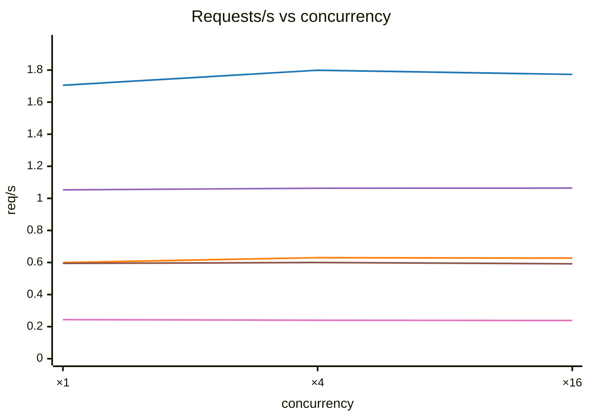
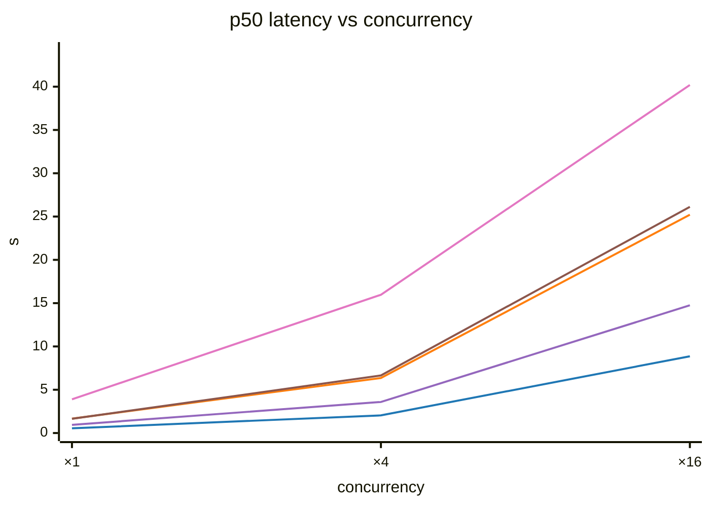

## speed — 2026-11-17 11:23 UTC

**PASS** · 570 s · 416 requests · 2 (0.5%) errors · 0 rate-limited · 6,901,487 tokens billed

Closed loop, 25 s per cell, 5 request classes × concurrency [1, 4, 16]. 416 requests, 6,901,487 tokens billed.

|  | requests | errors | 429s | p50 s | p90 s | p99 s | max s | req/s | API tok/s | MRR |
|---|---|---|---|---|---|---|---|---|---|---|
| short20 ×1 | 43 | 0 (0.0%) | 0 | 0.546 | 0.793 | 1.018 | 1.052 | 1.705 | 14,723 | 0.710 |
| short20 ×4 | 48 | 0 (0.0%) | 0 | 2.039 | 2.829 | 2.858 | 2.859 | 1.799 | 15,695 | 0.717 |
| short20 ×16 | 60 | 0 (0.0%) | 0 | 8.861 | 9.616 | 9.788 | 10.0 | 1.773 | 15,848 | 0.695 |
| many100 ×1 | 15 | 0 (0.0%) | 0 | 1.664 | 1.684 | 1.690 | 1.690 | 0.599 | 19,367 | 1.000 |
| many100 ×4 | 19 | 0 (0.0%) | 0 | 6.358 | 6.374 | 6.457 | 6.475 | 0.630 | 20,375 | 1.000 |
| many100 ×16 | 31 | 0 (0.0%) | 0 | 25.2 | 25.7 | 25.8 | 25.8 | 0.627 | 20,298 | 0.968 |
| long8k ×1 | 27 | 0 (0.0%) | 0 | 0.948 | 0.954 | 0.958 | 0.959 | 1.053 | 8,048 | 1.000 |
| long8k ×4 | 30 | 0 (0.0%) | 0 | 3.587 | 4.033 | 4.043 | 4.045 | 1.063 | 8,122 | 1.000 |
| long8k ×16 | 42 | 0 (0.0%) | 0 | 14.8 | 15.2 | 15.2 | 15.2 | 1.064 | 8,131 | 1.000 |
| pack32k ×1 | 15 | 0 (0.0%) | 0 | 1.643 | 1.980 | 2.383 | 2.430 | 0.595 | 15,824 | 1.000 |
| pack32k ×4 | 18 | 0 (0.0%) | 0 | 6.650 | 7.313 | 7.882 | 7.989 | 0.600 | 15,774 | 1.000 |
| pack32k ×16 | 30 | 0 (0.0%) | 0 | 26.1 | 27.1 | 27.4 | 27.4 | 0.592 | 15,334 | 1.000 |
| long32k ×1 | 7 | 0 (0.0%) | 0 | 3.893 | 4.784 | 4.816 | 4.819 | 0.244 | 7,155 | 1.000 |
| long32k ×4 | 10 | 0 (0.0%) | 0 | 16.0 | 17.6 | 17.8 | 17.8 | 0.240 | 7,156 | 1.000 |
| long32k ×16 | 21 | 2 (9.5%) | 0 | 40.2 | 59.2 | 59.5 | 59.5 | 0.239 | 7,074 | 1.000 |

| error | count | example | response |
|---|---|---|---|
| http 424 ModelError timed out at SageMaker | 2 | natural-2wikimqa natural-2wikimqa/query_88 | {"ErrorCode":"INTERNAL_FAILURE_FROM_MODEL","LogStreamArn":"arn:aws:logs:eu-west-3:<account-id>:log-group:/aws/sagemaker/Endpoints/reranker-mp-mainc-4b-1","Message":"Received server error (0) from primary with message \"Your invocation timed out while waiting for a response from container primary. Re |

*Throughput vs concurrency: short20, many100, long8k, pack32k, long32k*

*Requests/s vs concurrency: short20, many100, long8k, pack32k, long32k*

*p50 latency vs concurrency: short20, many100, long8k, pack32k, long32k*
