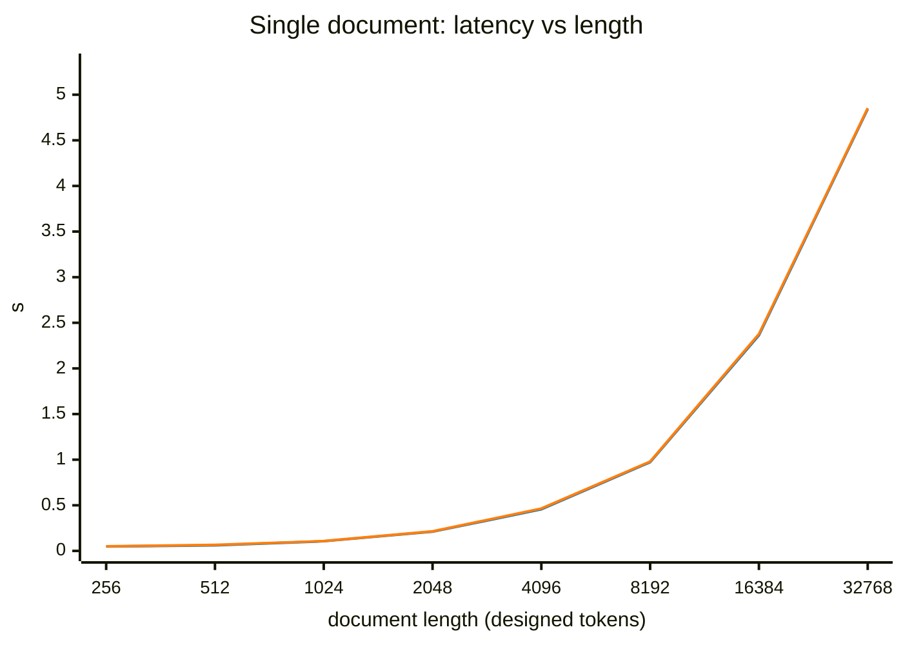
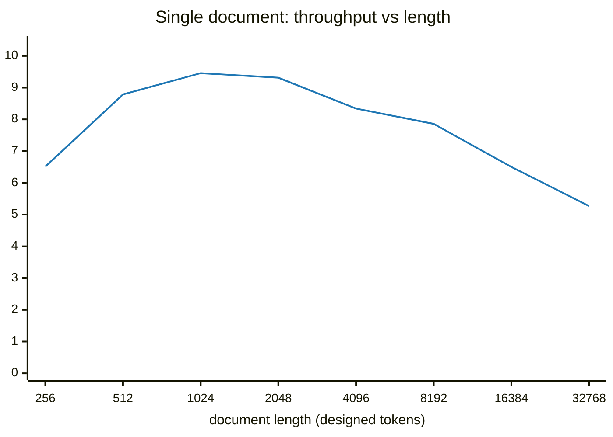
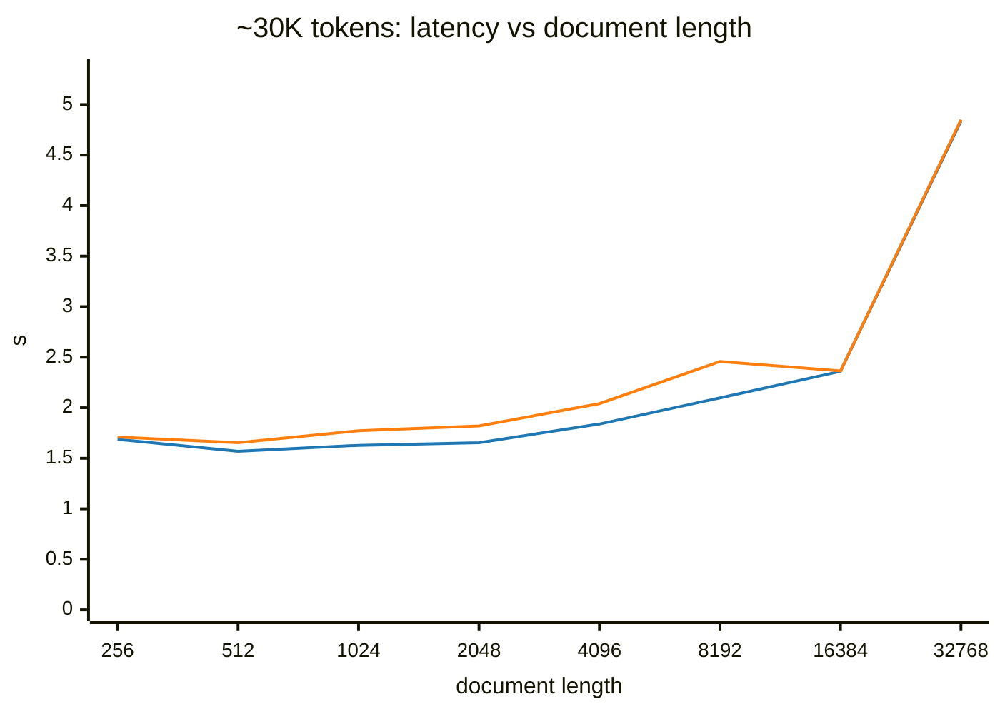
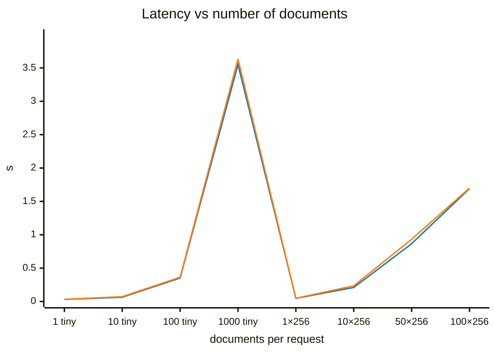
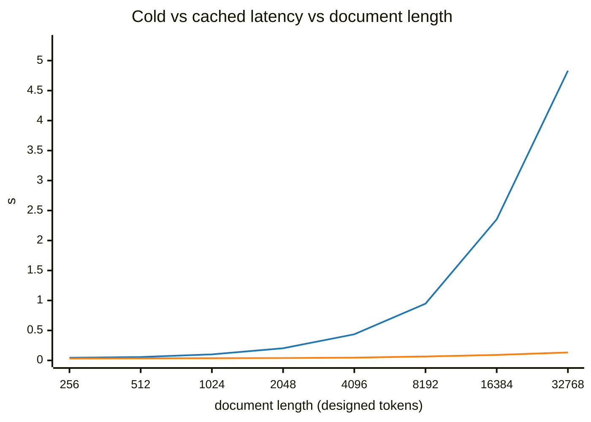
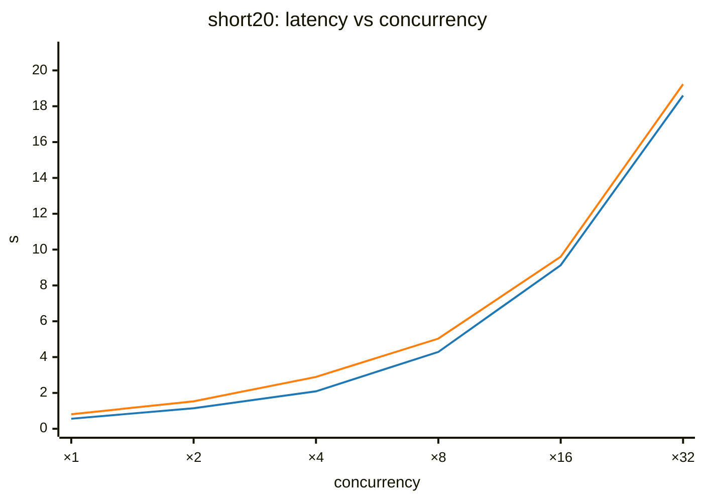
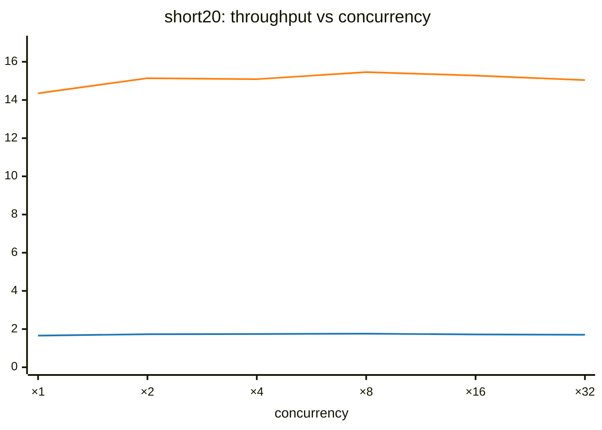
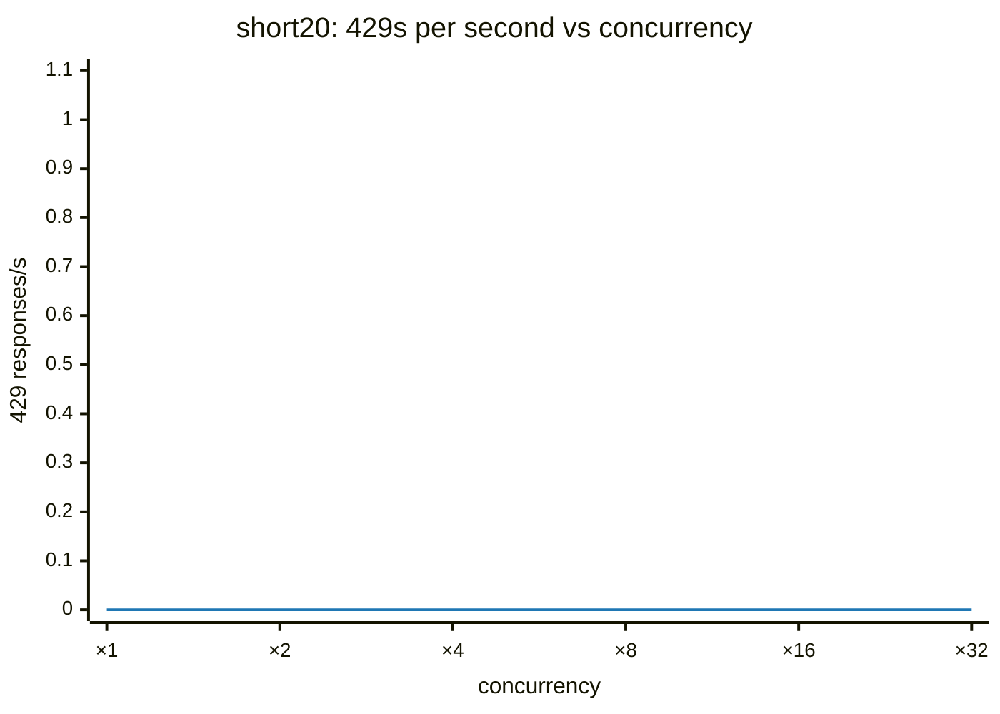

## meticulous — 2026-11-17 11:25 UTC

**PASS** · 895 s · 917 requests · 0 (0.0%) errors · 0 rate-limited · 10,199,759 tokens billed

Sequential requests (one in flight) unless stated; every query carries a nonce so nothing is served from the API's prefix cache.

### Single document: latency vs length

| rung | Qwen tokens | billed | errors | p50 s | p90 s | max s | API tok/s |
|---|---|---|---|---|---|---|---|
| 256 | 229 | 324 | 0 (0.0%) | 0.048 | 0.050 | 0.079 | 6,512 |
| 512 | 457 | 551 | 0 (0.0%) | 0.062 | 0.066 | 0.067 | 8,785 |
| 1,024 | 911 | 1,005 | 0 (0.0%) | 0.106 | 0.108 | 0.112 | 9,456 |
| 2,048 | 1,872 | 1,966 | 0 (0.0%) | 0.211 | 0.214 | 0.231 | 9,313 |
| 4,096 | 3,707 | 3,801 | 0 (0.0%) | 0.455 | 0.465 | 0.483 | 8,340 |
| 8,192 | 7,545 | 7,639 | 0 (0.0%) | 0.973 | 0.979 | 0.983 | 7,858 |
| 16,384 | 15,274 | 15,368 | 0 (0.0%) | 2.362 | 2.377 | 2.384 | 6,501 |
| 32,768 | 25,438 | 25,536 | 0 (0.0%) | 4.843 | 4.853 | 4.906 | 5,270 |

*Single document: latency vs length: p50, p90*

*Single document: throughput vs length: API tokens/s ÷ 1000*

### ~30K tokens per request: latency vs document length (fewer, longer documents)

| rung | docs/request | billed | errors | p50 s | p90 s | max s | API tok/s |
|---|---|---|---|---|---|---|---|
| 256 | 100 | 32,372 | 0 (0.0%) | 1.688 | 1.710 | 1.730 | 19,113 |
| 512 | 55 | 30,264 | 0 (0.0%) | 1.569 | 1.654 | 1.752 | 19,180 |
| 1,024 | 28 | 28,183 | 0 (0.0%) | 1.628 | 1.773 | 1.830 | 17,386 |
| 2,048 | 13 | 25,573 | 0 (0.0%) | 1.654 | 1.820 | 1.948 | 15,936 |
| 4,096 | 6 | 22,806 | 0 (0.0%) | 1.839 | 2.041 | 2.180 | 12,580 |
| 8,192 | 3 | 22,922 | 0 (0.0%) | 2.097 | 2.458 | 2.708 | 11,207 |
| 16,384 | 1 | 15,366 | 0 (0.0%) | 2.360 | 2.365 | 2.366 | 6,512 |
| 32,768 | 1 | 25,540 | 0 (0.0%) | 4.836 | 4.851 | 4.888 | 5,276 |

*~30K tokens: latency vs document length: p50, p90*

### Latency vs number of documents

| documents | billed | errors | p50 s | p90 s | max s | MRR |
|---|---|---|---|---|---|---|
| 1 tiny | 91.0 | 0 (0.0%) | 0.031 | 0.033 | 0.035 | 1.000 |
| 10 tiny | 922 | 0 (0.0%) | 0.064 | 0.072 | 0.073 | 1.000 |
| 100 tiny | 9,289 | 0 (0.0%) | 0.352 | 0.364 | 0.371 | 1.000 |
| 1000 tiny | 93,889 | 0 (0.0%) | 3.551 | 3.632 | 3.640 | 1.000 |
| 1×256 | 323 | 0 (0.0%) | 0.048 | 0.049 | 0.051 | 1.000 |
| 10×256 | 3,234 | 0 (0.0%) | 0.210 | 0.235 | 0.260 | 1.000 |
| 50×256 | 16,160 | 0 (0.0%) | 0.865 | 0.933 | 0.952 | 1.000 |
| 100×256 | 32,339 | 0 (0.0%) | 1.692 | 1.700 | 1.713 | 0.950 |

*Latency vs number of documents: p50, p90*

### Cold vs cached: the same single-document request sent twice in a row

The API caches prompt prefixes, so a repeated (query, document) pair skips most of the compute. Cold = fresh nonce in the query; cached = the identical request again immediately after.

| rung | pairs | cold p50 s | cached p50 s | speed-up × | cold max s | cached max s | errors |
|---|---|---|---|---|---|---|---|
| 256 | 10 | 0.044 | 0.032 | 1.375 | 0.046 | 0.033 |  |
| 512 | 10 | 0.057 | 0.035 | 1.633 | 0.063 | 0.036 |  |
| 1,024 | 10 | 0.101 | 0.038 | 2.658 | 0.102 | 0.040 |  |
| 2,048 | 10 | 0.203 | 0.040 | 5.028 | 0.210 | 0.042 |  |
| 4,096 | 10 | 0.436 | 0.047 | 9.365 | 0.445 | 0.048 |  |
| 8,192 | 10 | 0.947 | 0.066 | 14.3 | 0.961 | 0.067 |  |
| 16,384 | 10 | 2.353 | 0.093 | 25.3 | 2.363 | 0.095 |  |
| 32,768 | 10 | 4.832 | 0.132 | 36.5 | 4.892 | 0.134 |  |

*Cold vs cached latency vs document length: cold p50, cached p50*

### short20: latency and throughput vs concurrency

|  | requests | errors | 429s | p50 s | p90 s | p99 s | max s | req/s | API tok/s | MRR |
|---|---|---|---|---|---|---|---|---|---|---|
| ×1 | 42 | 0 (0.0%) | 0 | 0.560 | 0.807 | 1.038 | 1.079 | 1.656 | 14,347 | 0.726 |
| ×2 | 45 | 0 (0.0%) | 0 | 1.147 | 1.532 | 1.883 | 2.015 | 1.732 | 15,141 | 0.711 |
| ×4 | 47 | 0 (0.0%) | 0 | 2.090 | 2.894 | 2.931 | 2.950 | 1.743 | 15,095 | 0.733 |
| ×8 | 51 | 0 (0.0%) | 0 | 4.288 | 5.032 | 5.597 | 5.796 | 1.758 | 15,459 | 0.706 |
| ×16 | 58 | 0 (0.0%) | 0 | 9.130 | 9.601 | 9.965 | 9.967 | 1.718 | 15,276 | 0.688 |
| ×32 | 74 | 0 (0.0%) | 0 | 18.6 | 19.2 | 19.4 | 19.6 | 1.702 | 15,036 | 0.672 |

No 429s up to concurrency ×32.

*short20: latency vs concurrency: p50, p90*

*short20: throughput vs concurrency: req/s, API tokens/s ÷ 1000*

*short20: 429s per second vs concurrency: 429/s*

917 requests, 10,199,759 tokens billed.
