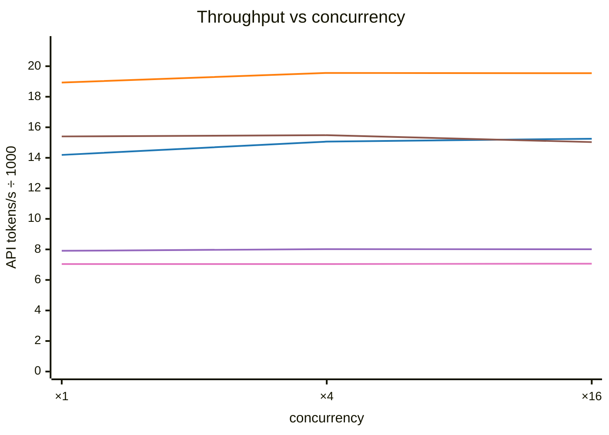
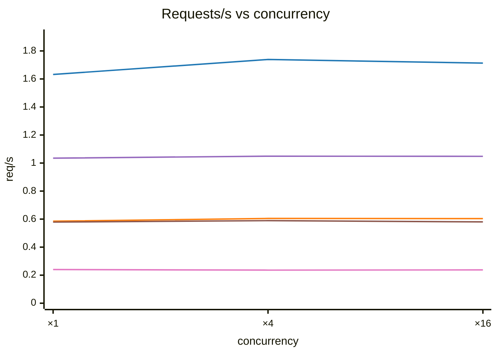
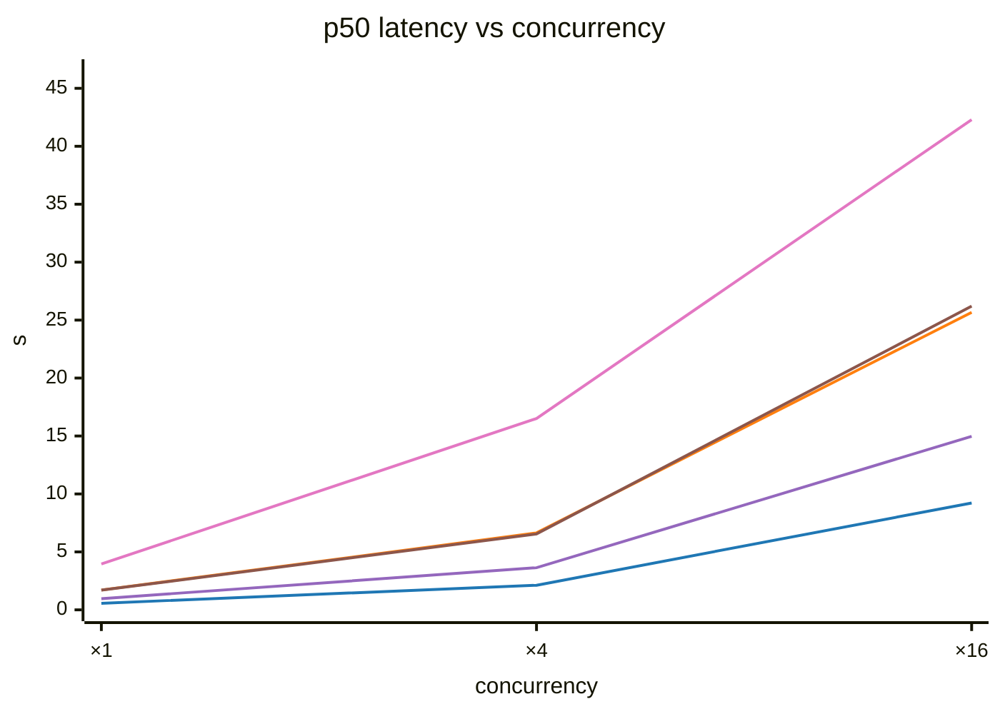

## speed — 2026-11-17 11:39 UTC

**PASS** · 575 s · 407 requests · 2 (0.5%) errors · 0 rate-limited · 6,801,020 tokens billed

Closed loop, 25 s per cell, 5 request classes × concurrency [1, 4, 16]. 407 requests, 6,801,020 tokens billed.

|  | requests | errors | 429s | p50 s | p90 s | p99 s | max s | req/s | API tok/s | MRR |
|---|---|---|---|---|---|---|---|---|---|---|
| short20 ×1 | 41 | 0 (0.0%) | 0 | 0.565 | 0.816 | 1.056 | 1.095 | 1.632 | 14,191 | 0.720 |
| short20 ×4 | 47 | 0 (0.0%) | 0 | 2.123 | 2.913 | 2.948 | 2.968 | 1.739 | 15,064 | 0.713 |
| short20 ×16 | 58 | 0 (0.0%) | 0 | 9.219 | 9.999 | 10.2 | 10.4 | 1.713 | 15,249 | 0.697 |
| many100 ×1 | 15 | 0 (0.0%) | 0 | 1.709 | 1.725 | 1.733 | 1.734 | 0.585 | 18,928 | 1.000 |
| many100 ×4 | 19 | 0 (0.0%) | 0 | 6.639 | 6.653 | 6.717 | 6.729 | 0.605 | 19,559 | 1.000 |
| many100 ×16 | 30 | 0 (0.0%) | 0 | 25.7 | 26.6 | 26.7 | 26.7 | 0.604 | 19,538 | 0.967 |
| long8k ×1 | 26 | 0 (0.0%) | 0 | 0.965 | 0.973 | 0.979 | 0.981 | 1.035 | 7,910 | 1.000 |
| long8k ×4 | 29 | 0 (0.0%) | 0 | 3.634 | 4.093 | 4.100 | 4.102 | 1.049 | 8,017 | 1.000 |
| long8k ×16 | 41 | 0 (0.0%) | 0 | 15.0 | 15.4 | 15.4 | 15.4 | 1.048 | 8,009 | 1.000 |
| pack32k ×1 | 15 | 0 (0.0%) | 0 | 1.697 | 2.023 | 2.425 | 2.472 | 0.579 | 15,401 | 1.000 |
| pack32k ×4 | 18 | 0 (0.0%) | 0 | 6.547 | 7.339 | 7.628 | 7.669 | 0.589 | 15,479 | 1.000 |
| pack32k ×16 | 30 | 0 (0.0%) | 0 | 26.2 | 27.6 | 27.8 | 27.8 | 0.580 | 15,029 | 1.000 |
| long32k ×1 | 7 | 0 (0.0%) | 0 | 3.957 | 4.833 | 4.854 | 4.856 | 0.240 | 7,044 | 1.000 |
| long32k ×4 | 10 | 0 (0.0%) | 0 | 16.5 | 18.0 | 18.1 | 18.1 | 0.236 | 7,042 | 1.000 |
| long32k ×16 | 21 | 2 (9.5%) | 0 | 42.3 | 59.3 | 59.4 | 59.4 | 0.238 | 7,065 | 1.000 |

| error | count | example | response |
|---|---|---|---|
| http 424 ModelError timed out at SageMaker | 2 | natural-summ_screen_fd natural-summ_screen_fd/query_42 | {"ErrorCode":"INTERNAL_FAILURE_FROM_MODEL","LogStreamArn":"arn:aws:logs:eu-west-3:<account-id>:log-group:/aws/sagemaker/Endpoints/reranker-mp-mainc-4b-2","Message":"Received server error (0) from primary with message \"Your invocation timed out while waiting for a response from container primary. Re |

*Throughput vs concurrency: short20, many100, long8k, pack32k, long32k*

*Requests/s vs concurrency: short20, many100, long8k, pack32k, long32k*

*p50 latency vs concurrency: short20, many100, long8k, pack32k, long32k*
