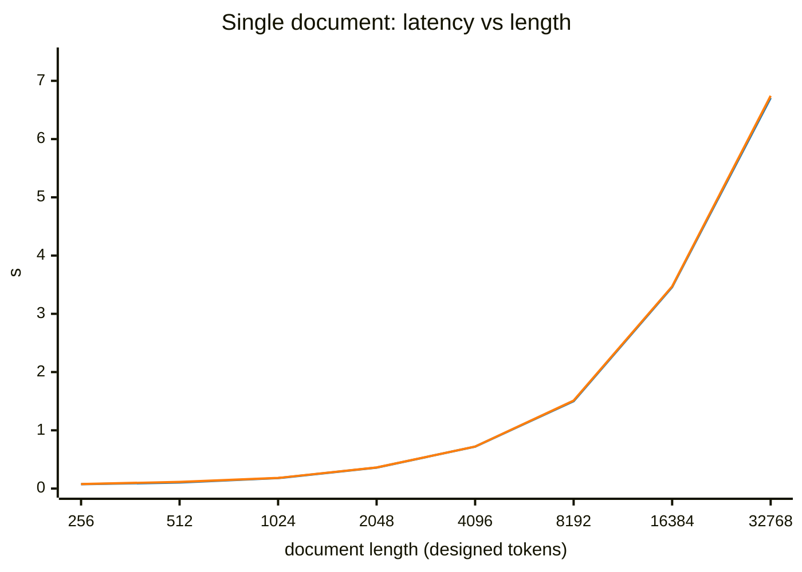
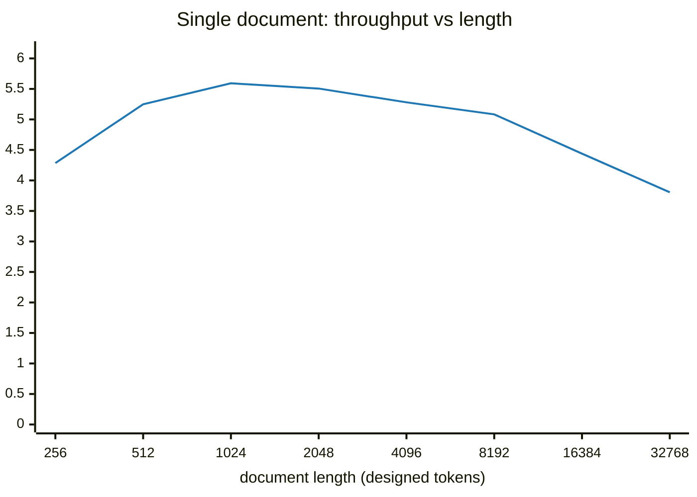
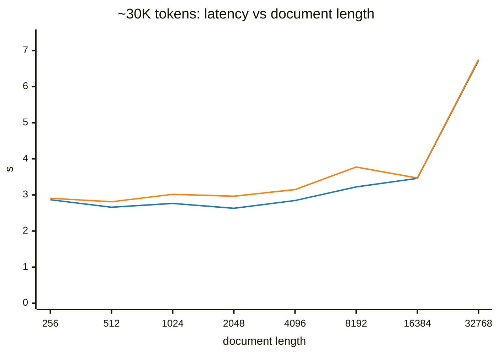
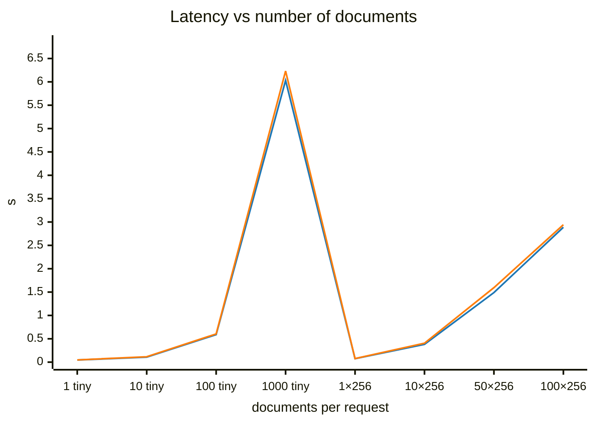
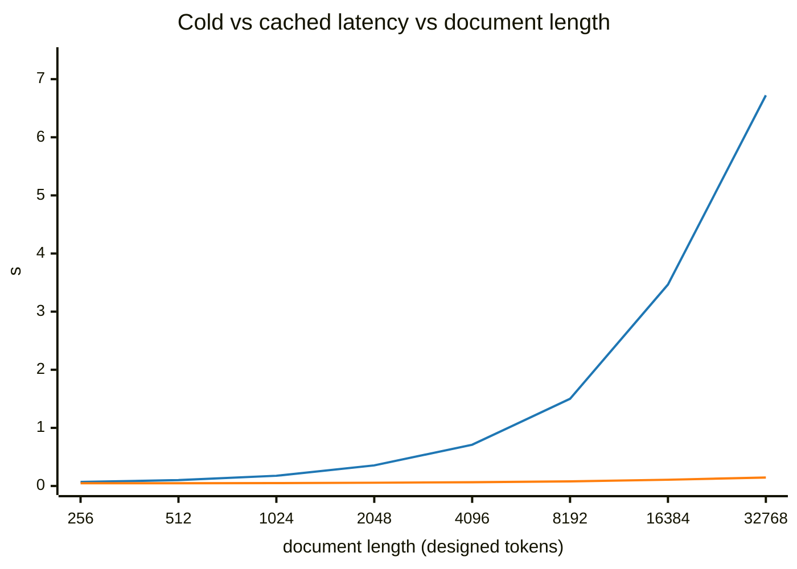
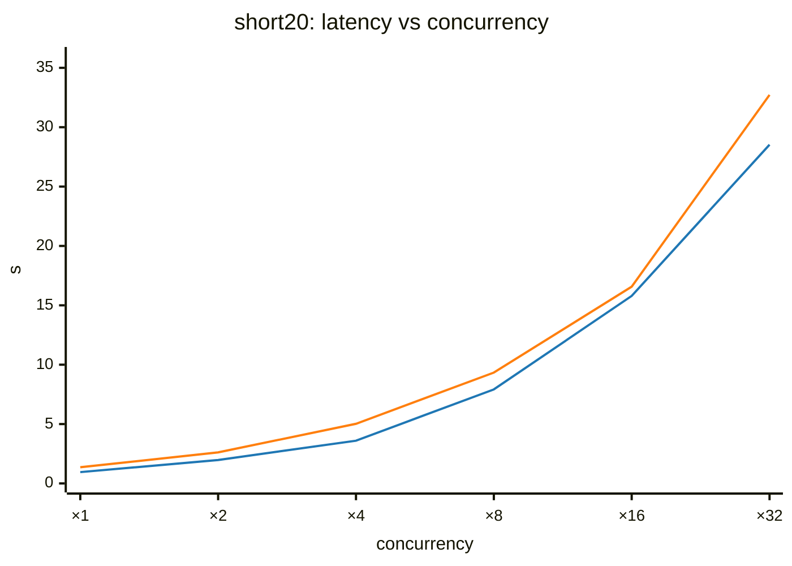
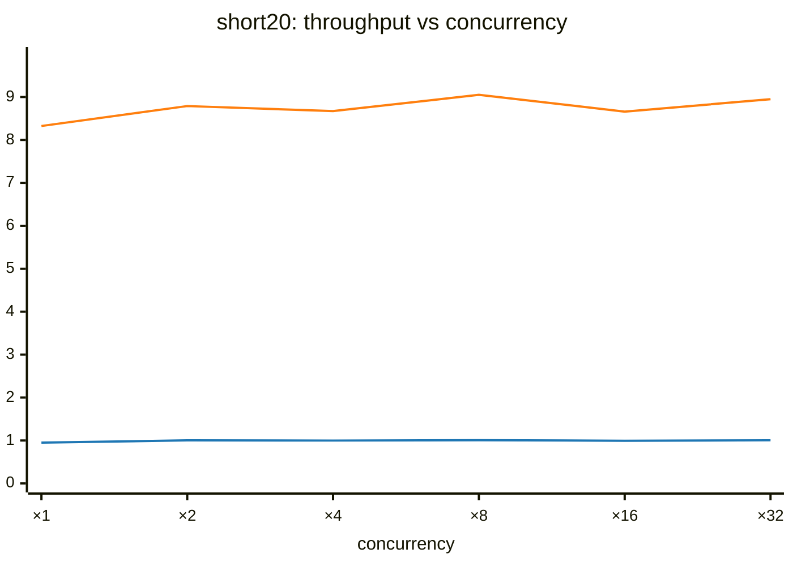
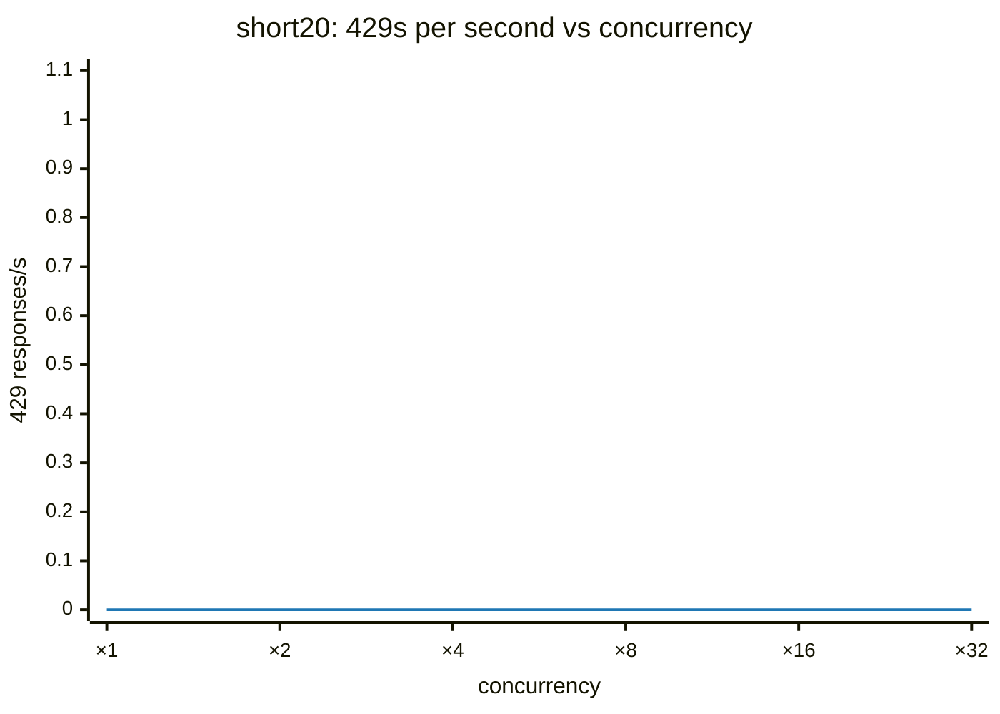

## meticulous — 2026-11-17 12:25 UTC

**PASS** · 1273 s · 807 requests · 0 (0.0%) errors · 0 rate-limited · 9,241,809 tokens billed

Sequential requests (one in flight) unless stated; every query carries a nonce so nothing is served from the API's prefix cache.

### Single document: latency vs length

| rung | Qwen tokens | billed | errors | p50 s | p90 s | max s | API tok/s |
|---|---|---|---|---|---|---|---|
| 256 | 229 | 324 | 0 (0.0%) | 0.074 | 0.077 | 0.109 | 4,285 |
| 512 | 457 | 551 | 0 (0.0%) | 0.103 | 0.114 | 0.116 | 5,248 |
| 1,024 | 911 | 1,005 | 0 (0.0%) | 0.179 | 0.182 | 0.185 | 5,592 |
| 2,048 | 1,872 | 1,966 | 0 (0.0%) | 0.360 | 0.363 | 0.364 | 5,506 |
| 4,096 | 3,707 | 3,801 | 0 (0.0%) | 0.720 | 0.721 | 0.721 | 5,280 |
| 8,192 | 7,545 | 7,639 | 0 (0.0%) | 1.501 | 1.511 | 1.516 | 5,083 |
| 16,384 | 15,274 | 15,368 | 0 (0.0%) | 3.460 | 3.471 | 3.475 | 4,439 |
| 32,768 | 25,438 | 25,536 | 0 (0.0%) | 6.708 | 6.743 | 6.825 | 3,806 |

*Single document: latency vs length: p50, p90*

*Single document: throughput vs length: API tokens/s ÷ 1000*

### ~30K tokens per request: latency vs document length (fewer, longer documents)

| rung | docs/request | billed | errors | p50 s | p90 s | max s | API tok/s |
|---|---|---|---|---|---|---|---|
| 256 | 100 | 32,366 | 0 (0.0%) | 2.867 | 2.908 | 2.920 | 11,251 |
| 512 | 55 | 30,278 | 0 (0.0%) | 2.659 | 2.811 | 2.974 | 11,309 |
| 1,024 | 28 | 28,179 | 0 (0.0%) | 2.765 | 3.017 | 3.157 | 10,175 |
| 2,048 | 13 | 25,572 | 0 (0.0%) | 2.630 | 2.965 | 3.161 | 9,856 |
| 4,096 | 6 | 22,808 | 0 (0.0%) | 2.845 | 3.148 | 3.400 | 8,141 |
| 8,192 | 3 | 22,922 | 0 (0.0%) | 3.223 | 3.774 | 4.169 | 7,315 |
| 16,384 | 1 | 15,367 | 0 (0.0%) | 3.459 | 3.468 | 3.500 | 4,439 |
| 32,768 | 1 | 25,541 | 0 (0.0%) | 6.725 | 6.754 | 6.793 | 3,794 |

*~30K tokens: latency vs document length: p50, p90*

### Latency vs number of documents

| documents | billed | errors | p50 s | p90 s | max s | MRR |
|---|---|---|---|---|---|---|
| 1 tiny | 91.0 | 0 (0.0%) | 0.047 | 0.048 | 0.052 | 1.000 |
| 10 tiny | 921 | 0 (0.0%) | 0.106 | 0.116 | 0.118 | 1.000 |
| 100 tiny | 9,249 | 0 (0.0%) | 0.589 | 0.604 | 0.627 | 1.000 |
| 1000 tiny | 93,889 | 0 (0.0%) | 6.030 | 6.232 | 6.257 | 1.000 |
| 1×256 | 323 | 0 (0.0%) | 0.075 | 0.076 | 0.076 | 1.000 |
| 10×256 | 3,229 | 0 (0.0%) | 0.381 | 0.405 | 0.465 | 1.000 |
| 50×256 | 16,170 | 0 (0.0%) | 1.489 | 1.595 | 1.652 | 1.000 |
| 100×256 | 32,319 | 0 (0.0%) | 2.887 | 2.941 | 2.952 | 1.000 |

*Latency vs number of documents: p50, p90*

### Cold vs cached: the same single-document request sent twice in a row

The API caches prompt prefixes, so a repeated (query, document) pair skips most of the compute. Cold = fresh nonce in the query; cached = the identical request again immediately after.

| rung | pairs | cold p50 s | cached p50 s | speed-up × | cold max s | cached max s | errors |
|---|---|---|---|---|---|---|---|
| 256 | 10 | 0.070 | 0.048 | 1.462 | 0.083 | 0.049 |  |
| 512 | 10 | 0.101 | 0.048 | 2.094 | 0.115 | 0.051 |  |
| 1,024 | 10 | 0.176 | 0.050 | 3.517 | 0.179 | 0.051 |  |
| 2,048 | 10 | 0.354 | 0.056 | 6.318 | 0.358 | 0.059 |  |
| 4,096 | 10 | 0.709 | 0.066 | 10.8 | 0.723 | 0.067 |  |
| 8,192 | 10 | 1.500 | 0.080 | 18.7 | 1.508 | 0.082 |  |
| 16,384 | 10 | 3.466 | 0.108 | 32.2 | 3.475 | 0.109 |  |
| 32,768 | 10 | 6.722 | 0.145 | 46.4 | 6.795 | 0.146 |  |

*Cold vs cached latency vs document length: cold p50, cached p50*

### short20: latency and throughput vs concurrency

|  | requests | errors | 429s | p50 s | p90 s | p99 s | max s | req/s | API tok/s | MRR |
|---|---|---|---|---|---|---|---|---|---|---|
| ×1 | 24 | 0 (0.0%) | 0 | 0.954 | 1.363 | 1.838 | 1.876 | 0.951 | 8,324 | 0.691 |
| ×2 | 26 | 0 (0.0%) | 0 | 1.972 | 2.614 | 3.366 | 3.498 | 1.003 | 8,789 | 0.696 |
| ×4 | 28 | 0 (0.0%) | 0 | 3.596 | 5.020 | 5.552 | 5.742 | 0.998 | 8,671 | 0.714 |
| ×8 | 32 | 0 (0.0%) | 0 | 7.919 | 9.335 | 10.1 | 10.1 | 1.007 | 9,051 | 0.701 |
| ×16 | 40 | 0 (0.0%) | 0 | 15.8 | 16.6 | 17.0 | 17.2 | 0.994 | 8,659 | 0.758 |
| ×32 | 57 | 0 (0.0%) | 0 | 28.5 | 32.7 | 33.4 | 33.4 | 1.005 | 8,949 | 0.725 |

No 429s up to concurrency ×32.

*short20: latency vs concurrency: p50, p90*

*short20: throughput vs concurrency: req/s, API tokens/s ÷ 1000*

*short20: 429s per second vs concurrency: 429/s*

807 requests, 9,241,809 tokens billed.
