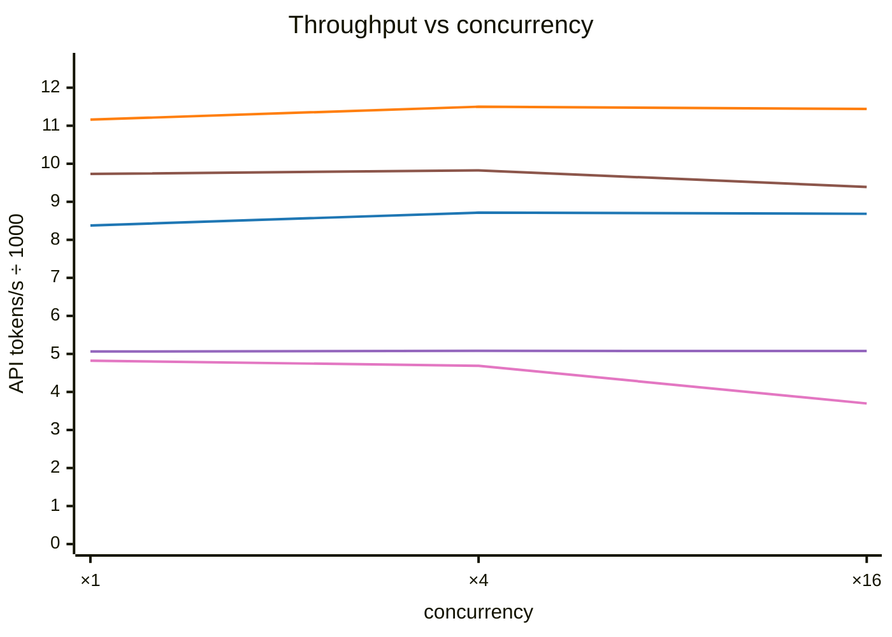
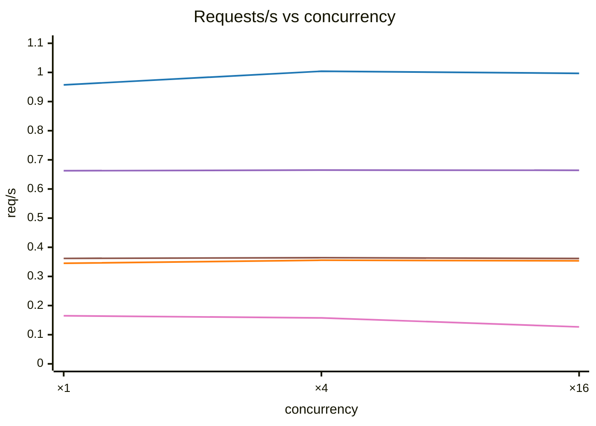
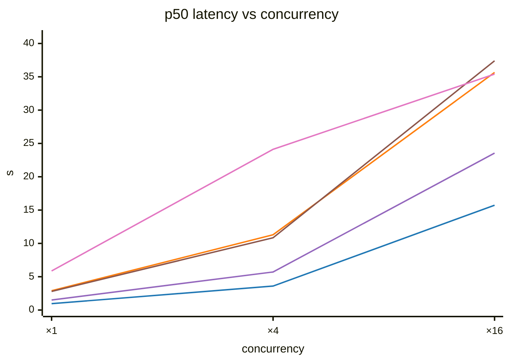

## speed — 2026-11-17 12:47 UTC

**PASS** · 648 s · 286 requests · 9 (3.1%) errors · 0 rate-limited · 4,729,315 tokens billed

Closed loop, 25 s per cell, 5 request classes × concurrency [1, 4, 16]. 286 requests, 4,729,315 tokens billed.

|  | requests | errors | 429s | p50 s | p90 s | p99 s | max s | req/s | API tok/s | MRR |
|---|---|---|---|---|---|---|---|---|---|---|
| short20 ×1 | 24 | 0 (0.0%) | 0 | 0.958 | 1.350 | 1.827 | 1.866 | 0.957 | 8,377 | 0.691 |
| short20 ×4 | 28 | 0 (0.0%) | 0 | 3.597 | 4.999 | 5.019 | 5.020 | 1.004 | 8,715 | 0.713 |
| short20 ×16 | 40 | 0 (0.0%) | 0 | 15.7 | 16.6 | 17.2 | 17.2 | 0.997 | 8,684 | 0.748 |
| many100 ×1 | 9 | 0 (0.0%) | 0 | 2.900 | 2.924 | 2.941 | 2.942 | 0.345 | 11,158 | 1.000 |
| many100 ×4 | 12 | 0 (0.0%) | 0 | 11.3 | 11.3 | 11.4 | 11.4 | 0.356 | 11,502 | 1.000 |
| many100 ×16 | 24 | 0 (0.0%) | 0 | 35.7 | 45.5 | 45.6 | 45.6 | 0.353 | 11,441 | 1.000 |
| long8k ×1 | 17 | 0 (0.0%) | 0 | 1.509 | 1.518 | 1.521 | 1.522 | 0.663 | 5,063 | 1.000 |
| long8k ×4 | 20 | 0 (0.0%) | 0 | 5.713 | 6.457 | 6.466 | 6.467 | 0.665 | 5,080 | 1.000 |
| long8k ×16 | 32 | 0 (0.0%) | 0 | 23.5 | 24.3 | 24.3 | 24.3 | 0.664 | 5,076 | 1.000 |
| pack32k ×1 | 10 | 0 (0.0%) | 0 | 2.793 | 2.945 | 3.292 | 3.331 | 0.362 | 9,732 | 1.000 |
| pack32k ×4 | 13 | 0 (0.0%) | 0 | 10.8 | 11.4 | 11.6 | 11.6 | 0.364 | 9,826 | 1.000 |
| pack32k ×16 | 25 | 0 (0.0%) | 0 | 37.4 | 45.5 | 46.2 | 46.2 | 0.362 | 9,390 | 1.000 |
| long32k ×1 | 5 | 0 (0.0%) | 0 | 5.866 | 6.497 | 6.663 | 6.682 | 0.165 | 4,821 | 1.000 |
| long32k ×4 | 8 | 0 (0.0%) | 0 | 24.1 | 26.3 | 26.3 | 26.3 | 0.158 | 4,688 | 1.000 |
| long32k ×16 | 19 | 9 (47.4%) | 0 | 35.4 | 55.9 | 59.6 | 60.0 | 0.127 | 3,697 | 1.000 |

| error | count | example | response |
|---|---|---|---|
| http 424 ModelError timed out at SageMaker | 9 | natural-qmsum natural-qmsum/query_25 | {"ErrorCode":"INTERNAL_FAILURE_FROM_MODEL","LogStreamArn":"arn:aws:logs:eu-west-3:<account-id>:log-group:/aws/sagemaker/Endpoints/reranker-mp-mainc-8b-3","Message":"Received server error (0) from primary with message \"Your invocation timed out while waiting for a response from container primary. Re |

*Throughput vs concurrency: short20, many100, long8k, pack32k, long32k*

*Requests/s vs concurrency: short20, many100, long8k, pack32k, long32k*

*p50 latency vs concurrency: short20, many100, long8k, pack32k, long32k*
