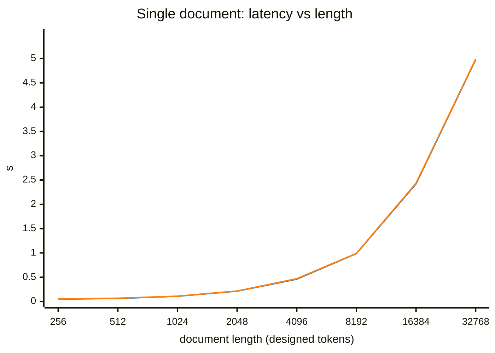
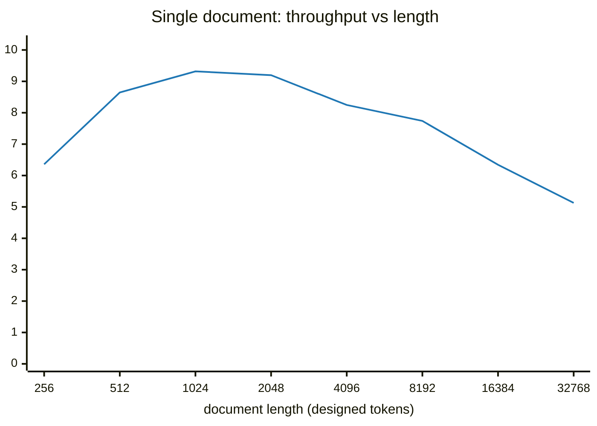
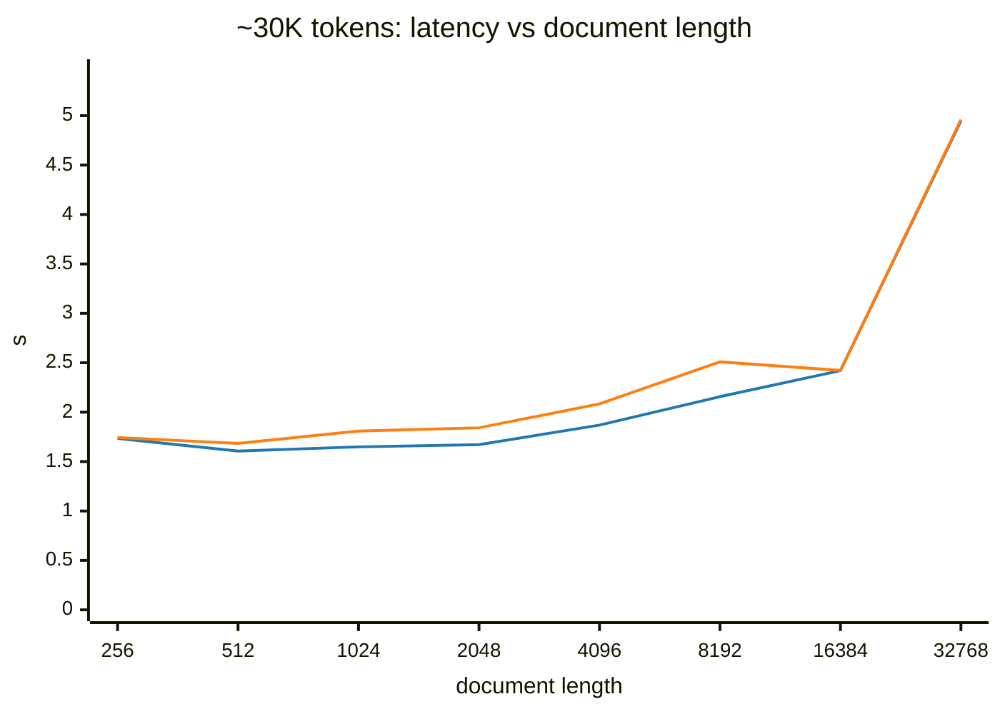
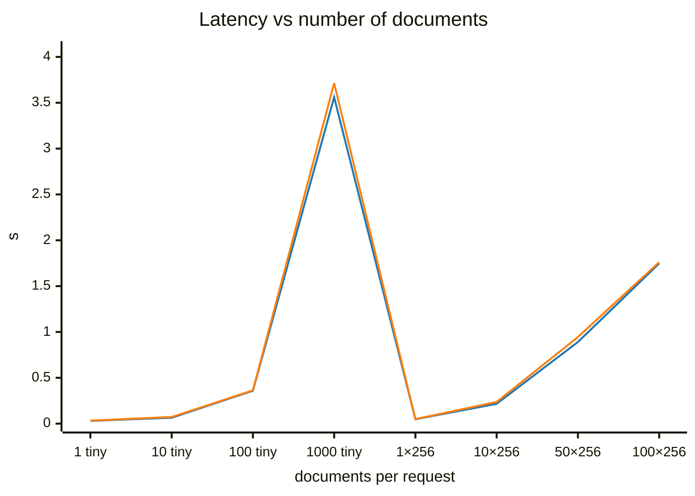
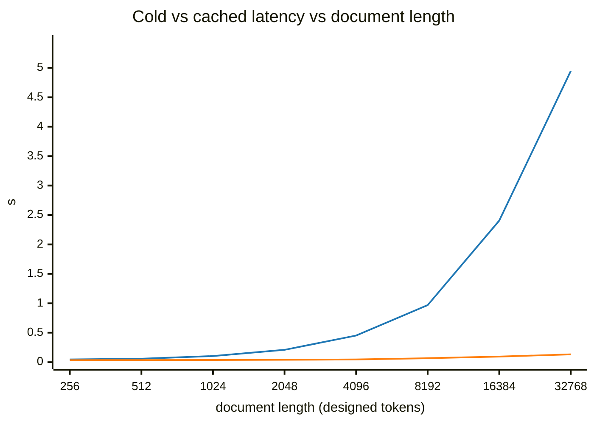
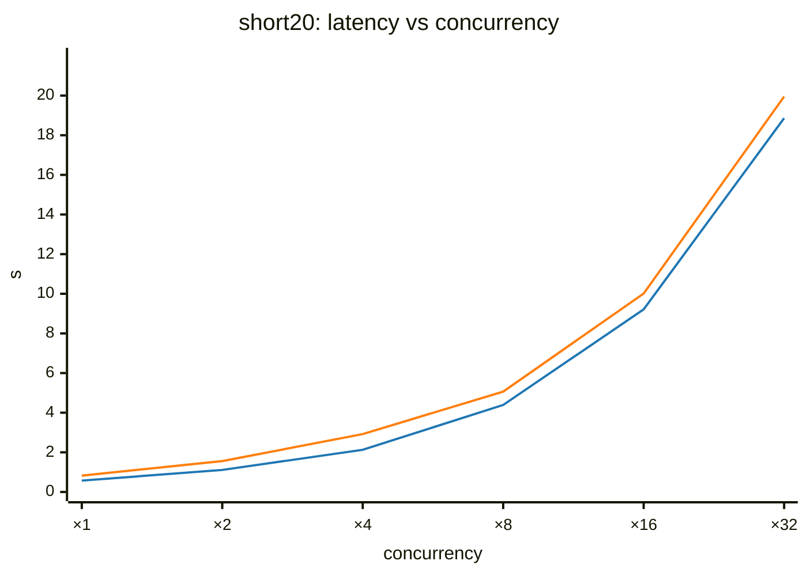
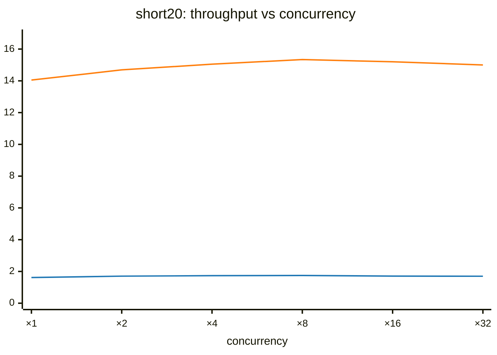
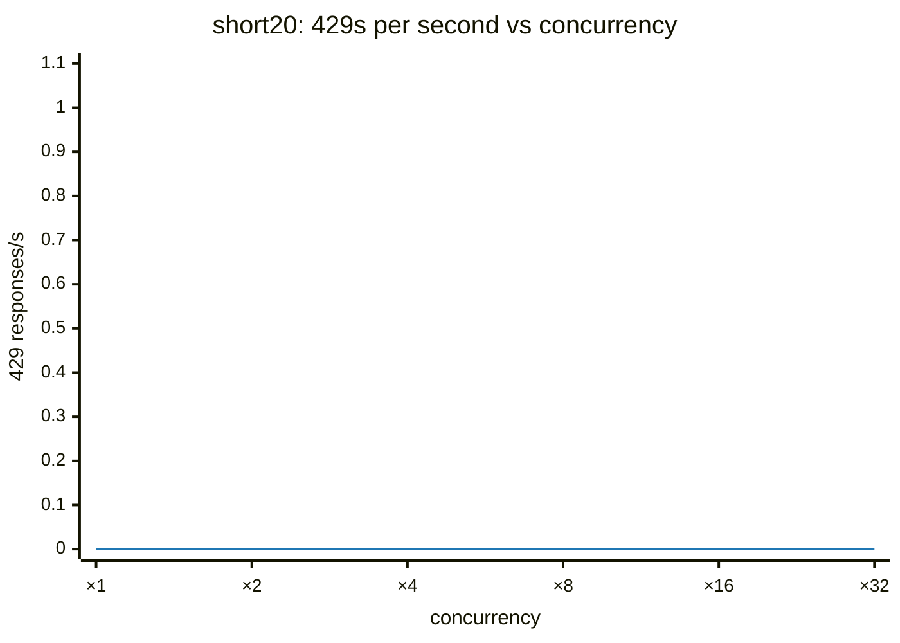

## meticulous — 2026-11-17 12:49 UTC

**PASS** · 911 s · 915 requests · 0 (0.0%) errors · 0 rate-limited · 10,180,207 tokens billed

Sequential requests (one in flight) unless stated; every query carries a nonce so nothing is served from the API's prefix cache.

### Single document: latency vs length

| rung | Qwen tokens | billed | errors | p50 s | p90 s | max s | API tok/s |
|---|---|---|---|---|---|---|---|
| 256 | 229 | 324 | 0 (0.0%) | 0.050 | 0.051 | 0.082 | 6,359 |
| 512 | 457 | 551 | 0 (0.0%) | 0.062 | 0.069 | 0.070 | 8,645 |
| 1,024 | 911 | 1,005 | 0 (0.0%) | 0.107 | 0.109 | 0.113 | 9,318 |
| 2,048 | 1,872 | 1,966 | 0 (0.0%) | 0.213 | 0.216 | 0.222 | 9,197 |
| 4,096 | 3,707 | 3,801 | 0 (0.0%) | 0.459 | 0.469 | 0.478 | 8,247 |
| 8,192 | 7,545 | 7,640 | 0 (0.0%) | 0.986 | 0.991 | 0.993 | 7,739 |
| 16,384 | 15,274 | 15,368 | 0 (0.0%) | 2.420 | 2.435 | 2.443 | 6,342 |
| 32,768 | 25,438 | 25,536 | 0 (0.0%) | 4.978 | 4.989 | 5.044 | 5,127 |

*Single document: latency vs length: p50, p90*

*Single document: throughput vs length: API tokens/s ÷ 1000*

### ~30K tokens per request: latency vs document length (fewer, longer documents)

| rung | docs/request | billed | errors | p50 s | p90 s | max s | API tok/s |
|---|---|---|---|---|---|---|---|
| 256 | 100 | 32,426 | 0 (0.0%) | 1.734 | 1.743 | 1.755 | 18,703 |
| 512 | 55 | 30,278 | 0 (0.0%) | 1.607 | 1.684 | 1.784 | 18,786 |
| 1,024 | 28 | 28,191 | 0 (0.0%) | 1.649 | 1.809 | 1.866 | 17,083 |
| 2,048 | 13 | 25,572 | 0 (0.0%) | 1.671 | 1.842 | 1.985 | 15,680 |
| 4,096 | 6 | 22,809 | 0 (0.0%) | 1.869 | 2.084 | 2.224 | 12,383 |
| 8,192 | 3 | 22,922 | 0 (0.0%) | 2.157 | 2.509 | 2.753 | 10,975 |
| 16,384 | 1 | 15,367 | 0 (0.0%) | 2.420 | 2.422 | 2.425 | 6,351 |
| 32,768 | 1 | 25,540 | 0 (0.0%) | 4.947 | 4.960 | 5.024 | 5,159 |

*~30K tokens: latency vs document length: p50, p90*

### Latency vs number of documents

| documents | billed | errors | p50 s | p90 s | max s | MRR |
|---|---|---|---|---|---|---|
| 1 tiny | 90.9 | 0 (0.0%) | 0.031 | 0.033 | 0.036 | 1.000 |
| 10 tiny | 919 | 0 (0.0%) | 0.064 | 0.072 | 0.072 | 1.000 |
| 100 tiny | 9,259 | 0 (0.0%) | 0.359 | 0.363 | 0.380 | 1.000 |
| 1000 tiny | 93,789 | 0 (0.0%) | 3.560 | 3.714 | 3.715 | 1.000 |
| 1×256 | 324 | 0 (0.0%) | 0.049 | 0.050 | 0.051 | 1.000 |
| 10×256 | 3,232 | 0 (0.0%) | 0.216 | 0.237 | 0.265 | 1.000 |
| 50×256 | 16,180 | 0 (0.0%) | 0.891 | 0.945 | 0.981 | 1.000 |
| 100×256 | 32,309 | 0 (0.0%) | 1.747 | 1.761 | 1.774 | 0.950 |

*Latency vs number of documents: p50, p90*

### Cold vs cached: the same single-document request sent twice in a row

The API caches prompt prefixes, so a repeated (query, document) pair skips most of the compute. Cold = fresh nonce in the query; cached = the identical request again immediately after.

| rung | pairs | cold p50 s | cached p50 s | speed-up × | cold max s | cached max s | errors |
|---|---|---|---|---|---|---|---|
| 256 | 10 | 0.046 | 0.034 | 1.365 | 0.048 | 0.035 |  |
| 512 | 10 | 0.058 | 0.035 | 1.634 | 0.064 | 0.036 |  |
| 1,024 | 10 | 0.103 | 0.037 | 2.788 | 0.105 | 0.038 |  |
| 2,048 | 10 | 0.209 | 0.040 | 5.264 | 0.221 | 0.041 |  |
| 4,096 | 10 | 0.452 | 0.046 | 9.748 | 0.457 | 0.047 |  |
| 8,192 | 10 | 0.969 | 0.067 | 14.5 | 0.986 | 0.069 |  |
| 16,384 | 10 | 2.404 | 0.094 | 25.6 | 2.418 | 0.096 |  |
| 32,768 | 10 | 4.946 | 0.132 | 37.4 | 5.012 | 0.133 |  |

*Cold vs cached latency vs document length: cold p50, cached p50*

### short20: latency and throughput vs concurrency

|  | requests | errors | 429s | p50 s | p90 s | p99 s | max s | req/s | API tok/s | MRR |
|---|---|---|---|---|---|---|---|---|---|---|
| ×1 | 41 | 0 (0.0%) | 0 | 0.574 | 0.824 | 1.066 | 1.108 | 1.616 | 14,054 | 0.730 |
| ×2 | 44 | 0 (0.0%) | 0 | 1.111 | 1.559 | 1.912 | 2.041 | 1.704 | 14,691 | 0.717 |
| ×4 | 46 | 0 (0.0%) | 0 | 2.127 | 2.920 | 2.961 | 2.983 | 1.733 | 15,055 | 0.716 |
| ×8 | 51 | 0 (0.0%) | 0 | 4.390 | 5.065 | 5.641 | 5.844 | 1.744 | 15,342 | 0.716 |
| ×16 | 58 | 0 (0.0%) | 0 | 9.212 | 10.0 | 10.4 | 10.4 | 1.708 | 15,197 | 0.687 |
| ×32 | 75 | 0 (0.0%) | 0 | 18.9 | 20.0 | 20.6 | 20.6 | 1.698 | 14,997 | 0.684 |

No 429s up to concurrency ×32.

*short20: latency vs concurrency: p50, p90*

*short20: throughput vs concurrency: req/s, API tokens/s ÷ 1000*

*short20: 429s per second vs concurrency: 429/s*

915 requests, 10,180,207 tokens billed.
