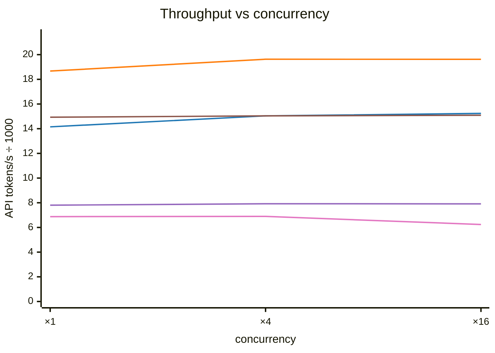
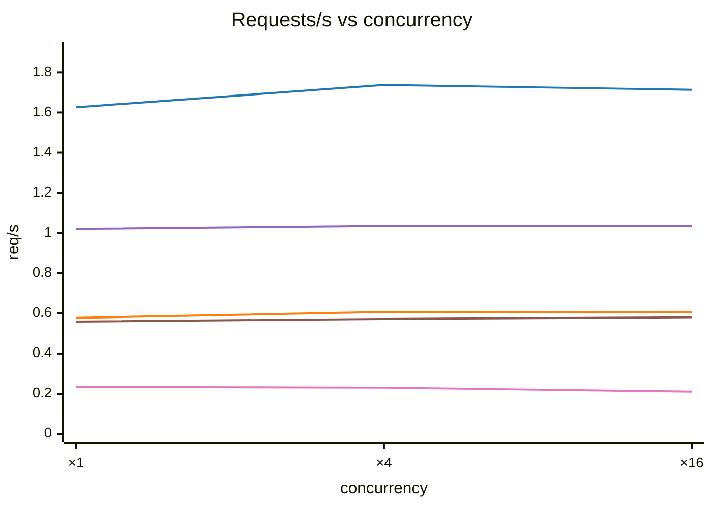
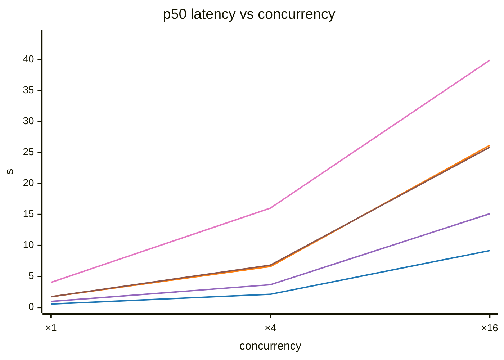

## speed — 2026-11-17 13:05 UTC

**PASS** · 574 s · 405 requests · 4 (1.0%) errors · 0 rate-limited · 6,695,216 tokens billed

Closed loop, 25 s per cell, 5 request classes × concurrency [1, 4, 16]. 405 requests, 6,695,216 tokens billed.

|  | requests | errors | 429s | p50 s | p90 s | p99 s | max s | req/s | API tok/s | MRR |
|---|---|---|---|---|---|---|---|---|---|---|
| short20 ×1 | 41 | 0 (0.0%) | 0 | 0.562 | 0.818 | 1.060 | 1.095 | 1.626 | 14,145 | 0.719 |
| short20 ×4 | 47 | 0 (0.0%) | 0 | 2.135 | 2.898 | 2.916 | 2.916 | 1.737 | 15,040 | 0.724 |
| short20 ×16 | 58 | 0 (0.0%) | 0 | 9.178 | 9.648 | 10.0 | 10.0 | 1.713 | 15,242 | 0.690 |
| many100 ×1 | 15 | 0 (0.0%) | 0 | 1.733 | 1.747 | 1.755 | 1.755 | 0.578 | 18,673 | 1.000 |
| many100 ×4 | 19 | 0 (0.0%) | 0 | 6.608 | 6.623 | 6.704 | 6.720 | 0.607 | 19,634 | 1.000 |
| many100 ×16 | 31 | 0 (0.0%) | 0 | 26.2 | 26.5 | 26.6 | 26.6 | 0.606 | 19,620 | 0.968 |
| long8k ×1 | 26 | 0 (0.0%) | 0 | 0.979 | 0.982 | 0.983 | 0.983 | 1.021 | 7,804 | 1.000 |
| long8k ×4 | 29 | 0 (0.0%) | 0 | 3.672 | 4.139 | 4.153 | 4.154 | 1.036 | 7,918 | 1.000 |
| long8k ×16 | 41 | 0 (0.0%) | 0 | 15.1 | 15.6 | 15.6 | 15.6 | 1.035 | 7,912 | 1.000 |
| pack32k ×1 | 14 | 0 (0.0%) | 0 | 1.737 | 2.092 | 2.486 | 2.532 | 0.559 | 14,926 | 1.000 |
| pack32k ×4 | 18 | 0 (0.0%) | 0 | 6.826 | 7.567 | 7.836 | 7.869 | 0.572 | 15,043 | 1.000 |
| pack32k ×16 | 29 | 0 (0.0%) | 0 | 25.8 | 27.7 | 28.4 | 28.4 | 0.580 | 15,093 | 1.000 |
| long32k ×1 | 7 | 0 (0.0%) | 0 | 4.053 | 4.953 | 4.976 | 4.979 | 0.234 | 6,876 | 1.000 |
| long32k ×4 | 9 | 0 (0.0%) | 0 | 16.0 | 18.3 | 18.5 | 18.5 | 0.231 | 6,895 | 1.000 |
| long32k ×16 | 21 | 4 (19.0%) | 0 | 39.9 | 59.1 | 59.3 | 59.3 | 0.211 | 6,239 | 1.000 |

| error | count | example | response |
|---|---|---|---|
| http 424 ModelError timed out at SageMaker | 4 | natural-summ_screen_fd natural-summ_screen_fd/query_49 | {"ErrorCode":"INTERNAL_FAILURE_FROM_MODEL","LogStreamArn":"arn:aws:logs:eu-west-3:<account-id>:log-group:/aws/sagemaker/Endpoints/reranker-mp-mainc-4b-3","Message":"Received server error (0) from primary with message \"Your invocation timed out while waiting for a response from container primary. Re |

*Throughput vs concurrency: short20, many100, long8k, pack32k, long32k*

*Requests/s vs concurrency: short20, many100, long8k, pack32k, long32k*

*p50 latency vs concurrency: short20, many100, long8k, pack32k, long32k*
