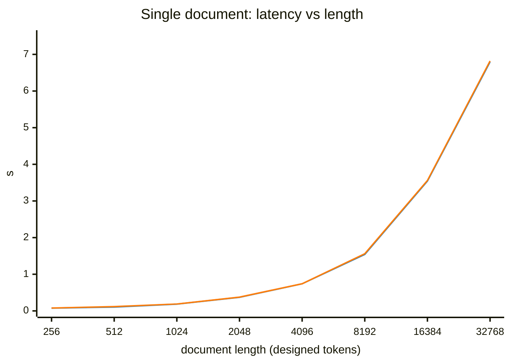
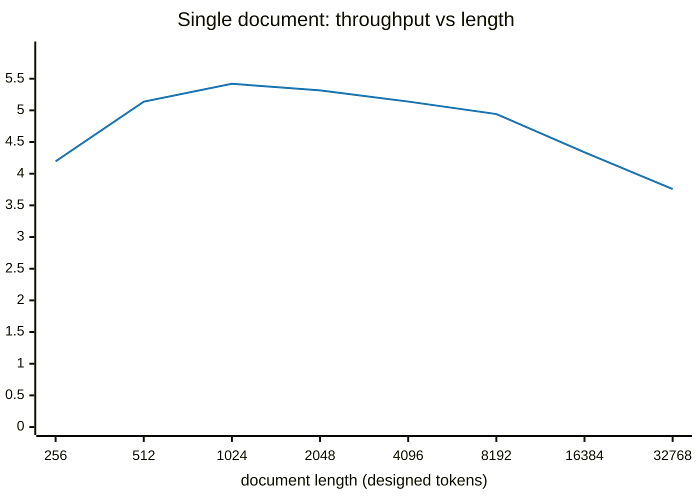
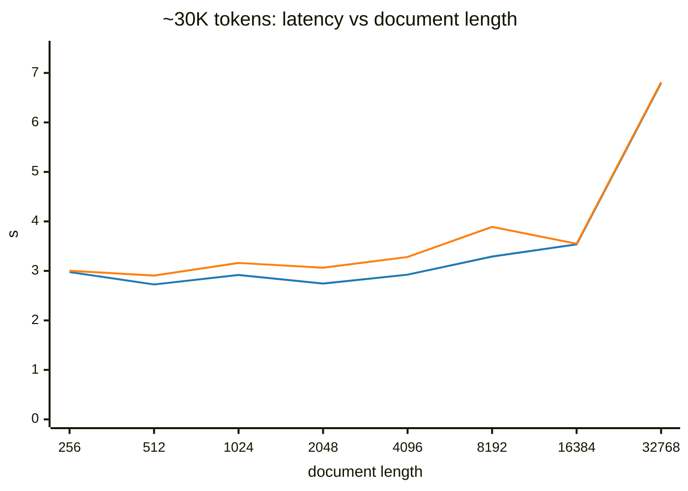
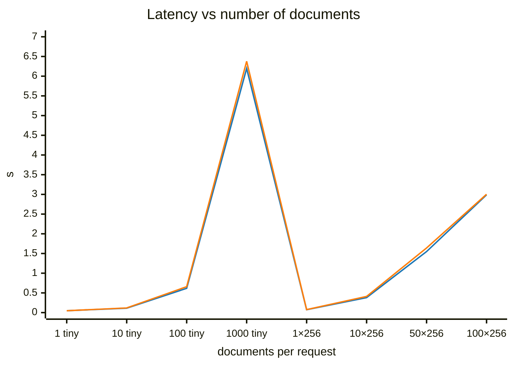
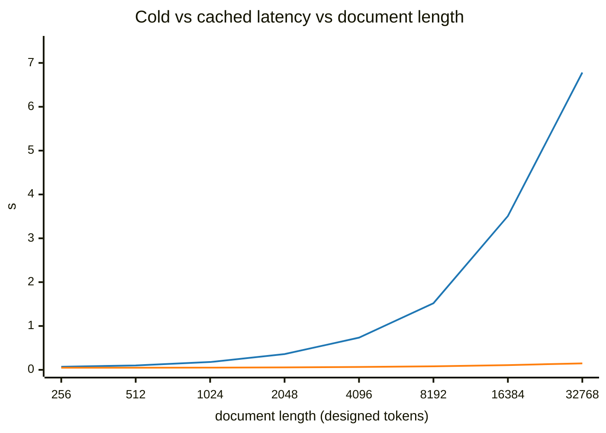
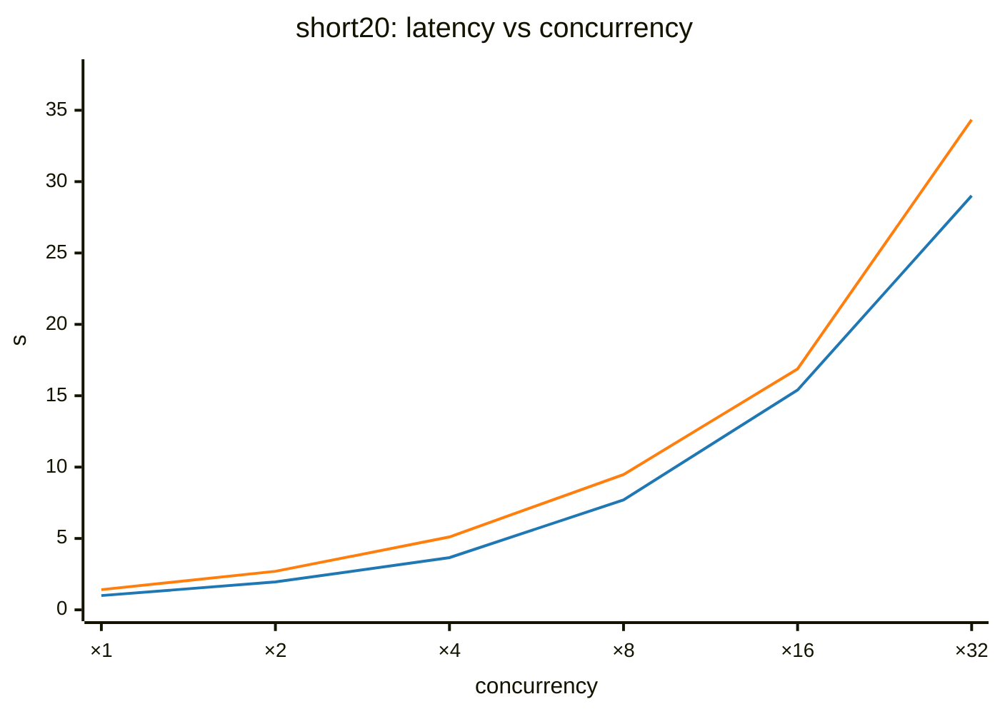
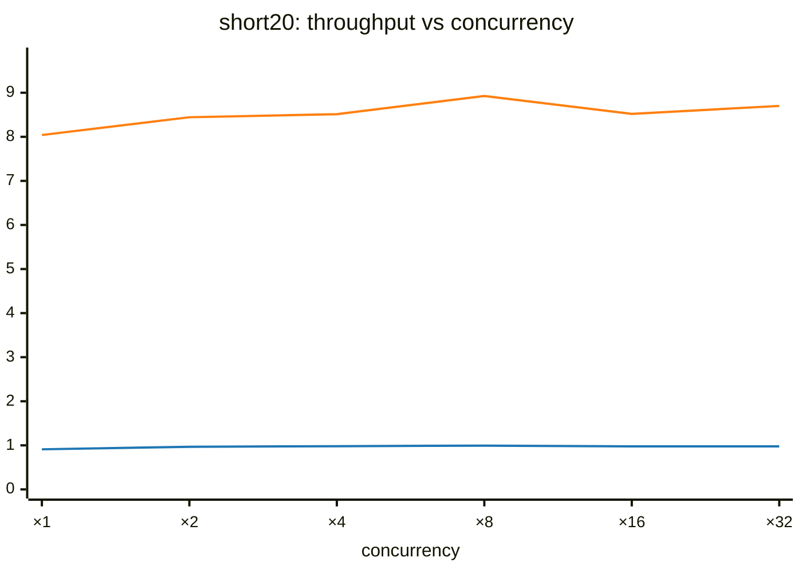
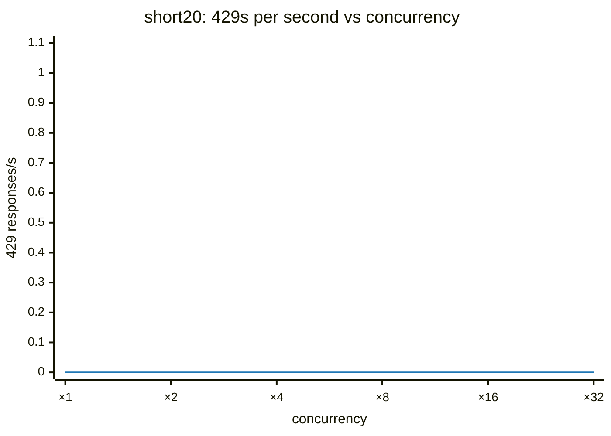

## meticulous — 2026-11-17 13:24 UTC

**PASS** · 1301 s · 806 requests · 0 (0.0%) errors · 0 rate-limited · 9,237,588 tokens billed

Sequential requests (one in flight) unless stated; every query carries a nonce so nothing is served from the API's prefix cache.

### Single document: latency vs length

| rung | Qwen tokens | billed | errors | p50 s | p90 s | max s | API tok/s |
|---|---|---|---|---|---|---|---|
| 256 | 229 | 324 | 0 (0.0%) | 0.075 | 0.079 | 0.113 | 4,196 |
| 512 | 457 | 551 | 0 (0.0%) | 0.105 | 0.119 | 0.123 | 5,137 |
| 1,024 | 911 | 1,005 | 0 (0.0%) | 0.185 | 0.189 | 0.191 | 5,420 |
| 2,048 | 1,872 | 1,966 | 0 (0.0%) | 0.371 | 0.377 | 0.377 | 5,315 |
| 4,096 | 3,707 | 3,800 | 0 (0.0%) | 0.739 | 0.741 | 0.744 | 5,139 |
| 8,192 | 7,545 | 7,639 | 0 (0.0%) | 1.542 | 1.560 | 1.570 | 4,942 |
| 16,384 | 15,274 | 15,368 | 0 (0.0%) | 3.543 | 3.559 | 3.563 | 4,338 |
| 32,768 | 25,438 | 25,536 | 0 (0.0%) | 6.796 | 6.820 | 6.846 | 3,757 |

*Single document: latency vs length: p50, p90*

*Single document: throughput vs length: API tokens/s ÷ 1000*

### ~30K tokens per request: latency vs document length (fewer, longer documents)

| rung | docs/request | billed | errors | p50 s | p90 s | max s | API tok/s |
|---|---|---|---|---|---|---|---|
| 256 | 100 | 32,399 | 0 (0.0%) | 2.976 | 3.002 | 3.020 | 10,880 |
| 512 | 55 | 30,253 | 0 (0.0%) | 2.726 | 2.906 | 3.081 | 10,947 |
| 1,024 | 28 | 28,176 | 0 (0.0%) | 2.917 | 3.161 | 3.270 | 9,823 |
| 2,048 | 13 | 25,574 | 0 (0.0%) | 2.745 | 3.065 | 3.317 | 9,498 |
| 4,096 | 6 | 22,807 | 0 (0.0%) | 2.924 | 3.281 | 3.495 | 7,896 |
| 8,192 | 3 | 22,923 | 0 (0.0%) | 3.290 | 3.890 | 4.306 | 7,123 |
| 16,384 | 1 | 15,367 | 0 (0.0%) | 3.535 | 3.549 | 3.552 | 4,348 |
| 32,768 | 1 | 25,540 | 0 (0.0%) | 6.796 | 6.812 | 6.872 | 3,756 |

*~30K tokens: latency vs document length: p50, p90*

### Latency vs number of documents

| documents | billed | errors | p50 s | p90 s | max s | MRR |
|---|---|---|---|---|---|---|
| 1 tiny | 91.4 | 0 (0.0%) | 0.047 | 0.048 | 0.051 | 1.000 |
| 10 tiny | 926 | 0 (0.0%) | 0.113 | 0.118 | 0.119 | 1.000 |
| 100 tiny | 9,309 | 0 (0.0%) | 0.616 | 0.658 | 0.663 | 1.000 |
| 1000 tiny | 94,189 | 0 (0.0%) | 6.196 | 6.377 | 6.410 | 0.950 |
| 1×256 | 323 | 0 (0.0%) | 0.074 | 0.076 | 0.082 | 1.000 |
| 10×256 | 3,233 | 0 (0.0%) | 0.381 | 0.411 | 0.446 | 1.000 |
| 50×256 | 16,155 | 0 (0.0%) | 1.549 | 1.640 | 1.677 | 1.000 |
| 100×256 | 32,319 | 0 (0.0%) | 2.990 | 3.003 | 3.040 | 1.000 |

*Latency vs number of documents: p50, p90*

### Cold vs cached: the same single-document request sent twice in a row

The API caches prompt prefixes, so a repeated (query, document) pair skips most of the compute. Cold = fresh nonce in the query; cached = the identical request again immediately after.

| rung | pairs | cold p50 s | cached p50 s | speed-up × | cold max s | cached max s | errors |
|---|---|---|---|---|---|---|---|
| 256 | 10 | 0.070 | 0.047 | 1.489 | 0.071 | 0.049 |  |
| 512 | 10 | 0.101 | 0.049 | 2.072 | 0.113 | 0.050 |  |
| 1,024 | 10 | 0.178 | 0.050 | 3.577 | 0.181 | 0.051 |  |
| 2,048 | 10 | 0.359 | 0.056 | 6.407 | 0.368 | 0.057 |  |
| 4,096 | 10 | 0.734 | 0.066 | 11.2 | 0.735 | 0.067 |  |
| 8,192 | 10 | 1.519 | 0.080 | 19.0 | 1.523 | 0.081 |  |
| 16,384 | 10 | 3.508 | 0.108 | 32.4 | 3.525 | 0.110 |  |
| 32,768 | 10 | 6.781 | 0.148 | 45.9 | 6.859 | 0.152 |  |

*Cold vs cached latency vs document length: cold p50, cached p50*

### short20: latency and throughput vs concurrency

|  | requests | errors | 429s | p50 s | p90 s | p99 s | max s | req/s | API tok/s | MRR |
|---|---|---|---|---|---|---|---|---|---|---|
| ×1 | 23 | 0 (0.0%) | 0 | 1.000 | 1.412 | 1.894 | 1.928 | 0.910 | 8,041 | 0.710 |
| ×2 | 25 | 0 (0.0%) | 0 | 1.954 | 2.699 | 3.452 | 3.581 | 0.968 | 8,444 | 0.687 |
| ×4 | 28 | 0 (0.0%) | 0 | 3.660 | 5.106 | 5.116 | 5.117 | 0.981 | 8,514 | 0.720 |
| ×8 | 32 | 0 (0.0%) | 0 | 7.704 | 9.480 | 10.2 | 10.2 | 0.993 | 8,926 | 0.700 |
| ×16 | 40 | 0 (0.0%) | 0 | 15.4 | 16.9 | 17.5 | 17.5 | 0.978 | 8,520 | 0.750 |
| ×32 | 58 | 0 (0.0%) | 0 | 29.0 | 34.3 | 34.4 | 34.5 | 0.977 | 8,701 | 0.733 |

No 429s up to concurrency ×32.

*short20: latency vs concurrency: p50, p90*

*short20: throughput vs concurrency: req/s, API tokens/s ÷ 1000*

*short20: 429s per second vs concurrency: 429/s*

806 requests, 9,237,588 tokens billed.
