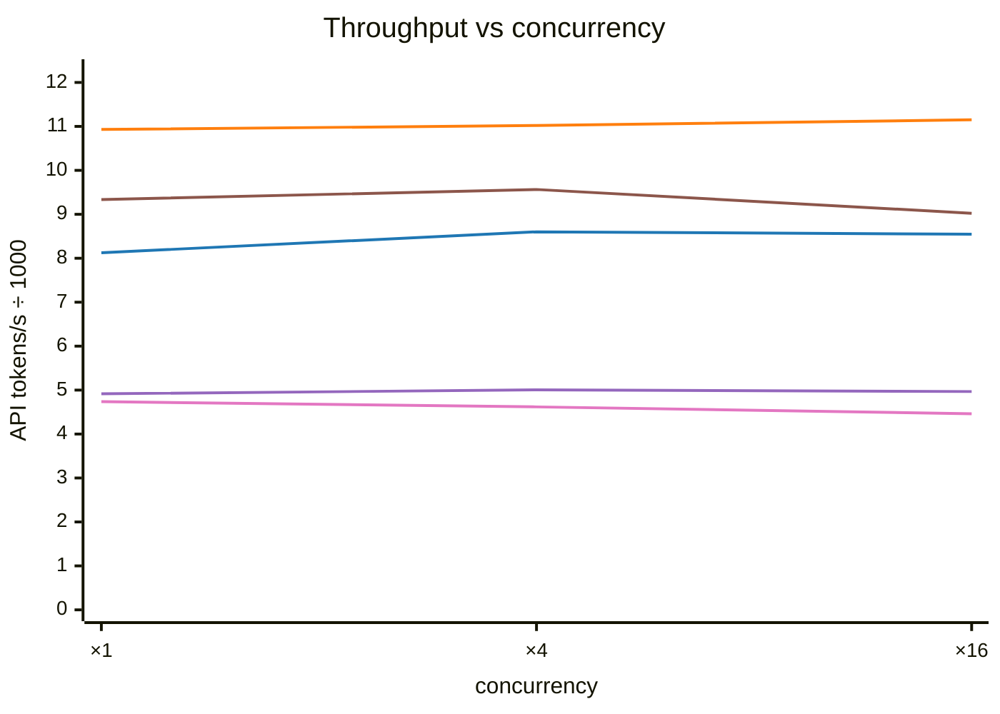
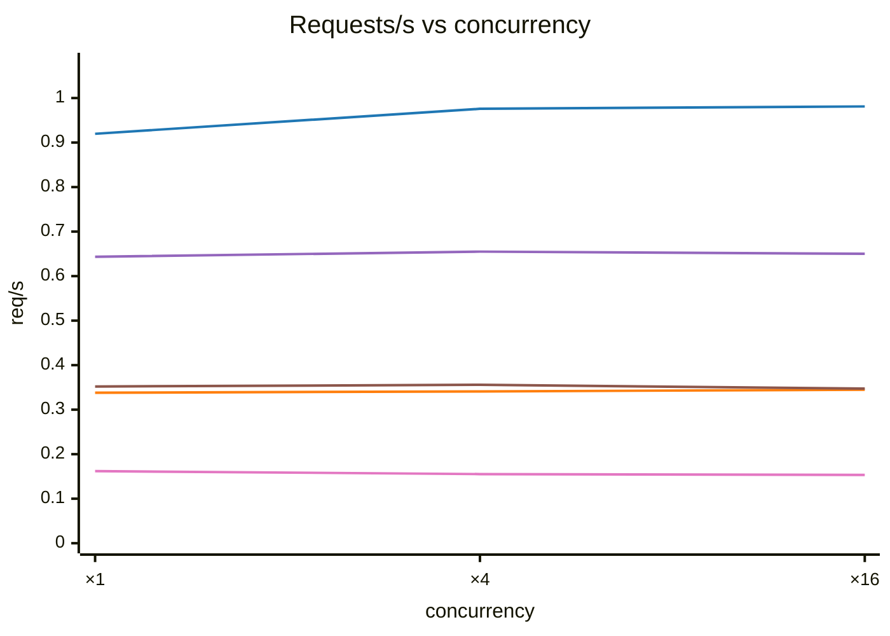
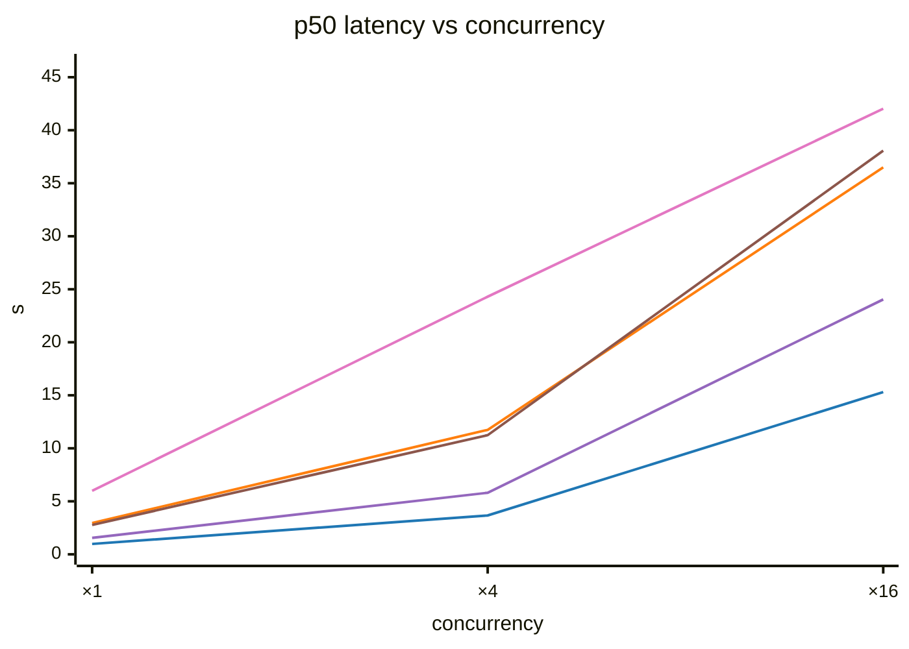

## speed — 2026-11-17 13:45 UTC

**PASS** · 651 s · 281 requests · 7 (2.5%) errors · 0 rate-limited · 4,690,707 tokens billed

Closed loop, 25 s per cell, 5 request classes × concurrency [1, 4, 16]. 281 requests, 4,690,707 tokens billed.

|  | requests | errors | 429s | p50 s | p90 s | p99 s | max s | req/s | API tok/s | MRR |
|---|---|---|---|---|---|---|---|---|---|---|
| short20 ×1 | 23 | 0 (0.0%) | 0 | 0.980 | 1.384 | 1.866 | 1.899 | 0.920 | 8,125 | 0.707 |
| short20 ×4 | 27 | 0 (0.0%) | 0 | 3.665 | 5.096 | 5.624 | 5.809 | 0.976 | 8,601 | 0.710 |
| short20 ×16 | 40 | 0 (0.0%) | 0 | 15.3 | 16.8 | 17.5 | 17.5 | 0.981 | 8,547 | 0.767 |
| many100 ×1 | 9 | 0 (0.0%) | 0 | 2.955 | 2.985 | 2.996 | 2.997 | 0.338 | 10,933 | 1.000 |
| many100 ×4 | 12 | 0 (0.0%) | 0 | 11.7 | 11.8 | 11.9 | 11.9 | 0.341 | 11,021 | 1.000 |
| many100 ×16 | 24 | 0 (0.0%) | 0 | 36.5 | 46.5 | 46.6 | 46.6 | 0.345 | 11,155 | 1.000 |
| long8k ×1 | 17 | 0 (0.0%) | 0 | 1.555 | 1.560 | 1.570 | 1.572 | 0.643 | 4,916 | 1.000 |
| long8k ×4 | 20 | 0 (0.0%) | 0 | 5.805 | 6.565 | 6.586 | 6.588 | 0.655 | 5,005 | 1.000 |
| long8k ×16 | 32 | 0 (0.0%) | 0 | 24.0 | 24.8 | 24.9 | 24.9 | 0.650 | 4,967 | 1.000 |
| pack32k ×1 | 9 | 0 (0.0%) | 0 | 2.768 | 3.099 | 3.371 | 3.401 | 0.352 | 9,334 | 1.000 |
| pack32k ×4 | 12 | 0 (0.0%) | 0 | 11.2 | 12.0 | 12.0 | 12.1 | 0.356 | 9,565 | 1.000 |
| pack32k ×16 | 24 | 0 (0.0%) | 0 | 38.1 | 47.0 | 47.4 | 47.4 | 0.347 | 9,024 | 1.000 |
| long32k ×1 | 5 | 0 (0.0%) | 0 | 5.990 | 6.569 | 6.704 | 6.719 | 0.162 | 4,737 | 1.000 |
| long32k ×4 | 8 | 0 (0.0%) | 0 | 24.3 | 26.1 | 26.7 | 26.7 | 0.155 | 4,618 | 1.000 |
| long32k ×16 | 19 | 7 (36.8%) | 0 | 42.0 | 58.8 | 59.8 | 59.9 | 0.153 | 4,462 | 1.000 |

| error | count | example | response |
|---|---|---|---|
| http 424 ModelError timed out at SageMaker | 7 | natural-summ_screen_fd natural-summ_screen_fd/query_40 | {"ErrorCode":"INTERNAL_FAILURE_FROM_MODEL","LogStreamArn":"arn:aws:logs:eu-west-3:<account-id>:log-group:/aws/sagemaker/Endpoints/reranker-mp-mainc-8b-1","Message":"Received server error (0) from primary with message \"Your invocation timed out while waiting for a response from container primary. Re |

*Throughput vs concurrency: short20, many100, long8k, pack32k, long32k*

*Requests/s vs concurrency: short20, many100, long8k, pack32k, long32k*

*p50 latency vs concurrency: short20, many100, long8k, pack32k, long32k*
