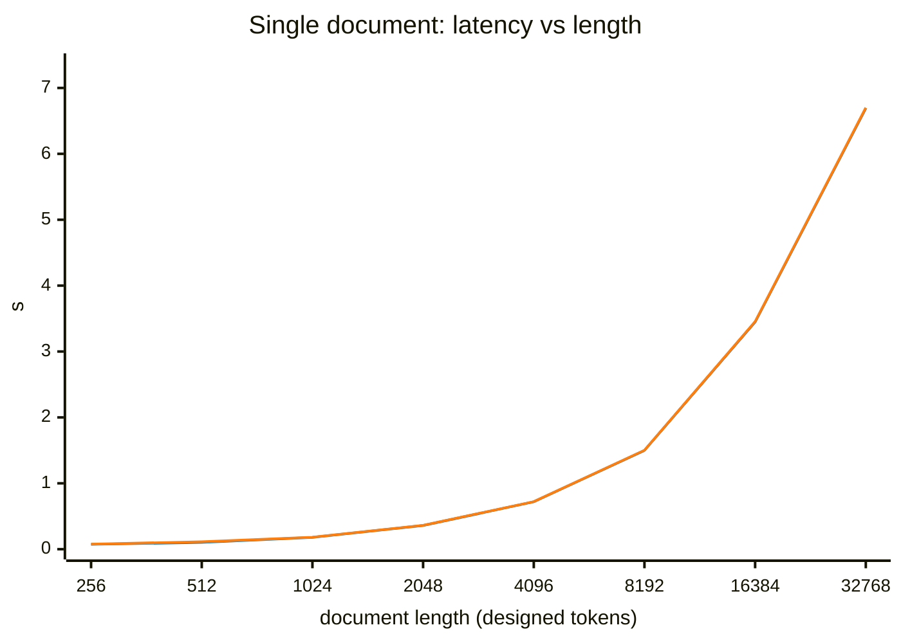
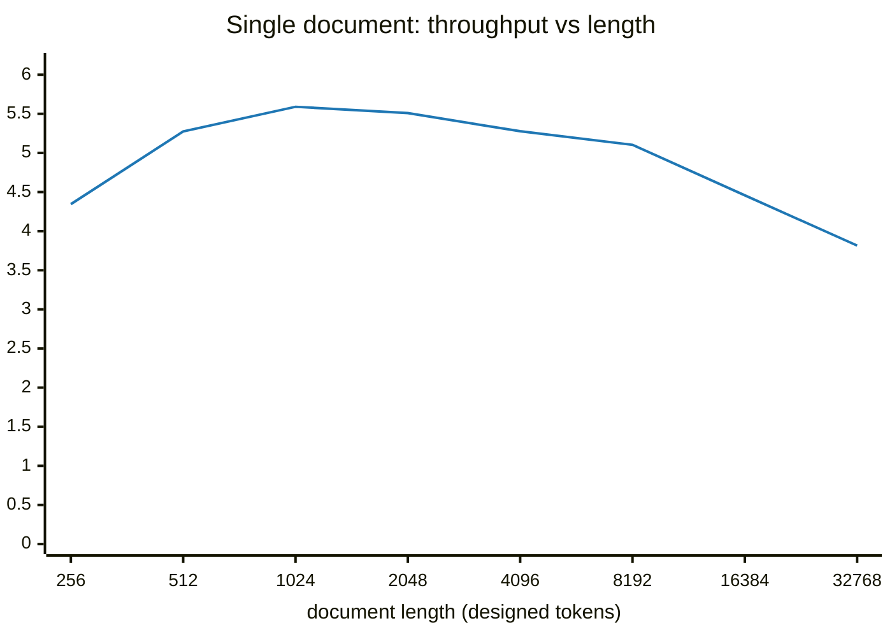
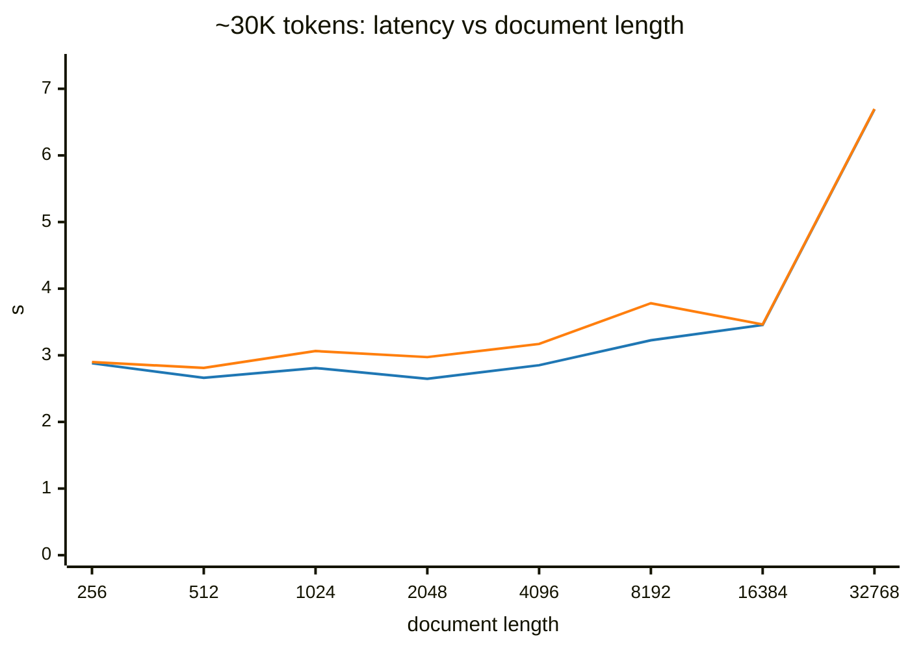
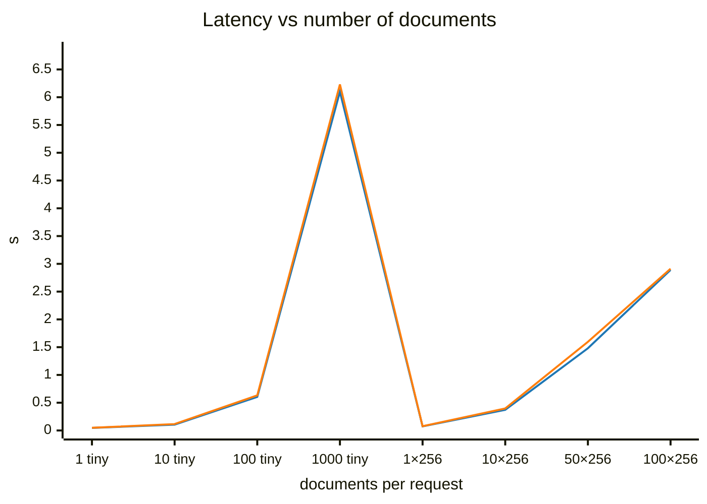
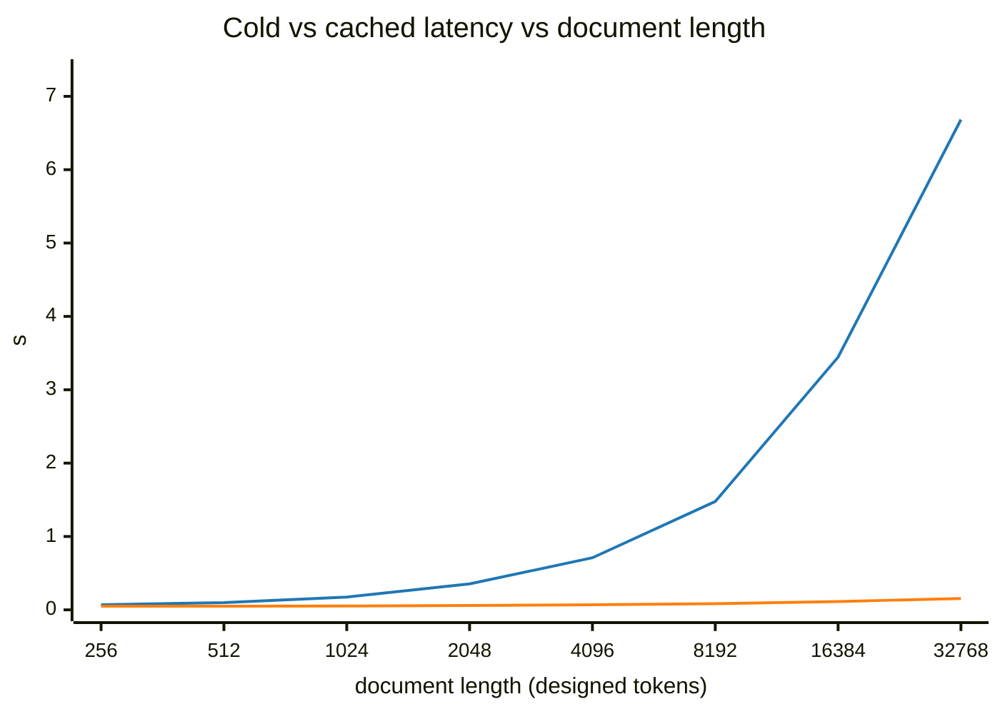
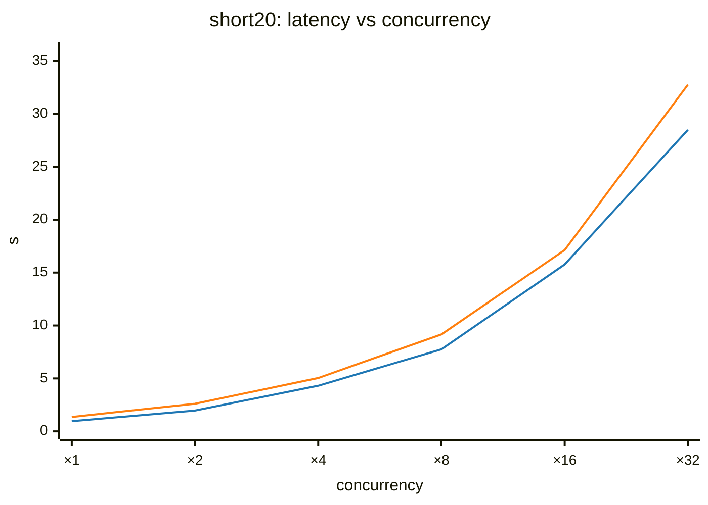
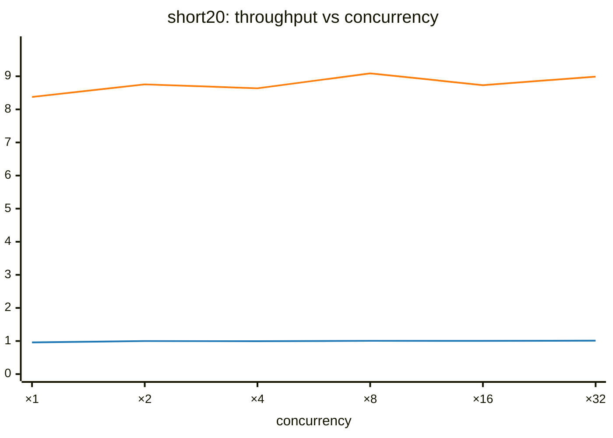
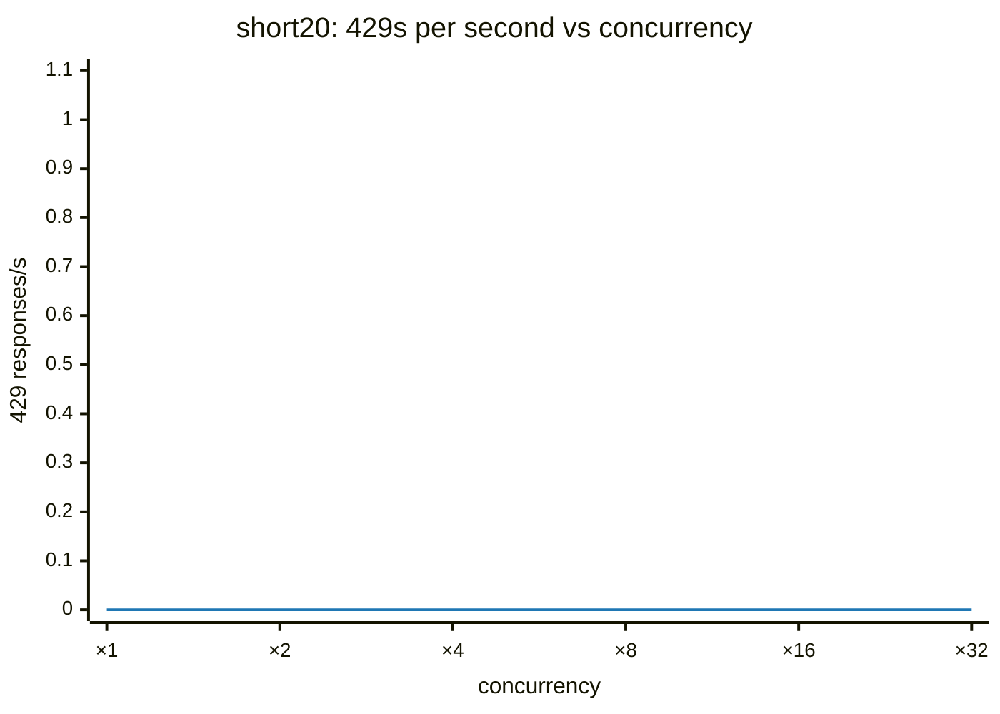

## meticulous — 2026-11-17 14:38 UTC

**PASS** · 1273 s · 809 requests · 0 (0.0%) errors · 0 rate-limited · 9,266,630 tokens billed

Sequential requests (one in flight) unless stated; every query carries a nonce so nothing is served from the API's prefix cache.

### Single document: latency vs length

| rung | Qwen tokens | billed | errors | p50 s | p90 s | max s | API tok/s |
|---|---|---|---|---|---|---|---|
| 256 | 229 | 324 | 0 (0.0%) | 0.074 | 0.077 | 0.097 | 4,345 |
| 512 | 457 | 551 | 0 (0.0%) | 0.102 | 0.114 | 0.115 | 5,275 |
| 1,024 | 911 | 1,005 | 0 (0.0%) | 0.180 | 0.182 | 0.183 | 5,590 |
| 2,048 | 1,872 | 1,966 | 0 (0.0%) | 0.359 | 0.363 | 0.363 | 5,510 |
| 4,096 | 3,707 | 3,800 | 0 (0.0%) | 0.719 | 0.722 | 0.729 | 5,277 |
| 8,192 | 7,545 | 7,640 | 0 (0.0%) | 1.499 | 1.502 | 1.506 | 5,104 |
| 16,384 | 15,274 | 15,369 | 0 (0.0%) | 3.447 | 3.454 | 3.457 | 4,458 |
| 32,768 | 25,438 | 25,536 | 0 (0.0%) | 6.690 | 6.700 | 6.754 | 3,816 |

*Single document: latency vs length: p50, p90*

*Single document: throughput vs length: API tokens/s ÷ 1000*

### ~30K tokens per request: latency vs document length (fewer, longer documents)

| rung | docs/request | billed | errors | p50 s | p90 s | max s | API tok/s |
|---|---|---|---|---|---|---|---|
| 256 | 100 | 32,406 | 0 (0.0%) | 2.880 | 2.898 | 2.921 | 11,244 |
| 512 | 55 | 30,286 | 0 (0.0%) | 2.663 | 2.811 | 2.967 | 11,310 |
| 1,024 | 28 | 28,176 | 0 (0.0%) | 2.809 | 3.064 | 3.152 | 10,134 |
| 2,048 | 13 | 25,573 | 0 (0.0%) | 2.647 | 2.973 | 3.191 | 9,819 |
| 4,096 | 6 | 22,808 | 0 (0.0%) | 2.851 | 3.170 | 3.368 | 8,150 |
| 8,192 | 3 | 22,923 | 0 (0.0%) | 3.225 | 3.782 | 4.197 | 7,297 |
| 16,384 | 1 | 15,367 | 0 (0.0%) | 3.455 | 3.463 | 3.464 | 4,448 |
| 32,768 | 1 | 25,541 | 0 (0.0%) | 6.691 | 6.698 | 6.764 | 3,816 |

*~30K tokens: latency vs document length: p50, p90*

### Latency vs number of documents

| documents | billed | errors | p50 s | p90 s | max s | MRR |
|---|---|---|---|---|---|---|
| 1 tiny | 91.0 | 0 (0.0%) | 0.046 | 0.048 | 0.050 | 1.000 |
| 10 tiny | 921 | 0 (0.0%) | 0.105 | 0.115 | 0.118 | 1.000 |
| 100 tiny | 9,299 | 0 (0.0%) | 0.604 | 0.632 | 0.633 | 1.000 |
| 1000 tiny | 94,489 | 0 (0.0%) | 6.099 | 6.230 | 6.234 | 1.000 |
| 1×256 | 323 | 0 (0.0%) | 0.075 | 0.076 | 0.076 | 1.000 |
| 10×256 | 3,231 | 0 (0.0%) | 0.372 | 0.397 | 0.428 | 1.000 |
| 50×256 | 16,140 | 0 (0.0%) | 1.480 | 1.596 | 1.627 | 1.000 |
| 100×256 | 32,259 | 0 (0.0%) | 2.891 | 2.912 | 2.921 | 1.000 |

*Latency vs number of documents: p50, p90*

### Cold vs cached: the same single-document request sent twice in a row

The API caches prompt prefixes, so a repeated (query, document) pair skips most of the compute. Cold = fresh nonce in the query; cached = the identical request again immediately after.

| rung | pairs | cold p50 s | cached p50 s | speed-up × | cold max s | cached max s | errors |
|---|---|---|---|---|---|---|---|
| 256 | 10 | 0.070 | 0.049 | 1.426 | 0.092 | 0.051 |  |
| 512 | 10 | 0.099 | 0.051 | 1.966 | 0.113 | 0.051 |  |
| 1,024 | 10 | 0.175 | 0.053 | 3.318 | 0.179 | 0.054 |  |
| 2,048 | 10 | 0.354 | 0.059 | 6.035 | 0.361 | 0.060 |  |
| 4,096 | 10 | 0.710 | 0.070 | 10.2 | 0.725 | 0.071 |  |
| 8,192 | 10 | 1.477 | 0.083 | 17.7 | 1.498 | 0.084 |  |
| 16,384 | 10 | 3.445 | 0.114 | 30.2 | 3.450 | 0.117 |  |
| 32,768 | 10 | 6.683 | 0.155 | 43.0 | 6.755 | 0.157 |  |

*Cold vs cached latency vs document length: cold p50, cached p50*

### short20: latency and throughput vs concurrency

|  | requests | errors | 429s | p50 s | p90 s | p99 s | max s | req/s | API tok/s | MRR |
|---|---|---|---|---|---|---|---|---|---|---|
| ×1 | 24 | 0 (0.0%) | 0 | 0.961 | 1.358 | 1.823 | 1.859 | 0.958 | 8,375 | 0.695 |
| ×2 | 26 | 0 (0.0%) | 0 | 1.963 | 2.610 | 3.368 | 3.495 | 0.999 | 8,756 | 0.699 |
| ×4 | 28 | 0 (0.0%) | 0 | 4.310 | 5.039 | 5.754 | 5.759 | 0.994 | 8,637 | 0.717 |
| ×8 | 33 | 0 (0.0%) | 0 | 7.750 | 9.159 | 9.650 | 9.873 | 1.006 | 9,089 | 0.732 |
| ×16 | 41 | 0 (0.0%) | 0 | 15.8 | 17.1 | 17.5 | 17.8 | 1.003 | 8,732 | 0.744 |
| ×32 | 57 | 0 (0.0%) | 0 | 28.5 | 32.8 | 33.3 | 33.3 | 1.010 | 8,990 | 0.729 |

No 429s up to concurrency ×32.

*short20: latency vs concurrency: p50, p90*

*short20: throughput vs concurrency: req/s, API tokens/s ÷ 1000*

*short20: 429s per second vs concurrency: 429/s*

809 requests, 9,266,630 tokens billed.
