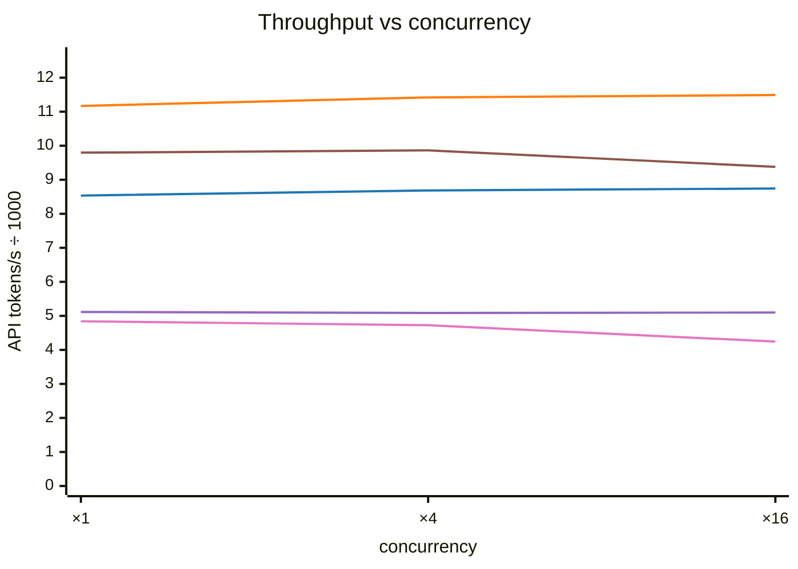
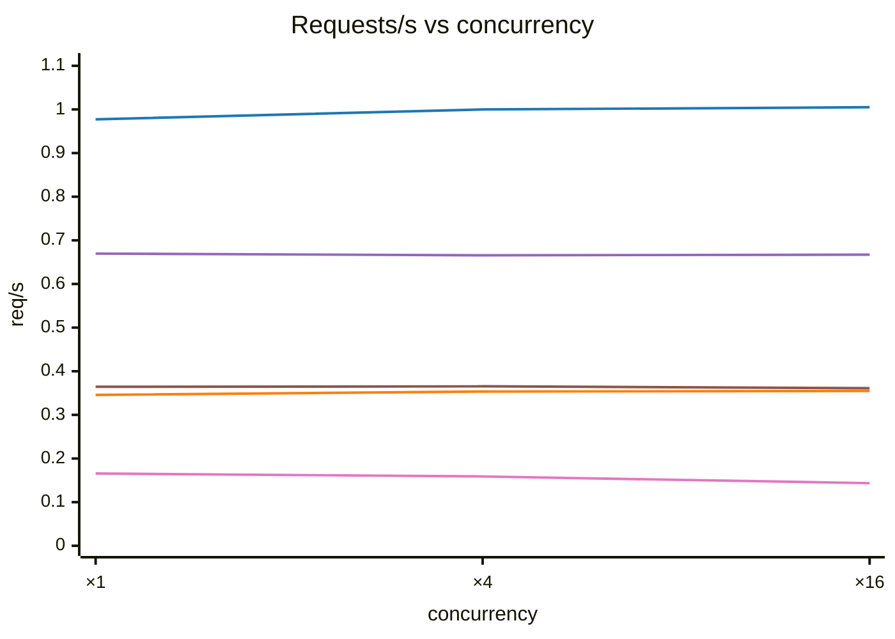
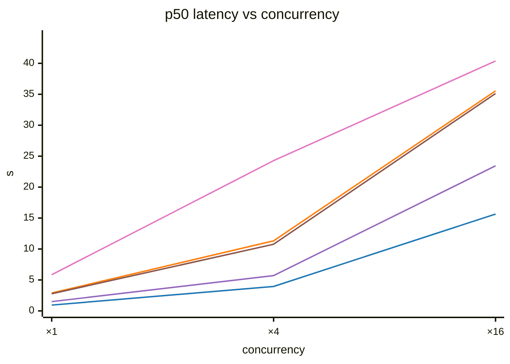

## speed — 2026-11-17 14:59 UTC

**PASS** · 650 s · 288 requests · 8 (2.8%) errors · 0 rate-limited · 4,782,868 tokens billed

Closed loop, 25 s per cell, 5 request classes × concurrency [1, 4, 16]. 288 requests, 4,782,868 tokens billed.

|  | requests | errors | 429s | p50 s | p90 s | p99 s | max s | req/s | API tok/s | MRR |
|---|---|---|---|---|---|---|---|---|---|---|
| short20 ×1 | 25 | 0 (0.0%) | 0 | 0.940 | 1.337 | 1.808 | 1.848 | 0.977 | 8,536 | 0.683 |
| short20 ×4 | 28 | 0 (0.0%) | 0 | 3.949 | 5.033 | 5.039 | 5.039 | 1.000 | 8,685 | 0.714 |
| short20 ×16 | 41 | 0 (0.0%) | 0 | 15.7 | 17.2 | 17.2 | 17.2 | 1.005 | 8,743 | 0.744 |
| many100 ×1 | 9 | 0 (0.0%) | 0 | 2.888 | 2.930 | 2.955 | 2.957 | 0.346 | 11,167 | 1.000 |
| many100 ×4 | 12 | 0 (0.0%) | 0 | 11.3 | 11.4 | 11.5 | 11.5 | 0.353 | 11,416 | 1.000 |
| many100 ×16 | 24 | 0 (0.0%) | 0 | 35.6 | 45.5 | 45.5 | 45.6 | 0.355 | 11,486 | 1.000 |
| long8k ×1 | 17 | 0 (0.0%) | 0 | 1.498 | 1.501 | 1.514 | 1.516 | 0.670 | 5,116 | 1.000 |
| long8k ×4 | 20 | 0 (0.0%) | 0 | 5.707 | 6.453 | 6.454 | 6.454 | 0.666 | 5,086 | 1.000 |
| long8k ×16 | 32 | 0 (0.0%) | 0 | 23.4 | 24.2 | 24.3 | 24.3 | 0.667 | 5,098 | 1.000 |
| pack32k ×1 | 10 | 0 (0.0%) | 0 | 2.770 | 2.923 | 3.254 | 3.291 | 0.364 | 9,796 | 1.000 |
| pack32k ×4 | 13 | 0 (0.0%) | 0 | 10.8 | 11.4 | 11.6 | 11.6 | 0.365 | 9,863 | 1.000 |
| pack32k ×16 | 24 | 0 (0.0%) | 0 | 35.1 | 45.2 | 45.9 | 46.0 | 0.361 | 9,380 | 1.000 |
| long32k ×1 | 5 | 0 (0.0%) | 0 | 5.841 | 6.474 | 6.637 | 6.655 | 0.166 | 4,841 | 1.000 |
| long32k ×4 | 8 | 0 (0.0%) | 0 | 24.3 | 25.4 | 26.0 | 26.1 | 0.159 | 4,725 | 1.000 |
| long32k ×16 | 20 | 8 (40.0%) | 0 | 40.4 | 59.5 | 60.0 | 60.0 | 0.144 | 4,244 | 1.000 |

| error | count | example | response |
|---|---|---|---|
| http 424 ModelError timed out at SageMaker | 8 | natural-2wikimqa natural-2wikimqa/query_53 | {"ErrorCode":"INTERNAL_FAILURE_FROM_MODEL","LogStreamArn":"arn:aws:logs:eu-west-3:<account-id>:log-group:/aws/sagemaker/Endpoints/reranker-mp-mainc-8b-2","Message":"Received server error (0) from primary with message \"Your invocation timed out while waiting for a response from container primary. Re |

*Throughput vs concurrency: short20, many100, long8k, pack32k, long32k*

*Requests/s vs concurrency: short20, many100, long8k, pack32k, long32k*

*p50 latency vs concurrency: short20, many100, long8k, pack32k, long32k*
