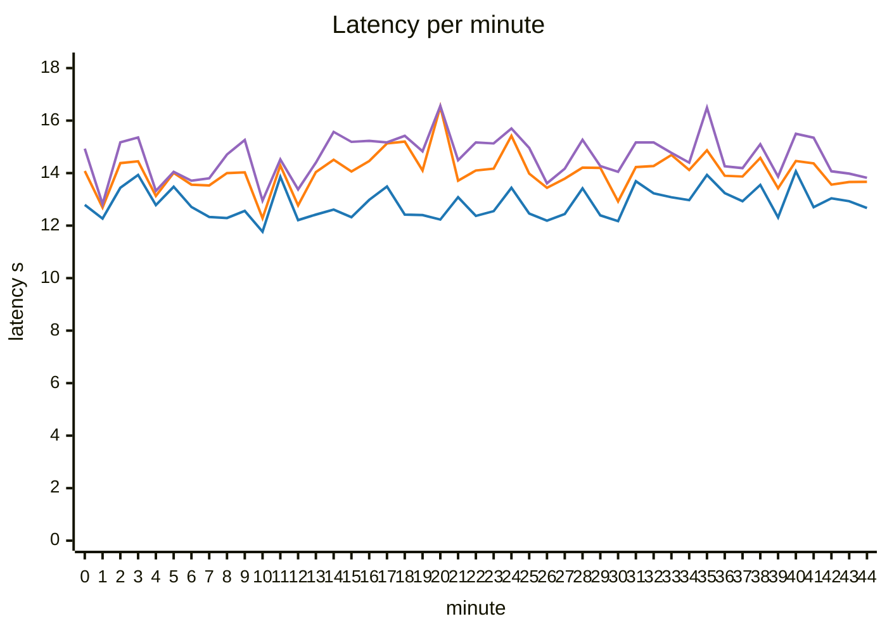
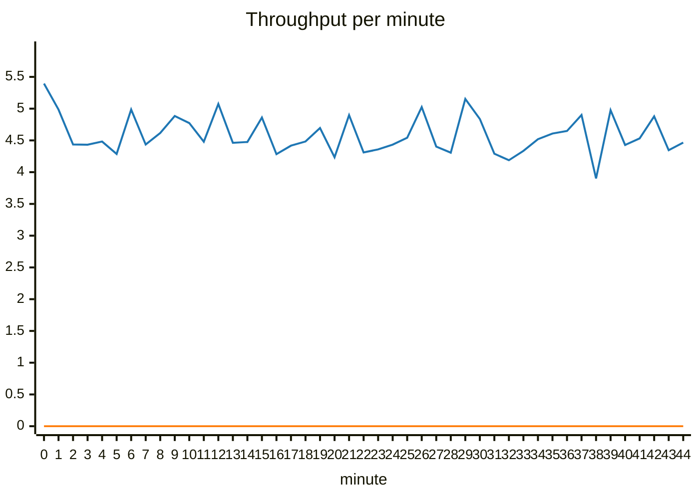

## hammer32k — 2026-11-17 13:57 UTC

**PASS** · 2709 s · 419 requests · 0 (0.0%) errors · 0 rate-limited · 12,387,255 tokens billed

45 min closed loop with 2 concurrent ~32K-token requests (350 distinct). 419 requests, 12,387,255 tokens billed.

|  | requests | errors | 429s | p50 s | p90 s | p99 s | max s | req/s | API tok/s | MRR |
|---|---|---|---|---|---|---|---|---|---|---|
| all | 419 | 0 (0.0%) | 0 | 12.8 | 14.2 | 15.6 | 16.6 | 0.155 | 4,588 | 0.998 |
| min 0–5 | 48 | 0 (0.0%) | 0 | 12.8 | 14.2 | 15.3 | 15.4 | 0.160 | 4,746 | 1.000 |
| min 5–10 | 47 | 0 (0.0%) | 0 | 12.7 | 13.9 | 15.0 | 15.3 | 0.157 | 4,642 | 1.000 |
| min 10–15 | 47 | 0 (0.0%) | 0 | 12.3 | 14.1 | 15.1 | 15.6 | 0.157 | 4,652 | 1.000 |
| min 15–20 | 46 | 0 (0.0%) | 0 | 12.7 | 15.1 | 15.3 | 15.4 | 0.153 | 4,547 | 1.000 |
| min 20–25 | 46 | 0 (0.0%) | 0 | 13.0 | 15.2 | 16.5 | 16.6 | 0.153 | 4,447 | 0.986 |
| min 25–30 | 47 | 0 (0.0%) | 0 | 12.4 | 14.1 | 15.1 | 15.3 | 0.157 | 4,686 | 1.000 |
| min 30–35 | 46 | 0 (0.0%) | 0 | 12.9 | 14.2 | 15.2 | 15.2 | 0.153 | 4,434 | 1.000 |
| min 35–40 | 46 | 0 (0.0%) | 0 | 13.1 | 14.4 | 15.9 | 16.5 | 0.153 | 4,607 | 1.000 |
| min 40–45 | 46 | 0 (0.0%) | 0 | 12.9 | 14.1 | 15.4 | 15.5 | 0.153 | 4,530 | 1.000 |

*Latency per minute: p50, p90, max*

*Throughput per minute: API tokens/s ÷ 1000, errors*
