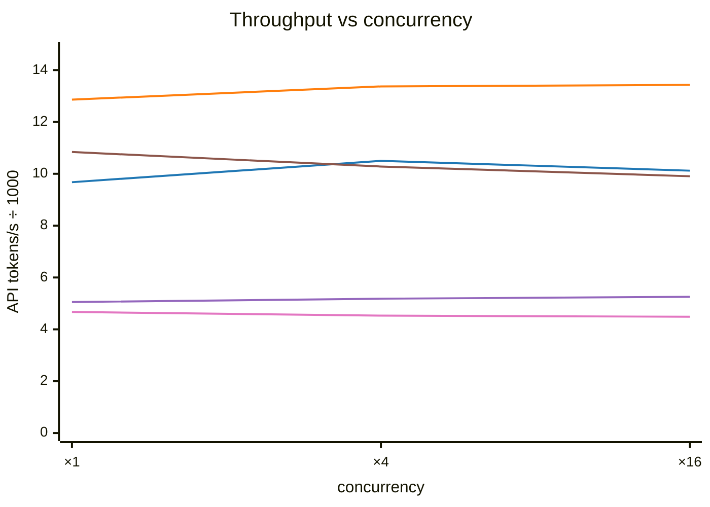
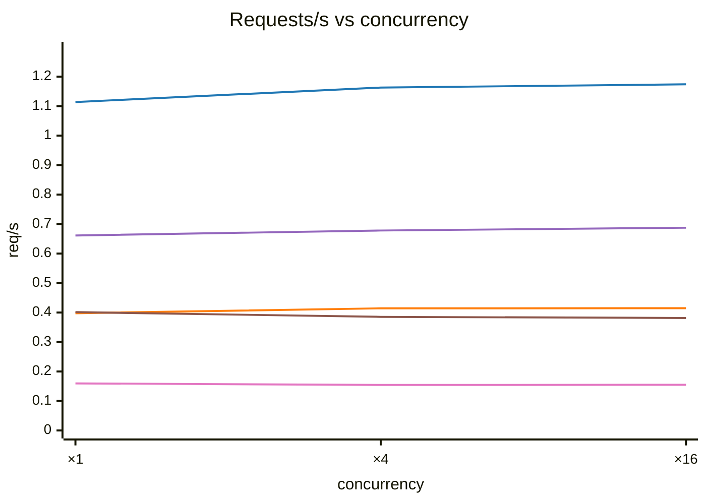
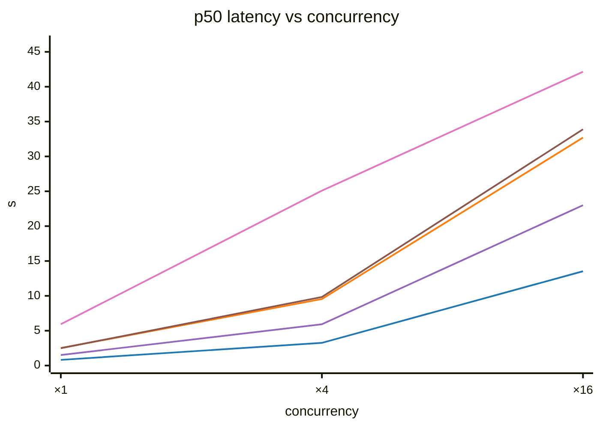

## speed — 2026-11-17 13:43 UTC

**PASS** · 625 s · 306 requests · 7 (2.3%) errors · 0 rate-limited · 5,069,908 tokens billed

Closed loop, 25 s per cell, 5 request classes × concurrency [1, 4, 16]. 306 requests, 5,069,908 tokens billed.

|  | requests | errors | 429s | p50 s | p90 s | p99 s | max s | req/s | API tok/s | MRR |
|---|---|---|---|---|---|---|---|---|---|---|
| short20 ×1 | 28 | 0 (0.0%) | 0 | 0.814 | 1.247 | 1.583 | 1.615 | 1.114 | 9,675 | 0.674 |
| short20 ×4 | 33 | 0 (0.0%) | 0 | 3.256 | 4.159 | 4.479 | 4.485 | 1.163 | 10,504 | 0.668 |
| short20 ×16 | 44 | 0 (0.0%) | 0 | 13.5 | 14.4 | 15.2 | 15.3 | 1.174 | 10,117 | 0.713 |
| many100 ×1 | 10 | 0 (0.0%) | 0 | 2.513 | 2.550 | 2.562 | 2.564 | 0.398 | 12,858 | 1.000 |
| many100 ×4 | 14 | 0 (0.0%) | 0 | 9.540 | 9.895 | 10.0 | 10.0 | 0.414 | 13,370 | 1.000 |
| many100 ×16 | 26 | 0 (0.0%) | 0 | 32.7 | 38.6 | 38.7 | 38.8 | 0.415 | 13,429 | 0.981 |
| long8k ×1 | 17 | 0 (0.0%) | 0 | 1.513 | 1.522 | 1.527 | 1.528 | 0.661 | 5,054 | 1.000 |
| long8k ×4 | 21 | 0 (0.0%) | 0 | 5.927 | 5.983 | 6.018 | 6.024 | 0.678 | 5,182 | 1.000 |
| long8k ×16 | 33 | 0 (0.0%) | 0 | 23.0 | 23.3 | 23.6 | 23.6 | 0.688 | 5,254 | 1.000 |
| pack32k ×1 | 11 | 0 (0.0%) | 0 | 2.490 | 2.686 | 3.191 | 3.247 | 0.401 | 10,840 | 1.000 |
| pack32k ×4 | 14 | 0 (0.0%) | 0 | 9.831 | 10.9 | 11.6 | 11.7 | 0.385 | 10,283 | 1.000 |
| pack32k ×16 | 25 | 0 (0.0%) | 0 | 33.9 | 43.1 | 43.7 | 43.9 | 0.381 | 9,905 | 1.000 |
| long32k ×1 | 4 | 0 (0.0%) | 0 | 5.926 | 7.094 | 7.464 | 7.505 | 0.160 | 4,671 | 1.000 |
| long32k ×4 | 7 | 0 (0.0%) | 0 | 25.1 | 26.2 | 26.4 | 26.4 | 0.154 | 4,530 | 1.000 |
| long32k ×16 | 19 | 7 (36.8%) | 0 | 42.2 | 59.1 | 59.4 | 59.4 | 0.155 | 4,485 | 1.000 |

| error | count | example | response |
|---|---|---|---|
| http 424 ModelError timed out at SageMaker | 7 | natural-qmsum natural-qmsum/query_38 | {"ErrorCode":"INTERNAL_FAILURE_FROM_MODEL","LogStreamArn":"arn:aws:logs:eu-west-3:<account-id>:log-group:/aws/sagemaker/Endpoints/reranker-aws031-4b-bf16-L2","Message":"Received server error (0) from primary with message \"Your invocation timed out while waiting for a response from container primary |

*Throughput vs concurrency: short20, many100, long8k, pack32k, long32k*

*Requests/s vs concurrency: short20, many100, long8k, pack32k, long32k*

*p50 latency vs concurrency: short20, many100, long8k, pack32k, long32k*
