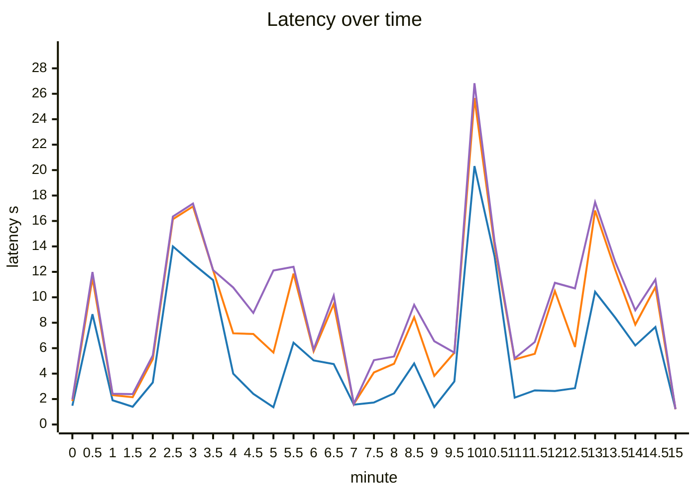
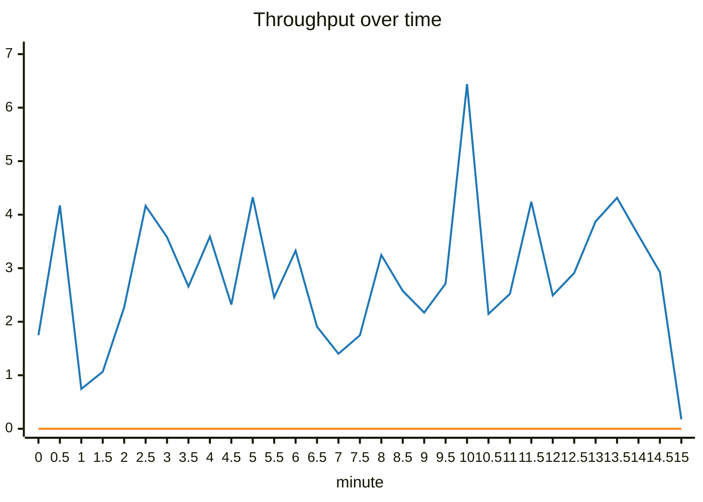

## normal — 2026-11-17 14:14 UTC

**PASS** · 918 s · 216 requests · 0 (0.0%) errors · 0 rate-limited · 2,635,041 tokens billed

15 min of Poisson traffic at 0.25 req/s; mix short20 60%, many100 10%, mid1k 10%, mid4k 10%, long8k 5%, long32k 5%. Billed 2,635,041 tokens.

|  | requests | errors | 429s | p50 s | p90 s | p99 s | max s | req/s | API tok/s | MRR |
|---|---|---|---|---|---|---|---|---|---|---|
| all | 216 | 0 (0.0%) | 0 | 4.632 | 13.7 | 22.4 | 26.8 | 0.240 | 2,928 | 0.832 |
| short20 | 119 | 0 (0.0%) | 0 | 2.887 | 12.9 | 21.0 | 22.1 | 0.132 | 1,159 | 0.703 |
| many100 | 26 | 0 (0.0%) | 0 | 5.104 | 12.7 | 25.1 | 26.0 | 0.029 | 936 | 0.962 |
| mid1k | 16 | 0 (0.0%) | 0 | 2.449 | 8.393 | 14.0 | 14.6 | 0.018 | 17.9 | 1.000 |
| mid4k | 22 | 0 (0.0%) | 0 | 1.415 | 11.7 | 23.8 | 26.8 | 0.024 | 93.0 | 1.000 |
| long8k | 15 | 0 (0.0%) | 0 | 3.902 | 13.7 | 19.8 | 20.7 | 0.017 | 127 | 1.000 |
| long32k | 18 | 0 (0.0%) | 0 | 11.0 | 16.8 | 19.4 | 19.9 | 0.020 | 596 | 1.000 |

*Latency over time: p50, p90, max*

*Throughput over time: API tokens/s ÷ 1000, errors*
