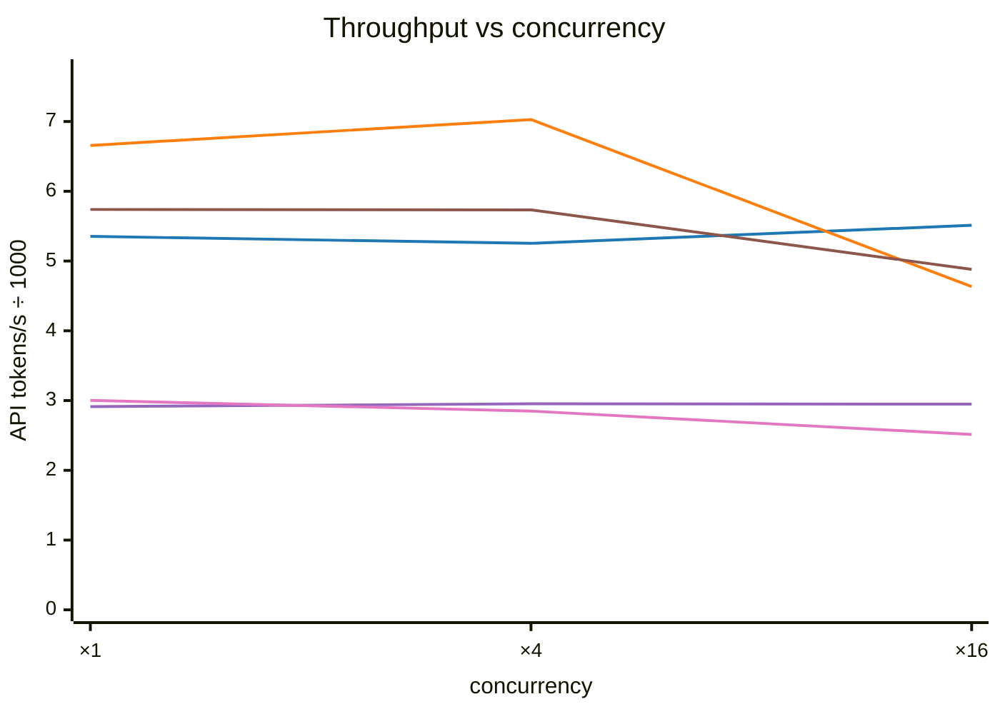
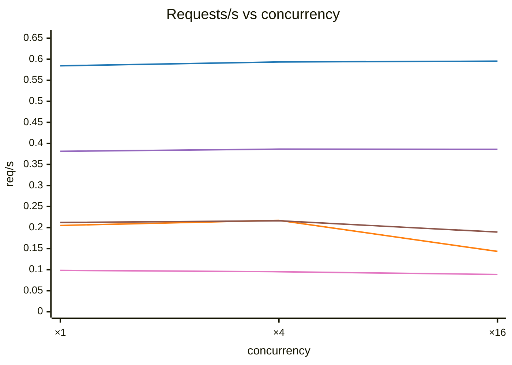
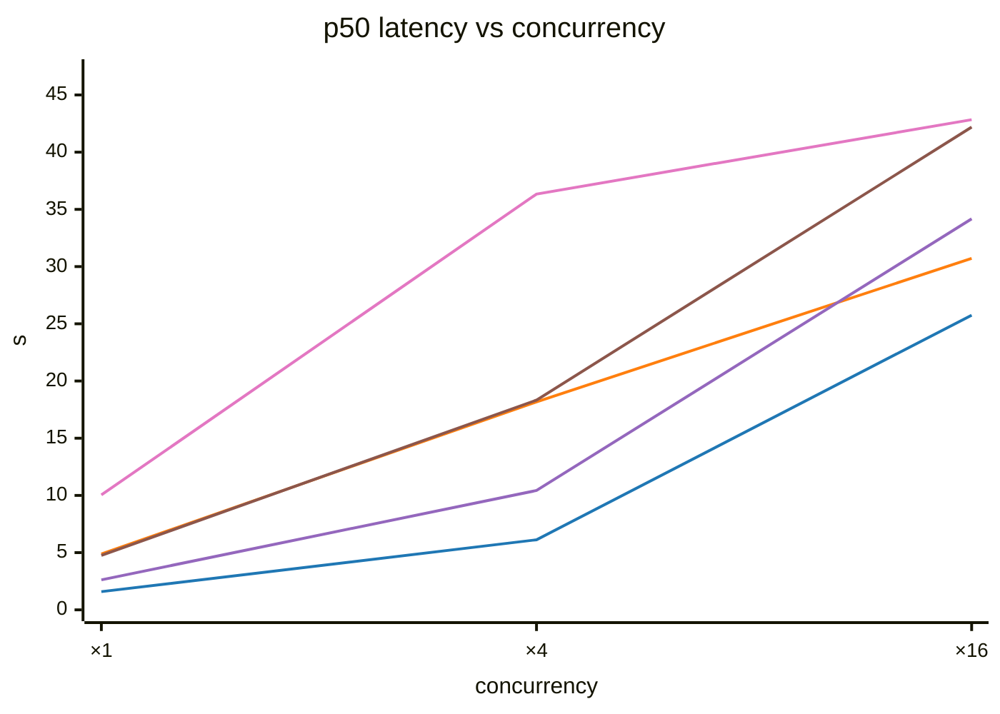

## speed — 2026-11-17 14:29 UTC

**FAIL** · 745 s · 211 requests · 25 (11.8%) errors · 0 rate-limited · 3,107,230 tokens billed

Closed loop, 25 s per cell, 5 request classes × concurrency [1, 4, 16]. 211 requests, 3,107,230 tokens billed.

|  | requests | errors | 429s | p50 s | p90 s | p99 s | max s | req/s | API tok/s | MRR |
|---|---|---|---|---|---|---|---|---|---|---|
| short20 ×1 | 15 | 0 (0.0%) | 0 | 1.592 | 2.214 | 3.000 | 3.122 | 0.584 | 5,353 | 0.686 |
| short20 ×4 | 19 | 0 (0.0%) | 0 | 6.122 | 8.550 | 8.573 | 8.575 | 0.593 | 5,254 | 0.684 |
| short20 ×16 | 30 | 0 (0.0%) | 0 | 25.8 | 27.8 | 28.2 | 28.4 | 0.595 | 5,512 | 0.697 |
| many100 ×1 | 6 | 0 (0.0%) | 0 | 4.881 | 4.894 | 4.899 | 4.900 | 0.205 | 6,656 | 1.000 |
| many100 ×4 | 9 | 0 (0.0%) | 0 | 18.2 | 18.6 | 18.8 | 18.8 | 0.217 | 7,028 | 1.000 |
| many100 ×16 | 21 | 9 (42.9%) | 0 | 30.7 | 51.7 | 56.2 | 56.6 | 0.143 | 4,634 | 1.000 |
| long8k ×1 | 10 | 0 (0.0%) | 0 | 2.620 | 2.637 | 2.638 | 2.639 | 0.381 | 2,914 | 1.000 |
| long8k ×4 | 13 | 0 (0.0%) | 0 | 10.4 | 10.5 | 10.5 | 10.5 | 0.386 | 2,953 | 1.000 |
| long8k ×16 | 25 | 0 (0.0%) | 0 | 34.2 | 41.7 | 42.0 | 42.0 | 0.386 | 2,949 | 1.000 |
| pack32k ×1 | 6 | 0 (0.0%) | 0 | 4.752 | 5.376 | 5.647 | 5.677 | 0.212 | 5,739 | 1.000 |
| pack32k ×4 | 9 | 0 (0.0%) | 0 | 18.3 | 18.9 | 19.9 | 20.1 | 0.216 | 5,733 | 1.000 |
| pack32k ×16 | 21 | 5 (23.8%) | 0 | 42.2 | 58.8 | 59.3 | 59.4 | 0.189 | 4,881 | 1.000 |
| long32k ×1 | 3 | 0 (0.0%) | 0 | 10.0 | 10.5 | 10.6 | 10.6 | 0.098 | 3,003 | 1.000 |
| long32k ×4 | 6 | 0 (0.0%) | 0 | 36.3 | 42.2 | 42.5 | 42.6 | 0.095 | 2,849 | 1.000 |
| long32k ×16 | 18 | 11 (61.1%) | 0 | 42.8 | 58.0 | 58.4 | 58.4 | 0.089 | 2,514 | 1.000 |

| error | count | example | response |
|---|---|---|---|
| http 424 ModelError timed out at SageMaker | 25 | ladder-256 ladder-256/ctx256_query18 | {"ErrorCode":"INTERNAL_FAILURE_FROM_MODEL","LogStreamArn":"arn:aws:logs:eu-west-3:<account-id>:log-group:/aws/sagemaker/Endpoints/reranker-aws031-8b-bf16-L2","Message":"Received server error (0) from primary with message \"Your invocation timed out while waiting for a response from container primary |

*Throughput vs concurrency: short20, many100, long8k, pack32k, long32k*

*Requests/s vs concurrency: short20, many100, long8k, pack32k, long32k*

*p50 latency vs concurrency: short20, many100, long8k, pack32k, long32k*
