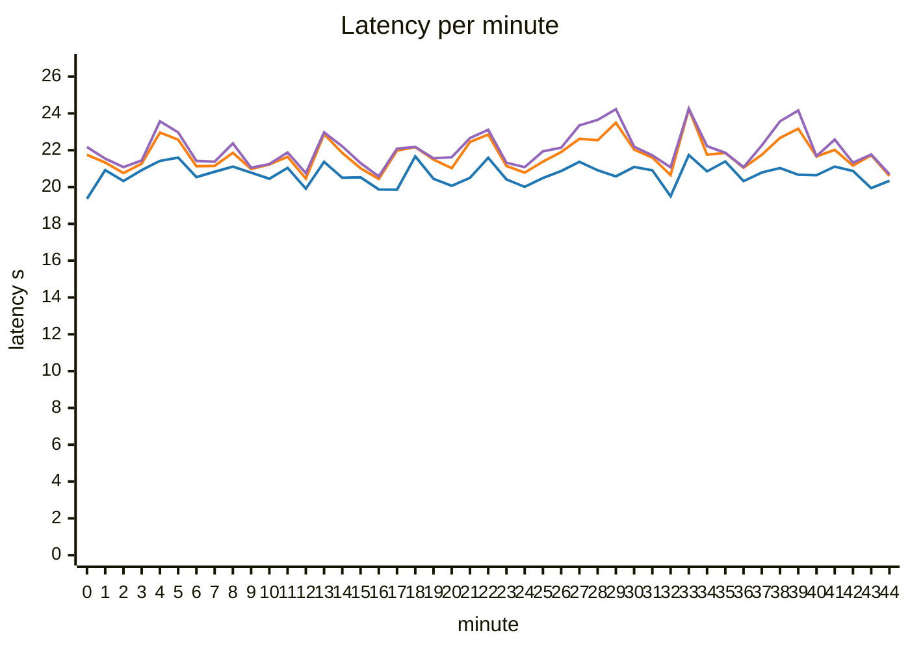
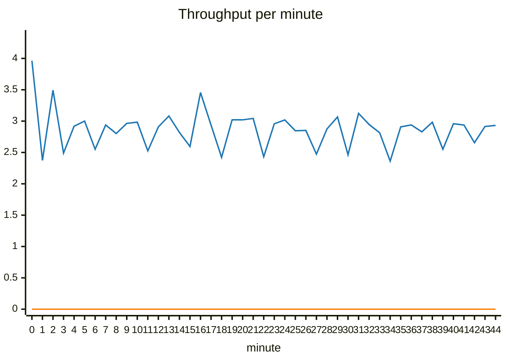

## hammer32k — 2026-11-17 15:26 UTC

**PASS** · 2713 s · 262 requests · 0 (0.0%) errors · 0 rate-limited · 7,748,515 tokens billed

45 min closed loop with 2 concurrent ~32K-token requests (350 distinct). 262 requests, 7,748,515 tokens billed.

|  | requests | errors | 429s | p50 s | p90 s | p99 s | max s | req/s | API tok/s | MRR |
|---|---|---|---|---|---|---|---|---|---|---|
| all | 262 | 0 (0.0%) | 0 | 20.6 | 22.2 | 24.2 | 24.2 | 0.097 | 2,870 | 0.996 |
| min 0–5 | 31 | 0 (0.0%) | 0 | 20.3 | 21.6 | 23.2 | 23.6 | 0.103 | 3,048 | 1.000 |
| min 5–10 | 29 | 0 (0.0%) | 0 | 20.8 | 21.8 | 22.8 | 23.0 | 0.097 | 2,851 | 1.000 |
| min 10–15 | 29 | 0 (0.0%) | 0 | 20.7 | 21.9 | 22.9 | 23.0 | 0.097 | 2,863 | 1.000 |
| min 15–20 | 29 | 0 (0.0%) | 0 | 20.4 | 21.9 | 22.2 | 22.2 | 0.097 | 2,886 | 0.983 |
| min 20–25 | 29 | 0 (0.0%) | 0 | 20.4 | 22.3 | 23.0 | 23.1 | 0.097 | 2,894 | 1.000 |
| min 25–30 | 29 | 0 (0.0%) | 0 | 20.8 | 22.9 | 24.1 | 24.2 | 0.097 | 2,822 | 1.000 |
| min 30–35 | 28 | 0 (0.0%) | 0 | 20.6 | 22.2 | 24.2 | 24.2 | 0.093 | 2,742 | 0.982 |
| min 35–40 | 29 | 0 (0.0%) | 0 | 20.7 | 21.9 | 24.0 | 24.2 | 0.097 | 2,842 | 1.000 |
| min 40–45 | 29 | 0 (0.0%) | 0 | 20.6 | 21.7 | 22.4 | 22.6 | 0.097 | 2,879 | 1.000 |

*Latency per minute: p50, p90, max*

*Throughput per minute: API tokens/s ÷ 1000, errors*
