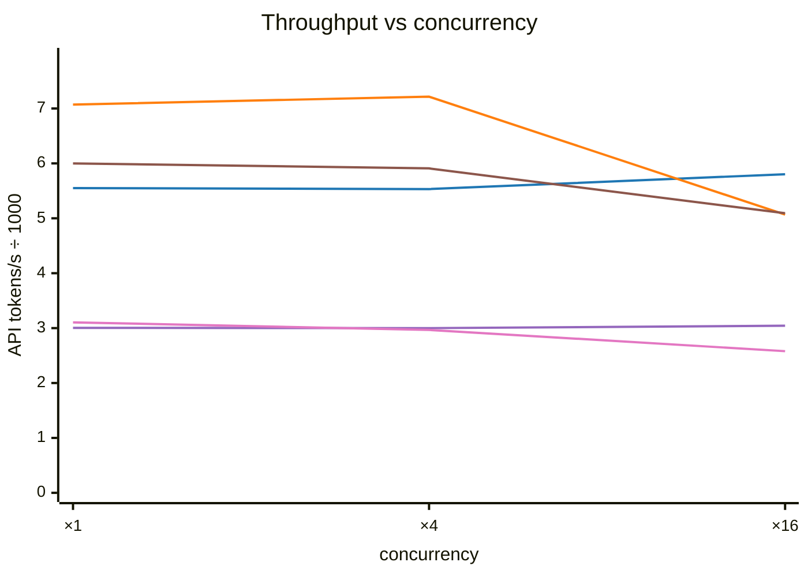
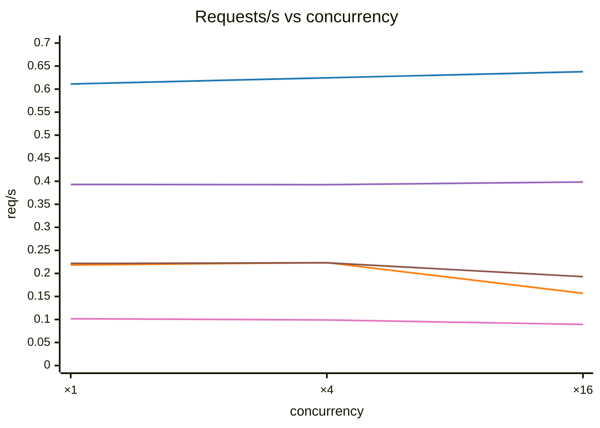
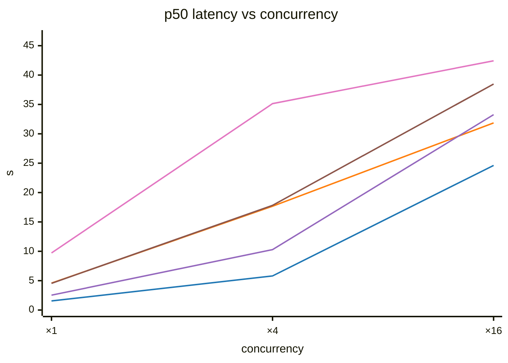

## speed — 2026-11-17 15:10 UTC

**FAIL** · 727 s · 213 requests · 24 (11.3%) errors · 0 rate-limited · 3,164,387 tokens billed

Closed loop, 25 s per cell, 5 request classes × concurrency [1, 4, 16]. 213 requests, 3,164,387 tokens billed.

|  | requests | errors | 429s | p50 s | p90 s | p99 s | max s | req/s | API tok/s | MRR |
|---|---|---|---|---|---|---|---|---|---|---|
| short20 ×1 | 16 | 0 (0.0%) | 0 | 1.551 | 2.102 | 2.834 | 2.951 | 0.611 | 5,550 | 0.646 |
| short20 ×4 | 19 | 0 (0.0%) | 0 | 5.806 | 8.087 | 8.120 | 8.123 | 0.625 | 5,532 | 0.684 |
| short20 ×16 | 31 | 0 (0.0%) | 0 | 24.6 | 26.0 | 26.5 | 26.5 | 0.638 | 5,803 | 0.710 |
| many100 ×1 | 6 | 0 (0.0%) | 0 | 4.582 | 4.621 | 4.630 | 4.631 | 0.218 | 7,072 | 1.000 |
| many100 ×4 | 9 | 0 (0.0%) | 0 | 17.7 | 18.4 | 18.5 | 18.6 | 0.223 | 7,215 | 1.000 |
| many100 ×16 | 21 | 8 (38.1%) | 0 | 31.9 | 53.6 | 58.2 | 58.7 | 0.157 | 5,068 | 1.000 |
| long8k ×1 | 10 | 0 (0.0%) | 0 | 2.534 | 2.580 | 2.580 | 2.580 | 0.393 | 3,005 | 1.000 |
| long8k ×4 | 13 | 0 (0.0%) | 0 | 10.3 | 10.3 | 10.3 | 10.3 | 0.393 | 3,000 | 1.000 |
| long8k ×16 | 25 | 0 (0.0%) | 0 | 33.3 | 40.3 | 40.6 | 40.7 | 0.398 | 3,043 | 1.000 |
| pack32k ×1 | 6 | 0 (0.0%) | 0 | 4.542 | 5.140 | 5.457 | 5.492 | 0.222 | 6,000 | 1.000 |
| pack32k ×4 | 9 | 0 (0.0%) | 0 | 17.8 | 19.4 | 19.5 | 19.5 | 0.223 | 5,909 | 1.000 |
| pack32k ×16 | 21 | 5 (23.8%) | 0 | 38.5 | 59.0 | 59.6 | 59.7 | 0.193 | 5,092 | 1.000 |
| long32k ×1 | 3 | 0 (0.0%) | 0 | 9.718 | 10.2 | 10.3 | 10.3 | 0.102 | 3,105 | 1.000 |
| long32k ×4 | 6 | 0 (0.0%) | 0 | 35.1 | 40.7 | 41.1 | 41.1 | 0.099 | 2,967 | 1.000 |
| long32k ×16 | 18 | 11 (61.1%) | 0 | 42.4 | 56.9 | 58.1 | 58.2 | 0.089 | 2,580 | 1.000 |

| error | count | example | response |
|---|---|---|---|
| http 424 ModelError timed out at SageMaker | 24 | ladder-256 ladder-256/ctx256_query83 | {"ErrorCode":"INTERNAL_FAILURE_FROM_MODEL","LogStreamArn":"arn:aws:logs:eu-west-3:<account-id>:log-group:/aws/sagemaker/Endpoints/reranker-aws031-8b-bf16-L3","Message":"Received server error (0) from primary with message \"Your invocation timed out while waiting for a response from container primary |

*Throughput vs concurrency: short20, many100, long8k, pack32k, long32k*

*Requests/s vs concurrency: short20, many100, long8k, pack32k, long32k*

*p50 latency vs concurrency: short20, many100, long8k, pack32k, long32k*
