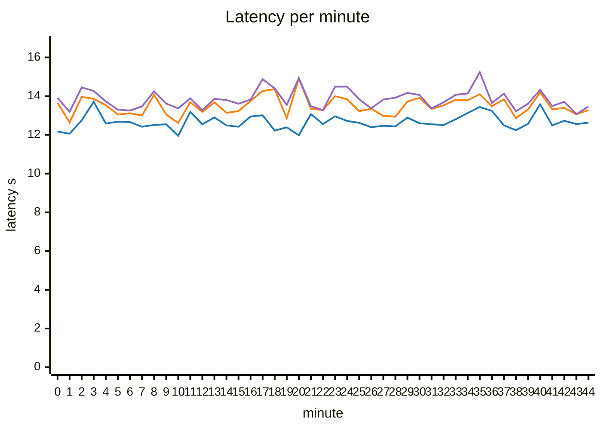
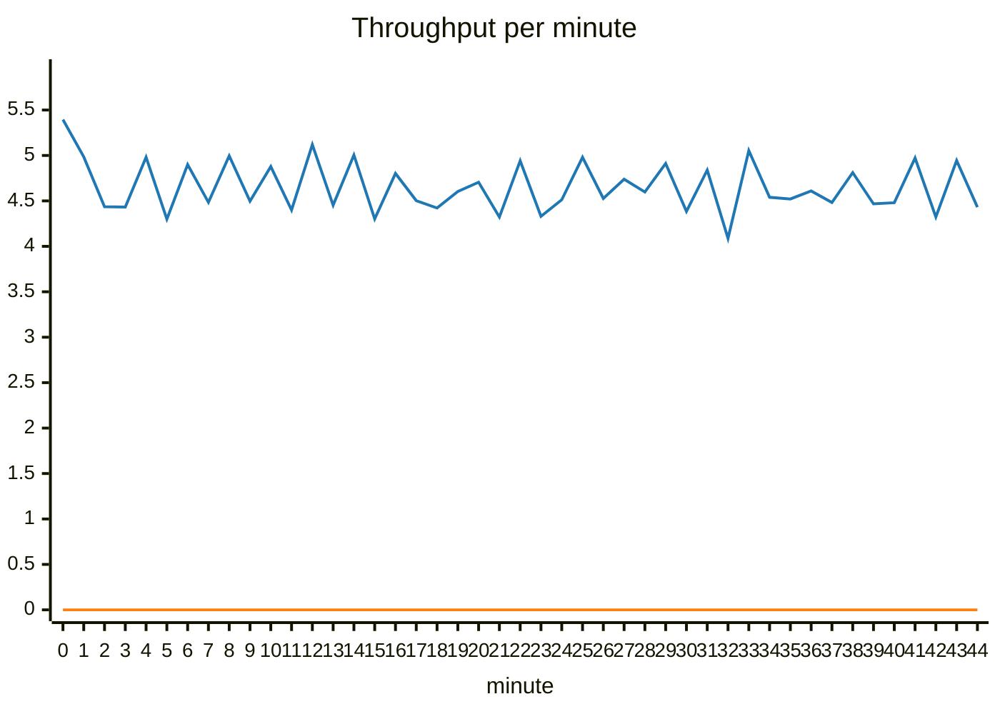

## hammer32k — 2026-11-17 15:36 UTC

**PASS** · 2708 s · 425 requests · 0 (0.0%) errors · 0 rate-limited · 12,564,163 tokens billed

45 min closed loop with 2 concurrent ~32K-token requests (350 distinct). 425 requests, 12,564,163 tokens billed.

|  | requests | errors | 429s | p50 s | p90 s | p99 s | max s | req/s | API tok/s | MRR |
|---|---|---|---|---|---|---|---|---|---|---|
| all | 425 | 0 (0.0%) | 0 | 12.7 | 13.7 | 14.5 | 15.2 | 0.157 | 4,653 | 0.995 |
| min 0–5 | 49 | 0 (0.0%) | 0 | 12.6 | 13.7 | 14.4 | 14.5 | 0.163 | 4,846 | 1.000 |
| min 5–10 | 47 | 0 (0.0%) | 0 | 12.6 | 13.4 | 14.2 | 14.2 | 0.157 | 4,635 | 1.000 |
| min 10–15 | 48 | 0 (0.0%) | 0 | 12.5 | 13.5 | 13.9 | 13.9 | 0.160 | 4,771 | 0.979 |
| min 15–20 | 46 | 0 (0.0%) | 0 | 12.6 | 13.8 | 14.7 | 14.9 | 0.153 | 4,527 | 1.000 |
| min 20–25 | 47 | 0 (0.0%) | 0 | 12.7 | 13.9 | 14.9 | 14.9 | 0.157 | 4,562 | 0.989 |
| min 25–30 | 48 | 0 (0.0%) | 0 | 12.5 | 13.5 | 14.0 | 14.2 | 0.160 | 4,751 | 1.000 |
| min 30–35 | 47 | 0 (0.0%) | 0 | 12.7 | 13.7 | 14.1 | 14.1 | 0.157 | 4,581 | 0.989 |
| min 35–40 | 46 | 0 (0.0%) | 0 | 12.8 | 13.7 | 14.7 | 15.2 | 0.153 | 4,578 | 1.000 |
| min 40–45 | 47 | 0 (0.0%) | 0 | 12.7 | 13.6 | 14.3 | 14.3 | 0.157 | 4,630 | 1.000 |

*Latency per minute: p50, p90, max*

*Throughput per minute: API tokens/s ÷ 1000, errors*
