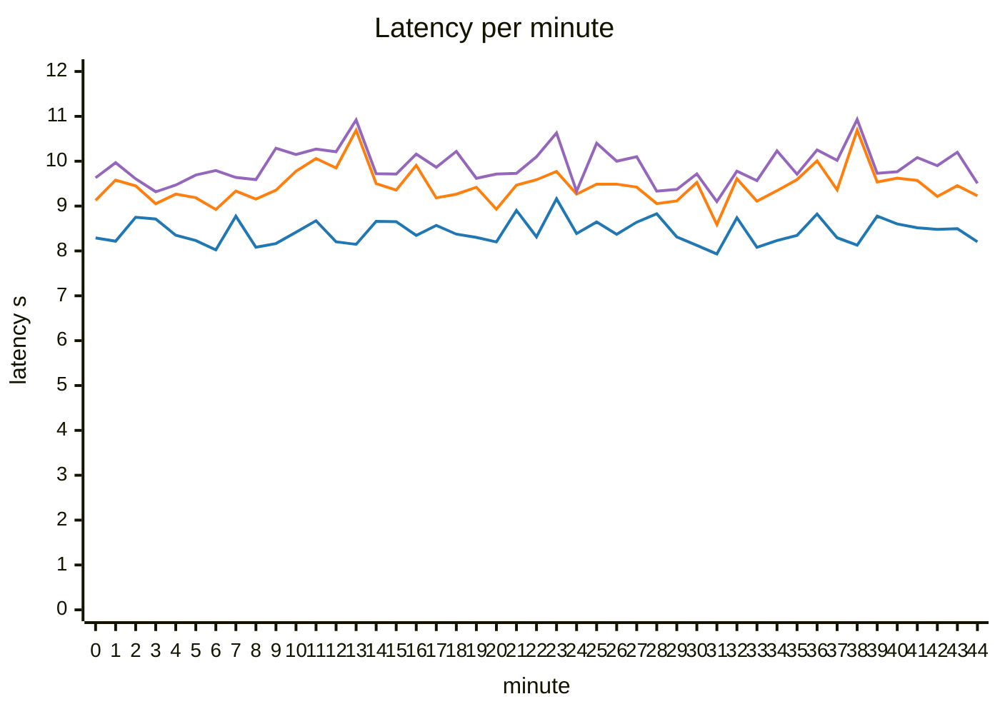
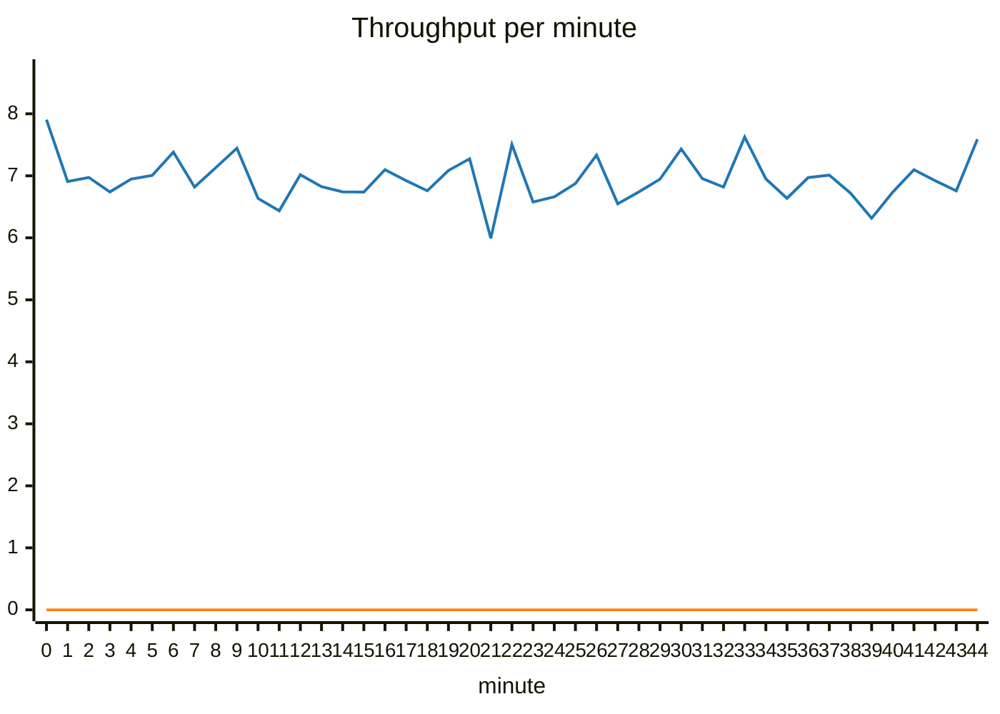

## hammer32k — 2026-11-17 15:52 UTC

**PASS** · 2708 s · 634 requests · 0 (0.0%) errors · 0 rate-limited · 18,750,775 tokens billed

45 min closed loop with 2 concurrent ~32K-token requests (350 distinct). 634 requests, 18,750,775 tokens billed.

|  | requests | errors | 429s | p50 s | p90 s | p99 s | max s | req/s | API tok/s | MRR |
|---|---|---|---|---|---|---|---|---|---|---|
| all | 634 | 0 (0.0%) | 0 | 8.424 | 9.530 | 10.3 | 10.9 | 0.235 | 6,945 | 0.997 |
| min 0–5 | 72 | 0 (0.0%) | 0 | 8.409 | 9.392 | 9.862 | 9.967 | 0.240 | 7,095 | 1.000 |
| min 5–10 | 72 | 0 (0.0%) | 0 | 8.117 | 9.307 | 9.936 | 10.3 | 0.240 | 7,157 | 1.000 |
| min 10–15 | 69 | 0 (0.0%) | 0 | 8.539 | 10.0 | 10.9 | 10.9 | 0.230 | 6,731 | 0.993 |
| min 15–20 | 70 | 0 (0.0%) | 0 | 8.382 | 9.404 | 10.2 | 10.2 | 0.233 | 6,920 | 0.993 |
| min 20–25 | 69 | 0 (0.0%) | 0 | 8.658 | 9.498 | 10.3 | 10.6 | 0.230 | 6,802 | 1.000 |
| min 25–30 | 70 | 0 (0.0%) | 0 | 8.543 | 9.375 | 10.2 | 10.4 | 0.233 | 6,889 | 1.000 |
| min 30–35 | 72 | 0 (0.0%) | 0 | 8.118 | 9.408 | 9.908 | 10.2 | 0.240 | 7,157 | 1.000 |
| min 35–40 | 69 | 0 (0.0%) | 0 | 8.589 | 9.728 | 10.9 | 10.9 | 0.230 | 6,731 | 0.993 |
| min 40–45 | 71 | 0 (0.0%) | 0 | 8.430 | 9.507 | 10.1 | 10.2 | 0.237 | 7,021 | 0.993 |

*Latency per minute: p50, p90, max*

*Throughput per minute: API tokens/s ÷ 1000, errors*
