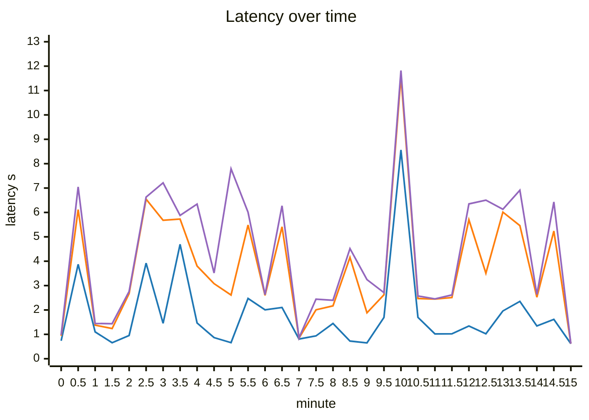
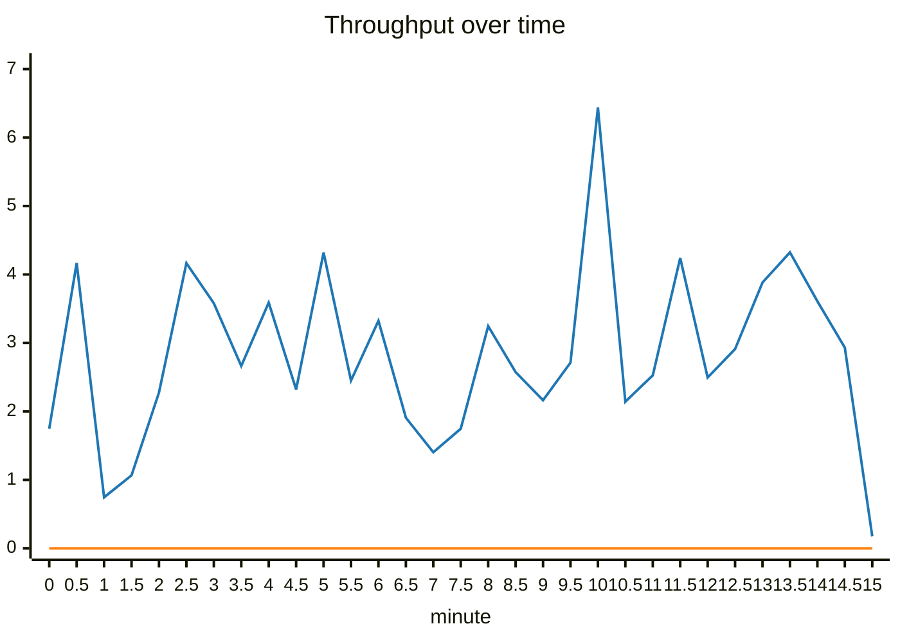

## normal — 2026-11-17 16:25 UTC

**PASS** · 918 s · 216 requests · 0 (0.0%) errors · 0 rate-limited · 2,635,428 tokens billed

15 min of Poisson traffic at 0.25 req/s; mix short20 60%, many100 10%, mid1k 10%, mid4k 10%, long8k 5%, long32k 5%. Billed 2,635,428 tokens.

|  | requests | errors | 429s | p50 s | p90 s | p99 s | max s | req/s | API tok/s | MRR |
|---|---|---|---|---|---|---|---|---|---|---|
| all | 216 | 0 (0.0%) | 0 | 1.298 | 6.003 | 11.0 | 11.8 | 0.240 | 2,928 | 0.805 |
| short20 | 119 | 0 (0.0%) | 0 | 0.883 | 4.517 | 8.135 | 11.8 | 0.132 | 1,159 | 0.659 |
| many100 | 26 | 0 (0.0%) | 0 | 2.587 | 4.477 | 8.942 | 8.973 | 0.029 | 936 | 0.942 |
| mid1k | 16 | 0 (0.0%) | 0 | 0.162 | 2.186 | 4.916 | 5.331 | 0.018 | 17.9 | 1.000 |
| mid4k | 22 | 0 (0.0%) | 0 | 0.653 | 4.035 | 8.210 | 9.168 | 0.024 | 93.0 | 1.000 |
| long8k | 15 | 0 (0.0%) | 0 | 1.459 | 5.239 | 10.8 | 11.6 | 0.017 | 127 | 1.000 |
| long32k | 18 | 0 (0.0%) | 0 | 6.308 | 7.387 | 10.7 | 11.3 | 0.020 | 595 | 1.000 |

*Latency over time: p50, p90, max*

*Throughput over time: API tokens/s ÷ 1000, errors*
