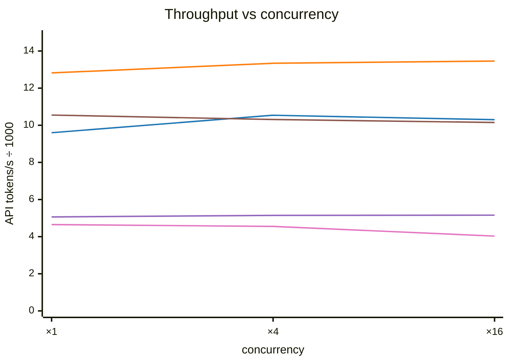
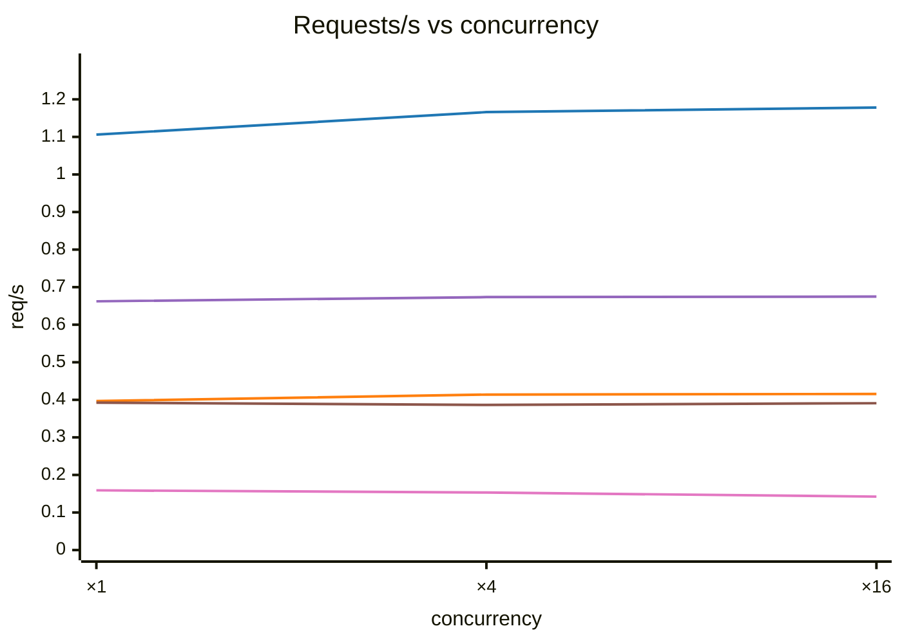
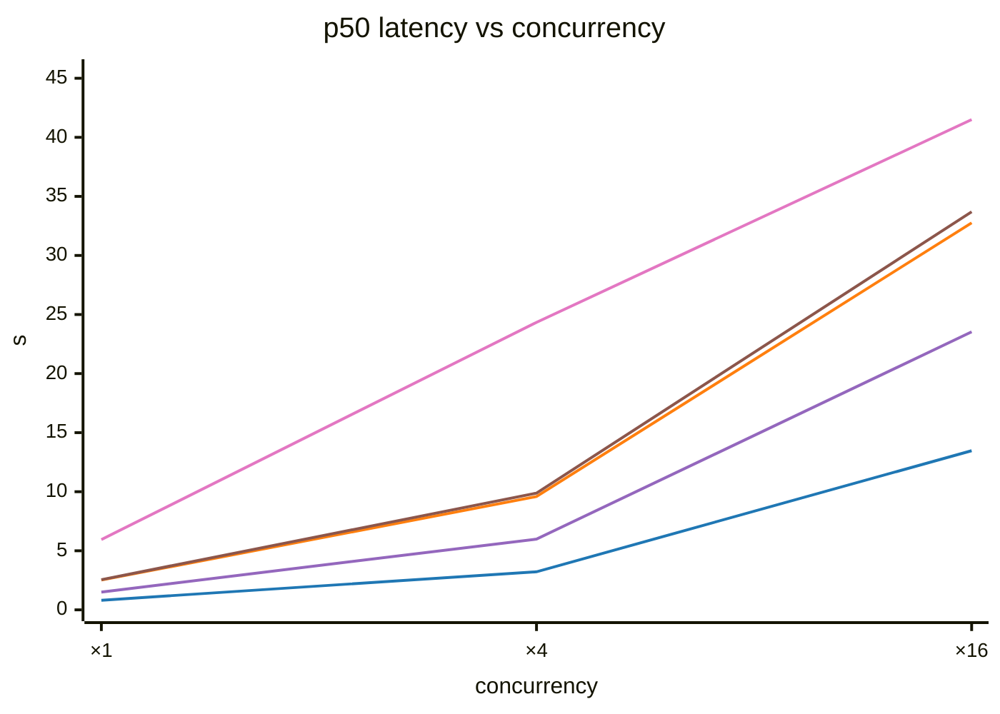

## speed — 2026-11-17 16:40 UTC

**PASS** · 627 s · 305 requests · 8 (2.6%) errors · 0 rate-limited · 5,036,501 tokens billed

Closed loop, 25 s per cell, 5 request classes × concurrency [1, 4, 16]. 305 requests, 5,036,501 tokens billed.

|  | requests | errors | 429s | p50 s | p90 s | p99 s | max s | req/s | API tok/s | MRR |
|---|---|---|---|---|---|---|---|---|---|---|
| short20 ×1 | 28 | 0 (0.0%) | 0 | 0.812 | 1.233 | 1.568 | 1.598 | 1.106 | 9,599 | 0.674 |
| short20 ×4 | 33 | 0 (0.0%) | 0 | 3.222 | 4.138 | 4.459 | 4.459 | 1.166 | 10,538 | 0.666 |
| short20 ×16 | 45 | 0 (0.0%) | 0 | 13.5 | 14.3 | 14.6 | 14.7 | 1.178 | 10,298 | 0.712 |
| many100 ×1 | 10 | 0 (0.0%) | 0 | 2.524 | 2.543 | 2.544 | 2.544 | 0.397 | 12,820 | 1.000 |
| many100 ×4 | 14 | 0 (0.0%) | 0 | 9.589 | 9.842 | 9.916 | 9.916 | 0.414 | 13,342 | 1.000 |
| many100 ×16 | 26 | 0 (0.0%) | 0 | 32.8 | 38.5 | 38.8 | 38.8 | 0.416 | 13,459 | 0.981 |
| long8k ×1 | 17 | 0 (0.0%) | 0 | 1.508 | 1.528 | 1.530 | 1.530 | 0.662 | 5,061 | 1.000 |
| long8k ×4 | 20 | 0 (0.0%) | 0 | 5.990 | 6.006 | 6.027 | 6.031 | 0.673 | 5,146 | 1.000 |
| long8k ×16 | 32 | 0 (0.0%) | 0 | 23.5 | 23.9 | 24.0 | 24.0 | 0.675 | 5,157 | 1.000 |
| pack32k ×1 | 10 | 0 (0.0%) | 0 | 2.552 | 2.772 | 3.255 | 3.309 | 0.392 | 10,553 | 1.000 |
| pack32k ×4 | 14 | 0 (0.0%) | 0 | 9.882 | 11.0 | 11.3 | 11.3 | 0.386 | 10,312 | 1.000 |
| pack32k ×16 | 25 | 0 (0.0%) | 0 | 33.7 | 42.1 | 42.9 | 42.9 | 0.391 | 10,152 | 1.000 |
| long32k ×1 | 4 | 0 (0.0%) | 0 | 5.950 | 7.155 | 7.533 | 7.575 | 0.159 | 4,651 | 1.000 |
| long32k ×4 | 8 | 0 (0.0%) | 0 | 24.3 | 26.5 | 27.3 | 27.4 | 0.153 | 4,551 | 1.000 |
| long32k ×16 | 19 | 8 (42.1%) | 0 | 41.5 | 57.0 | 58.4 | 58.6 | 0.142 | 4,030 | 1.000 |

| error | count | example | response |
|---|---|---|---|
| http 424 ModelError timed out at SageMaker | 8 | natural-summ_screen_fd natural-summ_screen_fd/query_92 | {"ErrorCode":"INTERNAL_FAILURE_FROM_MODEL","LogStreamArn":"arn:aws:logs:eu-west-3:<account-id>:log-group:/aws/sagemaker/Endpoints/reranker-aws031-4b-bf16-L3","Message":"Received server error (0) from primary with message \"Your invocation timed out while waiting for a response from container primary |

*Throughput vs concurrency: short20, many100, long8k, pack32k, long32k*

*Requests/s vs concurrency: short20, many100, long8k, pack32k, long32k*

*p50 latency vs concurrency: short20, many100, long8k, pack32k, long32k*
