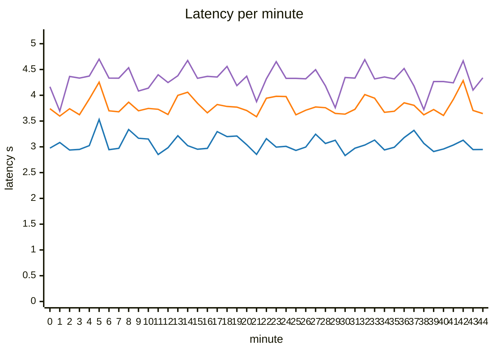
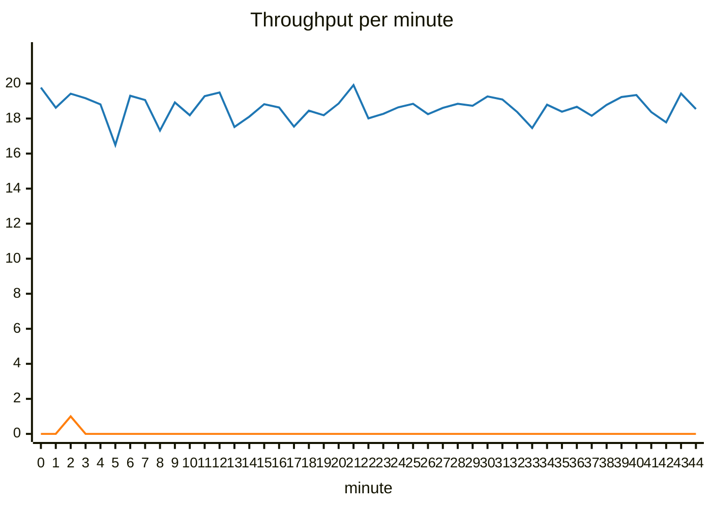

## hammer32k — 2026-11-17 16:48 UTC

**PASS** · 2704 s · 1701 requests · 1 (0.1%) errors · 0 rate-limited · 50,261,792 tokens billed

45 min closed loop with 2 concurrent ~32K-token requests (350 distinct). 1701 requests, 50,261,792 tokens billed.

|  | requests | errors | 429s | p50 s | p90 s | p99 s | max s | req/s | API tok/s | MRR |
|---|---|---|---|---|---|---|---|---|---|---|
| all | 1,701 | 1 (0.1%) | 0 | 3.037 | 3.778 | 4.370 | 4.701 | 0.630 | 18,615 | 0.983 |
| min 0–5 | 195 | 1 (0.5%) | 0 | 2.999 | 3.736 | 4.336 | 4.372 | 0.647 | 19,157 | 0.985 |
| min 5–10 | 185 | 0 (0.0%) | 0 | 3.116 | 3.797 | 4.561 | 4.701 | 0.617 | 18,219 | 0.982 |
| min 10–15 | 188 | 0 (0.0%) | 0 | 3.049 | 3.789 | 4.434 | 4.675 | 0.627 | 18,516 | 0.980 |
| min 15–20 | 186 | 0 (0.0%) | 0 | 3.142 | 3.783 | 4.358 | 4.560 | 0.620 | 18,326 | 0.983 |
| min 20–25 | 190 | 0 (0.0%) | 0 | 2.988 | 3.845 | 4.400 | 4.652 | 0.633 | 18,736 | 0.986 |
| min 25–30 | 189 | 0 (0.0%) | 0 | 3.081 | 3.709 | 4.321 | 4.496 | 0.630 | 18,654 | 0.980 |
| min 30–35 | 189 | 0 (0.0%) | 0 | 2.961 | 3.865 | 4.394 | 4.691 | 0.630 | 18,595 | 0.989 |
| min 35–40 | 189 | 0 (0.0%) | 0 | 3.089 | 3.742 | 4.313 | 4.520 | 0.630 | 18,645 | 0.978 |
| min 40–45 | 190 | 0 (0.0%) | 0 | 2.969 | 3.871 | 4.375 | 4.667 | 0.633 | 18,691 | 0.982 |

| error | count | example | response |
|---|---|---|---|
| http 424 ModelError container 0 | 1 | ladder1-32768 ladder1-32768/ctx32768_query62 | {"ErrorCode":"INTERNAL_FAILURE_FROM_MODEL","LogStreamArn":"arn:aws:logs:eu-west-3:<account-id>:log-group:/aws/sagemaker/Endpoints/reranker-aws031-06b-bf16-L3","Message":"Received server error (0) from primary with message \"Amazon SageMaker could not get a response from the reranker-aws031-06b-bf16- |

*Latency per minute: p50, p90, max*

*Throughput per minute: API tokens/s ÷ 1000, errors*
