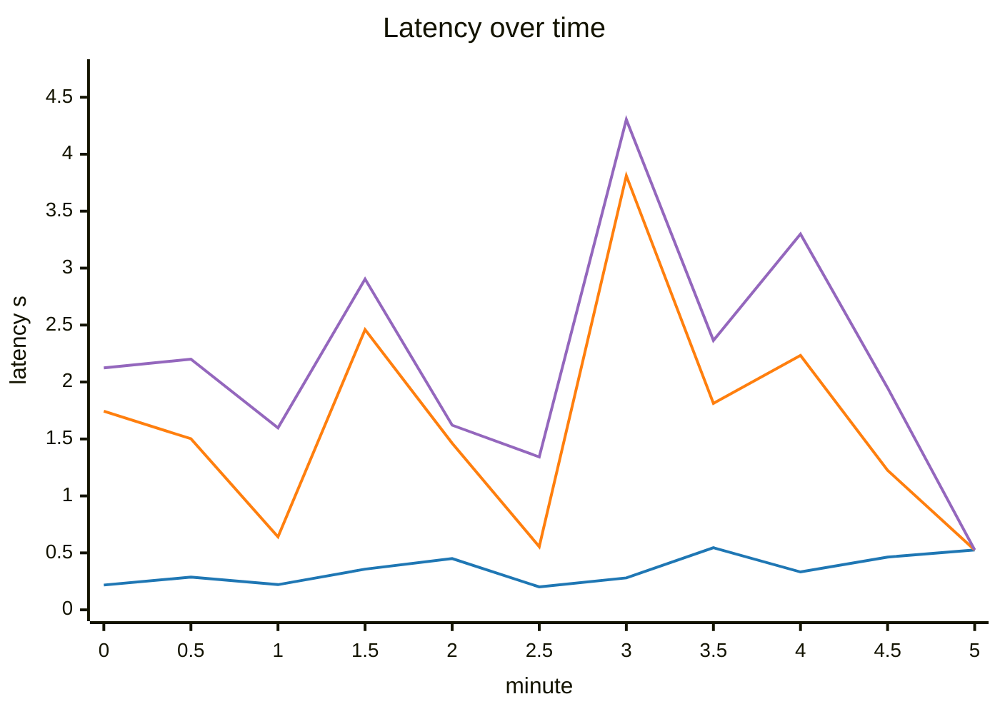
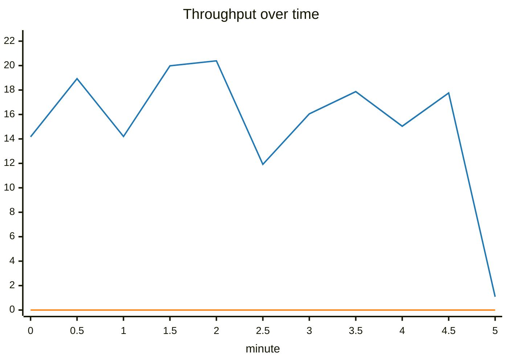

## normal — 2026-11-17 16:32 UTC

**PASS** · 301 s · 437 requests · 0 (0.0%) errors · 0 rate-limited · 5,022,151 tokens billed

5 min of Poisson traffic at 1.5 req/s; mix short20 60%, many100 10%, mid1k 10%, mid4k 10%, long8k 5%, long32k 5%. Billed 5,022,151 tokens.

|  | requests | errors | 429s | p50 s | p90 s | p99 s | max s | req/s | API tok/s | MRR |
|---|---|---|---|---|---|---|---|---|---|---|
| all | 437 | 0 (0.0%) | 0 | 0.336 | 1.672 | 3.817 | 4.304 | 1.457 | 16,741 | 0.791 |
| short20 | 241 | 0 (0.0%) | 0 | 0.225 | 1.337 | 3.441 | 3.967 | 0.803 | 6,868 | 0.632 |
| many100 | 48 | 0 (0.0%) | 0 | 0.546 | 1.899 | 3.420 | 3.853 | 0.160 | 5,193 | 0.958 |
| mid1k | 42 | 0 (0.0%) | 0 | 0.040 | 1.306 | 3.161 | 3.805 | 0.140 | 140 | 1.000 |
| mid4k | 43 | 0 (0.0%) | 0 | 0.145 | 0.951 | 1.931 | 2.528 | 0.143 | 545 | 1.000 |
| long8k | 31 | 0 (0.0%) | 0 | 0.465 | 2.424 | 3.533 | 3.824 | 0.103 | 789 | 1.000 |
| long32k | 32 | 0 (0.0%) | 0 | 1.592 | 2.351 | 3.992 | 4.304 | 0.107 | 3,206 | 0.984 |

*Latency over time: p50, p90, max*

*Throughput over time: API tokens/s ÷ 1000, errors*
