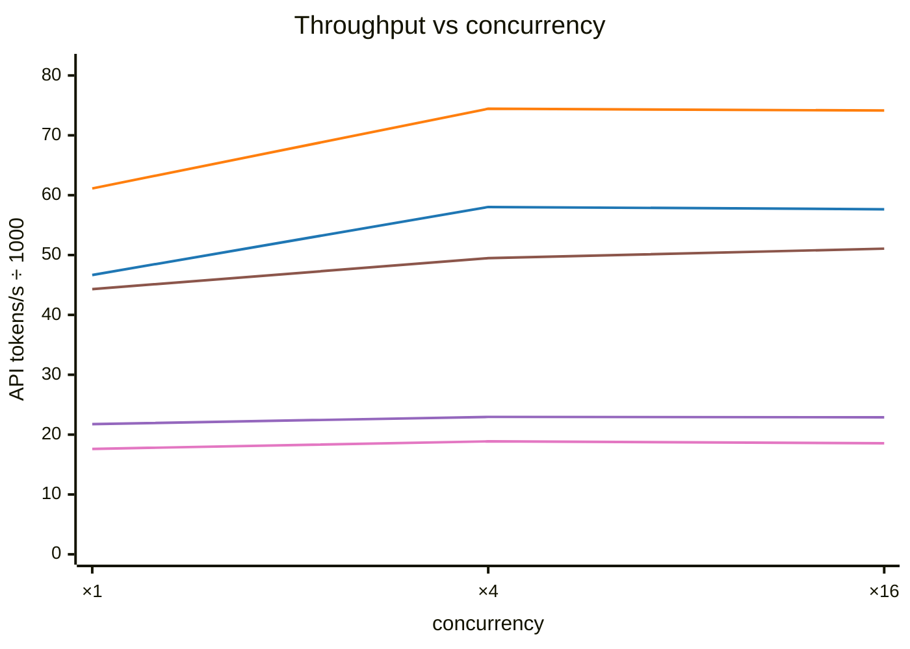
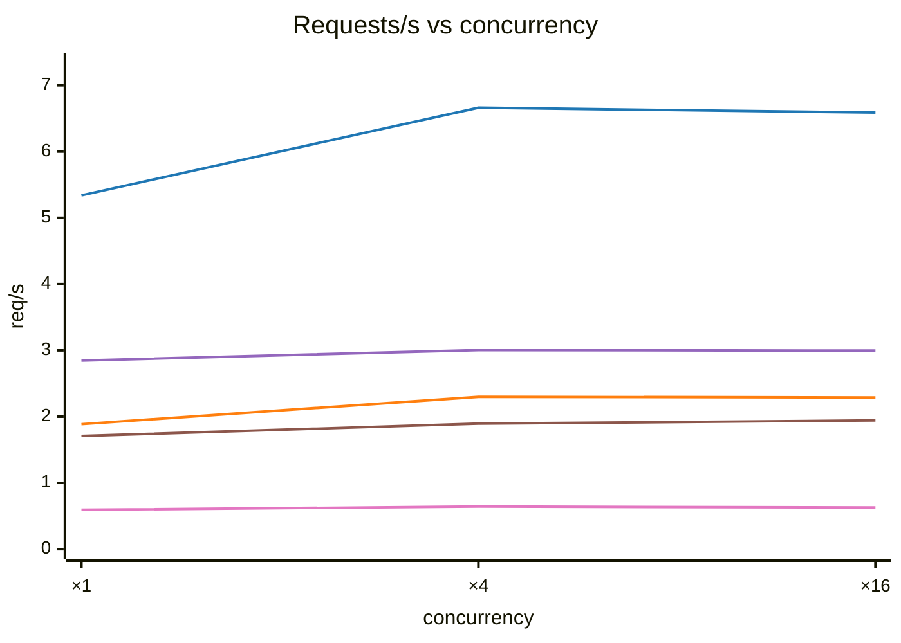
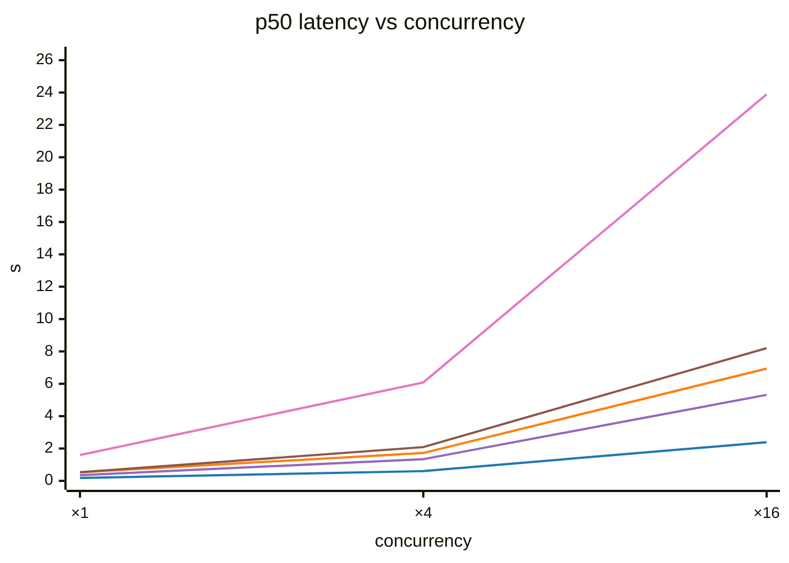

## speed — 2026-11-17 16:37 UTC

**PASS** · 462 s · 1128 requests · 0 (0.0%) errors · 0 rate-limited · 17,971,058 tokens billed

Closed loop, 25 s per cell, 5 request classes × concurrency [1, 4, 16]. 1128 requests, 17,971,058 tokens billed.

|  | requests | errors | 429s | p50 s | p90 s | p99 s | max s | req/s | API tok/s | MRR |
|---|---|---|---|---|---|---|---|---|---|---|
| short20 ×1 | 134 | 0 (0.0%) | 0 | 0.181 | 0.249 | 0.313 | 0.317 | 5.339 | 46,673 | 0.660 |
| short20 ×4 | 169 | 0 (0.0%) | 0 | 0.602 | 0.726 | 0.805 | 0.848 | 6.662 | 58,028 | 0.668 |
| short20 ×16 | 180 | 0 (0.0%) | 0 | 2.390 | 2.598 | 2.771 | 2.832 | 6.589 | 57,649 | 0.671 |
| many100 ×1 | 48 | 0 (0.0%) | 0 | 0.529 | 0.535 | 0.543 | 0.547 | 1.887 | 61,132 | 0.979 |
| many100 ×4 | 61 | 0 (0.0%) | 0 | 1.724 | 1.779 | 1.817 | 1.862 | 2.299 | 74,442 | 0.984 |
| many100 ×16 | 73 | 0 (0.0%) | 0 | 6.937 | 6.957 | 7.041 | 7.219 | 2.289 | 74,139 | 0.986 |
| long8k ×1 | 72 | 0 (0.0%) | 0 | 0.351 | 0.354 | 0.356 | 0.356 | 2.847 | 21,754 | 1.000 |
| long8k ×4 | 79 | 0 (0.0%) | 0 | 1.341 | 1.347 | 1.353 | 1.365 | 3.005 | 22,958 | 1.000 |
| long8k ×16 | 90 | 0 (0.0%) | 0 | 5.315 | 5.380 | 5.393 | 5.424 | 2.996 | 22,888 | 1.000 |
| pack32k ×1 | 43 | 0 (0.0%) | 0 | 0.533 | 0.815 | 0.940 | 0.952 | 1.709 | 44,305 | 1.000 |
| pack32k ×4 | 51 | 0 (0.0%) | 0 | 2.087 | 2.406 | 2.543 | 2.571 | 1.895 | 49,480 | 1.000 |
| pack32k ×16 | 63 | 0 (0.0%) | 0 | 8.204 | 8.680 | 8.981 | 8.997 | 1.944 | 51,069 | 1.000 |
| long32k ×1 | 15 | 0 (0.0%) | 0 | 1.598 | 2.237 | 2.260 | 2.262 | 0.595 | 17,613 | 1.000 |
| long32k ×4 | 19 | 0 (0.0%) | 0 | 6.083 | 7.247 | 7.341 | 7.352 | 0.643 | 18,874 | 1.000 |
| long32k ×16 | 31 | 0 (0.0%) | 0 | 23.9 | 25.2 | 25.4 | 25.5 | 0.629 | 18,551 | 1.000 |

*Throughput vs concurrency: short20, many100, long8k, pack32k, long32k*

*Requests/s vs concurrency: short20, many100, long8k, pack32k, long32k*

*p50 latency vs concurrency: short20, many100, long8k, pack32k, long32k*
