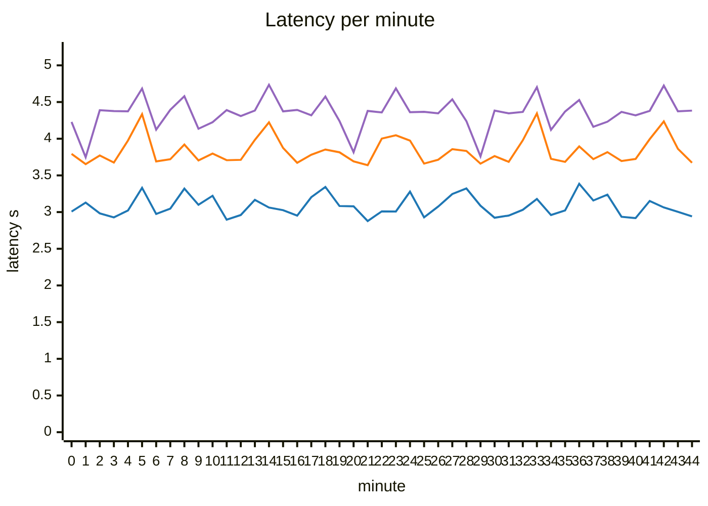
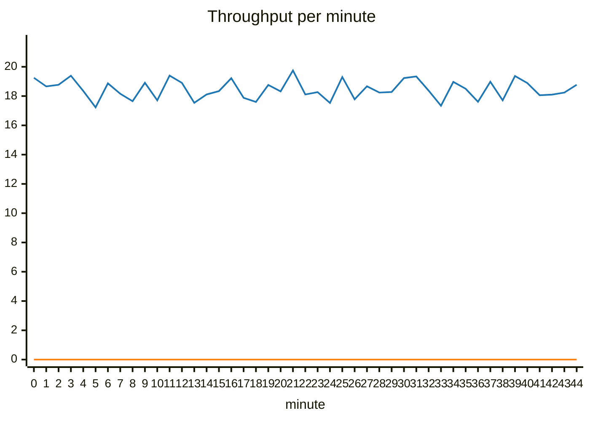

## hammer32k — 2026-11-17 17:04 UTC

**PASS** · 2702 s · 1685 requests · 0 (0.0%) errors · 0 rate-limited · 49,825,585 tokens billed

45 min closed loop with 2 concurrent ~32K-token requests (350 distinct). 1685 requests, 49,825,585 tokens billed.

|  | requests | errors | 429s | p50 s | p90 s | p99 s | max s | req/s | API tok/s | MRR |
|---|---|---|---|---|---|---|---|---|---|---|
| all | 1,685 | 0 (0.0%) | 0 | 3.062 | 3.799 | 4.391 | 4.735 | 0.624 | 18,454 | 0.983 |
| min 0–5 | 191 | 0 (0.0%) | 0 | 3.030 | 3.776 | 4.375 | 4.388 | 0.637 | 18,885 | 0.984 |
| min 5–10 | 185 | 0 (0.0%) | 0 | 3.146 | 3.791 | 4.595 | 4.684 | 0.617 | 18,163 | 0.982 |
| min 10–15 | 186 | 0 (0.0%) | 0 | 3.061 | 3.815 | 4.440 | 4.735 | 0.620 | 18,333 | 0.986 |
| min 15–20 | 186 | 0 (0.0%) | 0 | 3.115 | 3.787 | 4.376 | 4.575 | 0.620 | 18,361 | 0.983 |
| min 20–25 | 187 | 0 (0.0%) | 0 | 3.033 | 3.818 | 4.421 | 4.686 | 0.623 | 18,394 | 0.986 |
| min 25–30 | 187 | 0 (0.0%) | 0 | 3.109 | 3.762 | 4.349 | 4.536 | 0.623 | 18,454 | 0.980 |
| min 30–35 | 189 | 0 (0.0%) | 0 | 2.976 | 3.848 | 4.421 | 4.702 | 0.630 | 18,648 | 0.991 |
| min 35–40 | 187 | 0 (0.0%) | 0 | 3.121 | 3.763 | 4.366 | 4.528 | 0.623 | 18,433 | 0.977 |
| min 40–45 | 187 | 0 (0.0%) | 0 | 3.004 | 3.854 | 4.429 | 4.724 | 0.623 | 18,414 | 0.982 |

*Latency per minute: p50, p90, max*

*Throughput per minute: API tokens/s ÷ 1000, errors*
