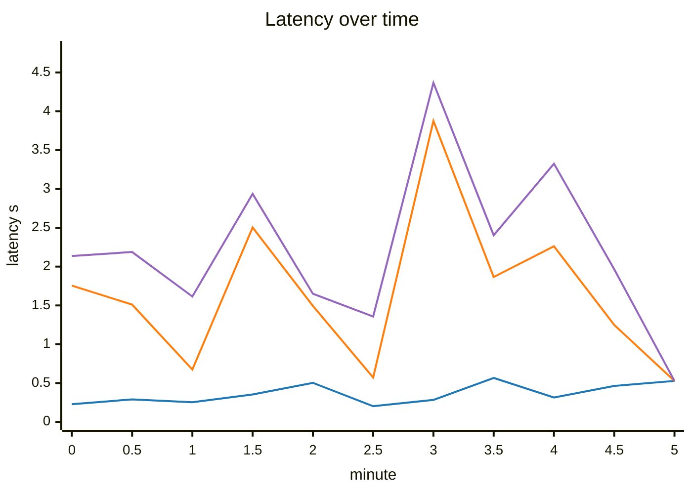
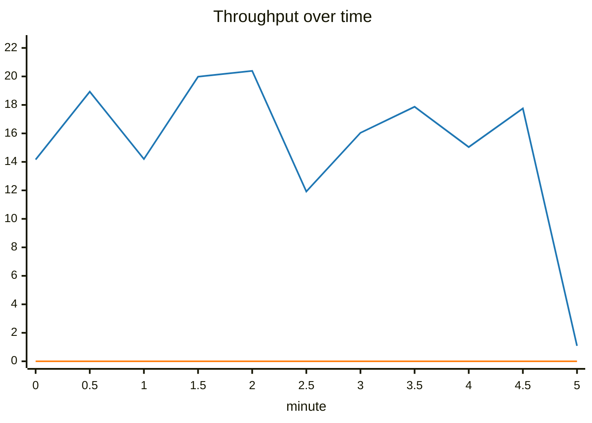

## normal — 2026-11-17 16:48 UTC

**PASS** · 301 s · 437 requests · 0 (0.0%) errors · 0 rate-limited · 5,020,414 tokens billed

5 min of Poisson traffic at 1.5 req/s; mix short20 60%, many100 10%, mid1k 10%, mid4k 10%, long8k 5%, long32k 5%. Billed 5,020,414 tokens.

|  | requests | errors | 429s | p50 s | p90 s | p99 s | max s | req/s | API tok/s | MRR |
|---|---|---|---|---|---|---|---|---|---|---|
| all | 437 | 0 (0.0%) | 0 | 0.339 | 1.689 | 3.888 | 4.367 | 1.457 | 16,735 | 0.793 |
| short20 | 241 | 0 (0.0%) | 0 | 0.226 | 1.371 | 3.491 | 4.034 | 0.803 | 6,866 | 0.634 |
| many100 | 48 | 0 (0.0%) | 0 | 0.557 | 1.922 | 3.474 | 3.929 | 0.160 | 5,189 | 0.958 |
| mid1k | 42 | 0 (0.0%) | 0 | 0.041 | 1.327 | 3.210 | 3.865 | 0.140 | 140 | 1.000 |
| mid4k | 43 | 0 (0.0%) | 0 | 0.144 | 0.973 | 1.979 | 2.584 | 0.143 | 545 | 1.000 |
| long8k | 31 | 0 (0.0%) | 0 | 0.464 | 2.453 | 3.596 | 3.901 | 0.103 | 789 | 1.000 |
| long32k | 32 | 0 (0.0%) | 0 | 1.627 | 2.389 | 4.044 | 4.367 | 0.107 | 3,206 | 0.984 |

*Latency over time: p50, p90, max*

*Throughput over time: API tokens/s ÷ 1000, errors*
