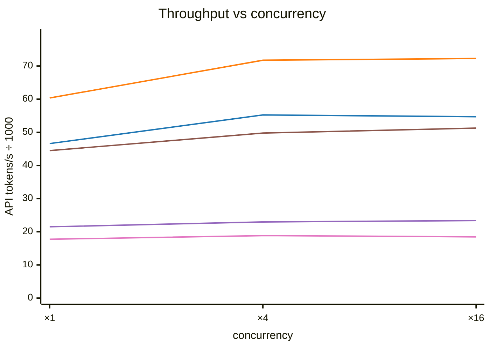
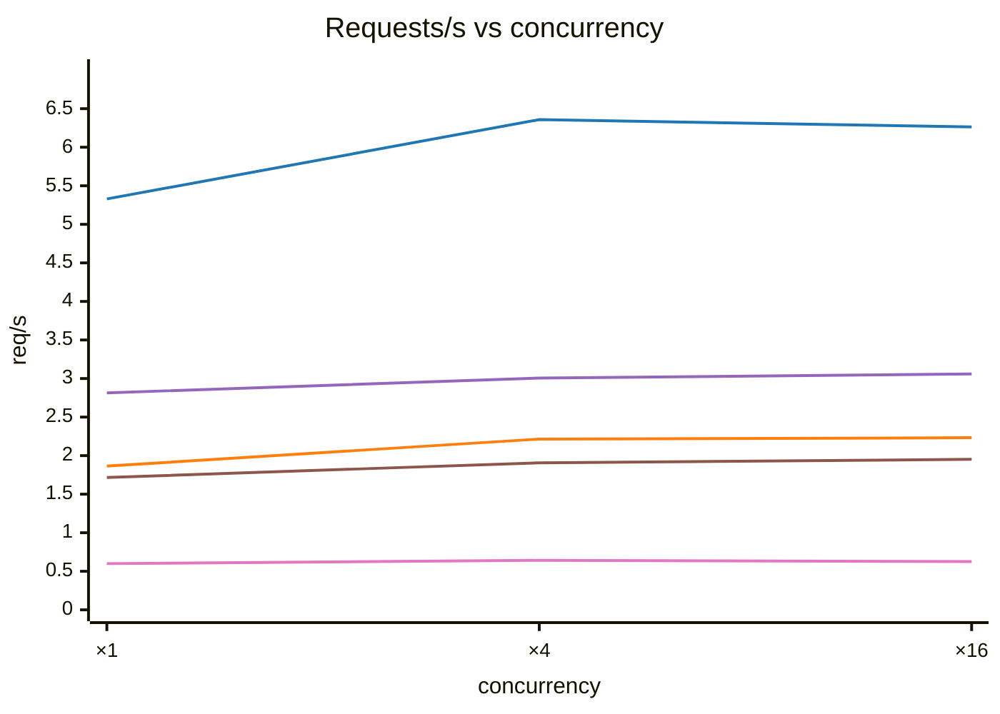
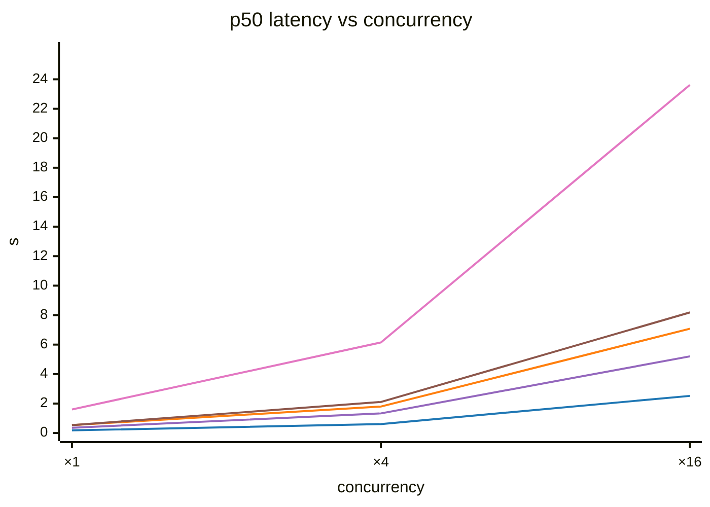

## speed — 2026-11-17 16:53 UTC

**PASS** · 462 s · 1108 requests · 0 (0.0%) errors · 0 rate-limited · 17,669,447 tokens billed

Closed loop, 25 s per cell, 5 request classes × concurrency [1, 4, 16]. 1108 requests, 17,669,447 tokens billed.

|  | requests | errors | 429s | p50 s | p90 s | p99 s | max s | req/s | API tok/s | MRR |
|---|---|---|---|---|---|---|---|---|---|---|
| short20 ×1 | 134 | 0 (0.0%) | 0 | 0.181 | 0.250 | 0.314 | 0.320 | 5.329 | 46,598 | 0.670 |
| short20 ×4 | 162 | 0 (0.0%) | 0 | 0.606 | 0.756 | 0.865 | 0.901 | 6.358 | 55,242 | 0.675 |
| short20 ×16 | 171 | 0 (0.0%) | 0 | 2.520 | 2.745 | 2.925 | 2.981 | 6.263 | 54,702 | 0.669 |
| many100 ×1 | 47 | 0 (0.0%) | 0 | 0.536 | 0.543 | 0.549 | 0.552 | 1.864 | 60,352 | 0.979 |
| many100 ×4 | 59 | 0 (0.0%) | 0 | 1.798 | 1.854 | 1.904 | 1.961 | 2.215 | 71,743 | 0.983 |
| many100 ×16 | 71 | 0 (0.0%) | 0 | 7.079 | 7.176 | 7.272 | 7.440 | 2.232 | 72,269 | 0.986 |
| long8k ×1 | 71 | 0 (0.0%) | 0 | 0.355 | 0.359 | 0.362 | 0.364 | 2.814 | 21,499 | 1.000 |
| long8k ×4 | 79 | 0 (0.0%) | 0 | 1.333 | 1.354 | 1.365 | 1.386 | 3.006 | 22,965 | 1.000 |
| long8k ×16 | 92 | 0 (0.0%) | 0 | 5.202 | 5.262 | 5.289 | 5.341 | 3.059 | 23,372 | 1.000 |
| pack32k ×1 | 43 | 0 (0.0%) | 0 | 0.537 | 0.813 | 0.928 | 0.940 | 1.716 | 44,477 | 1.000 |
| pack32k ×4 | 51 | 0 (0.0%) | 0 | 2.107 | 2.374 | 2.523 | 2.539 | 1.907 | 49,767 | 1.000 |
| pack32k ×16 | 63 | 0 (0.0%) | 0 | 8.182 | 8.711 | 8.920 | 8.928 | 1.952 | 51,268 | 1.000 |
| long32k ×1 | 15 | 0 (0.0%) | 0 | 1.597 | 2.219 | 2.237 | 2.237 | 0.600 | 17,753 | 1.000 |
| long32k ×4 | 19 | 0 (0.0%) | 0 | 6.146 | 7.263 | 7.373 | 7.381 | 0.642 | 18,843 | 1.000 |
| long32k ×16 | 31 | 0 (0.0%) | 0 | 23.6 | 24.7 | 25.5 | 25.5 | 0.626 | 18,470 | 1.000 |

*Throughput vs concurrency: short20, many100, long8k, pack32k, long32k*

*Requests/s vs concurrency: short20, many100, long8k, pack32k, long32k*

*p50 latency vs concurrency: short20, many100, long8k, pack32k, long32k*
