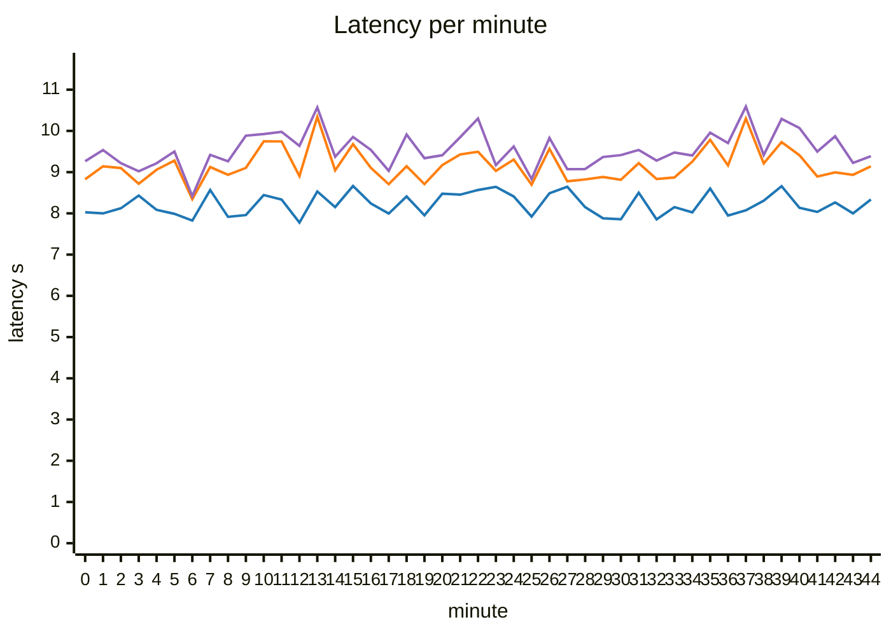
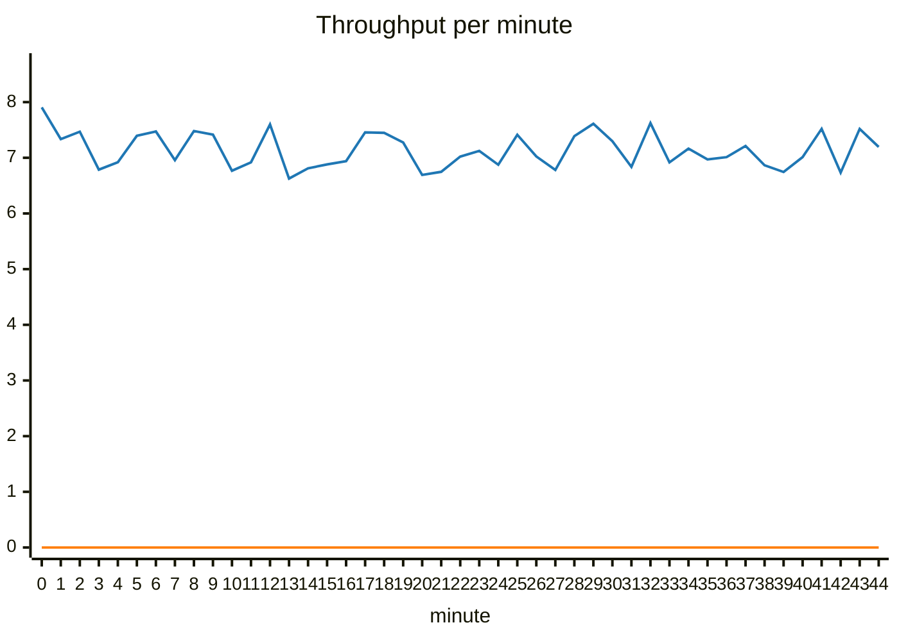

## hammer32k — 2026-11-17 17:56 UTC

**PASS** · 2708 s · 652 requests · 0 (0.0%) errors · 0 rate-limited · 19,270,452 tokens billed

45 min closed loop with 2 concurrent ~32K-token requests (350 distinct). 652 requests, 19,270,452 tokens billed.

|  | requests | errors | 429s | p50 s | p90 s | p99 s | max s | req/s | API tok/s | MRR |
|---|---|---|---|---|---|---|---|---|---|---|
| all | 652 | 0 (0.0%) | 0 | 8.181 | 9.255 | 10.0 | 10.6 | 0.241 | 7,137 | 0.997 |
| min 0–5 | 74 | 0 (0.0%) | 0 | 8.107 | 9.087 | 9.460 | 9.536 | 0.247 | 7,284 | 1.000 |
| min 5–10 | 74 | 0 (0.0%) | 0 | 7.936 | 9.068 | 9.604 | 9.884 | 0.247 | 7,345 | 1.000 |
| min 10–15 | 71 | 0 (0.0%) | 0 | 8.303 | 9.636 | 10.5 | 10.6 | 0.237 | 6,944 | 0.993 |
| min 15–20 | 73 | 0 (0.0%) | 0 | 8.150 | 9.128 | 9.870 | 9.911 | 0.243 | 7,200 | 0.993 |
| min 20–25 | 70 | 0 (0.0%) | 0 | 8.549 | 9.401 | 9.986 | 10.3 | 0.233 | 6,892 | 1.000 |
| min 25–30 | 73 | 0 (0.0%) | 0 | 8.135 | 9.050 | 9.737 | 9.829 | 0.243 | 7,244 | 1.000 |
| min 30–35 | 73 | 0 (0.0%) | 0 | 8.024 | 9.029 | 9.494 | 9.538 | 0.243 | 7,168 | 1.000 |
| min 35–40 | 71 | 0 (0.0%) | 0 | 8.395 | 9.705 | 10.6 | 10.6 | 0.237 | 6,961 | 0.993 |
| min 40–45 | 73 | 0 (0.0%) | 0 | 8.163 | 9.119 | 9.924 | 10.1 | 0.243 | 7,196 | 0.993 |

*Latency per minute: p50, p90, max*

*Throughput per minute: API tokens/s ÷ 1000, errors*
