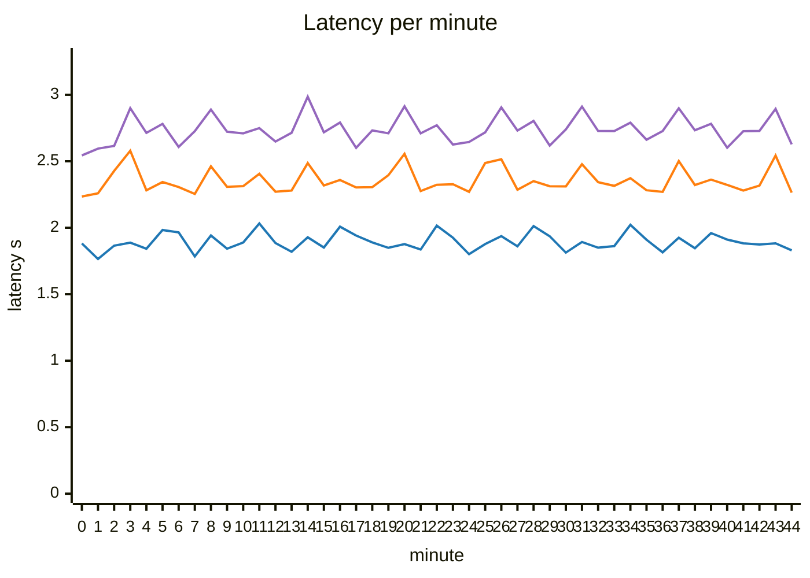
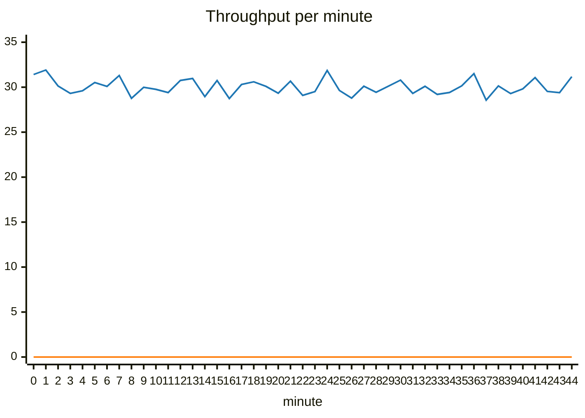

## hammer32k — 2026-11-17 17:54 UTC

**PASS** · 2702 s · 2742 requests · 0 (0.0%) errors · 0 rate-limited · 81,078,620 tokens billed

45 min closed loop with 2 concurrent ~32K-token requests (350 distinct). 2742 requests, 81,078,620 tokens billed.

|  | requests | errors | 429s | p50 s | p90 s | p99 s | max s | req/s | API tok/s | MRR |
|---|---|---|---|---|---|---|---|---|---|---|
| all | 2,742 | 0 (0.0%) | 0 | 1.885 | 2.351 | 2.732 | 2.985 | 1.016 | 30,029 | 0.979 |
| min 0–5 | 310 | 0 (0.0%) | 0 | 1.849 | 2.345 | 2.713 | 2.899 | 1.033 | 30,471 | 0.982 |
| min 5–10 | 305 | 0 (0.0%) | 0 | 1.899 | 2.350 | 2.726 | 2.889 | 1.017 | 30,132 | 0.981 |
| min 10–15 | 304 | 0 (0.0%) | 0 | 1.894 | 2.346 | 2.721 | 2.985 | 1.013 | 29,967 | 0.978 |
| min 15–20 | 305 | 0 (0.0%) | 0 | 1.890 | 2.352 | 2.717 | 2.791 | 1.017 | 30,094 | 0.979 |
| min 20–25 | 305 | 0 (0.0%) | 0 | 1.890 | 2.317 | 2.714 | 2.913 | 1.017 | 30,092 | 0.977 |
| min 25–30 | 301 | 0 (0.0%) | 0 | 1.914 | 2.376 | 2.754 | 2.905 | 1.003 | 29,617 | 0.977 |
| min 30–35 | 302 | 0 (0.0%) | 0 | 1.875 | 2.359 | 2.739 | 2.911 | 1.007 | 29,766 | 0.983 |
| min 35–40 | 304 | 0 (0.0%) | 0 | 1.896 | 2.355 | 2.735 | 2.898 | 1.013 | 29,928 | 0.981 |
| min 40–45 | 306 | 0 (0.0%) | 0 | 1.856 | 2.322 | 2.725 | 2.894 | 1.020 | 30,195 | 0.977 |

*Latency per minute: p50, p90, max*

*Throughput per minute: API tokens/s ÷ 1000, errors*
