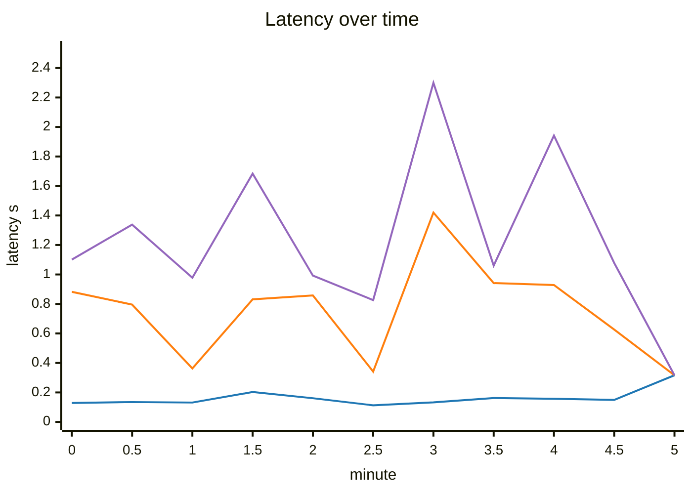
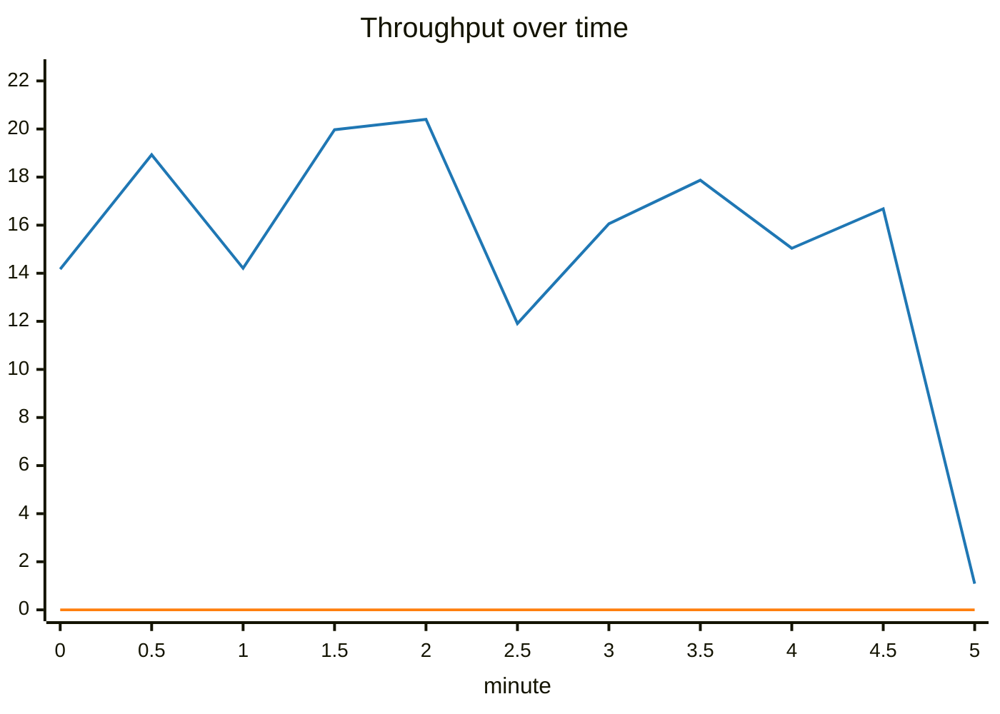

## normal — 2026-11-17 17:49 UTC

**PASS** · 301 s · 436 requests · 0 (0.0%) errors · 0 rate-limited · 4,989,654 tokens billed

5 min of Poisson traffic at 1.5 req/s; mix short20 60%, many100 10%, mid1k 10%, mid4k 10%, long8k 5%, long32k 5%. Billed 4,989,654 tokens.

|  | requests | errors | 429s | p50 s | p90 s | p99 s | max s | req/s | API tok/s | MRR |
|---|---|---|---|---|---|---|---|---|---|---|
| all | 436 | 0 (0.0%) | 0 | 0.141 | 0.872 | 1.683 | 2.300 | 1.453 | 16,632 | 0.789 |
| short20 | 241 | 0 (0.0%) | 0 | 0.126 | 0.445 | 1.557 | 1.867 | 0.803 | 6,868 | 0.626 |
| many100 | 47 | 0 (0.0%) | 0 | 0.328 | 0.649 | 1.451 | 1.577 | 0.157 | 5,084 | 0.968 |
| mid1k | 42 | 0 (0.0%) | 0 | 0.030 | 0.370 | 1.366 | 1.802 | 0.140 | 140 | 1.000 |
| mid4k | 43 | 0 (0.0%) | 0 | 0.092 | 0.297 | 0.526 | 0.649 | 0.143 | 545 | 1.000 |
| long8k | 31 | 0 (0.0%) | 0 | 0.206 | 1.023 | 1.574 | 1.680 | 0.103 | 789 | 1.000 |
| long32k | 32 | 0 (0.0%) | 0 | 0.975 | 1.384 | 2.189 | 2.300 | 0.107 | 3,206 | 0.984 |

*Latency over time: p50, p90, max*

*Throughput over time: API tokens/s ÷ 1000, errors*
