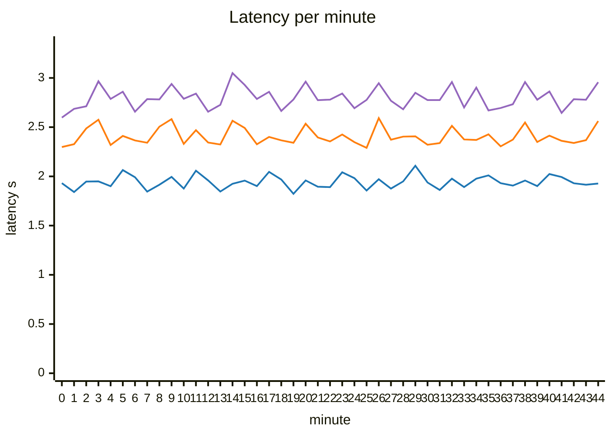
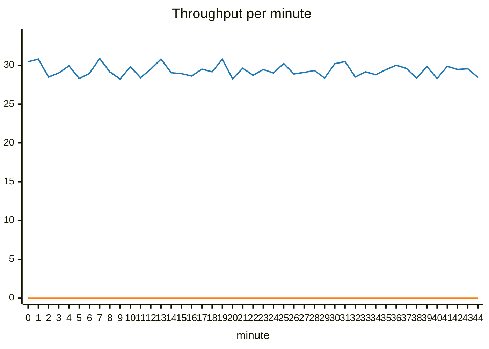

## hammer32k — 2026-11-18 07:44 UTC

**PASS** · 2702 s · 2678 requests · 0 (0.0%) errors · 0 rate-limited · 79,178,095 tokens billed

45 min closed loop with 2 concurrent ~32K-token requests (350 distinct). 2678 requests, 79,178,095 tokens billed.

|  | requests | errors | 429s | p50 s | p90 s | p99 s | max s | req/s | API tok/s | MRR |
|---|---|---|---|---|---|---|---|---|---|---|
| all | 2,678 | 0 (0.0%) | 0 | 1.934 | 2.403 | 2.787 | 3.049 | 0.992 | 29,325 | 0.978 |
| min 0–5 | 302 | 0 (0.0%) | 0 | 1.912 | 2.392 | 2.786 | 2.966 | 1.007 | 29,736 | 0.982 |
| min 5–10 | 295 | 0 (0.0%) | 0 | 1.949 | 2.415 | 2.790 | 2.939 | 0.983 | 29,099 | 0.982 |
| min 10–15 | 299 | 0 (0.0%) | 0 | 1.925 | 2.382 | 2.788 | 3.049 | 0.997 | 29,511 | 0.973 |
| min 15–20 | 298 | 0 (0.0%) | 0 | 1.936 | 2.379 | 2.781 | 2.929 | 0.993 | 29,401 | 0.976 |
| min 20–25 | 295 | 0 (0.0%) | 0 | 1.955 | 2.416 | 2.783 | 2.963 | 0.983 | 29,010 | 0.980 |
| min 25–30 | 296 | 0 (0.0%) | 0 | 1.932 | 2.414 | 2.790 | 2.947 | 0.987 | 29,175 | 0.978 |
| min 30–35 | 299 | 0 (0.0%) | 0 | 1.914 | 2.375 | 2.787 | 2.959 | 0.997 | 29,426 | 0.981 |
| min 35–40 | 298 | 0 (0.0%) | 0 | 1.942 | 2.402 | 2.779 | 2.958 | 0.993 | 29,445 | 0.979 |
| min 40–45 | 296 | 0 (0.0%) | 0 | 1.955 | 2.406 | 2.792 | 2.957 | 0.987 | 29,125 | 0.975 |

*Latency per minute: p50, p90, max*

*Throughput per minute: API tokens/s ÷ 1000, errors*
