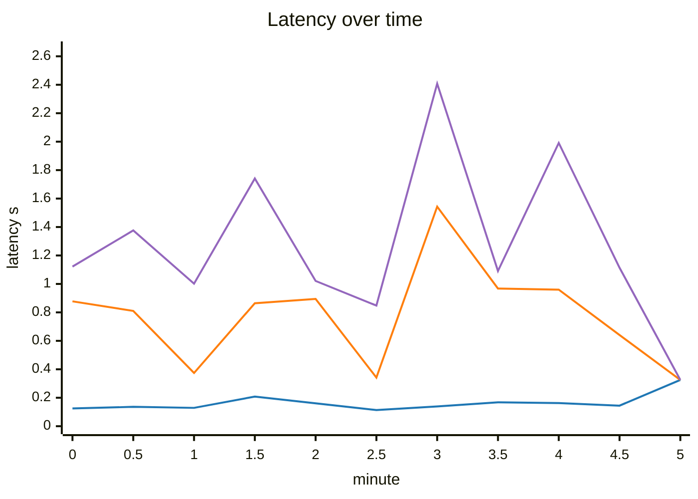
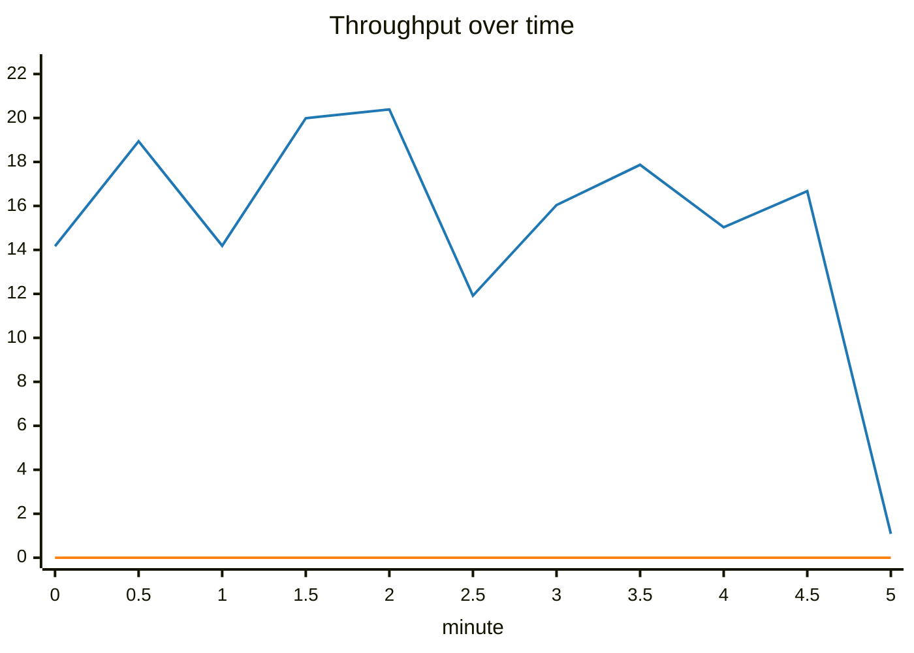

## normal — 2026-11-18 07:39 UTC

**PASS** · 301 s · 436 requests · 0 (0.0%) errors · 0 rate-limited · 4,988,419 tokens billed

5 min of Poisson traffic at 1.5 req/s; mix short20 60%, many100 10%, mid1k 10%, mid4k 10%, long8k 5%, long32k 5%. Billed 4,988,419 tokens.

|  | requests | errors | 429s | p50 s | p90 s | p99 s | max s | req/s | API tok/s | MRR |
|---|---|---|---|---|---|---|---|---|---|---|
| all | 436 | 0 (0.0%) | 0 | 0.147 | 0.897 | 1.739 | 2.408 | 1.453 | 16,628 | 0.793 |
| short20 | 241 | 0 (0.0%) | 0 | 0.127 | 0.478 | 1.647 | 1.977 | 0.803 | 6,868 | 0.634 |
| many100 | 47 | 0 (0.0%) | 0 | 0.333 | 0.706 | 1.506 | 1.633 | 0.157 | 5,080 | 0.968 |
| mid1k | 42 | 0 (0.0%) | 0 | 0.030 | 0.376 | 1.430 | 1.913 | 0.140 | 140 | 1.000 |
| mid4k | 43 | 0 (0.0%) | 0 | 0.091 | 0.315 | 0.588 | 0.728 | 0.143 | 545 | 1.000 |
| long8k | 31 | 0 (0.0%) | 0 | 0.210 | 1.058 | 1.663 | 1.741 | 0.103 | 789 | 1.000 |
| long32k | 32 | 0 (0.0%) | 0 | 0.998 | 1.411 | 2.279 | 2.408 | 0.107 | 3,206 | 0.984 |

*Latency over time: p50, p90, max*

*Throughput over time: API tokens/s ÷ 1000, errors*
