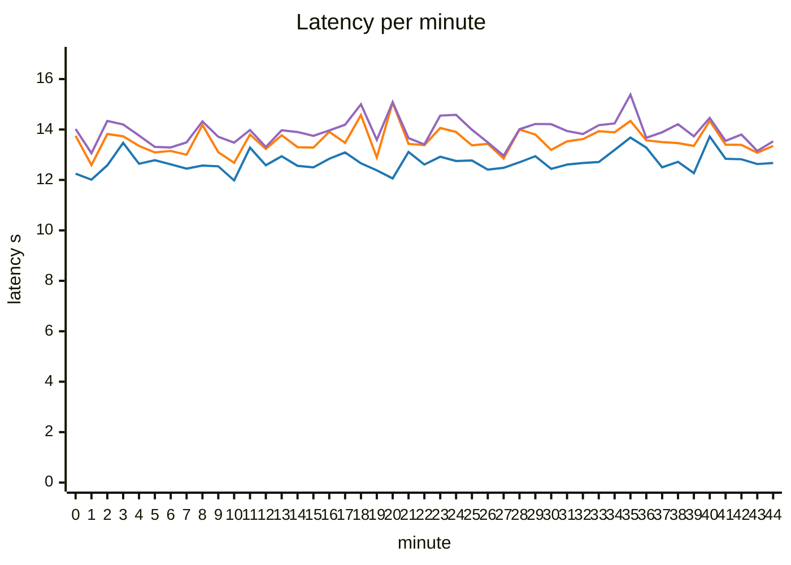
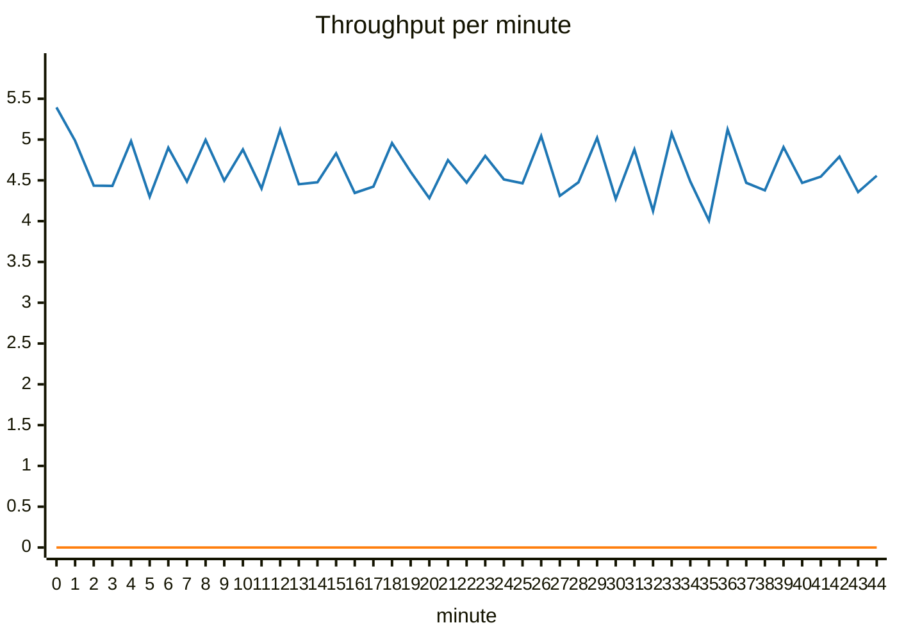

## hammer32k — 2026-11-18 07:55 UTC

**PASS** · 2707 s · 423 requests · 0 (0.0%) errors · 0 rate-limited · 12,507,537 tokens billed

45 min closed loop with 2 concurrent ~32K-token requests (350 distinct). 423 requests, 12,507,537 tokens billed.

|  | requests | errors | 429s | p50 s | p90 s | p99 s | max s | req/s | API tok/s | MRR |
|---|---|---|---|---|---|---|---|---|---|---|
| all | 423 | 0 (0.0%) | 0 | 12.7 | 13.8 | 14.6 | 15.4 | 0.157 | 4,632 | 0.995 |
| min 0–5 | 49 | 0 (0.0%) | 0 | 12.5 | 13.7 | 14.3 | 14.3 | 0.163 | 4,846 | 1.000 |
| min 5–10 | 47 | 0 (0.0%) | 0 | 12.6 | 13.4 | 14.2 | 14.3 | 0.157 | 4,635 | 1.000 |
| min 10–15 | 47 | 0 (0.0%) | 0 | 12.6 | 13.7 | 14.0 | 14.0 | 0.157 | 4,665 | 0.979 |
| min 15–20 | 47 | 0 (0.0%) | 0 | 12.7 | 13.9 | 14.8 | 15.0 | 0.157 | 4,633 | 1.000 |
| min 20–25 | 47 | 0 (0.0%) | 0 | 12.8 | 14.0 | 15.1 | 15.1 | 0.157 | 4,562 | 0.989 |
| min 25–30 | 47 | 0 (0.0%) | 0 | 12.6 | 13.6 | 14.1 | 14.2 | 0.157 | 4,663 | 1.000 |
| min 30–35 | 47 | 0 (0.0%) | 0 | 12.8 | 13.9 | 14.2 | 14.2 | 0.157 | 4,567 | 0.989 |
| min 35–40 | 46 | 0 (0.0%) | 0 | 12.9 | 13.8 | 14.9 | 15.4 | 0.153 | 4,577 | 1.000 |
| min 40–45 | 46 | 0 (0.0%) | 0 | 12.8 | 13.7 | 14.4 | 14.5 | 0.153 | 4,544 | 1.000 |

*Latency per minute: p50, p90, max*

*Throughput per minute: API tokens/s ÷ 1000, errors*
