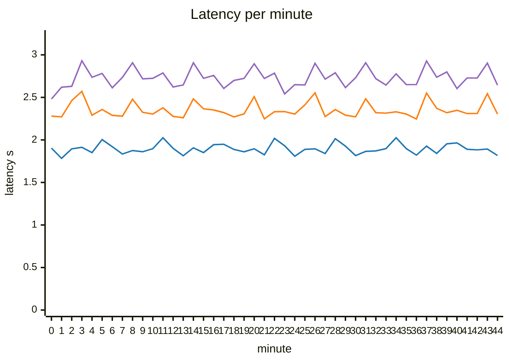
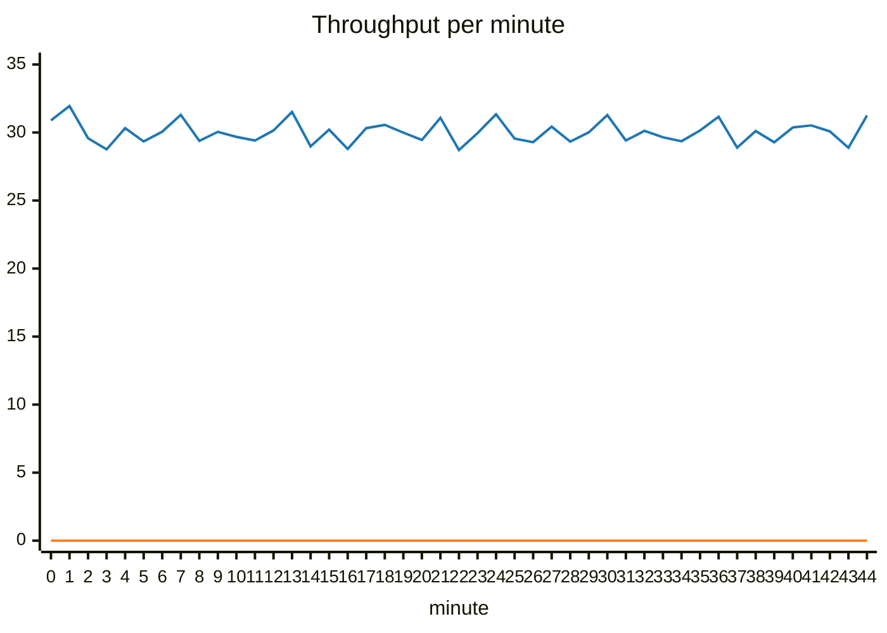

## hammer32k — 2026-11-18 07:50 UTC

**PASS** · 2702 s · 2741 requests · 0 (0.0%) errors · 0 rate-limited · 81,052,907 tokens billed

45 min closed loop with 2 concurrent ~32K-token requests (350 distinct). 2741 requests, 81,052,907 tokens billed.

|  | requests | errors | 429s | p50 s | p90 s | p99 s | max s | req/s | API tok/s | MRR |
|---|---|---|---|---|---|---|---|---|---|---|
| all | 2,741 | 0 (0.0%) | 0 | 1.891 | 2.359 | 2.736 | 2.930 | 1.015 | 30,020 | 0.979 |
| min 0–5 | 308 | 0 (0.0%) | 0 | 1.869 | 2.369 | 2.730 | 2.930 | 1.027 | 30,299 | 0.984 |
| min 5–10 | 304 | 0 (0.0%) | 0 | 1.899 | 2.364 | 2.734 | 2.907 | 1.013 | 30,028 | 0.978 |
| min 10–15 | 304 | 0 (0.0%) | 0 | 1.899 | 2.361 | 2.735 | 2.907 | 1.013 | 29,946 | 0.977 |
| min 15–20 | 304 | 0 (0.0%) | 0 | 1.896 | 2.330 | 2.714 | 2.758 | 1.013 | 29,974 | 0.982 |
| min 20–25 | 305 | 0 (0.0%) | 0 | 1.892 | 2.331 | 2.722 | 2.895 | 1.017 | 30,107 | 0.974 |
| min 25–30 | 302 | 0 (0.0%) | 0 | 1.901 | 2.364 | 2.747 | 2.901 | 1.007 | 29,720 | 0.977 |
| min 30–35 | 304 | 0 (0.0%) | 0 | 1.884 | 2.374 | 2.731 | 2.907 | 1.013 | 29,964 | 0.982 |
| min 35–40 | 304 | 0 (0.0%) | 0 | 1.892 | 2.378 | 2.758 | 2.928 | 1.013 | 29,918 | 0.980 |
| min 40–45 | 306 | 0 (0.0%) | 0 | 1.871 | 2.341 | 2.728 | 2.903 | 1.020 | 30,221 | 0.982 |

*Latency per minute: p50, p90, max*

*Throughput per minute: API tokens/s ÷ 1000, errors*
