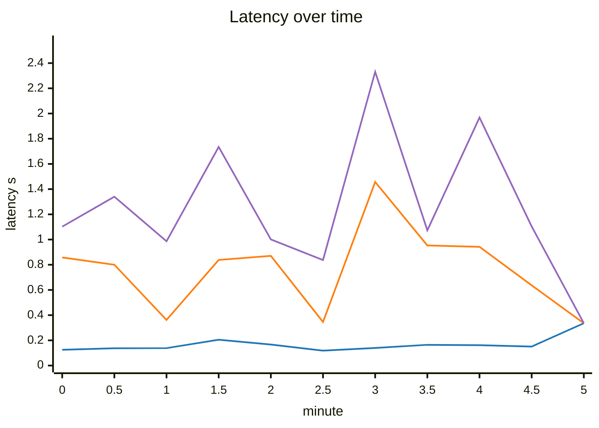
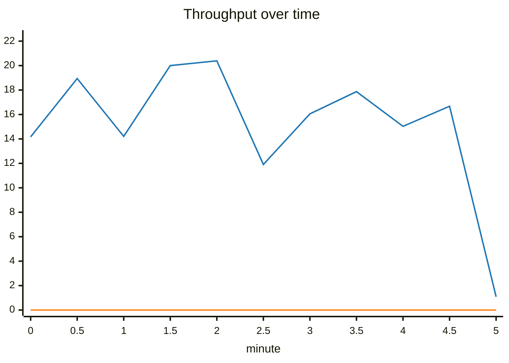

## normal — 2026-11-18 07:45 UTC

**PASS** · 301 s · 436 requests · 0 (0.0%) errors · 0 rate-limited · 4,990,225 tokens billed

5 min of Poisson traffic at 1.5 req/s; mix short20 60%, many100 10%, mid1k 10%, mid4k 10%, long8k 5%, long32k 5%. Billed 4,990,225 tokens.

|  | requests | errors | 429s | p50 s | p90 s | p99 s | max s | req/s | API tok/s | MRR |
|---|---|---|---|---|---|---|---|---|---|---|
| all | 436 | 0 (0.0%) | 0 | 0.148 | 0.878 | 1.720 | 2.331 | 1.453 | 16,634 | 0.791 |
| short20 | 241 | 0 (0.0%) | 0 | 0.131 | 0.453 | 1.585 | 1.894 | 0.803 | 6,868 | 0.630 |
| many100 | 47 | 0 (0.0%) | 0 | 0.334 | 0.654 | 1.495 | 1.622 | 0.157 | 5,086 | 0.968 |
| mid1k | 42 | 0 (0.0%) | 0 | 0.032 | 0.373 | 1.389 | 1.833 | 0.140 | 140 | 1.000 |
| mid4k | 43 | 0 (0.0%) | 0 | 0.094 | 0.300 | 0.538 | 0.660 | 0.143 | 545 | 1.000 |
| long8k | 31 | 0 (0.0%) | 0 | 0.210 | 1.039 | 1.595 | 1.693 | 0.103 | 789 | 1.000 |
| long32k | 32 | 0 (0.0%) | 0 | 0.986 | 1.398 | 2.219 | 2.331 | 0.107 | 3,206 | 0.984 |

*Latency over time: p50, p90, max*

*Throughput over time: API tokens/s ÷ 1000, errors*
