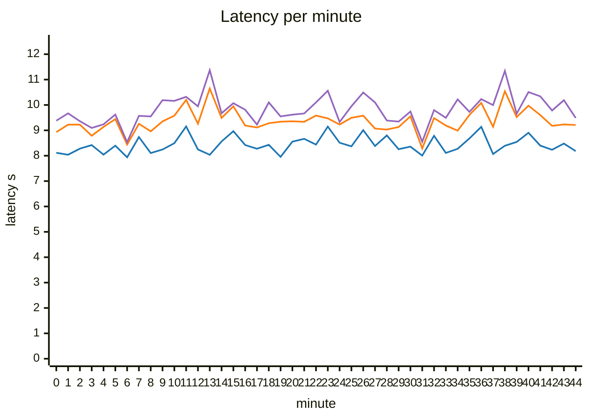
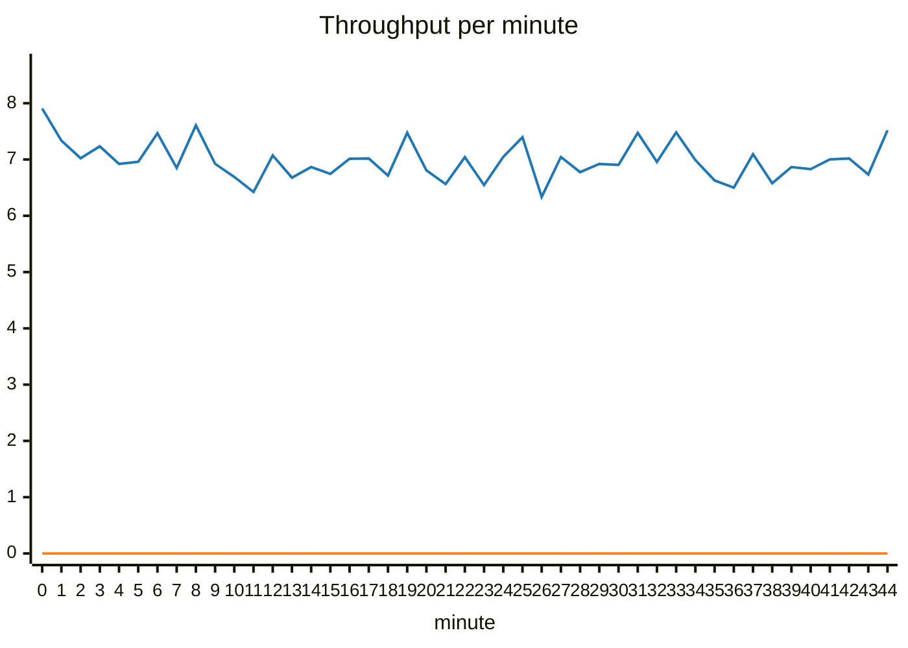

## hammer32k — 2026-11-18 09:03 UTC

**PASS** · 2707 s · 637 requests · 0 (0.0%) errors · 0 rate-limited · 18,838,874 tokens billed

45 min closed loop with 2 concurrent ~32K-token requests (350 distinct). 637 requests, 18,838,874 tokens billed.

|  | requests | errors | 429s | p50 s | p90 s | p99 s | max s | req/s | API tok/s | MRR |
|---|---|---|---|---|---|---|---|---|---|---|
| all | 637 | 0 (0.0%) | 0 | 8.363 | 9.499 | 10.4 | 11.4 | 0.236 | 6,977 | 0.996 |
| min 0–5 | 74 | 0 (0.0%) | 0 | 8.166 | 9.186 | 9.564 | 9.670 | 0.247 | 7,284 | 1.000 |
| min 5–10 | 72 | 0 (0.0%) | 0 | 8.105 | 9.282 | 9.787 | 10.2 | 0.240 | 7,161 | 1.000 |
| min 10–15 | 69 | 0 (0.0%) | 0 | 8.443 | 9.991 | 11.0 | 11.4 | 0.230 | 6,746 | 0.993 |
| min 15–20 | 71 | 0 (0.0%) | 0 | 8.380 | 9.463 | 10.1 | 10.1 | 0.237 | 6,993 | 0.993 |
| min 20–25 | 69 | 0 (0.0%) | 0 | 8.624 | 9.427 | 10.2 | 10.6 | 0.230 | 6,801 | 1.000 |
| min 25–30 | 70 | 0 (0.0%) | 0 | 8.400 | 9.388 | 10.2 | 10.5 | 0.233 | 6,895 | 1.000 |
| min 30–35 | 72 | 0 (0.0%) | 0 | 8.193 | 9.241 | 9.918 | 10.2 | 0.240 | 7,161 | 0.993 |
| min 35–40 | 69 | 0 (0.0%) | 0 | 8.558 | 9.721 | 11.0 | 11.3 | 0.230 | 6,733 | 0.993 |
| min 40–45 | 71 | 0 (0.0%) | 0 | 8.391 | 9.489 | 10.4 | 10.5 | 0.237 | 7,021 | 0.993 |

*Latency per minute: p50, p90, max*

*Throughput per minute: API tokens/s ÷ 1000, errors*
