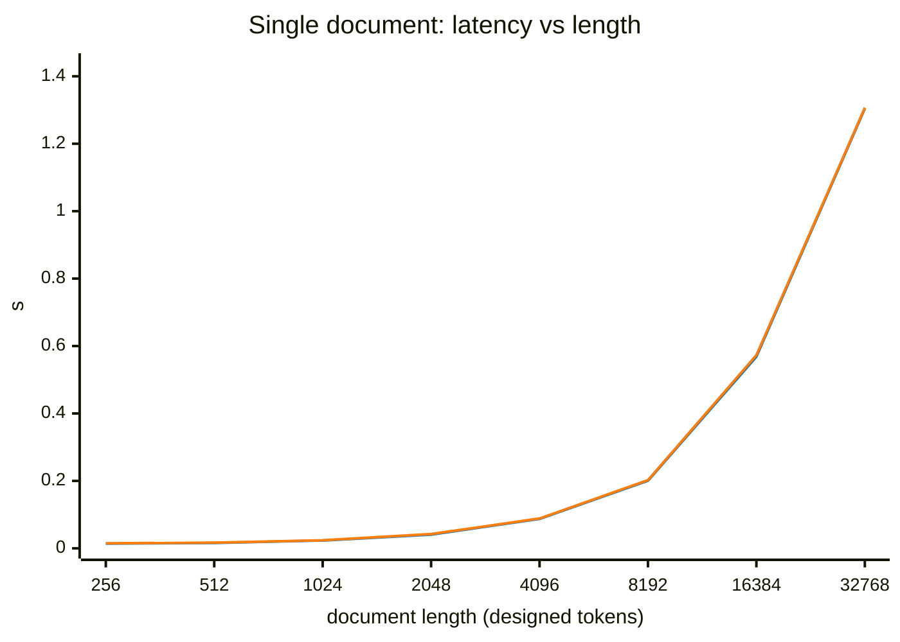
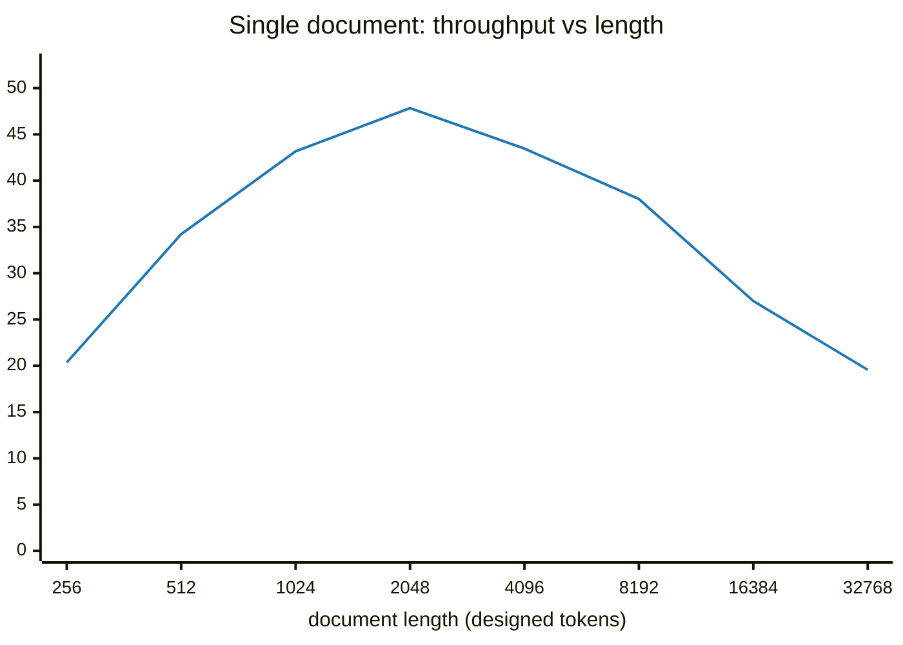
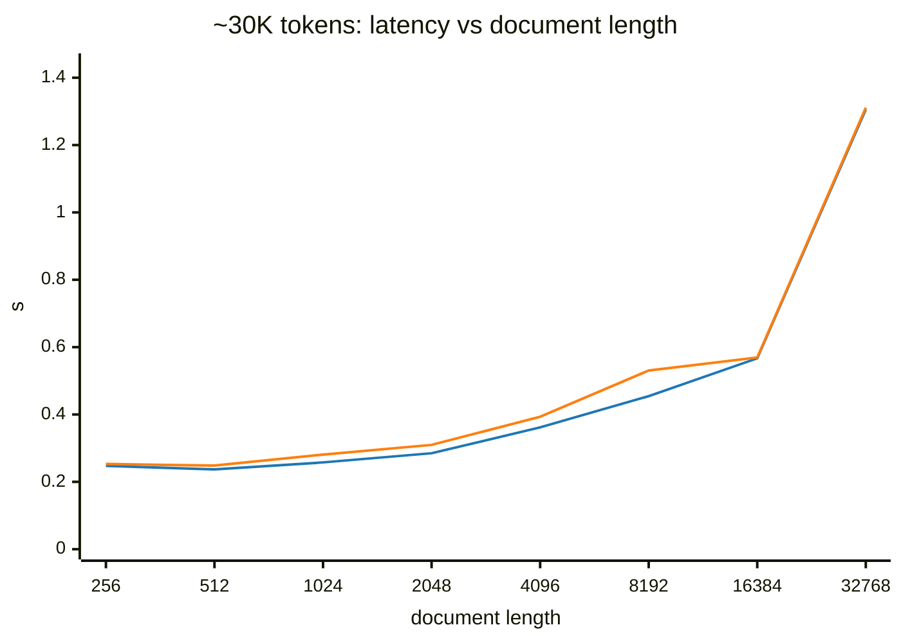
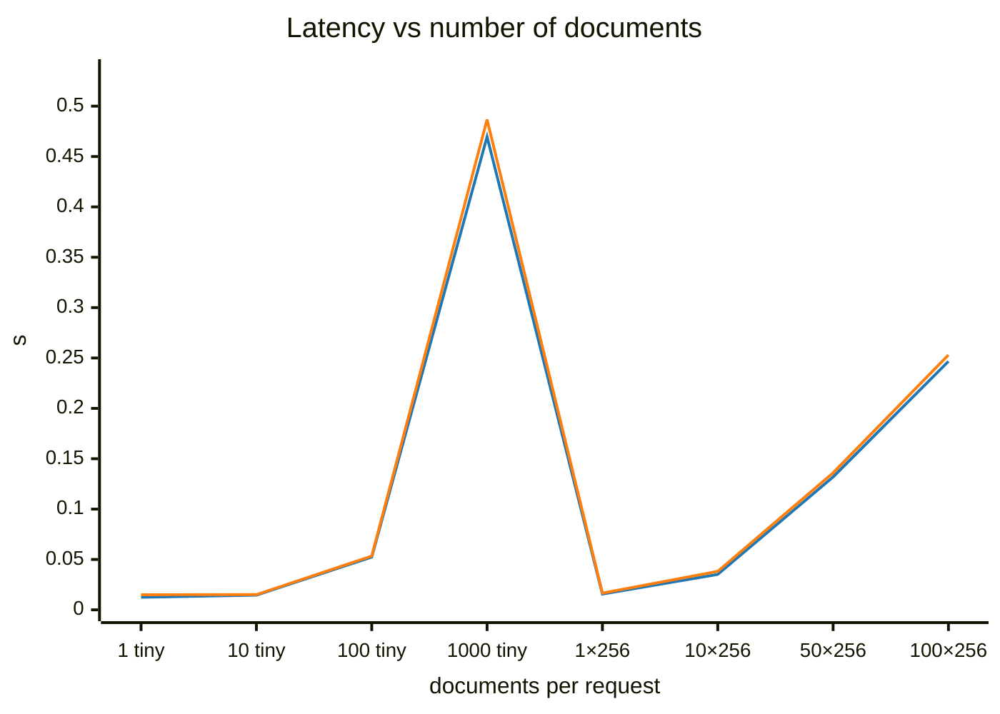
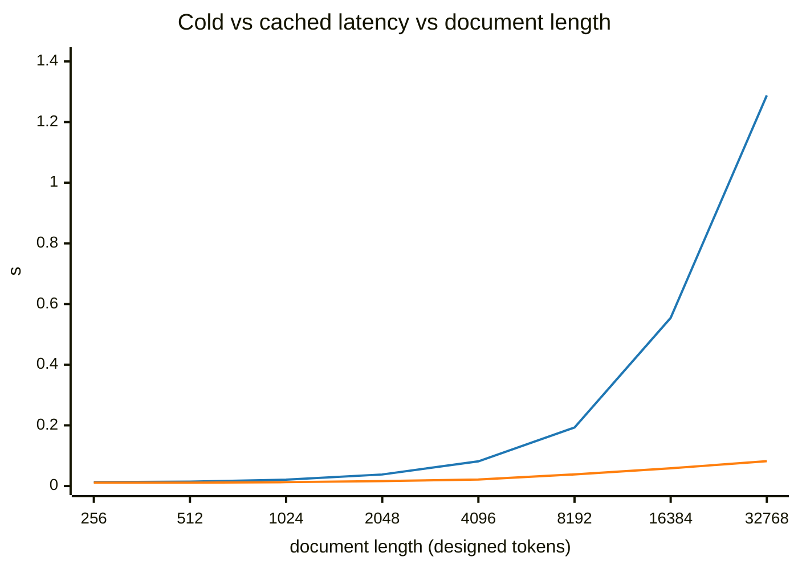
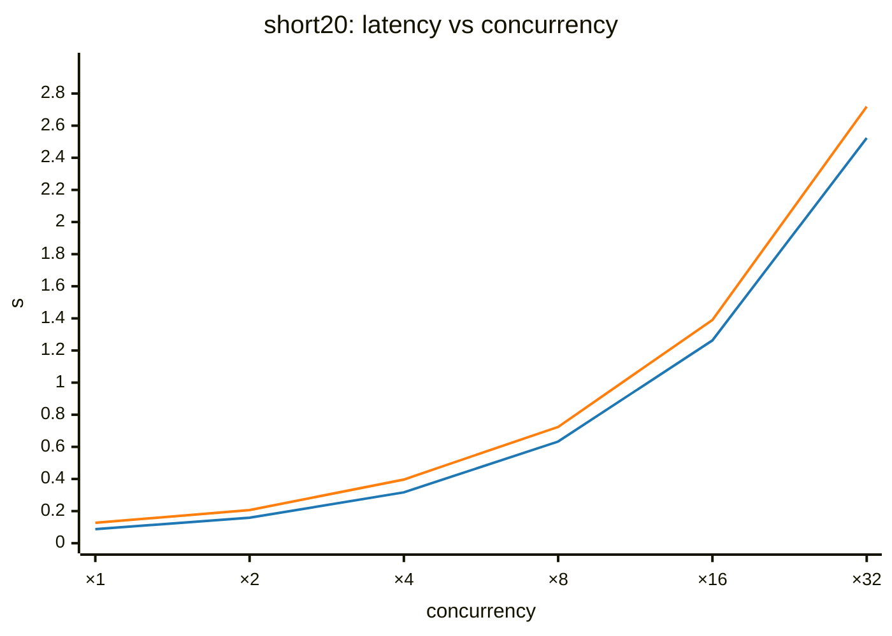
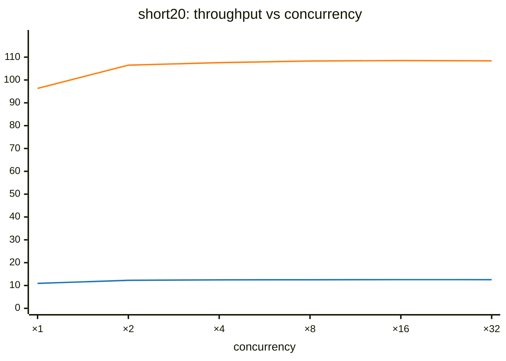
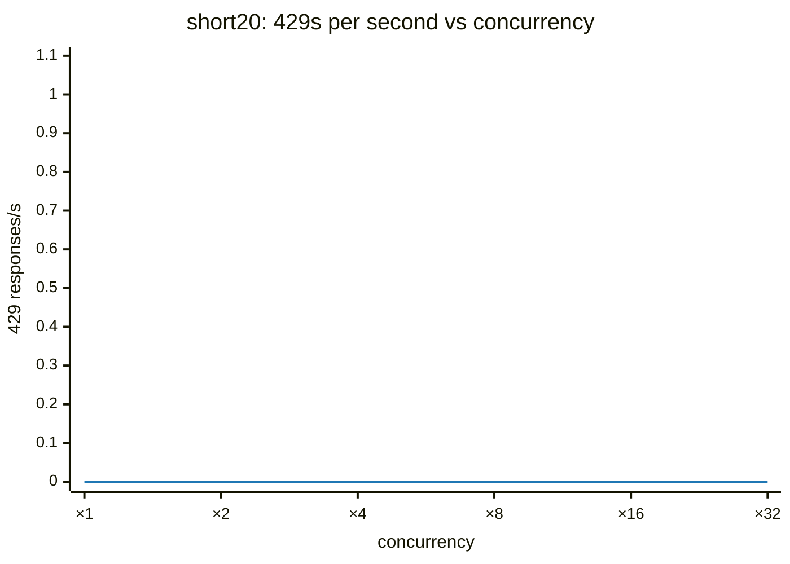

## meticulous — 2026-11-22 18:28 UTC

**PASS** · 325 s · 2492 requests · 1 (0.0%) errors · 0 rate-limited · 23,804,869 tokens billed

Sequential requests (one in flight) unless stated; every query carries a nonce so nothing is served from the API's prefix cache.

### Single document: latency vs length

| rung | Qwen tokens | billed | errors | p50 s | p90 s | max s | API tok/s |
|---|---|---|---|---|---|---|---|
| 256 | 229 | 323 | 0 (0.0%) | 0.014 | 0.015 | 0.059 | 20,362 |
| 512 | 457 | 551 | 0 (0.0%) | 0.016 | 0.017 | 0.018 | 34,225 |
| 1,024 | 911 | 1,005 | 0 (0.0%) | 0.023 | 0.024 | 0.024 | 43,167 |
| 2,048 | 1,872 | 1,966 | 0 (0.0%) | 0.041 | 0.043 | 0.044 | 47,843 |
| 4,096 | 3,707 | 3,801 | 0 (0.0%) | 0.087 | 0.089 | 0.090 | 43,459 |
| 8,192 | 7,545 | 7,640 | 0 (0.0%) | 0.200 | 0.202 | 0.204 | 38,019 |
| 16,384 | 15,274 | 15,368 | 0 (0.0%) | 0.568 | 0.573 | 0.576 | 26,995 |
| 32,768 | 25,438 | 25,536 | 0 (0.0%) | 1.304 | 1.307 | 1.309 | 19,564 |

*Single document: latency vs length: p50, p90*

*Single document: throughput vs length: API tokens/s ÷ 1000*

### ~30K tokens per request: latency vs document length (fewer, longer documents)

| rung | docs/request | billed | errors | p50 s | p90 s | max s | API tok/s |
|---|---|---|---|---|---|---|---|
| 256 | 100 | 32,366 | 0 (0.0%) | 0.247 | 0.253 | 0.254 | 129,908 |
| 512 | 55 | 30,286 | 0 (0.0%) | 0.237 | 0.248 | 0.265 | 126,310 |
| 1,024 | 28 | 28,183 | 0 (0.0%) | 0.258 | 0.281 | 0.286 | 109,246 |
| 2,048 | 13 | 25,571 | 0 (0.0%) | 0.285 | 0.310 | 0.333 | 91,923 |
| 4,096 | 6 | 22,806 | 0 (0.0%) | 0.362 | 0.393 | 0.418 | 64,646 |
| 8,192 | 3 | 22,921 | 0 (0.0%) | 0.455 | 0.531 | 0.584 | 51,097 |
| 16,384 | 1 | 15,367 | 0 (0.0%) | 0.567 | 0.569 | 0.573 | 27,095 |
| 32,768 | 1 | 25,541 | 0 (0.0%) | 1.306 | 1.311 | 1.312 | 19,544 |

*~30K tokens: latency vs document length: p50, p90*

### Latency vs number of documents

| documents | billed | errors | p50 s | p90 s | max s | MRR |
|---|---|---|---|---|---|---|
| 1 tiny | 91.3 | 0 (0.0%) | 0.013 | 0.015 | 0.023 | 1.000 |
| 10 tiny | 921 | 0 (0.0%) | 0.015 | 0.015 | 0.015 | 1.000 |
| 100 tiny | 9,329 | 0 (0.0%) | 0.052 | 0.053 | 0.054 | 0.950 |
| 1000 tiny | 93,689 | 0 (0.0%) | 0.470 | 0.487 | 0.487 | 0.933 |
| 1×256 | 323 | 0 (0.0%) | 0.016 | 0.017 | 0.017 | 1.000 |
| 10×256 | 3,235 | 0 (0.0%) | 0.035 | 0.038 | 0.040 | 1.000 |
| 50×256 | 16,175 | 0 (0.0%) | 0.132 | 0.136 | 0.138 | 1.000 |
| 100×256 | 32,319 | 0 (0.0%) | 0.247 | 0.253 | 0.255 | 1.000 |

*Latency vs number of documents: p50, p90*

### Cold vs cached: the same single-document request sent twice in a row

The API caches prompt prefixes, so a repeated (query, document) pair skips most of the compute. Cold = fresh nonce in the query; cached = the identical request again immediately after.

| rung | pairs | cold p50 s | cached p50 s | speed-up × | cold max s | cached max s | errors |
|---|---|---|---|---|---|---|---|
| 256 | 10 | 0.013 | 0.011 | 1.159 | 0.028 | 0.012 |  |
| 512 | 10 | 0.014 | 0.011 | 1.264 | 0.015 | 0.012 |  |
| 1,024 | 10 | 0.021 | 0.013 | 1.649 | 0.022 | 0.014 |  |
| 2,048 | 10 | 0.038 | 0.016 | 2.342 | 0.038 | 0.018 |  |
| 4,096 | 10 | 0.081 | 0.021 | 3.822 | 0.082 | 0.023 |  |
| 8,192 | 10 | 0.193 | 0.038 | 5.047 | 0.196 | 0.040 |  |
| 16,384 | 10 | 0.554 | 0.058 | 9.504 | 0.556 | 0.064 |  |
| 32,768 | 10 | 1.288 | 0.082 | 15.7 | 1.295 | 0.083 |  |

*Cold vs cached latency vs document length: cold p50, cached p50*

### short20: latency and throughput vs concurrency

|  | requests | errors | 429s | p50 s | p90 s | p99 s | max s | req/s | API tok/s | MRR |
|---|---|---|---|---|---|---|---|---|---|---|
| ×1 | 273 | 0 (0.0%) | 0 | 0.088 | 0.127 | 0.161 | 0.170 | 10.9 | 96,311 | 0.648 |
| ×2 | 308 | 0 (0.0%) | 0 | 0.159 | 0.206 | 0.246 | 0.255 | 12.3 | 106,459 | 0.637 |
| ×4 | 316 | 1 (0.3%) | 0 | 0.317 | 0.396 | 0.458 | 0.515 | 12.5 | 107,634 | 0.635 |
| ×8 | 321 | 0 (0.0%) | 0 | 0.633 | 0.724 | 0.824 | 0.872 | 12.5 | 108,279 | 0.632 |
| ×16 | 329 | 0 (0.0%) | 0 | 1.263 | 1.390 | 1.476 | 1.486 | 12.6 | 108,521 | 0.643 |
| ×32 | 345 | 0 (0.0%) | 0 | 2.523 | 2.719 | 2.820 | 2.875 | 12.6 | 108,372 | 0.639 |

No 429s up to concurrency ×32.

*short20: latency vs concurrency: p50, p90*

*short20: throughput vs concurrency: req/s, API tokens/s ÷ 1000*

*short20: 429s per second vs concurrency: 429/s*

| error | count | example | response |
|---|---|---|---|
| http 424 ModelError container 0 | 1 | beir-arguana beir-arguana/test-culture-cgeeghwmeo-pro02a | {"ErrorCode":"INTERNAL_FAILURE_FROM_MODEL","LogStreamArn":"arn:aws:logs:eu-west-3:<account-id>:log-group:/aws/sagemaker/Endpoints/reranker-tl-06b-q1","Message":"Received server error (0) from primary with message \"Connection reset by peer for the reranker-tl-06b-q1 endpoint. Please retry.\". See  |

2492 requests, 23,804,869 tokens billed.
