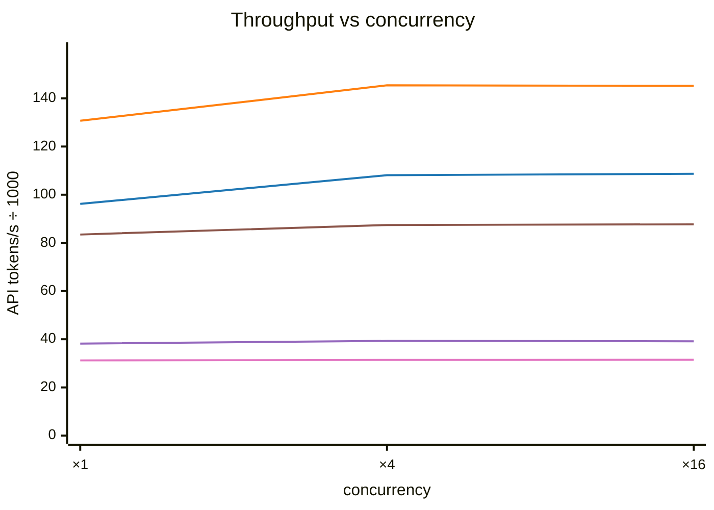
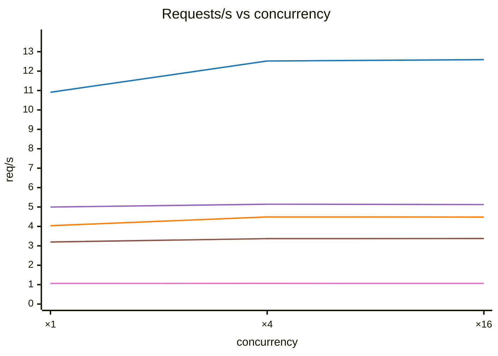
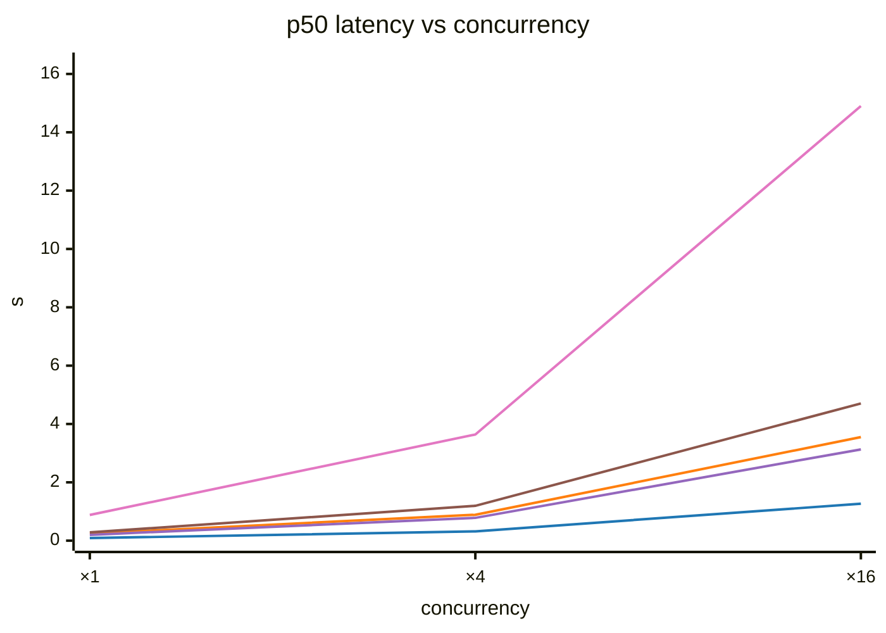

## speed — 2026-11-22 18:34 UTC

**PASS** · 441 s · 2032 requests · 0 (0.0%) errors · 0 rate-limited · 32,138,057 tokens billed

Closed loop, 25 s per cell, 5 request classes × concurrency [1, 4, 16]. 2032 requests, 32,138,057 tokens billed.

|  | requests | errors | 429s | p50 s | p90 s | p99 s | max s | req/s | API tok/s | MRR |
|---|---|---|---|---|---|---|---|---|---|---|
| short20 ×1 | 273 | 0 (0.0%) | 0 | 0.088 | 0.128 | 0.161 | 0.170 | 10.9 | 96,199 | 0.651 |
| short20 ×4 | 316 | 0 (0.0%) | 0 | 0.319 | 0.388 | 0.453 | 0.515 | 12.5 | 108,108 | 0.642 |
| short20 ×16 | 329 | 0 (0.0%) | 0 | 1.266 | 1.383 | 1.462 | 1.473 | 12.6 | 108,654 | 0.640 |
| many100 ×1 | 101 | 0 (0.0%) | 0 | 0.245 | 0.252 | 0.266 | 0.272 | 4.036 | 130,730 | 0.980 |
| many100 ×4 | 116 | 0 (0.0%) | 0 | 0.888 | 0.894 | 0.947 | 0.970 | 4.488 | 145,350 | 0.983 |
| many100 ×16 | 127 | 0 (0.0%) | 0 | 3.551 | 3.561 | 3.673 | 3.919 | 4.483 | 145,156 | 0.984 |
| long8k ×1 | 125 | 0 (0.0%) | 0 | 0.200 | 0.201 | 0.203 | 0.232 | 4.997 | 38,181 | 1.000 |
| long8k ×4 | 132 | 0 (0.0%) | 0 | 0.781 | 0.790 | 0.791 | 0.792 | 5.144 | 39,299 | 1.000 |
| long8k ×16 | 144 | 0 (0.0%) | 0 | 3.128 | 3.139 | 3.145 | 3.147 | 5.125 | 39,159 | 1.000 |
| pack32k ×1 | 80 | 0 (0.0%) | 0 | 0.283 | 0.467 | 0.541 | 0.575 | 3.196 | 83,466 | 1.000 |
| pack32k ×4 | 88 | 0 (0.0%) | 0 | 1.195 | 1.367 | 1.474 | 1.477 | 3.370 | 87,435 | 1.000 |
| pack32k ×16 | 100 | 0 (0.0%) | 0 | 4.703 | 4.991 | 5.229 | 5.245 | 3.375 | 87,696 | 1.000 |
| long32k ×1 | 27 | 0 (0.0%) | 0 | 0.883 | 1.303 | 1.307 | 1.307 | 1.061 | 31,231 | 1.000 |
| long32k ×4 | 31 | 0 (0.0%) | 0 | 3.640 | 4.241 | 4.340 | 4.342 | 1.065 | 31,416 | 1.000 |
| long32k ×16 | 43 | 0 (0.0%) | 0 | 14.9 | 16.0 | 16.2 | 16.2 | 1.060 | 31,453 | 0.988 |

*Throughput vs concurrency: short20, many100, long8k, pack32k, long32k*

*Requests/s vs concurrency: short20, many100, long8k, pack32k, long32k*

*p50 latency vs concurrency: short20, many100, long8k, pack32k, long32k*
