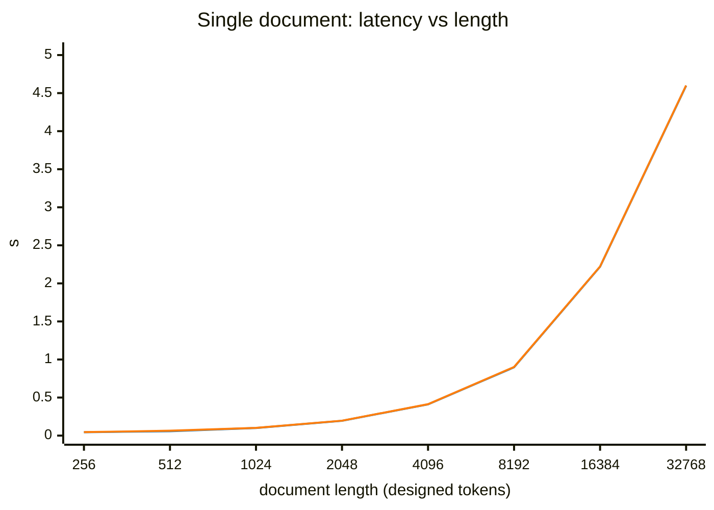
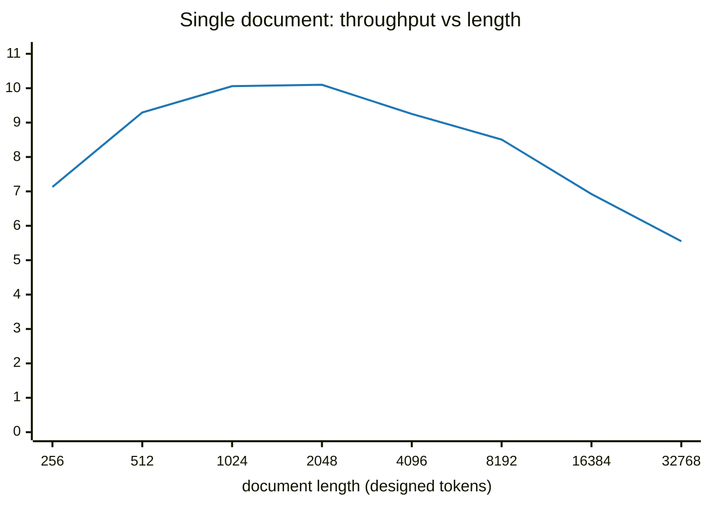
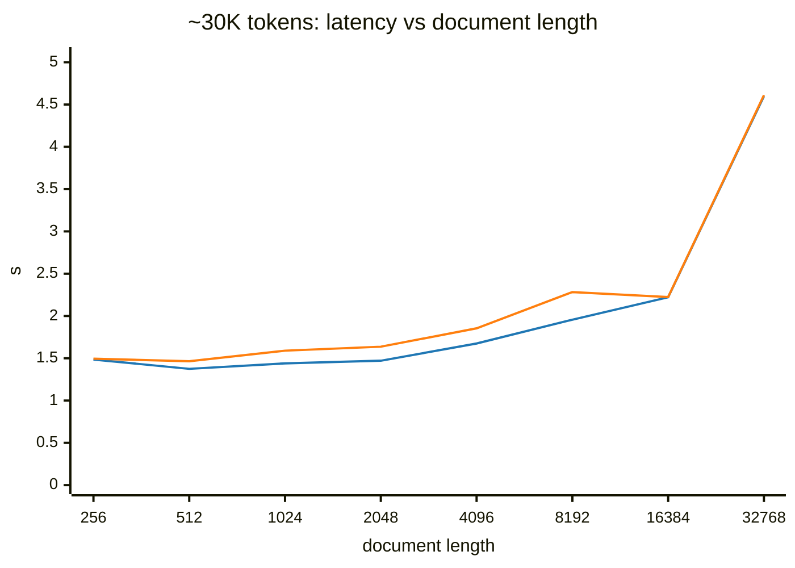
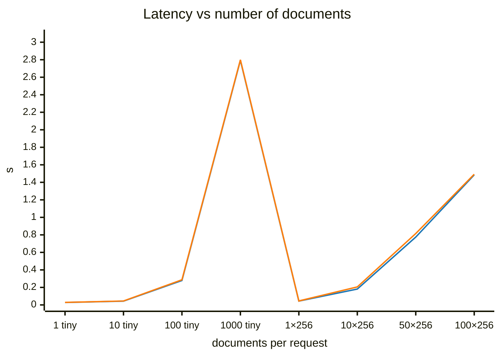
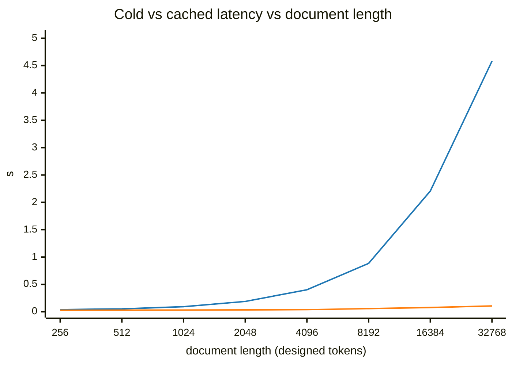
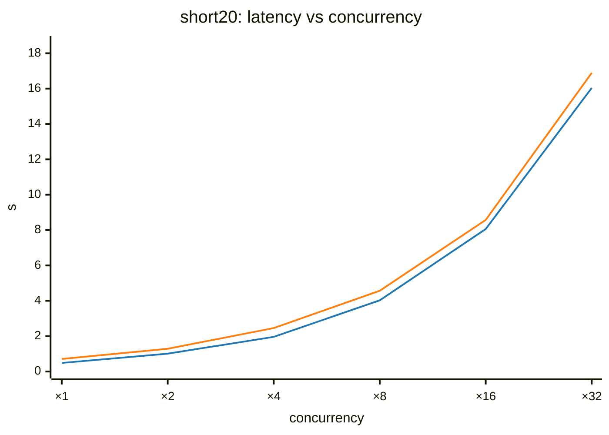
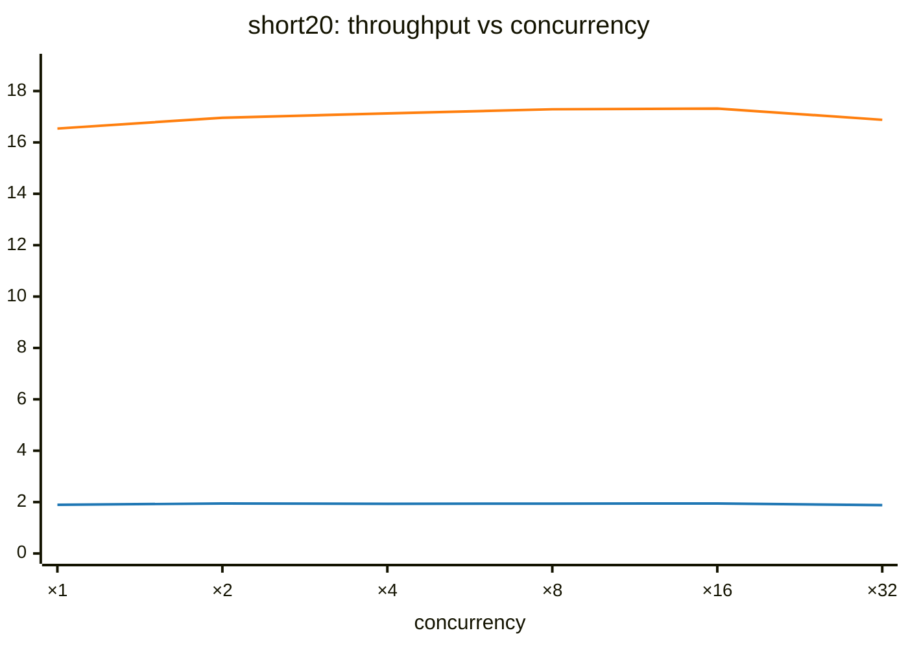
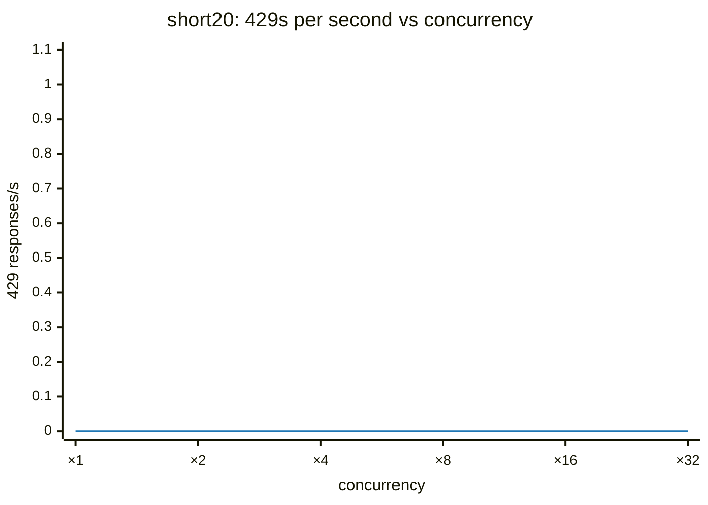

## meticulous — 2026-11-22 20:17 UTC

**PASS** · 838 s · 952 requests · 0 (0.0%) errors · 0 rate-limited · 10,541,534 tokens billed

Sequential requests (one in flight) unless stated; every query carries a nonce so nothing is served from the API's prefix cache.

### Single document: latency vs length

| rung | Qwen tokens | billed | errors | p50 s | p90 s | max s | API tok/s |
|---|---|---|---|---|---|---|---|
| 256 | 229 | 323 | 0 (0.0%) | 0.044 | 0.045 | 0.081 | 7,130 |
| 512 | 457 | 551 | 0 (0.0%) | 0.058 | 0.064 | 0.065 | 9,295 |
| 1,024 | 911 | 1,005 | 0 (0.0%) | 0.100 | 0.102 | 0.102 | 10,061 |
| 2,048 | 1,872 | 1,966 | 0 (0.0%) | 0.194 | 0.196 | 0.200 | 10,100 |
| 4,096 | 3,707 | 3,801 | 0 (0.0%) | 0.411 | 0.413 | 0.415 | 9,253 |
| 8,192 | 7,545 | 7,639 | 0 (0.0%) | 0.898 | 0.901 | 0.903 | 8,508 |
| 16,384 | 15,274 | 15,368 | 0 (0.0%) | 2.219 | 2.222 | 2.234 | 6,923 |
| 32,768 | 25,438 | 25,536 | 0 (0.0%) | 4.597 | 4.601 | 4.656 | 5,552 |

*Single document: latency vs length: p50, p90*

*Single document: throughput vs length: API tokens/s ÷ 1000*

### ~30K tokens per request: latency vs document length (fewer, longer documents)

| rung | docs/request | billed | errors | p50 s | p90 s | max s | API tok/s |
|---|---|---|---|---|---|---|---|
| 256 | 100 | 32,412 | 0 (0.0%) | 1.485 | 1.495 | 1.516 | 21,828 |
| 512 | 55 | 30,286 | 0 (0.0%) | 1.375 | 1.465 | 1.557 | 21,758 |
| 1,024 | 28 | 28,179 | 0 (0.0%) | 1.440 | 1.590 | 1.637 | 19,496 |
| 2,048 | 13 | 25,575 | 0 (0.0%) | 1.471 | 1.637 | 1.775 | 17,743 |
| 4,096 | 6 | 22,807 | 0 (0.0%) | 1.675 | 1.854 | 1.984 | 13,894 |
| 8,192 | 3 | 22,922 | 0 (0.0%) | 1.956 | 2.283 | 2.505 | 12,077 |
| 16,384 | 1 | 15,366 | 0 (0.0%) | 2.221 | 2.224 | 2.224 | 6,919 |
| 32,768 | 1 | 25,541 | 0 (0.0%) | 4.599 | 4.611 | 4.664 | 5,549 |

*~30K tokens: latency vs document length: p50, p90*

### Latency vs number of documents

| documents | billed | errors | p50 s | p90 s | max s | MRR |
|---|---|---|---|---|---|---|
| 1 tiny | 91.0 | 0 (0.0%) | 0.028 | 0.029 | 0.030 | 1.000 |
| 10 tiny | 915 | 0 (0.0%) | 0.043 | 0.045 | 0.051 | 1.000 |
| 100 tiny | 9,309 | 0 (0.0%) | 0.279 | 0.287 | 0.289 | 1.000 |
| 1000 tiny | 94,189 | 0 (0.0%) | 2.793 | 2.799 | 2.799 | 1.000 |
| 1×256 | 323 | 0 (0.0%) | 0.044 | 0.045 | 0.045 | 1.000 |
| 10×256 | 3,232 | 0 (0.0%) | 0.181 | 0.205 | 0.223 | 1.000 |
| 50×256 | 16,155 | 0 (0.0%) | 0.775 | 0.815 | 0.837 | 1.000 |
| 100×256 | 32,379 | 0 (0.0%) | 1.485 | 1.492 | 1.510 | 0.950 |

*Latency vs number of documents: p50, p90*

### Cold vs cached: the same single-document request sent twice in a row

The API caches prompt prefixes, so a repeated (query, document) pair skips most of the compute. Cold = fresh nonce in the query; cached = the identical request again immediately after.

| rung | pairs | cold p50 s | cached p50 s | speed-up × | cold max s | cached max s | errors |
|---|---|---|---|---|---|---|---|
| 256 | 10 | 0.040 | 0.027 | 1.463 | 0.053 | 0.029 |  |
| 512 | 10 | 0.053 | 0.030 | 1.774 | 0.058 | 0.032 |  |
| 1,024 | 10 | 0.093 | 0.031 | 2.975 | 0.094 | 0.032 |  |
| 2,048 | 10 | 0.189 | 0.034 | 5.606 | 0.194 | 0.035 |  |
| 4,096 | 10 | 0.402 | 0.038 | 10.5 | 0.407 | 0.039 |  |
| 8,192 | 10 | 0.884 | 0.057 | 15.4 | 0.892 | 0.059 |  |
| 16,384 | 10 | 2.207 | 0.078 | 28.3 | 2.215 | 0.082 |  |
| 32,768 | 10 | 4.581 | 0.106 | 43.0 | 4.649 | 0.108 |  |

*Cold vs cached latency vs document length: cold p50, cached p50*

### short20: latency and throughput vs concurrency

|  | requests | errors | 429s | p50 s | p90 s | p99 s | max s | req/s | API tok/s | MRR |
|---|---|---|---|---|---|---|---|---|---|---|
| ×1 | 48 | 0 (0.0%) | 0 | 0.485 | 0.710 | 0.932 | 0.977 | 1.894 | 16,538 | 0.719 |
| ×2 | 50 | 0 (0.0%) | 0 | 1.012 | 1.290 | 1.526 | 1.647 | 1.944 | 16,957 | 0.716 |
| ×4 | 52 | 0 (0.0%) | 0 | 1.961 | 2.458 | 2.858 | 2.892 | 1.935 | 17,133 | 0.723 |
| ×8 | 57 | 0 (0.0%) | 0 | 4.026 | 4.569 | 5.003 | 5.147 | 1.940 | 17,289 | 0.691 |
| ×16 | 64 | 0 (0.0%) | 0 | 8.061 | 8.575 | 8.975 | 9.072 | 1.945 | 17,315 | 0.677 |
| ×32 | 81 | 0 (0.0%) | 0 | 16.0 | 16.9 | 18.0 | 18.1 | 1.882 | 16,878 | 0.672 |

No 429s up to concurrency ×32.

*short20: latency vs concurrency: p50, p90*

*short20: throughput vs concurrency: req/s, API tokens/s ÷ 1000*

*short20: 429s per second vs concurrency: 429/s*

952 requests, 10,541,534 tokens billed.
