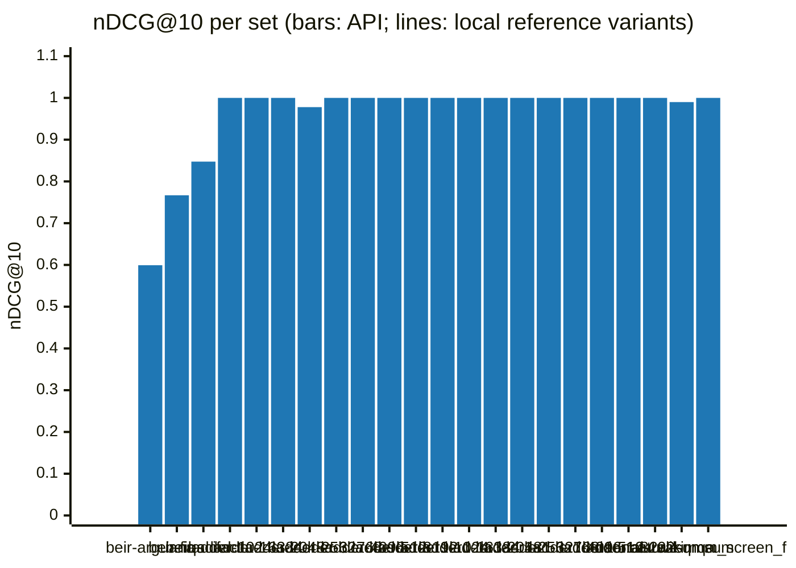

## quality — 2026-11-22 19:30 UTC

**PASS** · 2814 s · 2000 requests · 1 (0.1%) errors · 0 rate-limited · 29,443,091 tokens billed

Up to 300 requests per set (100 for natural-*) at 2 in flight (429s retried); 2000 requests, 29,443,091 tokens billed. nDCG@10 / MRR are against the ground-truth labels; every reference column is computed over the same requests. Local reference variants of Qwen3-Reranker-0.6B (scripts/reference.py): **none available here** — run scripts/reference.py on a GPU. |Δ| is the mean absolute score difference per document; top-1 is the share of requests where the API and the reference pick the same best document.

| set | requests | errors | 429s | nDCG@10 API | MRR API | p50 s |
|---|---|---|---|---|---|---|
| beir-arguana | 300 | 0 (0.0%) | 0 | 0.599 | 0.463 | 0.882 |
| beir-fiqa | 300 | 0 (0.0%) | 0 | 0.767 | 0.786 | 0.831 |
| beir-scifact | 300 | 0 (0.0%) | 0 | 0.847 | 0.811 | 1.298 |
| ladder-1024 | 50 | 0 (0.0%) | 0 | 1.000 | 1.000 | 2.789 |
| ladder-16384 | 50 | 0 (0.0%) | 0 | 1.000 | 1.000 | 4.398 |
| ladder-2048 | 50 | 0 (0.0%) | 0 | 1.000 | 1.000 | 2.955 |
| ladder-256 | 50 | 0 (0.0%) | 0 | 0.978 | 0.970 | 2.983 |
| ladder-32768 | 50 | 0 (0.0%) | 0 | 1.000 | 1.000 | 9.103 |
| ladder-4096 | 50 | 0 (0.0%) | 0 | 1.000 | 1.000 | 3.194 |
| ladder-512 | 50 | 0 (0.0%) | 0 | 1.000 | 1.000 | 2.750 |
| ladder-8192 | 50 | 0 (0.0%) | 0 | 1.000 | 1.000 | 3.841 |
| ladder1-1024 | 50 | 0 (0.0%) | 0 | 1.000 | 1.000 | 0.187 |
| ladder1-16384 | 50 | 0 (0.0%) | 0 | 1.000 | 1.000 | 4.390 |
| ladder1-2048 | 50 | 0 (0.0%) | 0 | 1.000 | 1.000 | 0.378 |
| ladder1-256 | 50 | 0 (0.0%) | 0 | 1.000 | 1.000 | 0.064 |
| ladder1-32768 | 50 | 0 (0.0%) | 0 | 1.000 | 1.000 | 9.096 |
| ladder1-4096 | 50 | 0 (0.0%) | 0 | 1.000 | 1.000 | 0.802 |
| ladder1-512 | 50 | 0 (0.0%) | 0 | 1.000 | 1.000 | 0.104 |
| ladder1-8192 | 50 | 0 (0.0%) | 0 | 1.000 | 1.000 | 1.766 |
| natural-2wikimqa | 100 | 0 (0.0%) | 0 | 1.000 | 1.000 | 7.353 |
| natural-qmsum | 100 | 0 (0.0%) | 0 | 0.990 | 0.987 | 7.697 |
| natural-summ_screen_fd | 100 | 1 (1.0%) | 0 | 1.000 | 1.000 | 7.645 |

| error | count | example | response |
|---|---|---|---|
| http 424 ModelError container 0 | 1 | natural-summ_screen_fd natural-summ_screen_fd/query_41 | {"ErrorCode":"INTERNAL_FAILURE_FROM_MODEL","LogStreamArn":"arn:aws:logs:eu-west-3:<account-id>:log-group:/aws/sagemaker/Endpoints/reranker-tl-4b-q2","Message":"Received server error (0) from primary with message \"Connection reset by peer for the reranker-tl-4b-q2 endpoint. Please retry.\". See ht |

*nDCG@10 per set (bars: API; lines: local reference variants): API*
