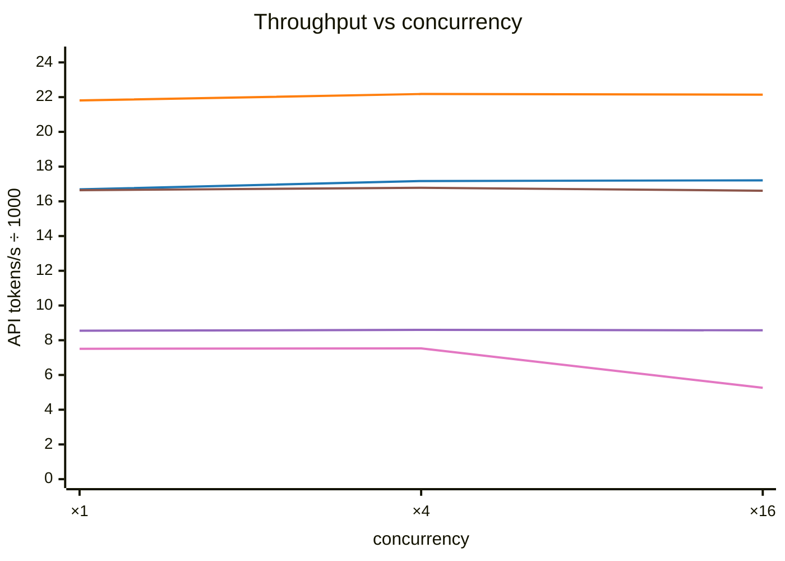
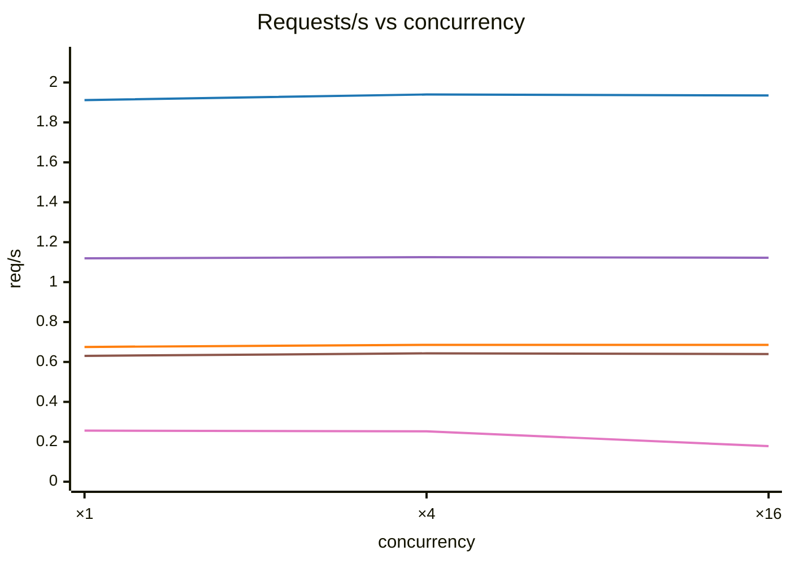
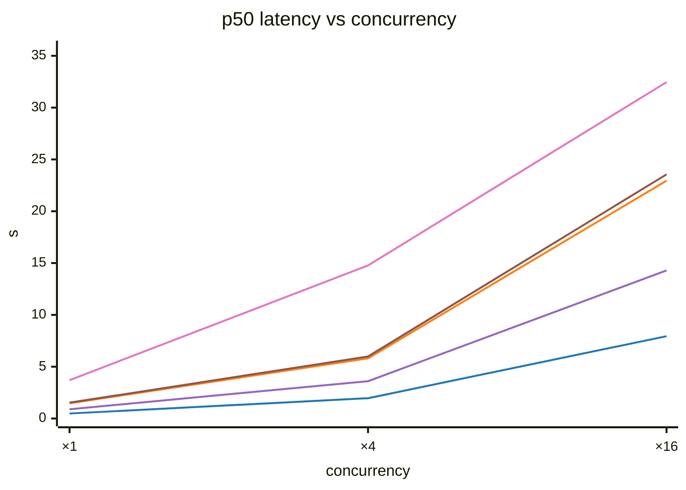

## speed — 2026-11-22 20:31 UTC

**PASS** · 565 s · 443 requests · 7 (1.6%) errors · 0 rate-limited · 7,200,101 tokens billed

Closed loop, 25 s per cell, 5 request classes × concurrency [1, 4, 16]. 443 requests, 7,200,101 tokens billed.

|  | requests | errors | 429s | p50 s | p90 s | p99 s | max s | req/s | API tok/s | MRR |
|---|---|---|---|---|---|---|---|---|---|---|
| short20 ×1 | 48 | 0 (0.0%) | 0 | 0.484 | 0.709 | 0.927 | 0.965 | 1.912 | 16,692 | 0.717 |
| short20 ×4 | 52 | 0 (0.0%) | 0 | 1.960 | 2.445 | 2.819 | 2.820 | 1.940 | 17,174 | 0.719 |
| short20 ×16 | 65 | 0 (0.0%) | 0 | 7.941 | 8.494 | 8.903 | 9.043 | 1.935 | 17,213 | 0.684 |
| many100 ×1 | 17 | 0 (0.0%) | 0 | 1.474 | 1.510 | 1.513 | 1.514 | 0.675 | 21,808 | 1.000 |
| many100 ×4 | 21 | 0 (0.0%) | 0 | 5.808 | 5.889 | 6.196 | 6.204 | 0.686 | 22,179 | 1.000 |
| many100 ×16 | 33 | 0 (0.0%) | 0 | 23.0 | 23.4 | 23.4 | 23.5 | 0.685 | 22,139 | 0.970 |
| long8k ×1 | 28 | 0 (0.0%) | 0 | 0.894 | 0.897 | 0.902 | 0.903 | 1.119 | 8,546 | 1.000 |
| long8k ×4 | 31 | 0 (0.0%) | 0 | 3.602 | 3.619 | 3.646 | 3.654 | 1.125 | 8,598 | 1.000 |
| long8k ×16 | 43 | 0 (0.0%) | 0 | 14.3 | 14.3 | 14.3 | 14.3 | 1.122 | 8,572 | 1.000 |
| pack32k ×1 | 16 | 0 (0.0%) | 0 | 1.529 | 1.989 | 2.251 | 2.296 | 0.631 | 16,641 | 1.000 |
| pack32k ×4 | 19 | 0 (0.0%) | 0 | 5.986 | 6.641 | 7.119 | 7.205 | 0.643 | 16,777 | 1.000 |
| pack32k ×16 | 31 | 0 (0.0%) | 0 | 23.6 | 24.6 | 25.0 | 25.1 | 0.640 | 16,606 | 1.000 |
| long32k ×1 | 7 | 0 (0.0%) | 0 | 3.697 | 4.564 | 4.584 | 4.587 | 0.256 | 7,510 | 1.000 |
| long32k ×4 | 10 | 0 (0.0%) | 0 | 14.8 | 16.8 | 17.0 | 17.0 | 0.253 | 7,530 | 1.000 |
| long32k ×16 | 22 | 7 (31.8%) | 0 | 32.5 | 53.5 | 58.5 | 59.1 | 0.178 | 5,262 | 1.000 |

| error | count | example | response |
|---|---|---|---|
| http 424 ModelError timed out at SageMaker | 7 | natural-summ_screen_fd natural-summ_screen_fd/query_42 | {"ErrorCode":"INTERNAL_FAILURE_FROM_MODEL","LogStreamArn":"arn:aws:logs:eu-west-3:<account-id>:log-group:/aws/sagemaker/Endpoints/reranker-tl-4b-q2","Message":"Received server error (0) from primary with message \"Your invocation timed out while waiting for a response from container primary. Review |

*Throughput vs concurrency: short20, many100, long8k, pack32k, long32k*

*Requests/s vs concurrency: short20, many100, long8k, pack32k, long32k*

*p50 latency vs concurrency: short20, many100, long8k, pack32k, long32k*
