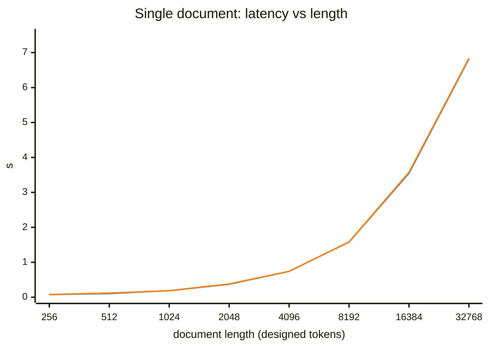
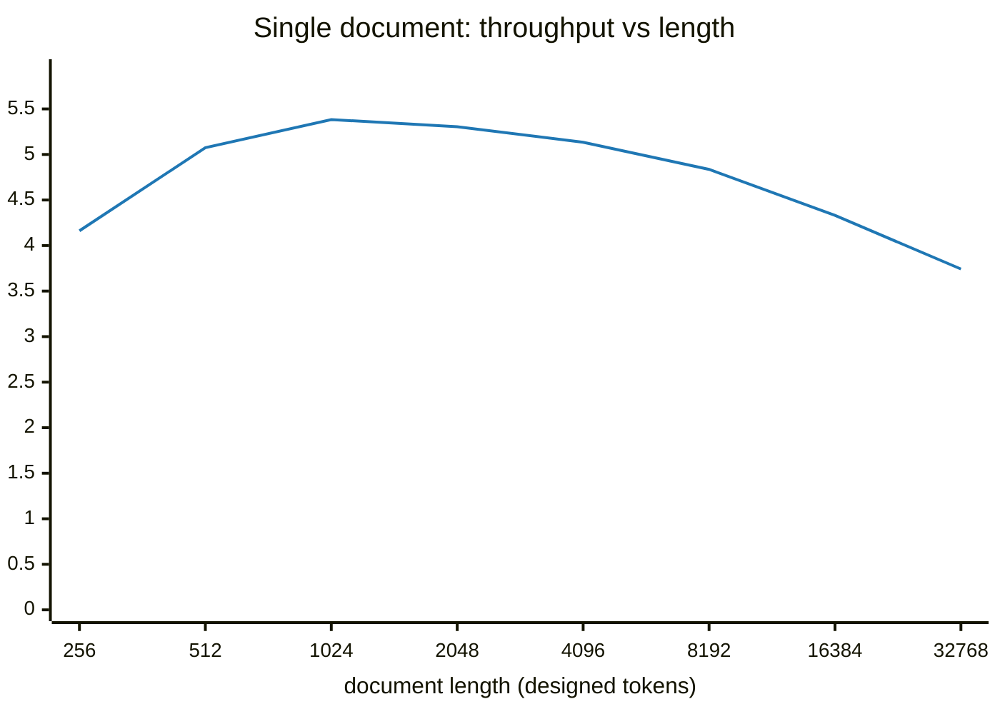
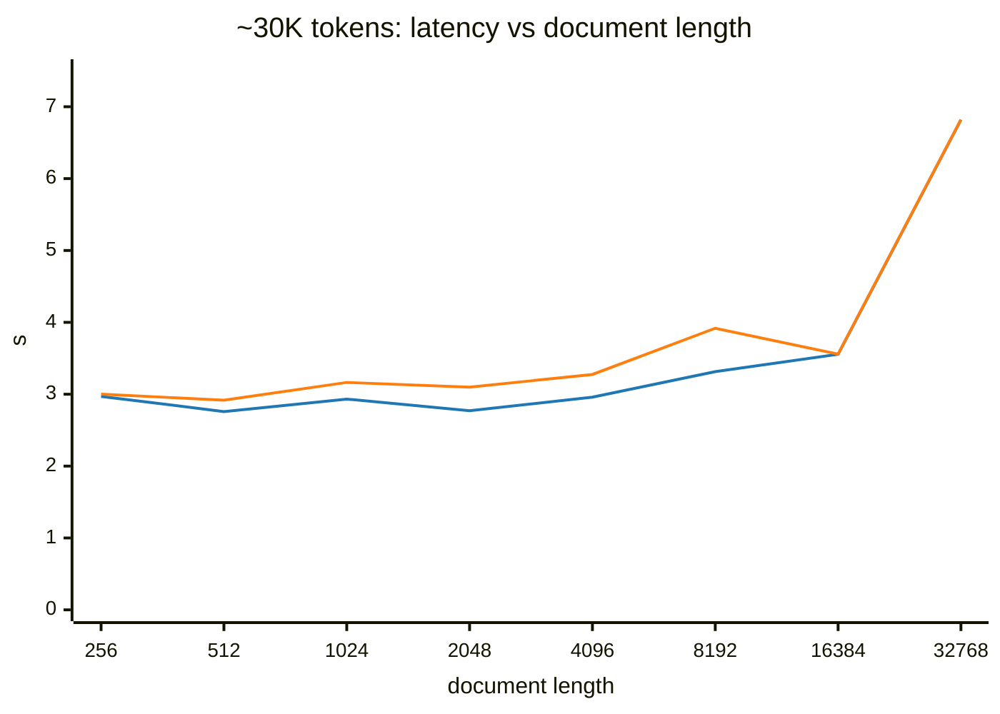
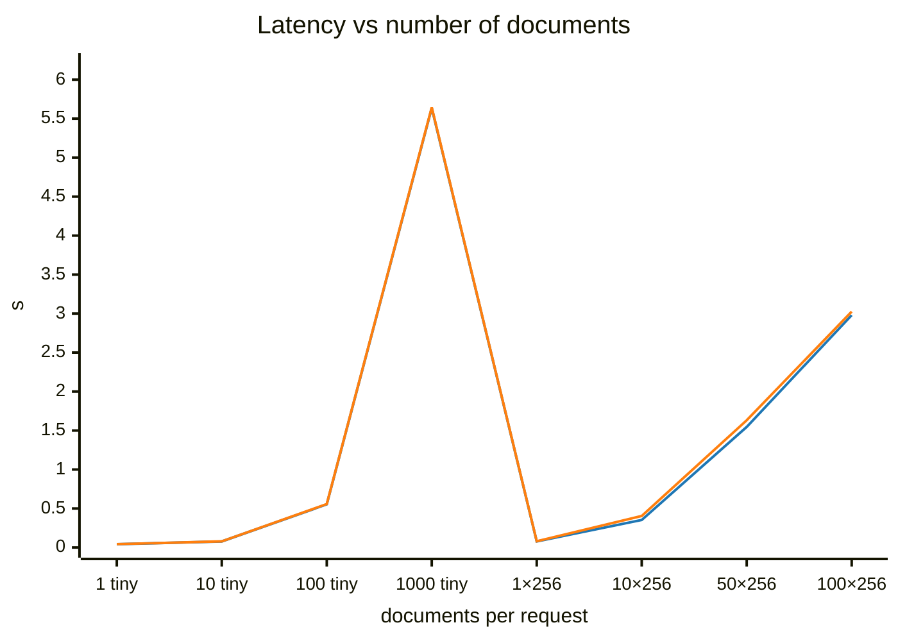
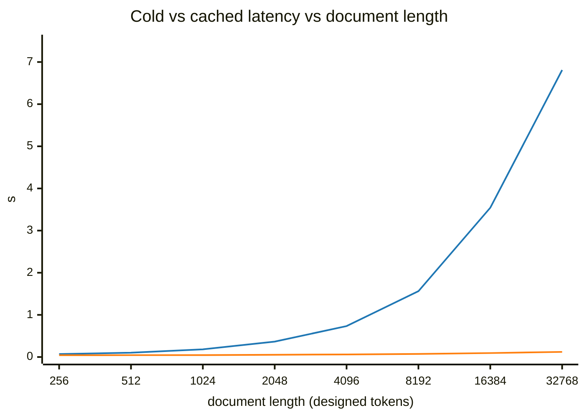
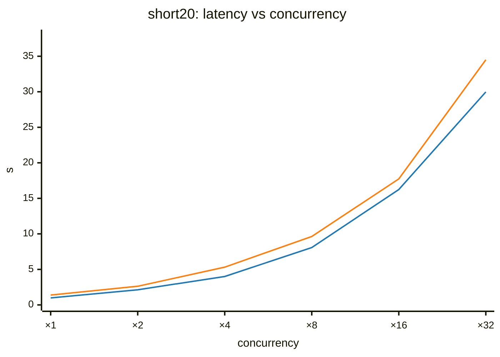
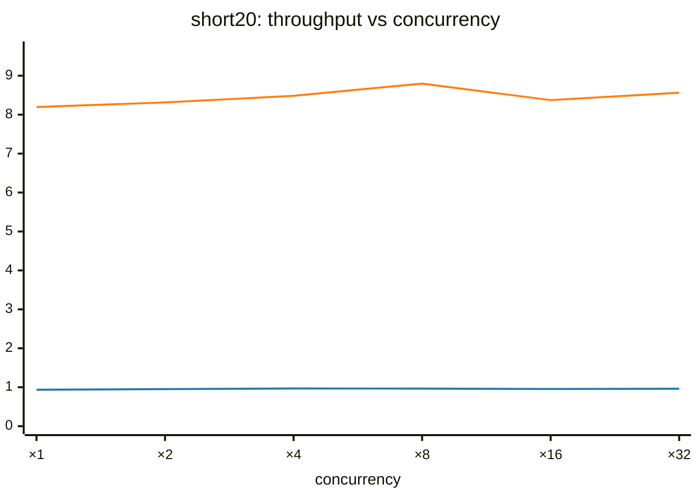
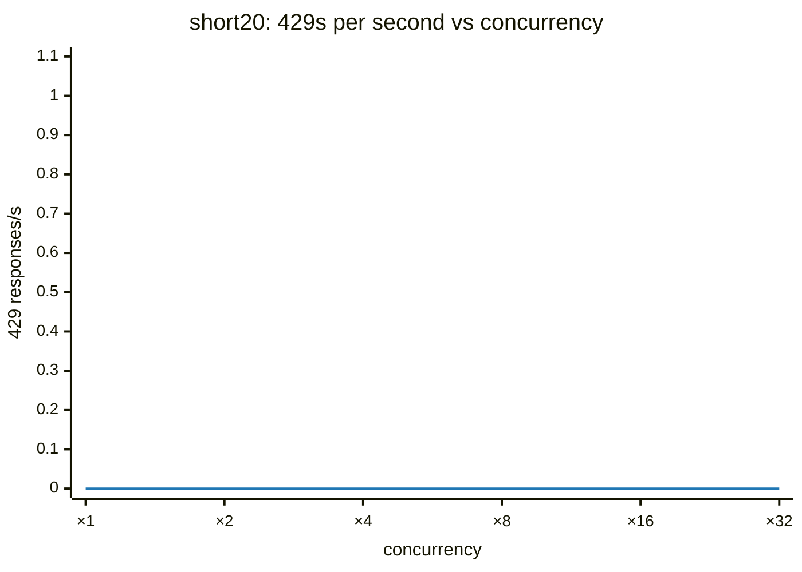

## meticulous — 2026-11-22 20:53 UTC

**PASS** · 1294 s · 801 requests · 0 (0.0%) errors · 0 rate-limited · 9,202,082 tokens billed

Sequential requests (one in flight) unless stated; every query carries a nonce so nothing is served from the API's prefix cache.

### Single document: latency vs length

| rung | Qwen tokens | billed | errors | p50 s | p90 s | max s | API tok/s |
|---|---|---|---|---|---|---|---|
| 256 | 229 | 324 | 0 (0.0%) | 0.076 | 0.079 | 0.105 | 4,162 |
| 512 | 457 | 551 | 0 (0.0%) | 0.105 | 0.119 | 0.121 | 5,074 |
| 1,024 | 911 | 1,005 | 0 (0.0%) | 0.186 | 0.189 | 0.191 | 5,383 |
| 2,048 | 1,872 | 1,966 | 0 (0.0%) | 0.372 | 0.379 | 0.381 | 5,304 |
| 4,096 | 3,707 | 3,800 | 0 (0.0%) | 0.740 | 0.742 | 0.746 | 5,134 |
| 8,192 | 7,545 | 7,640 | 0 (0.0%) | 1.579 | 1.583 | 1.586 | 4,836 |
| 16,384 | 15,274 | 15,368 | 0 (0.0%) | 3.550 | 3.576 | 3.578 | 4,331 |
| 32,768 | 25,438 | 25,536 | 0 (0.0%) | 6.819 | 6.837 | 6.891 | 3,742 |

*Single document: latency vs length: p50, p90*

*Single document: throughput vs length: API tokens/s ÷ 1000*

### ~30K tokens per request: latency vs document length (fewer, longer documents)

| rung | docs/request | billed | errors | p50 s | p90 s | max s | API tok/s |
|---|---|---|---|---|---|---|---|
| 256 | 100 | 32,386 | 0 (0.0%) | 2.969 | 3.001 | 3.012 | 10,907 |
| 512 | 55 | 30,282 | 0 (0.0%) | 2.759 | 2.917 | 3.093 | 10,937 |
| 1,024 | 28 | 28,172 | 0 (0.0%) | 2.932 | 3.164 | 3.228 | 9,801 |
| 2,048 | 13 | 25,572 | 0 (0.0%) | 2.770 | 3.098 | 3.346 | 9,415 |
| 4,096 | 6 | 22,808 | 0 (0.0%) | 2.959 | 3.275 | 3.521 | 7,849 |
| 8,192 | 3 | 22,923 | 0 (0.0%) | 3.314 | 3.918 | 4.346 | 7,066 |
| 16,384 | 1 | 15,366 | 0 (0.0%) | 3.555 | 3.558 | 3.570 | 4,323 |
| 32,768 | 1 | 25,541 | 0 (0.0%) | 6.817 | 6.821 | 6.895 | 3,744 |

*~30K tokens: latency vs document length: p50, p90*

### Latency vs number of documents

| documents | billed | errors | p50 s | p90 s | max s | MRR |
|---|---|---|---|---|---|---|
| 1 tiny | 91.0 | 0 (0.0%) | 0.042 | 0.043 | 0.044 | 1.000 |
| 10 tiny | 925 | 0 (0.0%) | 0.077 | 0.078 | 0.079 | 1.000 |
| 100 tiny | 9,299 | 0 (0.0%) | 0.553 | 0.557 | 0.562 | 1.000 |
| 1000 tiny | 94,389 | 0 (0.0%) | 5.637 | 5.645 | 5.650 | 1.000 |
| 1×256 | 323 | 0 (0.0%) | 0.077 | 0.079 | 0.081 | 1.000 |
| 10×256 | 3,233 | 0 (0.0%) | 0.353 | 0.404 | 0.444 | 1.000 |
| 50×256 | 16,175 | 0 (0.0%) | 1.546 | 1.632 | 1.675 | 1.000 |
| 100×256 | 32,319 | 0 (0.0%) | 2.979 | 3.025 | 3.030 | 1.000 |

*Latency vs number of documents: p50, p90*

### Cold vs cached: the same single-document request sent twice in a row

The API caches prompt prefixes, so a repeated (query, document) pair skips most of the compute. Cold = fresh nonce in the query; cached = the identical request again immediately after.

| rung | pairs | cold p50 s | cached p50 s | speed-up × | cold max s | cached max s | errors |
|---|---|---|---|---|---|---|---|
| 256 | 10 | 0.070 | 0.044 | 1.607 | 0.076 | 0.047 |  |
| 512 | 10 | 0.103 | 0.045 | 2.299 | 0.115 | 0.046 |  |
| 1,024 | 10 | 0.183 | 0.046 | 3.971 | 0.187 | 0.049 |  |
| 2,048 | 10 | 0.366 | 0.054 | 6.786 | 0.376 | 0.056 |  |
| 4,096 | 10 | 0.734 | 0.061 | 12.1 | 0.738 | 0.062 |  |
| 8,192 | 10 | 1.562 | 0.073 | 21.5 | 1.567 | 0.074 |  |
| 16,384 | 10 | 3.542 | 0.094 | 37.7 | 3.553 | 0.098 |  |
| 32,768 | 10 | 6.810 | 0.122 | 56.0 | 6.874 | 0.126 |  |

*Cold vs cached latency vs document length: cold p50, cached p50*

### short20: latency and throughput vs concurrency

|  | requests | errors | 429s | p50 s | p90 s | p99 s | max s | req/s | API tok/s | MRR |
|---|---|---|---|---|---|---|---|---|---|---|
| ×1 | 24 | 0 (0.0%) | 0 | 0.987 | 1.391 | 1.895 | 1.936 | 0.936 | 8,195 | 0.691 |
| ×2 | 25 | 0 (0.0%) | 0 | 2.132 | 2.628 | 3.216 | 3.332 | 0.952 | 8,313 | 0.687 |
| ×4 | 26 | 0 (0.0%) | 0 | 4.003 | 5.317 | 5.688 | 5.690 | 0.968 | 8,483 | 0.705 |
| ×8 | 31 | 0 (0.0%) | 0 | 8.073 | 9.634 | 10.4 | 10.4 | 0.967 | 8,798 | 0.707 |
| ×16 | 38 | 0 (0.0%) | 0 | 16.2 | 17.7 | 18.9 | 19.2 | 0.955 | 8,373 | 0.733 |
| ×32 | 57 | 0 (0.0%) | 0 | 30.0 | 34.5 | 34.6 | 34.6 | 0.961 | 8,563 | 0.728 |

No 429s up to concurrency ×32.

*short20: latency vs concurrency: p50, p90*

*short20: throughput vs concurrency: req/s, API tokens/s ÷ 1000*

*short20: 429s per second vs concurrency: 429/s*

801 requests, 9,202,082 tokens billed.
