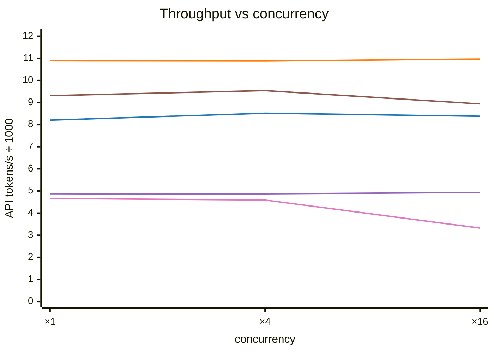
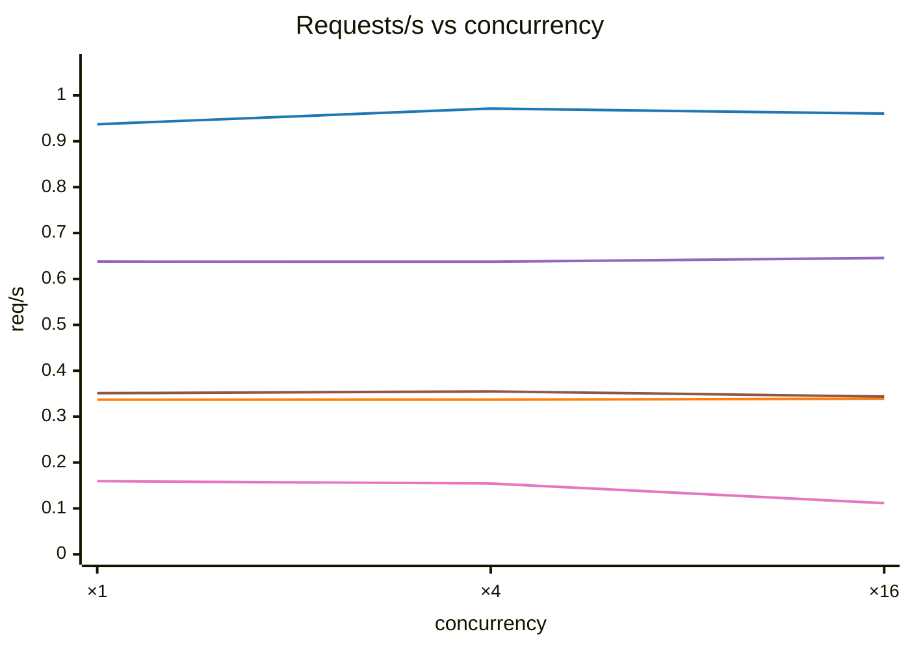
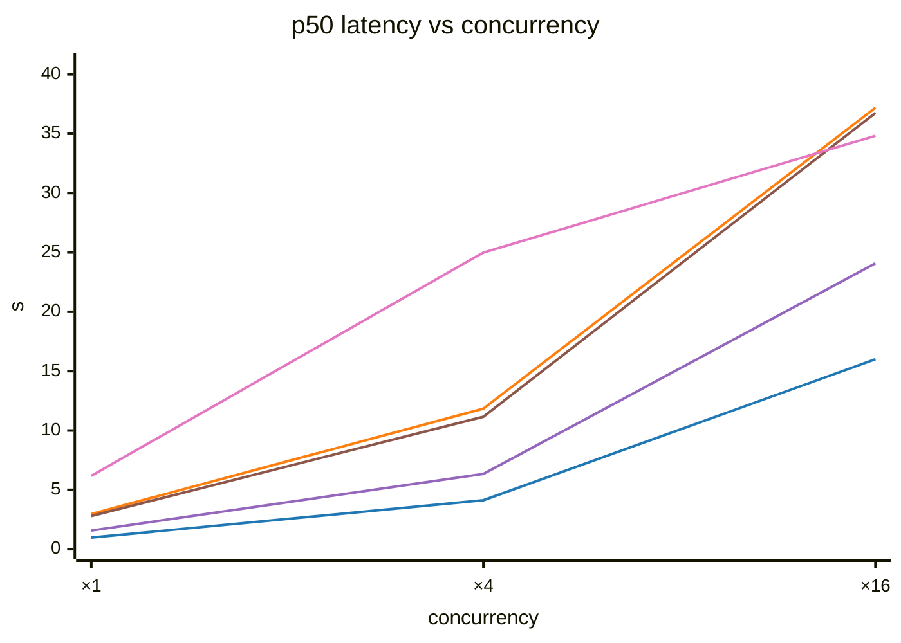

## speed — 2026-11-22 21:14 UTC

**PASS** · 648 s · 277 requests · 10 (3.6%) errors · 0 rate-limited · 4,553,309 tokens billed

Closed loop, 25 s per cell, 5 request classes × concurrency [1, 4, 16]. 277 requests, 4,553,309 tokens billed.

|  | requests | errors | 429s | p50 s | p90 s | p99 s | max s | req/s | API tok/s | MRR |
|---|---|---|---|---|---|---|---|---|---|---|
| short20 ×1 | 24 | 0 (0.0%) | 0 | 0.980 | 1.395 | 1.908 | 1.944 | 0.937 | 8,204 | 0.684 |
| short20 ×4 | 26 | 0 (0.0%) | 0 | 4.124 | 5.286 | 5.672 | 5.674 | 0.971 | 8,516 | 0.689 |
| short20 ×16 | 39 | 0 (0.0%) | 0 | 16.0 | 17.1 | 17.8 | 17.8 | 0.960 | 8,380 | 0.748 |
| many100 ×1 | 9 | 0 (0.0%) | 0 | 2.970 | 2.989 | 3.020 | 3.024 | 0.337 | 10,893 | 1.000 |
| many100 ×4 | 12 | 0 (0.0%) | 0 | 11.8 | 12.5 | 12.6 | 12.6 | 0.337 | 10,881 | 1.000 |
| many100 ×16 | 24 | 0 (0.0%) | 0 | 37.2 | 47.3 | 47.3 | 47.3 | 0.339 | 10,965 | 1.000 |
| long8k ×1 | 16 | 0 (0.0%) | 0 | 1.571 | 1.576 | 1.576 | 1.576 | 0.638 | 4,874 | 1.000 |
| long8k ×4 | 19 | 0 (0.0%) | 0 | 6.342 | 6.416 | 6.428 | 6.429 | 0.638 | 4,872 | 1.000 |
| long8k ×16 | 32 | 0 (0.0%) | 0 | 24.1 | 24.9 | 24.9 | 24.9 | 0.646 | 4,934 | 1.000 |
| pack32k ×1 | 9 | 0 (0.0%) | 0 | 2.795 | 3.113 | 3.388 | 3.419 | 0.351 | 9,312 | 1.000 |
| pack32k ×4 | 12 | 0 (0.0%) | 0 | 11.2 | 11.7 | 12.1 | 12.2 | 0.355 | 9,540 | 1.000 |
| pack32k ×16 | 24 | 0 (0.0%) | 0 | 36.7 | 47.0 | 47.6 | 47.7 | 0.344 | 8,938 | 1.000 |
| long32k ×1 | 4 | 0 (0.0%) | 0 | 6.182 | 6.672 | 6.773 | 6.784 | 0.159 | 4,662 | 1.000 |
| long32k ×4 | 8 | 0 (0.0%) | 0 | 25.0 | 26.0 | 26.8 | 26.9 | 0.154 | 4,591 | 1.000 |
| long32k ×16 | 19 | 10 (52.6%) | 0 | 34.8 | 54.8 | 59.1 | 59.5 | 0.111 | 3,323 | 1.000 |

| error | count | example | response |
|---|---|---|---|
| http 424 ModelError timed out at SageMaker | 10 | natural-summ_screen_fd natural-summ_screen_fd/query_18 | {"ErrorCode":"INTERNAL_FAILURE_FROM_MODEL","LogStreamArn":"arn:aws:logs:eu-west-3:<account-id>:log-group:/aws/sagemaker/Endpoints/reranker-tl-8b-q1","Message":"Received server error (0) from primary with message \"Your invocation timed out while waiting for a response from container primary. Review |

*Throughput vs concurrency: short20, many100, long8k, pack32k, long32k*

*Requests/s vs concurrency: short20, many100, long8k, pack32k, long32k*

*p50 latency vs concurrency: short20, many100, long8k, pack32k, long32k*
