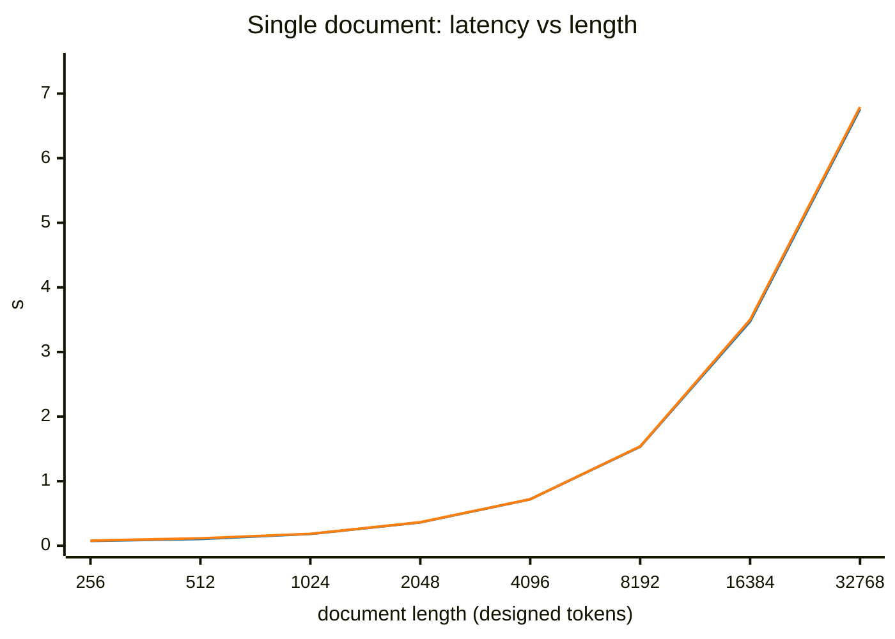
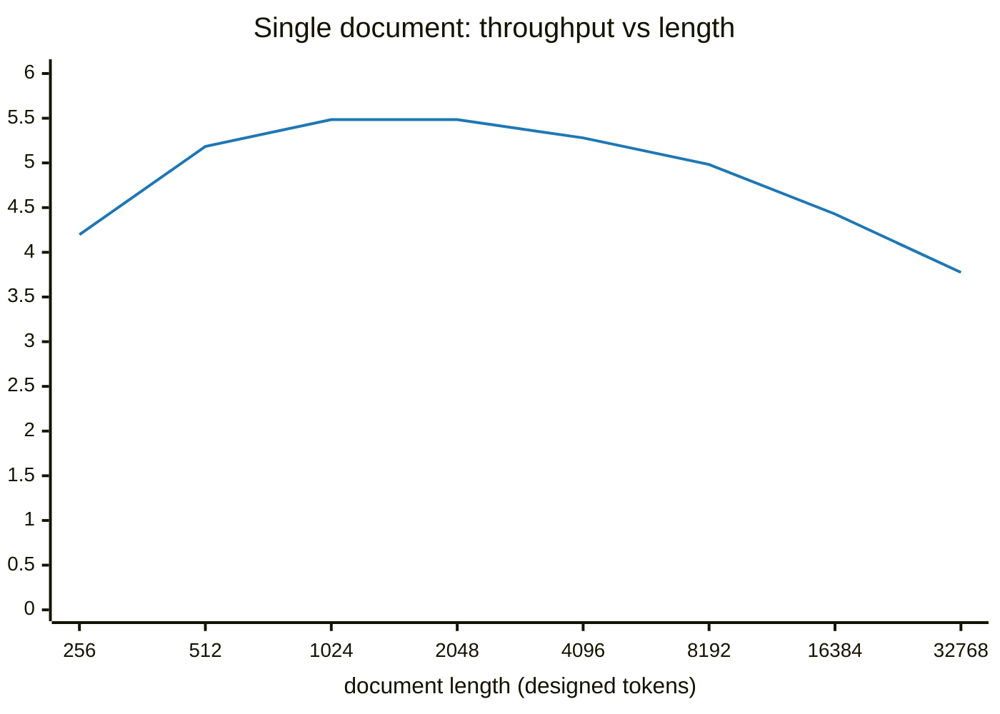
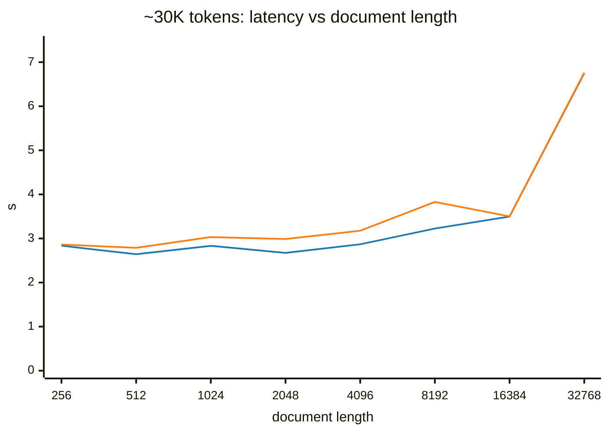
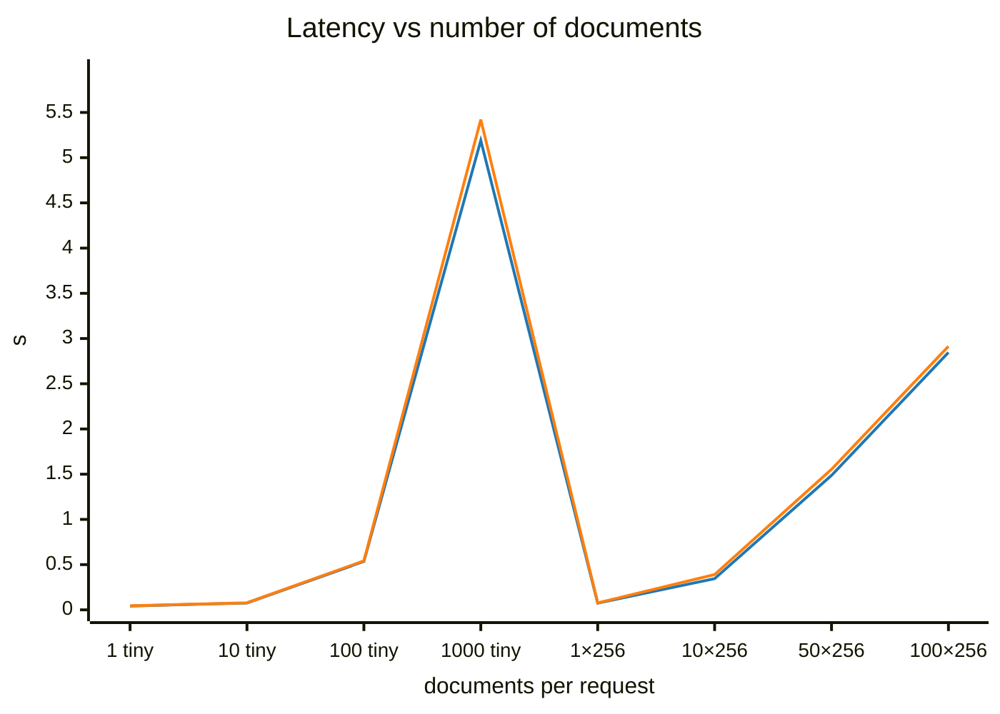
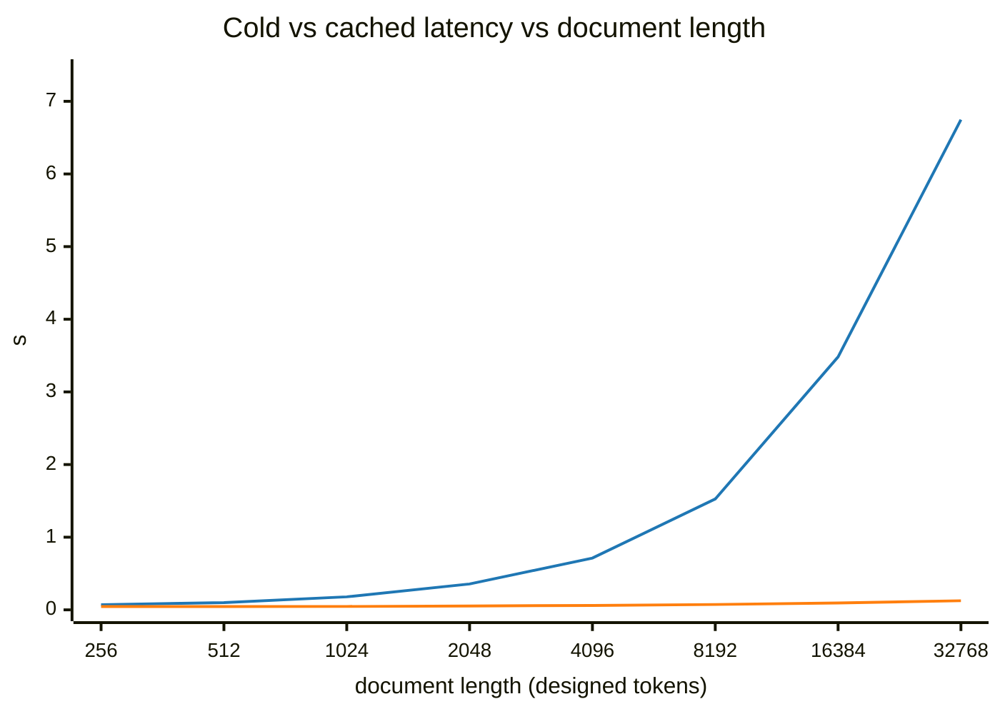
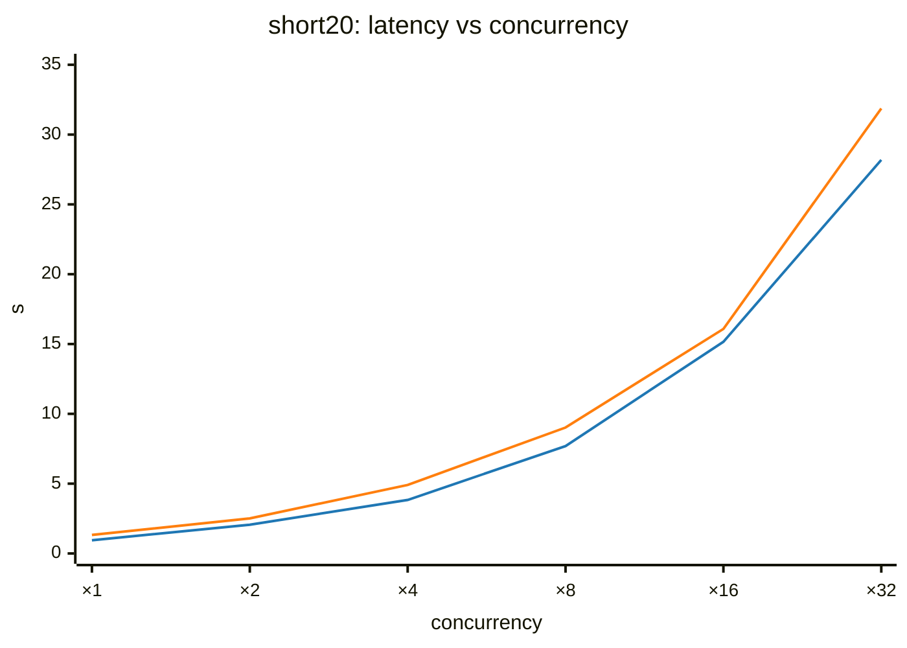
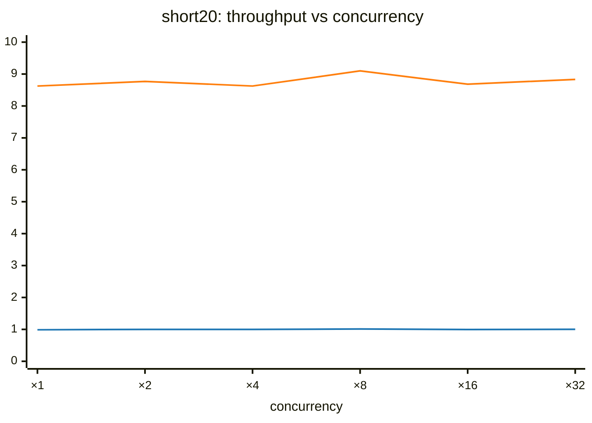
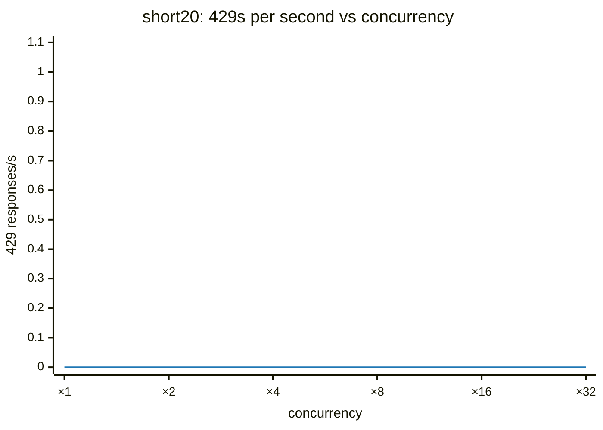

## meticulous — 2026-11-22 20:50 UTC

**PASS** · 1267 s · 808 requests · 0 (0.0%) errors · 0 rate-limited · 9,241,294 tokens billed

Sequential requests (one in flight) unless stated; every query carries a nonce so nothing is served from the API's prefix cache.

### Single document: latency vs length

| rung | Qwen tokens | billed | errors | p50 s | p90 s | max s | API tok/s |
|---|---|---|---|---|---|---|---|
| 256 | 229 | 324 | 0 (0.0%) | 0.076 | 0.080 | 0.103 | 4,198 |
| 512 | 457 | 551 | 0 (0.0%) | 0.104 | 0.116 | 0.119 | 5,184 |
| 1,024 | 911 | 1,005 | 0 (0.0%) | 0.183 | 0.185 | 0.188 | 5,484 |
| 2,048 | 1,872 | 1,966 | 0 (0.0%) | 0.361 | 0.364 | 0.365 | 5,484 |
| 4,096 | 3,707 | 3,800 | 0 (0.0%) | 0.720 | 0.721 | 0.723 | 5,280 |
| 8,192 | 7,545 | 7,640 | 0 (0.0%) | 1.534 | 1.538 | 1.544 | 4,982 |
| 16,384 | 15,274 | 15,368 | 0 (0.0%) | 3.471 | 3.500 | 3.504 | 4,428 |
| 32,768 | 25,438 | 25,536 | 0 (0.0%) | 6.760 | 6.792 | 6.872 | 3,775 |

*Single document: latency vs length: p50, p90*

*Single document: throughput vs length: API tokens/s ÷ 1000*

### ~30K tokens per request: latency vs document length (fewer, longer documents)

| rung | docs/request | billed | errors | p50 s | p90 s | max s | API tok/s |
|---|---|---|---|---|---|---|---|
| 256 | 100 | 32,406 | 0 (0.0%) | 2.836 | 2.861 | 2.888 | 11,410 |
| 512 | 55 | 30,271 | 0 (0.0%) | 2.642 | 2.788 | 2.968 | 11,388 |
| 1,024 | 28 | 28,194 | 0 (0.0%) | 2.833 | 3.031 | 3.112 | 10,163 |
| 2,048 | 13 | 25,569 | 0 (0.0%) | 2.673 | 2.988 | 3.219 | 9,765 |
| 4,096 | 6 | 22,807 | 0 (0.0%) | 2.868 | 3.175 | 3.413 | 8,101 |
| 8,192 | 3 | 22,924 | 0 (0.0%) | 3.225 | 3.828 | 4.232 | 7,243 |
| 16,384 | 1 | 15,367 | 0 (0.0%) | 3.498 | 3.501 | 3.505 | 4,394 |
| 32,768 | 1 | 25,540 | 0 (0.0%) | 6.747 | 6.761 | 6.831 | 3,781 |

*~30K tokens: latency vs document length: p50, p90*

### Latency vs number of documents

| documents | billed | errors | p50 s | p90 s | max s | MRR |
|---|---|---|---|---|---|---|
| 1 tiny | 91.5 | 0 (0.0%) | 0.043 | 0.044 | 0.045 | 1.000 |
| 10 tiny | 914 | 0 (0.0%) | 0.075 | 0.078 | 0.079 | 1.000 |
| 100 tiny | 9,309 | 0 (0.0%) | 0.536 | 0.542 | 0.542 | 1.000 |
| 1000 tiny | 93,589 | 0 (0.0%) | 5.190 | 5.421 | 5.433 | 1.000 |
| 1×256 | 323 | 0 (0.0%) | 0.075 | 0.077 | 0.079 | 1.000 |
| 10×256 | 3,230 | 0 (0.0%) | 0.345 | 0.391 | 0.430 | 1.000 |
| 50×256 | 16,180 | 0 (0.0%) | 1.487 | 1.554 | 1.610 | 1.000 |
| 100×256 | 32,289 | 0 (0.0%) | 2.846 | 2.914 | 2.940 | 1.000 |

*Latency vs number of documents: p50, p90*

### Cold vs cached: the same single-document request sent twice in a row

The API caches prompt prefixes, so a repeated (query, document) pair skips most of the compute. Cold = fresh nonce in the query; cached = the identical request again immediately after.

| rung | pairs | cold p50 s | cached p50 s | speed-up × | cold max s | cached max s | errors |
|---|---|---|---|---|---|---|---|
| 256 | 10 | 0.070 | 0.045 | 1.578 | 0.074 | 0.046 |  |
| 512 | 10 | 0.100 | 0.045 | 2.209 | 0.113 | 0.048 |  |
| 1,024 | 10 | 0.179 | 0.047 | 3.851 | 0.181 | 0.048 |  |
| 2,048 | 10 | 0.356 | 0.053 | 6.678 | 0.364 | 0.055 |  |
| 4,096 | 10 | 0.713 | 0.061 | 11.7 | 0.720 | 0.063 |  |
| 8,192 | 10 | 1.526 | 0.074 | 20.8 | 1.530 | 0.075 |  |
| 16,384 | 10 | 3.482 | 0.095 | 36.6 | 3.485 | 0.097 |  |
| 32,768 | 10 | 6.748 | 0.125 | 54.0 | 6.830 | 0.128 |  |

*Cold vs cached latency vs document length: cold p50, cached p50*

### short20: latency and throughput vs concurrency

|  | requests | errors | 429s | p50 s | p90 s | p99 s | max s | req/s | API tok/s | MRR |
|---|---|---|---|---|---|---|---|---|---|---|
| ×1 | 25 | 0 (0.0%) | 0 | 0.945 | 1.328 | 1.813 | 1.854 | 0.987 | 8,625 | 0.687 |
| ×2 | 26 | 0 (0.0%) | 0 | 2.058 | 2.515 | 3.079 | 3.200 | 1.000 | 8,768 | 0.699 |
| ×4 | 29 | 0 (0.0%) | 0 | 3.832 | 4.907 | 5.472 | 5.473 | 0.998 | 8,625 | 0.698 |
| ×8 | 32 | 0 (0.0%) | 0 | 7.692 | 9.019 | 9.727 | 9.727 | 1.012 | 9,099 | 0.706 |
| ×16 | 40 | 0 (0.0%) | 0 | 15.2 | 16.1 | 16.4 | 16.6 | 0.996 | 8,682 | 0.743 |
| ×32 | 56 | 0 (0.0%) | 0 | 28.2 | 31.9 | 32.6 | 32.6 | 1.003 | 8,833 | 0.732 |

No 429s up to concurrency ×32.

*short20: latency vs concurrency: p50, p90*

*short20: throughput vs concurrency: req/s, API tokens/s ÷ 1000*

*short20: 429s per second vs concurrency: 429/s*

808 requests, 9,241,294 tokens billed.
