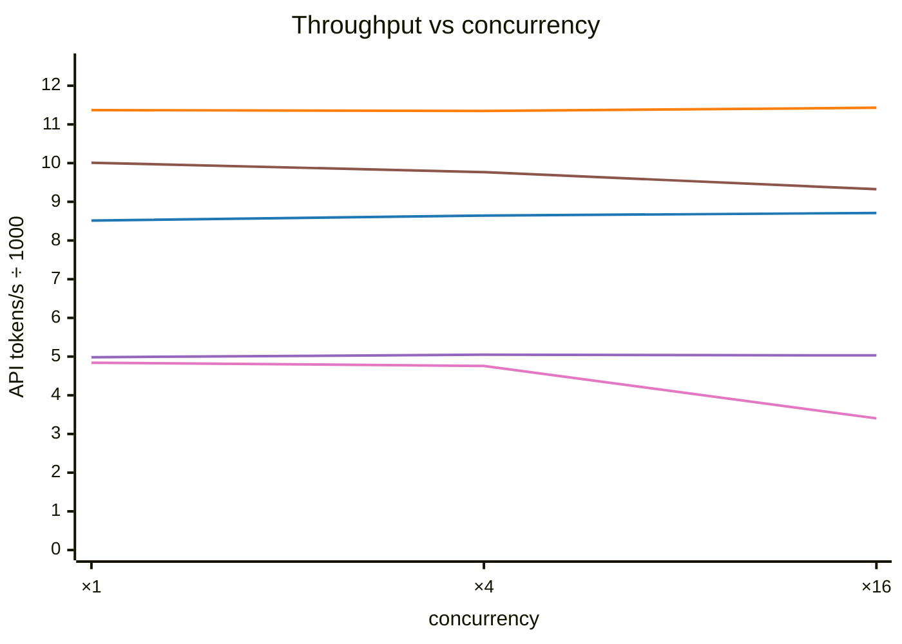
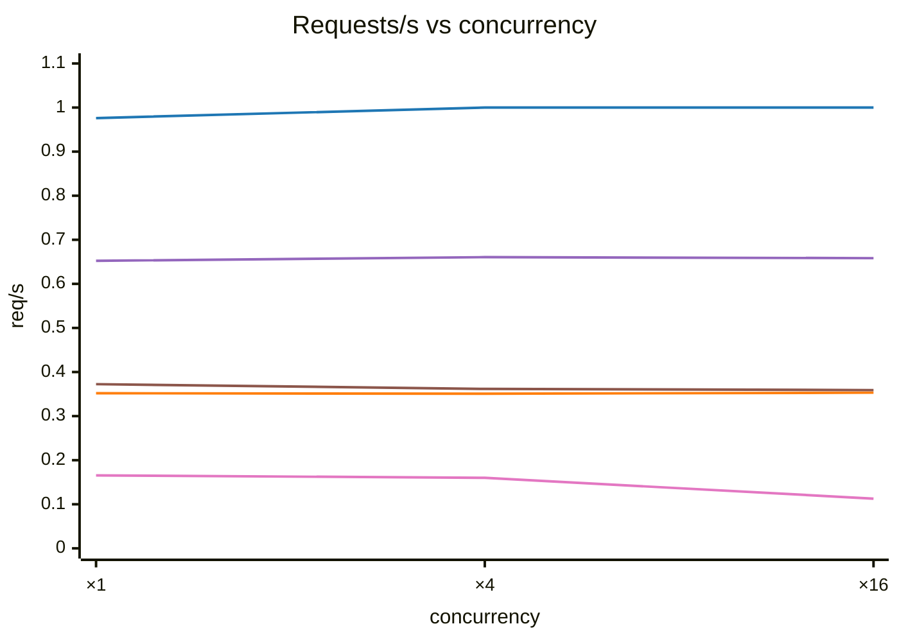
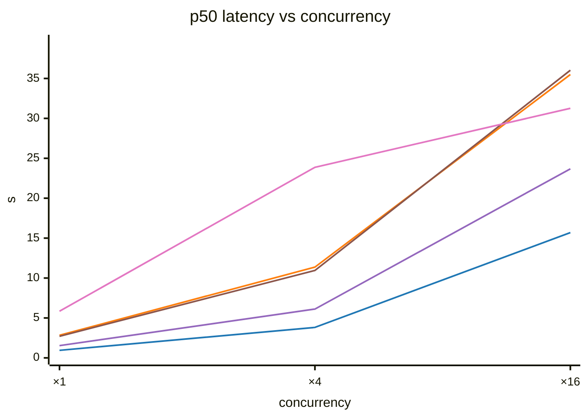

## speed — 2026-11-22 21:12 UTC

**PASS** · 650 s · 288 requests · 10 (3.5%) errors · 0 rate-limited · 4,724,742 tokens billed

Closed loop, 25 s per cell, 5 request classes × concurrency [1, 4, 16]. 288 requests, 4,724,742 tokens billed.

|  | requests | errors | 429s | p50 s | p90 s | p99 s | max s | req/s | API tok/s | MRR |
|---|---|---|---|---|---|---|---|---|---|---|
| short20 ×1 | 25 | 0 (0.0%) | 0 | 0.944 | 1.343 | 1.835 | 1.878 | 0.976 | 8,515 | 0.687 |
| short20 ×4 | 29 | 0 (0.0%) | 0 | 3.818 | 4.884 | 5.435 | 5.436 | 1.000 | 8,643 | 0.704 |
| short20 ×16 | 40 | 0 (0.0%) | 0 | 15.7 | 17.0 | 17.5 | 17.7 | 1.000 | 8,712 | 0.750 |
| many100 ×1 | 9 | 0 (0.0%) | 0 | 2.829 | 2.877 | 2.889 | 2.890 | 0.352 | 11,374 | 1.000 |
| many100 ×4 | 12 | 0 (0.0%) | 0 | 11.4 | 11.4 | 12.1 | 12.2 | 0.351 | 11,352 | 1.000 |
| many100 ×16 | 24 | 0 (0.0%) | 0 | 35.5 | 45.3 | 45.5 | 45.6 | 0.353 | 11,426 | 1.000 |
| long8k ×1 | 17 | 0 (0.0%) | 0 | 1.536 | 1.539 | 1.540 | 1.540 | 0.652 | 4,984 | 1.000 |
| long8k ×4 | 20 | 0 (0.0%) | 0 | 6.114 | 6.176 | 6.185 | 6.186 | 0.661 | 5,048 | 1.000 |
| long8k ×16 | 32 | 0 (0.0%) | 0 | 23.7 | 24.5 | 24.5 | 24.5 | 0.658 | 5,031 | 1.000 |
| pack32k ×1 | 10 | 0 (0.0%) | 0 | 2.707 | 2.890 | 3.243 | 3.282 | 0.372 | 10,009 | 1.000 |
| pack32k ×4 | 13 | 0 (0.0%) | 0 | 11.0 | 11.6 | 11.9 | 12.0 | 0.362 | 9,767 | 1.000 |
| pack32k ×16 | 25 | 0 (0.0%) | 0 | 36.0 | 45.8 | 46.3 | 46.4 | 0.359 | 9,325 | 1.000 |
| long32k ×1 | 5 | 0 (0.0%) | 0 | 5.843 | 6.492 | 6.681 | 6.702 | 0.166 | 4,841 | 1.000 |
| long32k ×4 | 8 | 0 (0.0%) | 0 | 23.9 | 24.8 | 25.8 | 25.9 | 0.160 | 4,759 | 1.000 |
| long32k ×16 | 19 | 10 (52.6%) | 0 | 31.3 | 51.4 | 56.1 | 56.6 | 0.113 | 3,403 | 1.000 |

| error | count | example | response |
|---|---|---|---|
| http 424 ModelError timed out at SageMaker | 10 | ladder1-32768 ladder1-32768/ctx32768_query42 | {"ErrorCode":"INTERNAL_FAILURE_FROM_MODEL","LogStreamArn":"arn:aws:logs:eu-west-3:<account-id>:log-group:/aws/sagemaker/Endpoints/reranker-tl-8b-q3","Message":"Received server error (0) from primary with message \"Your invocation timed out while waiting for a response from container primary. Review |

*Throughput vs concurrency: short20, many100, long8k, pack32k, long32k*

*Requests/s vs concurrency: short20, many100, long8k, pack32k, long32k*

*p50 latency vs concurrency: short20, many100, long8k, pack32k, long32k*
