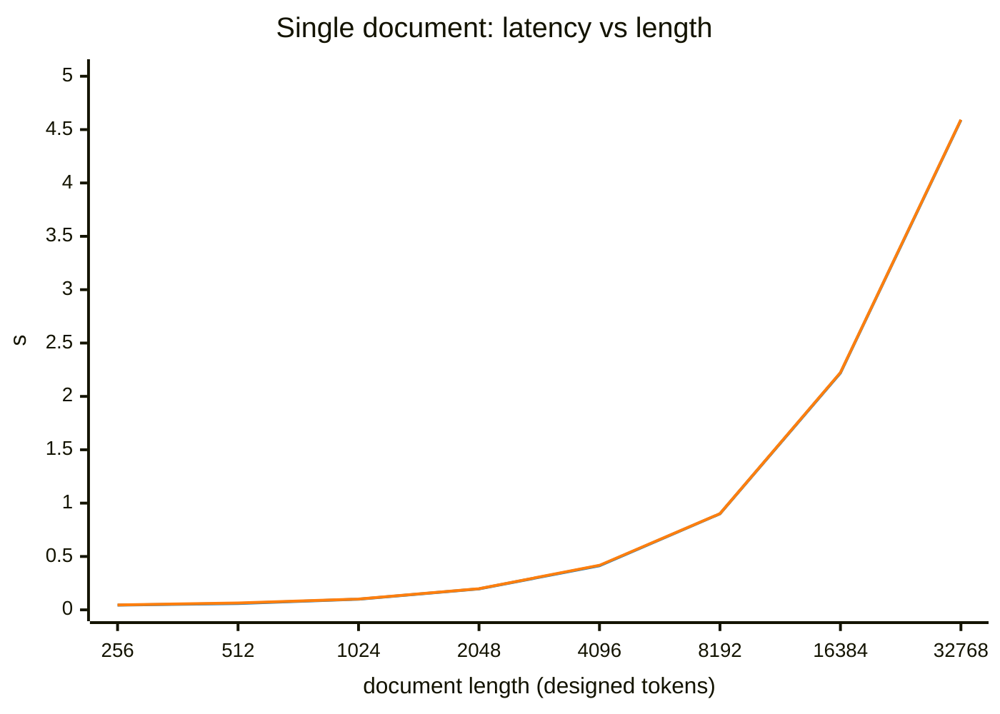
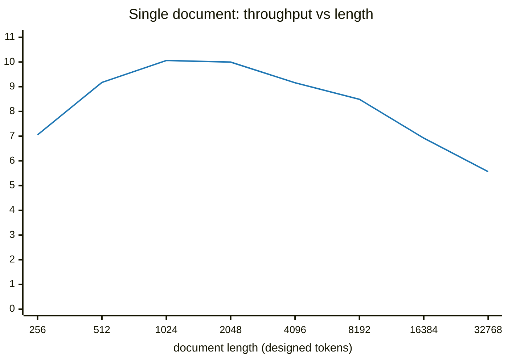
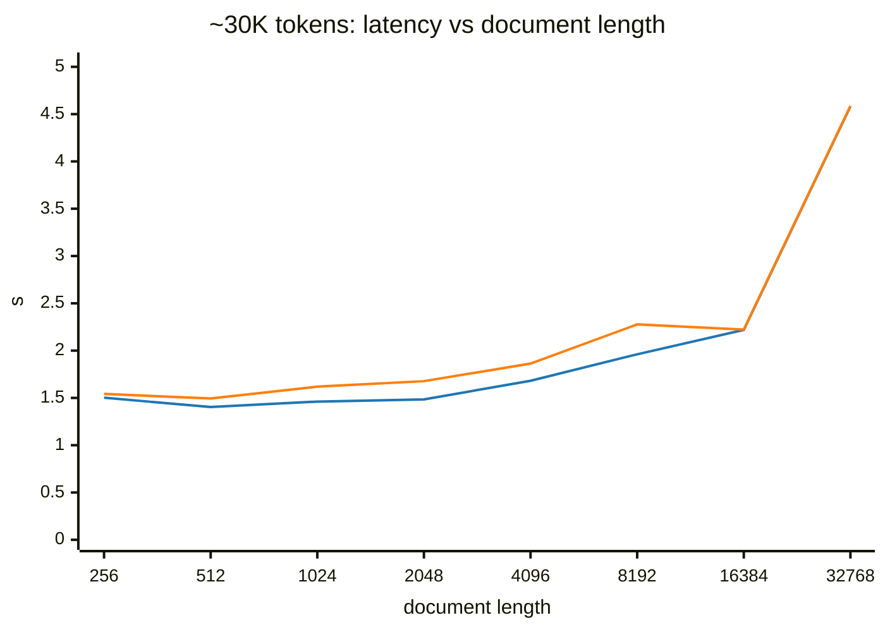
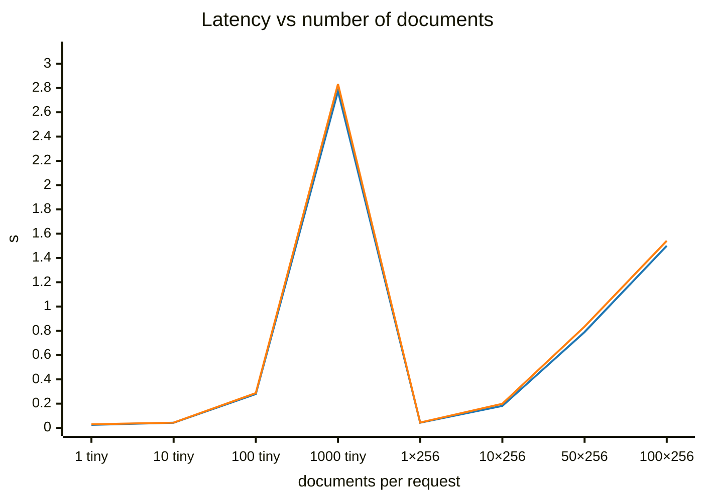
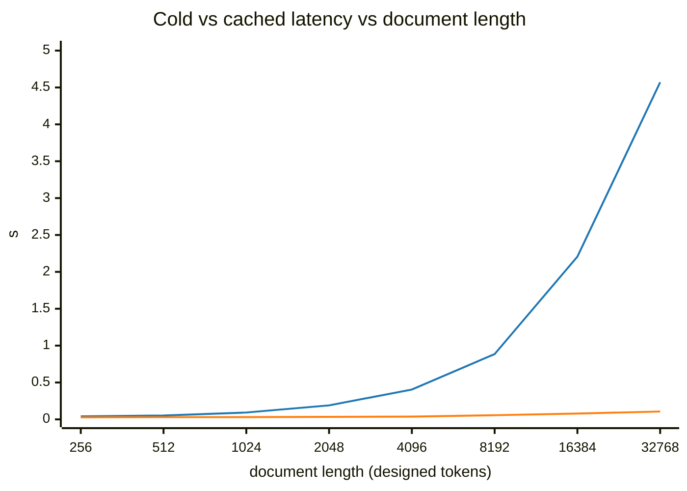
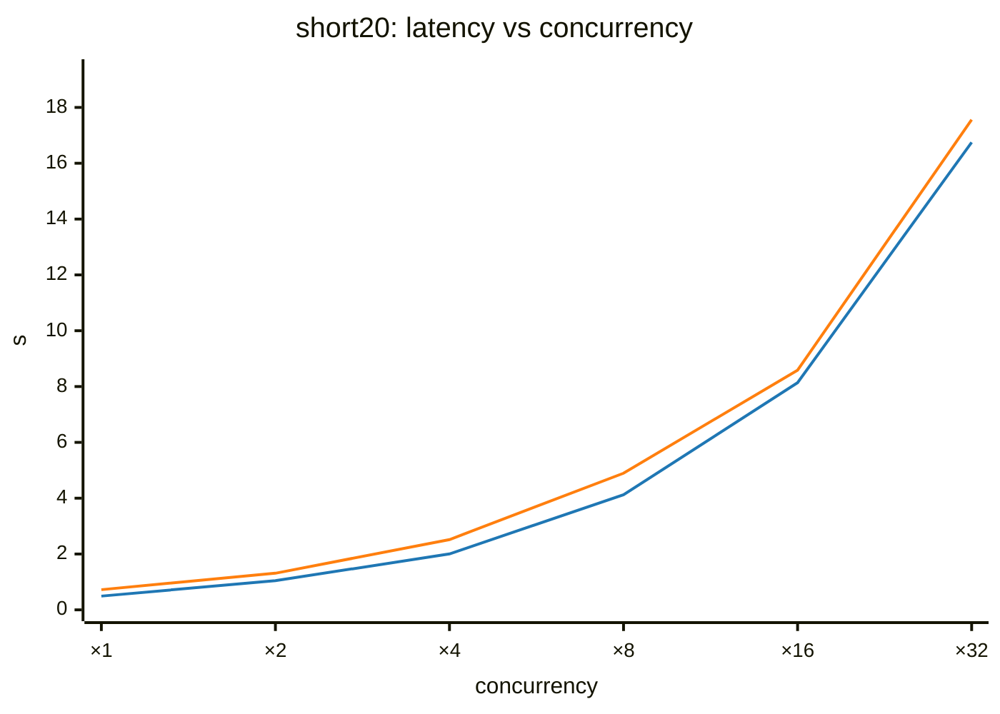
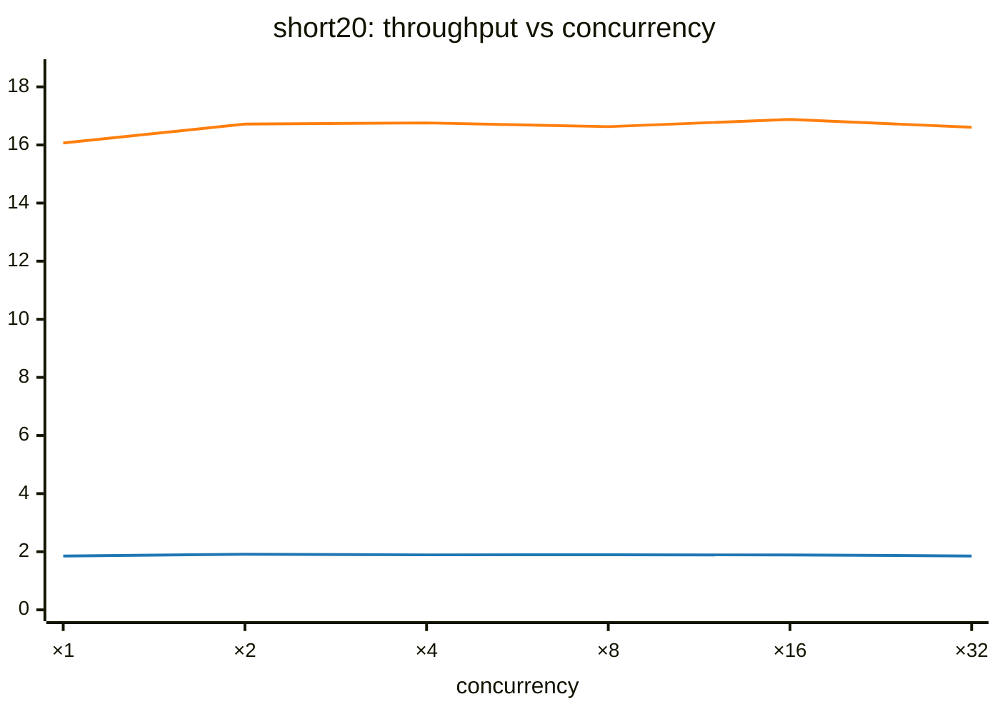
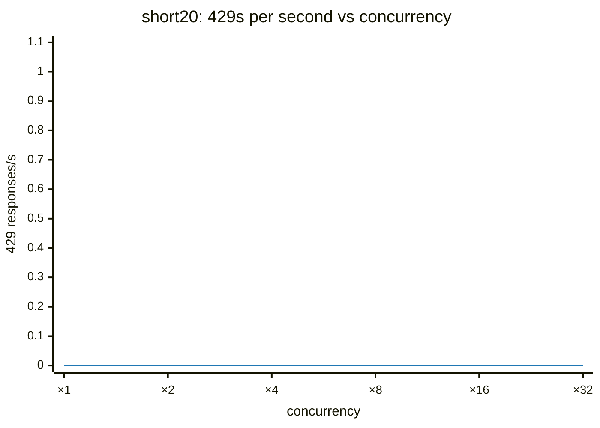

## meticulous — 2026-11-22 21:36 UTC

**PASS** · 840 s · 945 requests · 0 (0.0%) errors · 0 rate-limited · 10,467,900 tokens billed

Sequential requests (one in flight) unless stated; every query carries a nonce so nothing is served from the API's prefix cache.

### Single document: latency vs length

| rung | Qwen tokens | billed | errors | p50 s | p90 s | max s | API tok/s |
|---|---|---|---|---|---|---|---|
| 256 | 229 | 324 | 0 (0.0%) | 0.045 | 0.046 | 0.075 | 7,054 |
| 512 | 457 | 551 | 0 (0.0%) | 0.060 | 0.064 | 0.065 | 9,174 |
| 1,024 | 911 | 1,005 | 0 (0.0%) | 0.100 | 0.101 | 0.102 | 10,058 |
| 2,048 | 1,872 | 1,966 | 0 (0.0%) | 0.196 | 0.199 | 0.203 | 9,995 |
| 4,096 | 3,707 | 3,801 | 0 (0.0%) | 0.414 | 0.417 | 0.428 | 9,160 |
| 8,192 | 7,545 | 7,640 | 0 (0.0%) | 0.900 | 0.902 | 0.903 | 8,491 |
| 16,384 | 15,274 | 15,368 | 0 (0.0%) | 2.220 | 2.224 | 2.236 | 6,920 |
| 32,768 | 25,438 | 25,536 | 0 (0.0%) | 4.589 | 4.593 | 4.656 | 5,563 |

*Single document: latency vs length: p50, p90*

*Single document: throughput vs length: API tokens/s ÷ 1000*

### ~30K tokens per request: latency vs document length (fewer, longer documents)

| rung | docs/request | billed | errors | p50 s | p90 s | max s | API tok/s |
|---|---|---|---|---|---|---|---|
| 256 | 100 | 32,379 | 0 (0.0%) | 1.502 | 1.542 | 1.547 | 21,388 |
| 512 | 55 | 30,293 | 0 (0.0%) | 1.404 | 1.494 | 1.581 | 21,374 |
| 1,024 | 28 | 28,172 | 0 (0.0%) | 1.461 | 1.619 | 1.669 | 19,197 |
| 2,048 | 13 | 25,576 | 0 (0.0%) | 1.484 | 1.677 | 1.773 | 17,532 |
| 4,096 | 6 | 22,807 | 0 (0.0%) | 1.681 | 1.863 | 1.999 | 13,830 |
| 8,192 | 3 | 22,922 | 0 (0.0%) | 1.961 | 2.277 | 2.503 | 12,092 |
| 16,384 | 1 | 15,367 | 0 (0.0%) | 2.219 | 2.223 | 2.225 | 6,925 |
| 32,768 | 1 | 25,540 | 0 (0.0%) | 4.582 | 4.587 | 4.639 | 5,571 |

*~30K tokens: latency vs document length: p50, p90*

### Latency vs number of documents

| documents | billed | errors | p50 s | p90 s | max s | MRR |
|---|---|---|---|---|---|---|
| 1 tiny | 91.8 | 0 (0.0%) | 0.025 | 0.030 | 0.033 | 1.000 |
| 10 tiny | 925 | 0 (0.0%) | 0.043 | 0.043 | 0.044 | 1.000 |
| 100 tiny | 9,269 | 0 (0.0%) | 0.279 | 0.287 | 0.288 | 1.000 |
| 1000 tiny | 93,989 | 0 (0.0%) | 2.774 | 2.833 | 2.837 | 1.000 |
| 1×256 | 323 | 0 (0.0%) | 0.043 | 0.044 | 0.044 | 1.000 |
| 10×256 | 3,228 | 0 (0.0%) | 0.181 | 0.199 | 0.226 | 1.000 |
| 50×256 | 16,120 | 0 (0.0%) | 0.790 | 0.835 | 0.850 | 1.000 |
| 100×256 | 32,329 | 0 (0.0%) | 1.500 | 1.541 | 1.543 | 0.950 |

*Latency vs number of documents: p50, p90*

### Cold vs cached: the same single-document request sent twice in a row

The API caches prompt prefixes, so a repeated (query, document) pair skips most of the compute. Cold = fresh nonce in the query; cached = the identical request again immediately after.

| rung | pairs | cold p50 s | cached p50 s | speed-up × | cold max s | cached max s | errors |
|---|---|---|---|---|---|---|---|
| 256 | 10 | 0.041 | 0.027 | 1.474 | 0.046 | 0.030 |  |
| 512 | 10 | 0.052 | 0.030 | 1.736 | 0.058 | 0.031 |  |
| 1,024 | 10 | 0.093 | 0.031 | 2.969 | 0.095 | 0.033 |  |
| 2,048 | 10 | 0.190 | 0.033 | 5.672 | 0.198 | 0.035 |  |
| 4,096 | 10 | 0.404 | 0.038 | 10.6 | 0.411 | 0.040 |  |
| 8,192 | 10 | 0.885 | 0.057 | 15.6 | 0.888 | 0.058 |  |
| 16,384 | 10 | 2.206 | 0.079 | 28.0 | 2.215 | 0.080 |  |
| 32,768 | 10 | 4.571 | 0.107 | 42.9 | 4.627 | 0.109 |  |

*Cold vs cached latency vs document length: cold p50, cached p50*

### short20: latency and throughput vs concurrency

|  | requests | errors | 429s | p50 s | p90 s | p99 s | max s | req/s | API tok/s | MRR |
|---|---|---|---|---|---|---|---|---|---|---|
| ×1 | 47 | 0 (0.0%) | 0 | 0.493 | 0.723 | 0.951 | 0.991 | 1.854 | 16,075 | 0.721 |
| ×2 | 49 | 0 (0.0%) | 0 | 1.045 | 1.312 | 1.576 | 1.693 | 1.912 | 16,719 | 0.712 |
| ×4 | 52 | 0 (0.0%) | 0 | 2.004 | 2.517 | 2.877 | 2.878 | 1.892 | 16,758 | 0.721 |
| ×8 | 55 | 0 (0.0%) | 0 | 4.124 | 4.896 | 5.270 | 5.457 | 1.895 | 16,626 | 0.704 |
| ×16 | 63 | 0 (0.0%) | 0 | 8.138 | 8.586 | 9.012 | 9.061 | 1.889 | 16,877 | 0.681 |
| ×32 | 79 | 0 (0.0%) | 0 | 16.7 | 17.6 | 17.9 | 18.0 | 1.854 | 16,613 | 0.679 |

No 429s up to concurrency ×32.

*short20: latency vs concurrency: p50, p90*

*short20: throughput vs concurrency: req/s, API tokens/s ÷ 1000*

*short20: 429s per second vs concurrency: 429/s*

945 requests, 10,467,900 tokens billed.
