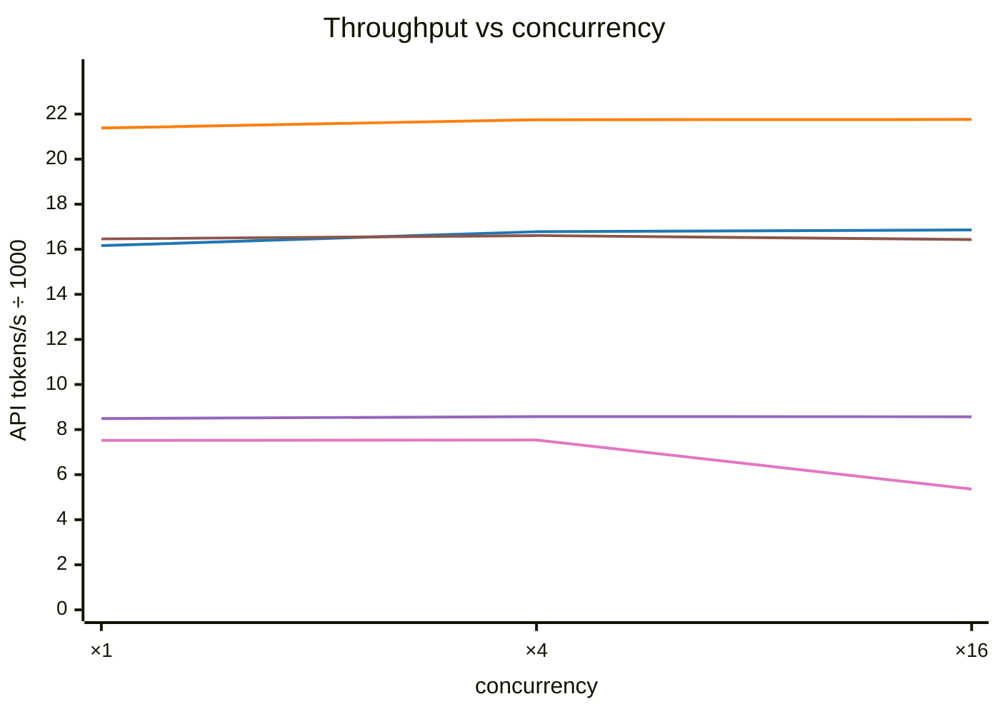
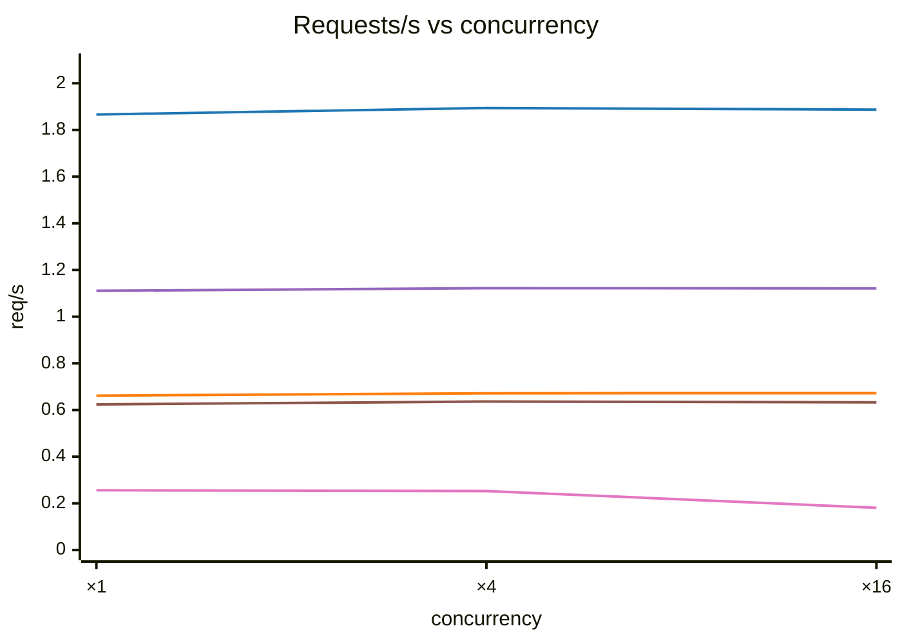
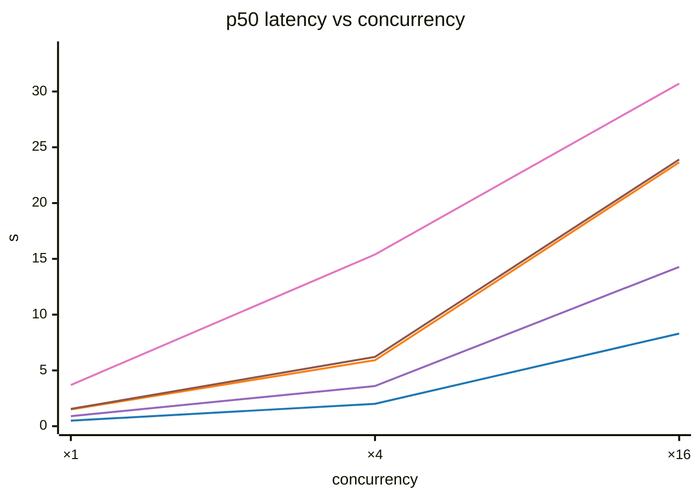

## speed — 2026-11-22 21:50 UTC

**PASS** · 566 s · 439 requests · 7 (1.6%) errors · 0 rate-limited · 7,119,910 tokens billed

Closed loop, 25 s per cell, 5 request classes × concurrency [1, 4, 16]. 439 requests, 7,119,910 tokens billed.

|  | requests | errors | 429s | p50 s | p90 s | p99 s | max s | req/s | API tok/s | MRR |
|---|---|---|---|---|---|---|---|---|---|---|
| short20 ×1 | 47 | 0 (0.0%) | 0 | 0.495 | 0.722 | 0.945 | 0.985 | 1.866 | 16,163 | 0.723 |
| short20 ×4 | 52 | 0 (0.0%) | 0 | 2.008 | 2.512 | 2.880 | 2.881 | 1.894 | 16,778 | 0.711 |
| short20 ×16 | 63 | 0 (0.0%) | 0 | 8.300 | 8.682 | 8.857 | 8.862 | 1.887 | 16,859 | 0.684 |
| many100 ×1 | 17 | 0 (0.0%) | 0 | 1.503 | 1.541 | 1.544 | 1.544 | 0.661 | 21,376 | 1.000 |
| many100 ×4 | 20 | 0 (0.0%) | 0 | 5.916 | 6.290 | 6.339 | 6.339 | 0.672 | 21,745 | 1.000 |
| many100 ×16 | 32 | 0 (0.0%) | 0 | 23.6 | 23.7 | 24.0 | 24.0 | 0.672 | 21,757 | 0.969 |
| long8k ×1 | 28 | 0 (0.0%) | 0 | 0.899 | 0.903 | 0.912 | 0.912 | 1.111 | 8,489 | 1.000 |
| long8k ×4 | 32 | 0 (0.0%) | 0 | 3.602 | 3.626 | 3.631 | 3.631 | 1.122 | 8,574 | 1.000 |
| long8k ×16 | 43 | 0 (0.0%) | 0 | 14.3 | 14.3 | 14.3 | 14.3 | 1.121 | 8,569 | 1.000 |
| pack32k ×1 | 16 | 0 (0.0%) | 0 | 1.552 | 1.993 | 2.251 | 2.296 | 0.624 | 16,460 | 1.000 |
| pack32k ×4 | 19 | 0 (0.0%) | 0 | 6.212 | 6.877 | 7.072 | 7.103 | 0.636 | 16,611 | 1.000 |
| pack32k ×16 | 31 | 0 (0.0%) | 0 | 23.9 | 24.9 | 25.2 | 25.3 | 0.633 | 16,434 | 1.000 |
| long32k ×1 | 7 | 0 (0.0%) | 0 | 3.692 | 4.549 | 4.570 | 4.573 | 0.256 | 7,518 | 1.000 |
| long32k ×4 | 10 | 0 (0.0%) | 0 | 15.4 | 16.9 | 16.9 | 17.0 | 0.253 | 7,539 | 1.000 |
| long32k ×16 | 22 | 7 (31.8%) | 0 | 30.7 | 53.6 | 58.6 | 59.2 | 0.181 | 5,358 | 1.000 |

| error | count | example | response |
|---|---|---|---|
| http 424 ModelError timed out at SageMaker | 7 | natural-summ_screen_fd natural-summ_screen_fd/query_26 | {"ErrorCode":"INTERNAL_FAILURE_FROM_MODEL","LogStreamArn":"arn:aws:logs:eu-west-3:<account-id>:log-group:/aws/sagemaker/Endpoints/reranker-tl-4b-q3","Message":"Received server error (0) from primary with message \"Your invocation timed out while waiting for a response from container primary. Review |

*Throughput vs concurrency: short20, many100, long8k, pack32k, long32k*

*Requests/s vs concurrency: short20, many100, long8k, pack32k, long32k*

*p50 latency vs concurrency: short20, many100, long8k, pack32k, long32k*
