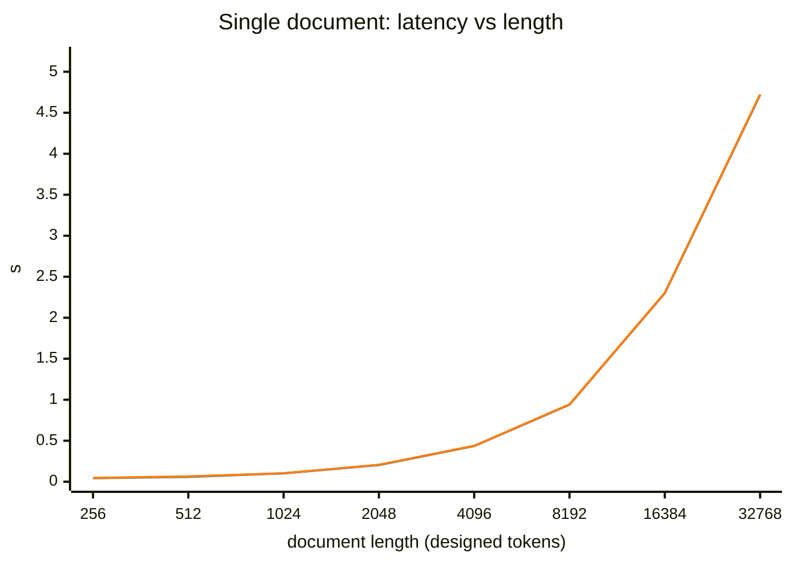
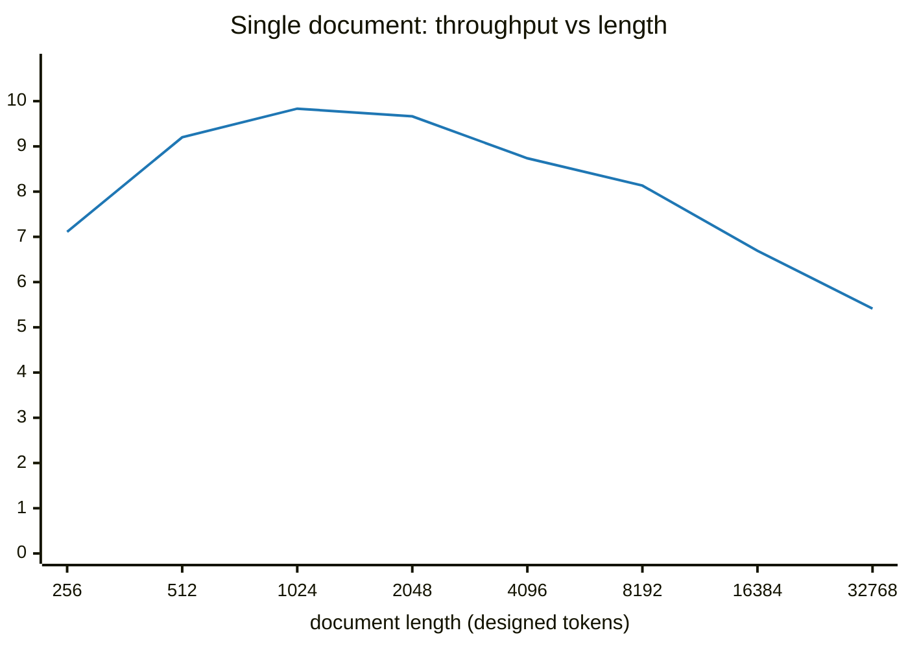
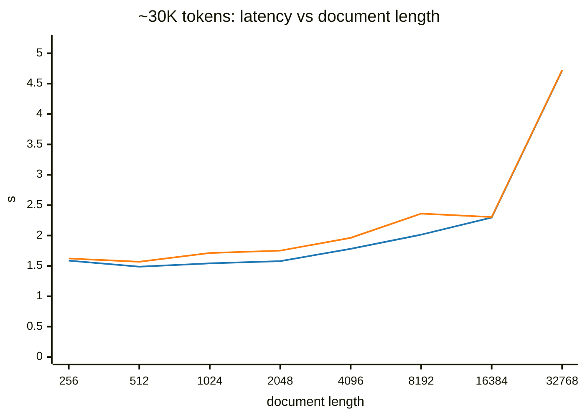
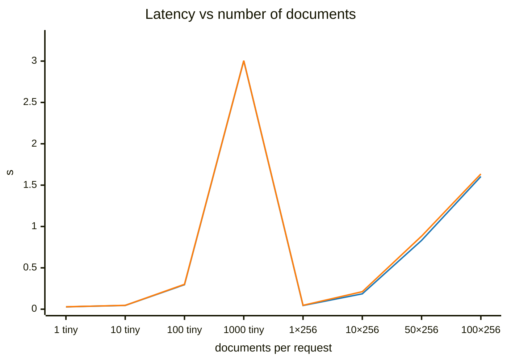
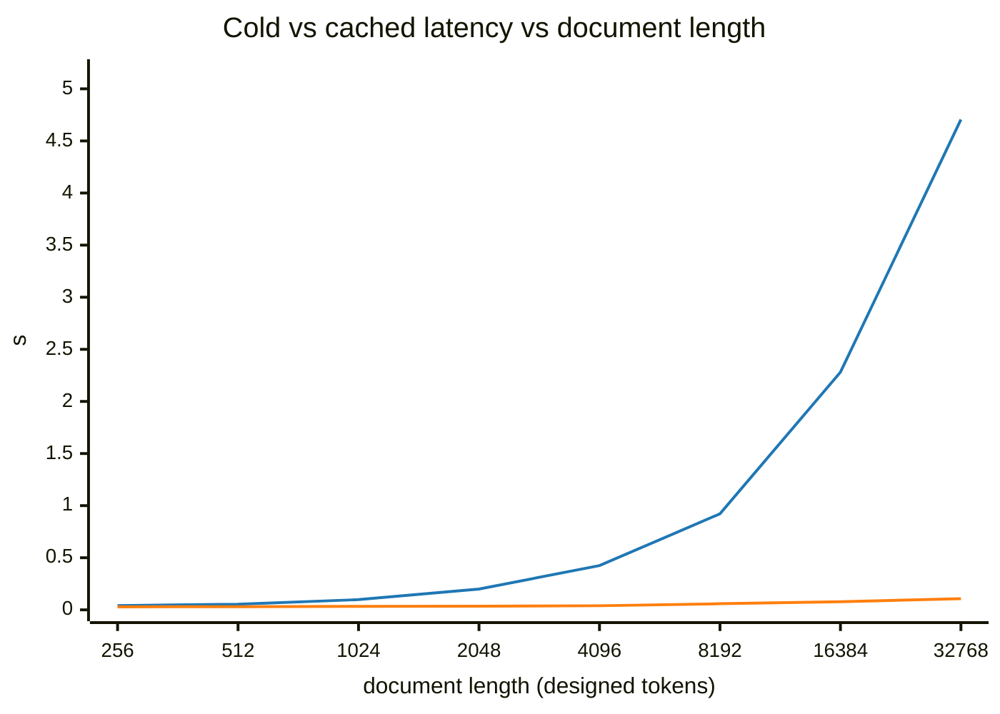
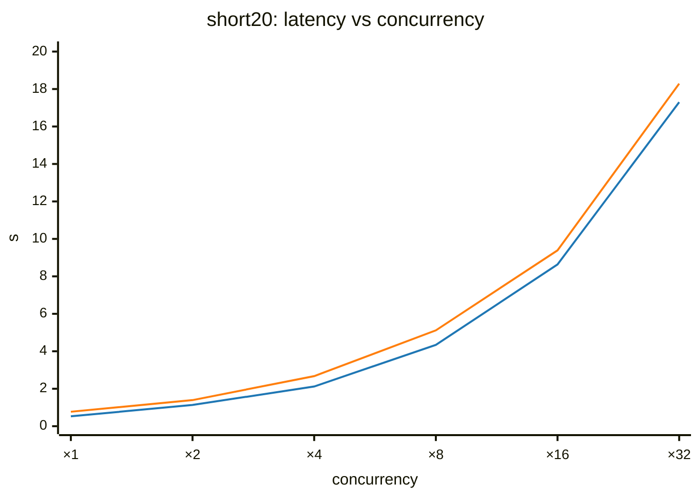
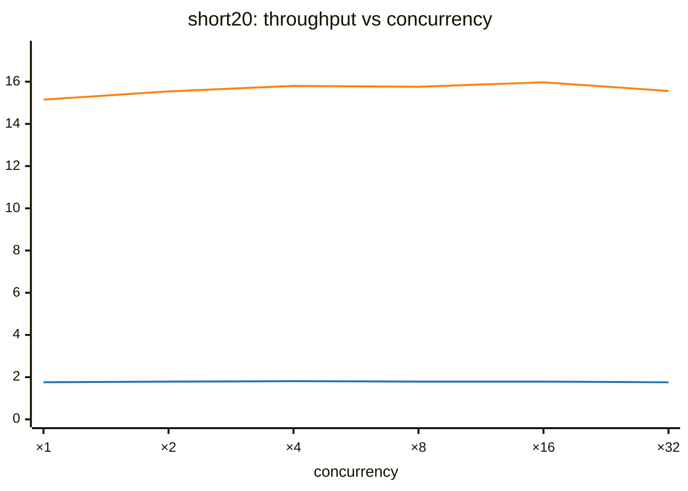
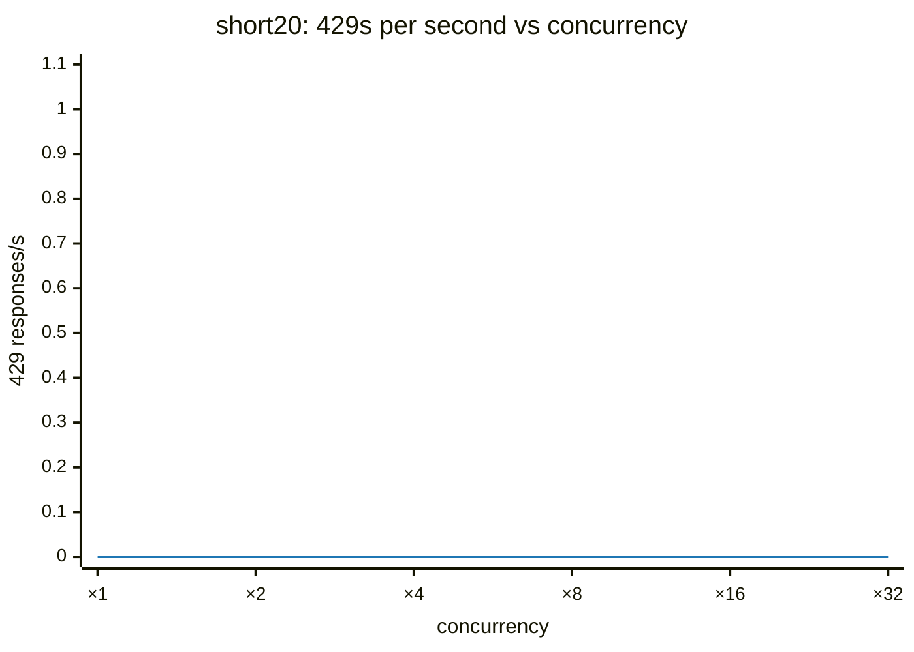

## meticulous — 2026-11-22 22:21 UTC

**PASS** · 865 s · 927 requests · 0 (0.0%) errors · 0 rate-limited · 10,299,400 tokens billed

Sequential requests (one in flight) unless stated; every query carries a nonce so nothing is served from the API's prefix cache.

### Single document: latency vs length

| rung | Qwen tokens | billed | errors | p50 s | p90 s | max s | API tok/s |
|---|---|---|---|---|---|---|---|
| 256 | 229 | 323 | 0 (0.0%) | 0.044 | 0.046 | 0.070 | 7,110 |
| 512 | 457 | 551 | 0 (0.0%) | 0.059 | 0.064 | 0.066 | 9,201 |
| 1,024 | 911 | 1,005 | 0 (0.0%) | 0.102 | 0.103 | 0.106 | 9,834 |
| 2,048 | 1,872 | 1,966 | 0 (0.0%) | 0.203 | 0.206 | 0.210 | 9,664 |
| 4,096 | 3,707 | 3,801 | 0 (0.0%) | 0.435 | 0.438 | 0.442 | 8,737 |
| 8,192 | 7,545 | 7,639 | 0 (0.0%) | 0.939 | 0.943 | 0.948 | 8,133 |
| 16,384 | 15,274 | 15,368 | 0 (0.0%) | 2.298 | 2.303 | 2.310 | 6,692 |
| 32,768 | 25,438 | 25,536 | 0 (0.0%) | 4.716 | 4.723 | 4.767 | 5,413 |

*Single document: latency vs length: p50, p90*

*Single document: throughput vs length: API tokens/s ÷ 1000*

### ~30K tokens per request: latency vs document length (fewer, longer documents)

| rung | docs/request | billed | errors | p50 s | p90 s | max s | API tok/s |
|---|---|---|---|---|---|---|---|
| 256 | 100 | 32,392 | 0 (0.0%) | 1.587 | 1.622 | 1.645 | 20,316 |
| 512 | 55 | 30,275 | 0 (0.0%) | 1.487 | 1.568 | 1.674 | 20,262 |
| 1,024 | 28 | 28,178 | 0 (0.0%) | 1.542 | 1.712 | 1.755 | 18,211 |
| 2,048 | 13 | 25,565 | 0 (0.0%) | 1.578 | 1.751 | 1.890 | 16,623 |
| 4,096 | 6 | 22,807 | 0 (0.0%) | 1.781 | 1.962 | 2.094 | 13,143 |
| 8,192 | 3 | 22,924 | 0 (0.0%) | 2.014 | 2.361 | 2.606 | 11,684 |
| 16,384 | 1 | 15,367 | 0 (0.0%) | 2.296 | 2.304 | 2.304 | 6,694 |
| 32,768 | 1 | 25,540 | 0 (0.0%) | 4.717 | 4.724 | 4.805 | 5,409 |

*~30K tokens: latency vs document length: p50, p90*

### Latency vs number of documents

| documents | billed | errors | p50 s | p90 s | max s | MRR |
|---|---|---|---|---|---|---|
| 1 tiny | 91.1 | 0 (0.0%) | 0.028 | 0.029 | 0.029 | 1.000 |
| 10 tiny | 920 | 0 (0.0%) | 0.046 | 0.046 | 0.046 | 1.000 |
| 100 tiny | 9,319 | 0 (0.0%) | 0.296 | 0.301 | 0.305 | 1.000 |
| 1000 tiny | 94,589 | 0 (0.0%) | 3.004 | 3.006 | 3.012 | 1.000 |
| 1×256 | 324 | 0 (0.0%) | 0.045 | 0.047 | 0.047 | 1.000 |
| 10×256 | 3,233 | 0 (0.0%) | 0.186 | 0.212 | 0.240 | 1.000 |
| 50×256 | 16,160 | 0 (0.0%) | 0.832 | 0.884 | 0.907 | 1.000 |
| 100×256 | 32,309 | 0 (0.0%) | 1.604 | 1.635 | 1.638 | 0.950 |

*Latency vs number of documents: p50, p90*

### Cold vs cached: the same single-document request sent twice in a row

The API caches prompt prefixes, so a repeated (query, document) pair skips most of the compute. Cold = fresh nonce in the query; cached = the identical request again immediately after.

| rung | pairs | cold p50 s | cached p50 s | speed-up × | cold max s | cached max s | errors |
|---|---|---|---|---|---|---|---|
| 256 | 10 | 0.041 | 0.029 | 1.431 | 0.045 | 0.030 |  |
| 512 | 10 | 0.054 | 0.030 | 1.787 | 0.060 | 0.031 |  |
| 1,024 | 10 | 0.098 | 0.033 | 2.944 | 0.100 | 0.034 |  |
| 2,048 | 10 | 0.199 | 0.035 | 5.738 | 0.203 | 0.036 |  |
| 4,096 | 10 | 0.424 | 0.039 | 10.8 | 0.432 | 0.042 |  |
| 8,192 | 10 | 0.921 | 0.058 | 15.8 | 0.930 | 0.061 |  |
| 16,384 | 10 | 2.281 | 0.078 | 29.2 | 2.285 | 0.080 |  |
| 32,768 | 10 | 4.705 | 0.108 | 43.7 | 4.769 | 0.110 |  |

*Cold vs cached latency vs document length: cold p50, cached p50*

### short20: latency and throughput vs concurrency

|  | requests | errors | 429s | p50 s | p90 s | p99 s | max s | req/s | API tok/s | MRR |
|---|---|---|---|---|---|---|---|---|---|---|
| ×1 | 44 | 0 (0.0%) | 0 | 0.527 | 0.773 | 1.009 | 1.052 | 1.757 | 15,154 | 0.715 |
| ×2 | 46 | 0 (0.0%) | 0 | 1.134 | 1.393 | 1.674 | 1.786 | 1.789 | 15,538 | 0.715 |
| ×4 | 48 | 0 (0.0%) | 0 | 2.120 | 2.674 | 3.051 | 3.051 | 1.810 | 15,801 | 0.718 |
| ×8 | 53 | 0 (0.0%) | 0 | 4.343 | 5.117 | 5.575 | 5.780 | 1.790 | 15,758 | 0.725 |
| ×16 | 60 | 0 (0.0%) | 0 | 8.635 | 9.387 | 9.604 | 9.829 | 1.787 | 15,973 | 0.687 |
| ×32 | 76 | 0 (0.0%) | 0 | 17.3 | 18.3 | 18.6 | 18.9 | 1.756 | 15,562 | 0.681 |

No 429s up to concurrency ×32.

*short20: latency vs concurrency: p50, p90*

*short20: throughput vs concurrency: req/s, API tokens/s ÷ 1000*

*short20: 429s per second vs concurrency: 429/s*

927 requests, 10,299,400 tokens billed.
