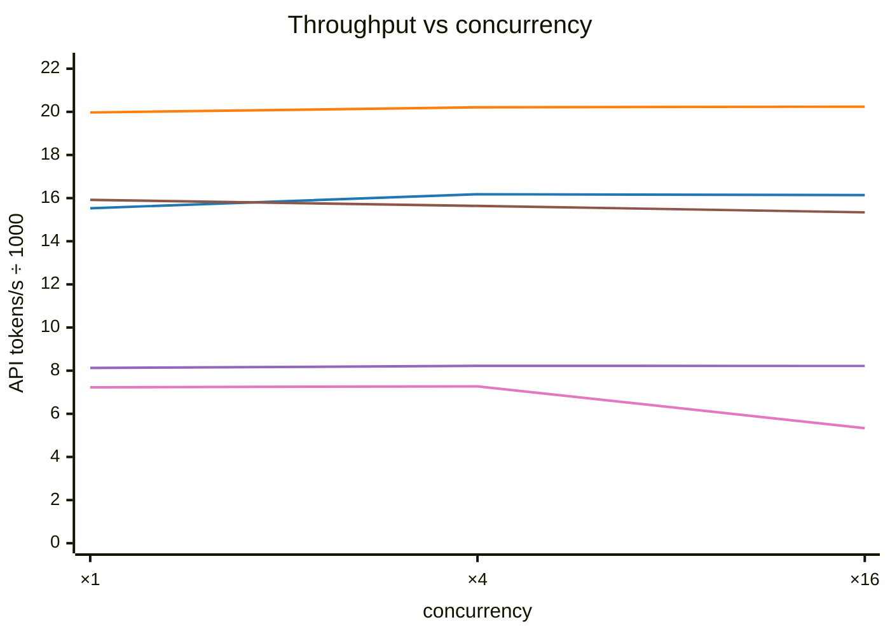
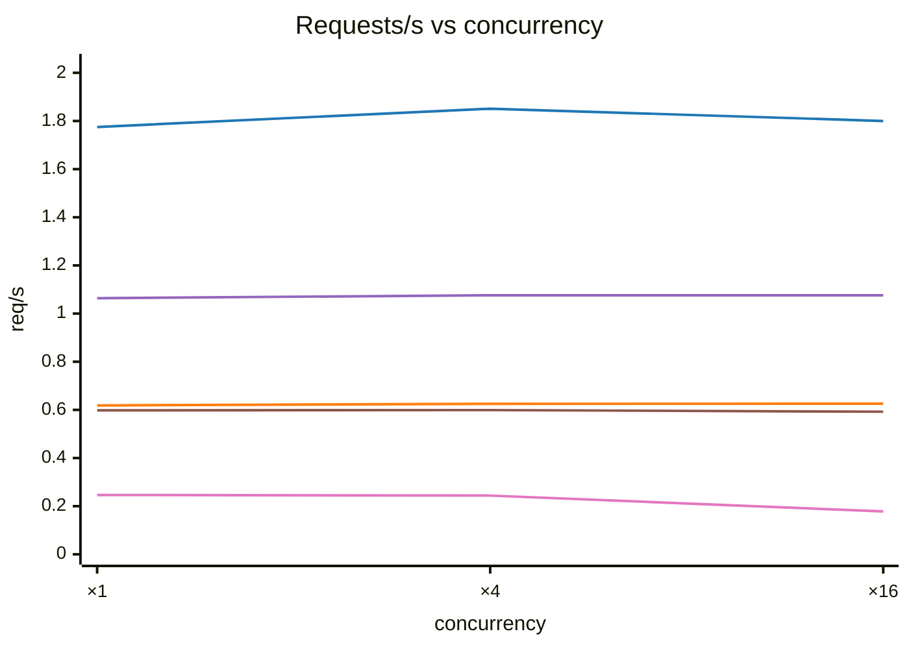
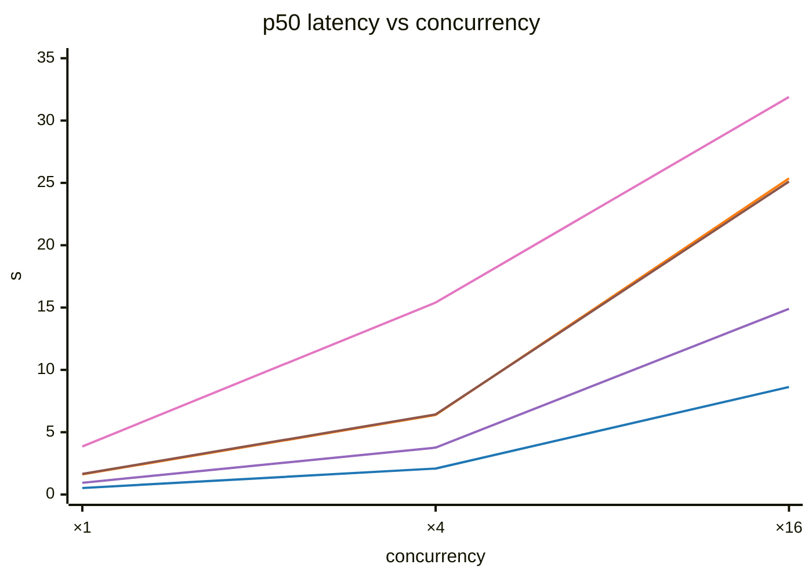

## speed — 2026-11-22 22:36 UTC

**PASS** · 575 s · 423 requests · 7 (1.7%) errors · 0 rate-limited · 6,883,617 tokens billed

Closed loop, 25 s per cell, 5 request classes × concurrency [1, 4, 16]. 423 requests, 6,883,617 tokens billed.

|  | requests | errors | 429s | p50 s | p90 s | p99 s | max s | req/s | API tok/s | MRR |
|---|---|---|---|---|---|---|---|---|---|---|
| short20 ×1 | 45 | 0 (0.0%) | 0 | 0.522 | 0.763 | 0.997 | 1.036 | 1.775 | 15,531 | 0.709 |
| short20 ×4 | 49 | 0 (0.0%) | 0 | 2.087 | 2.626 | 2.997 | 3.001 | 1.851 | 16,182 | 0.714 |
| short20 ×16 | 61 | 0 (0.0%) | 0 | 8.628 | 9.130 | 9.463 | 9.488 | 1.800 | 16,137 | 0.678 |
| many100 ×1 | 16 | 0 (0.0%) | 0 | 1.614 | 1.639 | 1.651 | 1.652 | 0.619 | 19,970 | 1.000 |
| many100 ×4 | 19 | 0 (0.0%) | 0 | 6.381 | 6.406 | 6.483 | 6.499 | 0.625 | 20,206 | 1.000 |
| many100 ×16 | 31 | 0 (0.0%) | 0 | 25.4 | 25.6 | 25.7 | 25.8 | 0.626 | 20,241 | 0.968 |
| long8k ×1 | 27 | 0 (0.0%) | 0 | 0.940 | 0.943 | 0.946 | 0.946 | 1.064 | 8,126 | 1.000 |
| long8k ×4 | 30 | 0 (0.0%) | 0 | 3.764 | 3.779 | 3.788 | 3.788 | 1.076 | 8,222 | 1.000 |
| long8k ×16 | 42 | 0 (0.0%) | 0 | 14.9 | 14.9 | 15.0 | 15.0 | 1.076 | 8,219 | 1.000 |
| pack32k ×1 | 15 | 0 (0.0%) | 0 | 1.651 | 1.962 | 2.352 | 2.398 | 0.598 | 15,920 | 1.000 |
| pack32k ×4 | 19 | 0 (0.0%) | 0 | 6.431 | 7.393 | 7.720 | 7.785 | 0.599 | 15,637 | 1.000 |
| pack32k ×16 | 30 | 0 (0.0%) | 0 | 25.1 | 26.4 | 27.1 | 27.2 | 0.592 | 15,340 | 1.000 |
| long32k ×1 | 7 | 0 (0.0%) | 0 | 3.852 | 4.703 | 4.708 | 4.709 | 0.246 | 7,229 | 1.000 |
| long32k ×4 | 10 | 0 (0.0%) | 0 | 15.4 | 17.4 | 17.6 | 17.6 | 0.244 | 7,274 | 1.000 |
| long32k ×16 | 22 | 7 (31.8%) | 0 | 31.9 | 54.7 | 59.5 | 60.1 | 0.178 | 5,333 | 1.000 |

| error | count | example | response |
|---|---|---|---|
| http 424 ModelError timed out at SageMaker | 7 | natural-qmsum natural-qmsum/query_96 | {"ErrorCode":"INTERNAL_FAILURE_FROM_MODEL","LogStreamArn":"arn:aws:logs:eu-west-3:<account-id>:log-group:/aws/sagemaker/Endpoints/reranker-tl-4b-q1","Message":"Received server error (0) from primary with message \"Your invocation timed out while waiting for a response from container primary. Review |

*Throughput vs concurrency: short20, many100, long8k, pack32k, long32k*

*Requests/s vs concurrency: short20, many100, long8k, pack32k, long32k*

*p50 latency vs concurrency: short20, many100, long8k, pack32k, long32k*
