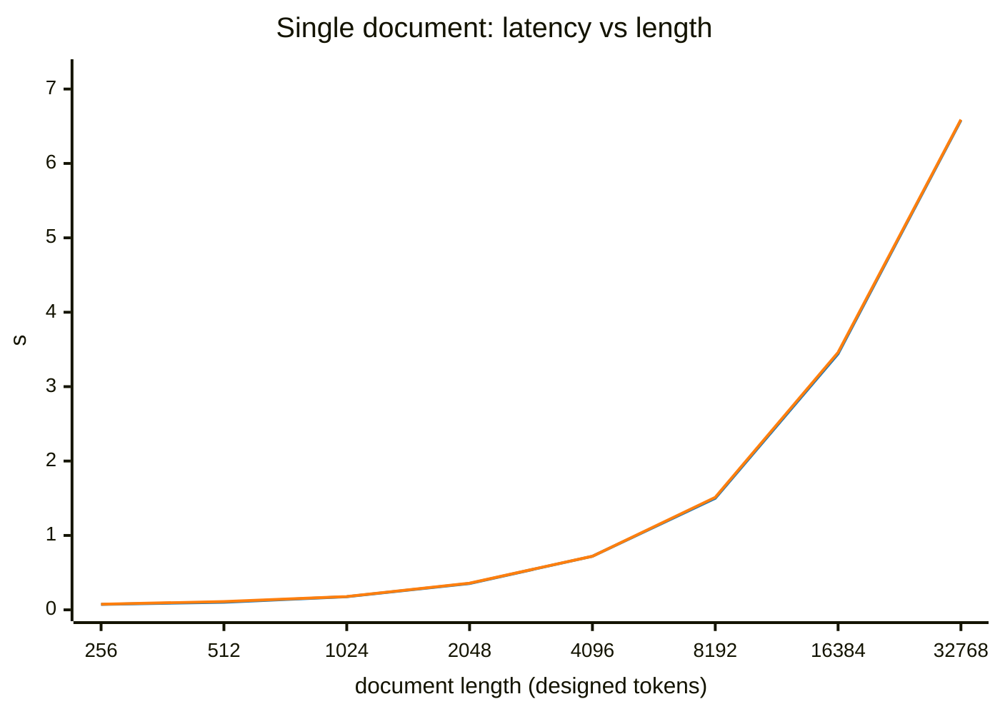
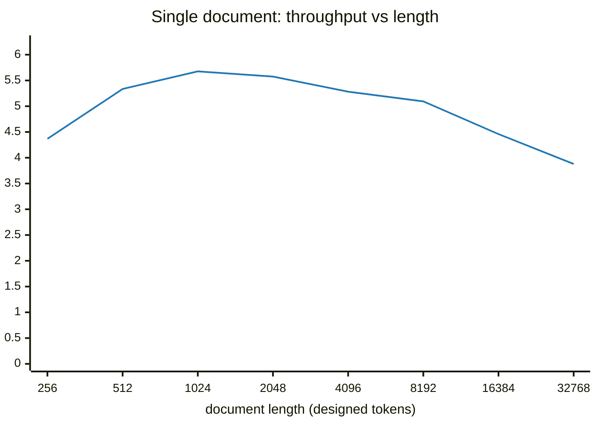
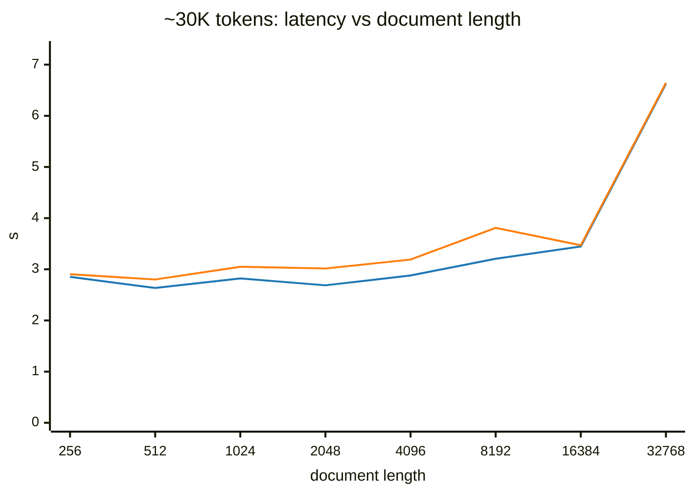
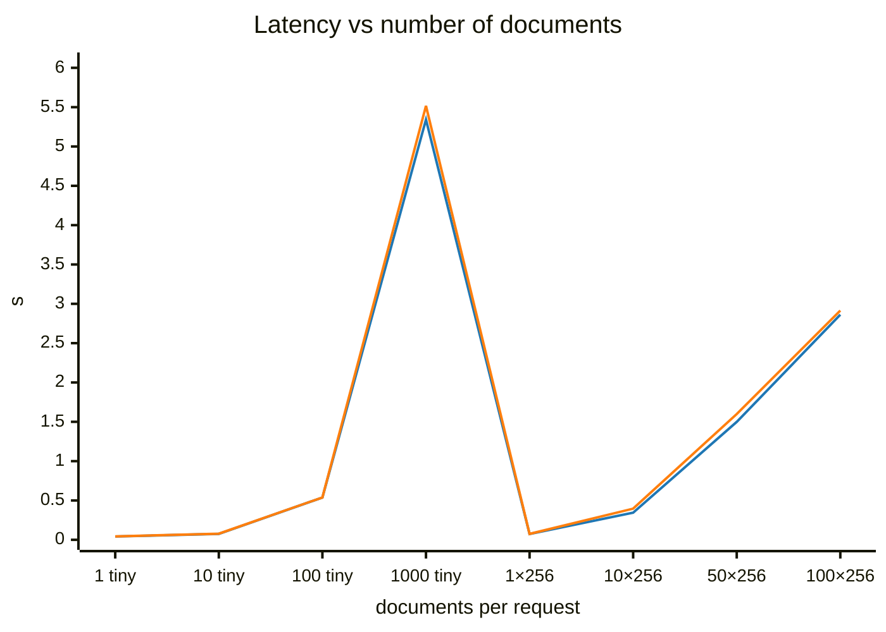
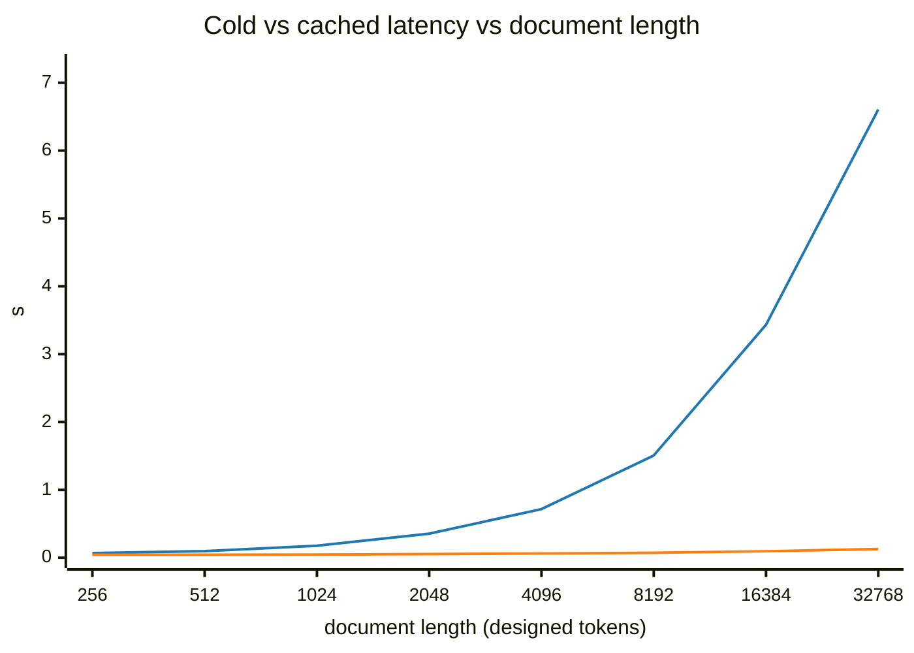
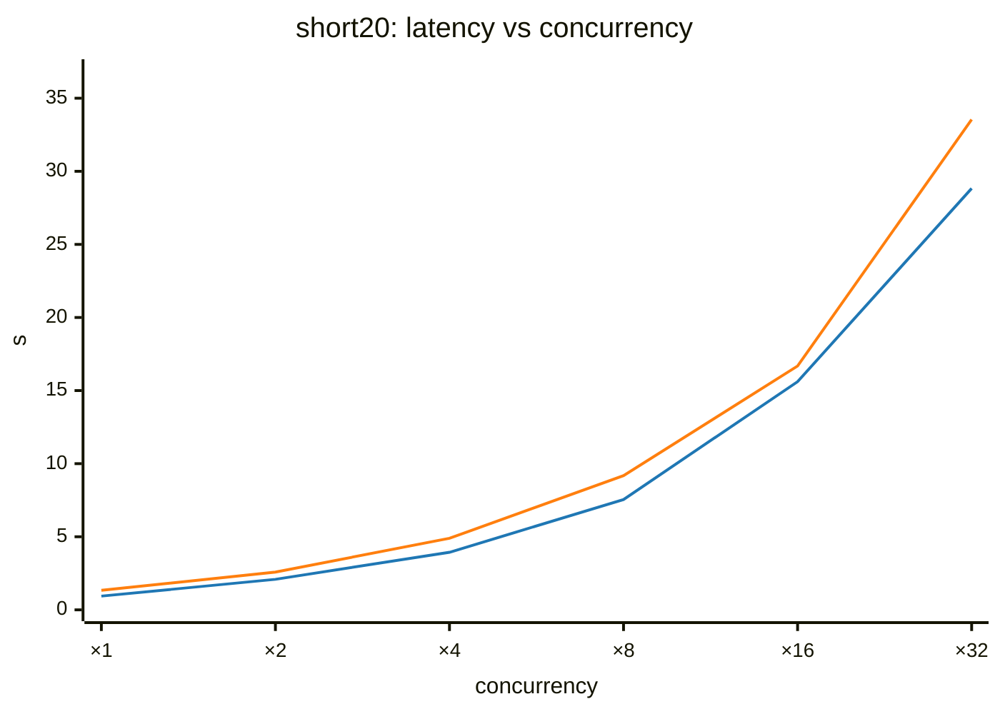
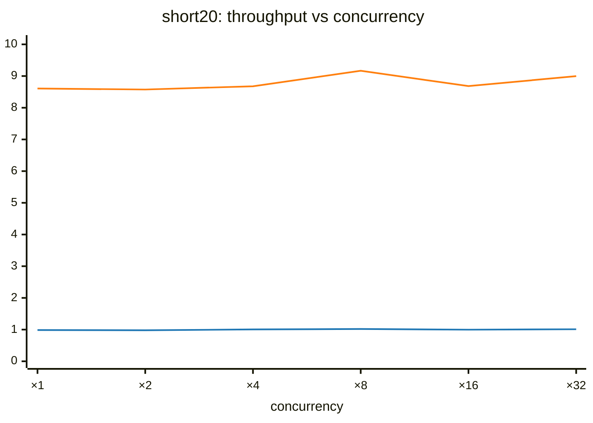
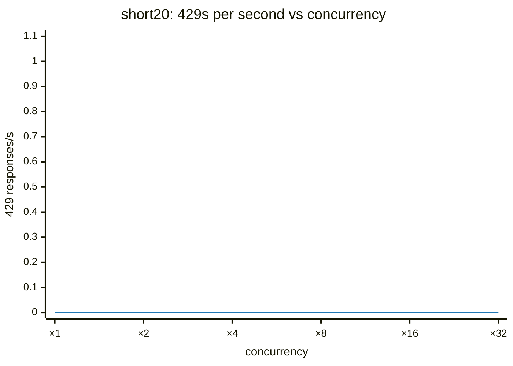

## meticulous — 2026-11-22 22:54 UTC

**PASS** · 1258 s · 810 requests · 0 (0.0%) errors · 0 rate-limited · 9,267,338 tokens billed

Sequential requests (one in flight) unless stated; every query carries a nonce so nothing is served from the API's prefix cache.

### Single document: latency vs length

| rung | Qwen tokens | billed | errors | p50 s | p90 s | max s | API tok/s |
|---|---|---|---|---|---|---|---|
| 256 | 229 | 324 | 0 (0.0%) | 0.073 | 0.075 | 0.096 | 4,367 |
| 512 | 457 | 551 | 0 (0.0%) | 0.102 | 0.112 | 0.114 | 5,334 |
| 1,024 | 911 | 1,005 | 0 (0.0%) | 0.176 | 0.179 | 0.182 | 5,676 |
| 2,048 | 1,872 | 1,966 | 0 (0.0%) | 0.354 | 0.358 | 0.361 | 5,575 |
| 4,096 | 3,707 | 3,800 | 0 (0.0%) | 0.720 | 0.721 | 0.721 | 5,282 |
| 8,192 | 7,545 | 7,640 | 0 (0.0%) | 1.500 | 1.513 | 1.516 | 5,094 |
| 16,384 | 15,274 | 15,369 | 0 (0.0%) | 3.441 | 3.461 | 3.478 | 4,459 |
| 32,768 | 25,438 | 25,536 | 0 (0.0%) | 6.580 | 6.589 | 6.652 | 3,880 |

*Single document: latency vs length: p50, p90*

*Single document: throughput vs length: API tokens/s ÷ 1000*

### ~30K tokens per request: latency vs document length (fewer, longer documents)

| rung | docs/request | billed | errors | p50 s | p90 s | max s | API tok/s |
|---|---|---|---|---|---|---|---|
| 256 | 100 | 32,392 | 0 (0.0%) | 2.852 | 2.903 | 2.907 | 11,329 |
| 512 | 55 | 30,271 | 0 (0.0%) | 2.635 | 2.801 | 2.972 | 11,368 |
| 1,024 | 28 | 28,179 | 0 (0.0%) | 2.822 | 3.049 | 3.117 | 10,148 |
| 2,048 | 13 | 25,572 | 0 (0.0%) | 2.687 | 3.016 | 3.249 | 9,754 |
| 4,096 | 6 | 22,805 | 0 (0.0%) | 2.879 | 3.190 | 3.387 | 8,134 |
| 8,192 | 3 | 22,922 | 0 (0.0%) | 3.206 | 3.809 | 4.229 | 7,285 |
| 16,384 | 1 | 15,366 | 0 (0.0%) | 3.445 | 3.469 | 3.476 | 4,472 |
| 32,768 | 1 | 25,541 | 0 (0.0%) | 6.623 | 6.643 | 6.707 | 3,856 |

*~30K tokens: latency vs document length: p50, p90*

### Latency vs number of documents

| documents | billed | errors | p50 s | p90 s | max s | MRR |
|---|---|---|---|---|---|---|
| 1 tiny | 91.5 | 0 (0.0%) | 0.042 | 0.043 | 0.044 | 1.000 |
| 10 tiny | 923 | 0 (0.0%) | 0.075 | 0.078 | 0.080 | 1.000 |
| 100 tiny | 9,319 | 0 (0.0%) | 0.537 | 0.538 | 0.540 | 1.000 |
| 1000 tiny | 93,989 | 0 (0.0%) | 5.342 | 5.516 | 5.523 | 1.000 |
| 1×256 | 323 | 0 (0.0%) | 0.073 | 0.075 | 0.076 | 1.000 |
| 10×256 | 3,228 | 0 (0.0%) | 0.345 | 0.396 | 0.437 | 1.000 |
| 50×256 | 16,150 | 0 (0.0%) | 1.499 | 1.599 | 1.618 | 1.000 |
| 100×256 | 32,319 | 0 (0.0%) | 2.862 | 2.914 | 2.921 | 1.000 |

*Latency vs number of documents: p50, p90*

### Cold vs cached: the same single-document request sent twice in a row

The API caches prompt prefixes, so a repeated (query, document) pair skips most of the compute. Cold = fresh nonce in the query; cached = the identical request again immediately after.

| rung | pairs | cold p50 s | cached p50 s | speed-up × | cold max s | cached max s | errors |
|---|---|---|---|---|---|---|---|
| 256 | 10 | 0.069 | 0.045 | 1.541 | 0.076 | 0.046 |  |
| 512 | 10 | 0.098 | 0.045 | 2.187 | 0.111 | 0.047 |  |
| 1,024 | 10 | 0.177 | 0.047 | 3.813 | 0.182 | 0.048 |  |
| 2,048 | 10 | 0.355 | 0.053 | 6.671 | 0.365 | 0.056 |  |
| 4,096 | 10 | 0.717 | 0.063 | 11.4 | 0.721 | 0.063 |  |
| 8,192 | 10 | 1.507 | 0.074 | 20.4 | 1.518 | 0.075 |  |
| 16,384 | 10 | 3.433 | 0.096 | 35.7 | 3.443 | 0.098 |  |
| 32,768 | 10 | 6.607 | 0.128 | 51.7 | 6.682 | 0.131 |  |

*Cold vs cached latency vs document length: cold p50, cached p50*

### short20: latency and throughput vs concurrency

|  | requests | errors | 429s | p50 s | p90 s | p99 s | max s | req/s | API tok/s | MRR |
|---|---|---|---|---|---|---|---|---|---|---|
| ×1 | 25 | 0 (0.0%) | 0 | 0.939 | 1.334 | 1.816 | 1.854 | 0.986 | 8,607 | 0.687 |
| ×2 | 26 | 0 (0.0%) | 0 | 2.087 | 2.585 | 3.139 | 3.258 | 0.979 | 8,575 | 0.696 |
| ×4 | 29 | 0 (0.0%) | 0 | 3.936 | 4.893 | 5.456 | 5.457 | 1.005 | 8,677 | 0.704 |
| ×8 | 32 | 0 (0.0%) | 0 | 7.544 | 9.178 | 9.838 | 9.897 | 1.020 | 9,168 | 0.698 |
| ×16 | 40 | 0 (0.0%) | 0 | 15.6 | 16.7 | 17.4 | 17.4 | 0.997 | 8,683 | 0.748 |
| ×32 | 58 | 0 (0.0%) | 0 | 28.8 | 33.5 | 34.2 | 34.2 | 1.011 | 8,997 | 0.734 |

No 429s up to concurrency ×32.

*short20: latency vs concurrency: p50, p90*

*short20: throughput vs concurrency: req/s, API tokens/s ÷ 1000*

*short20: 429s per second vs concurrency: 429/s*

810 requests, 9,267,338 tokens billed.
